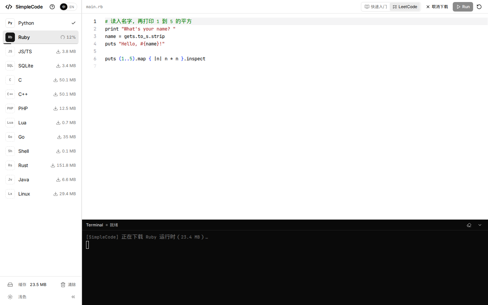
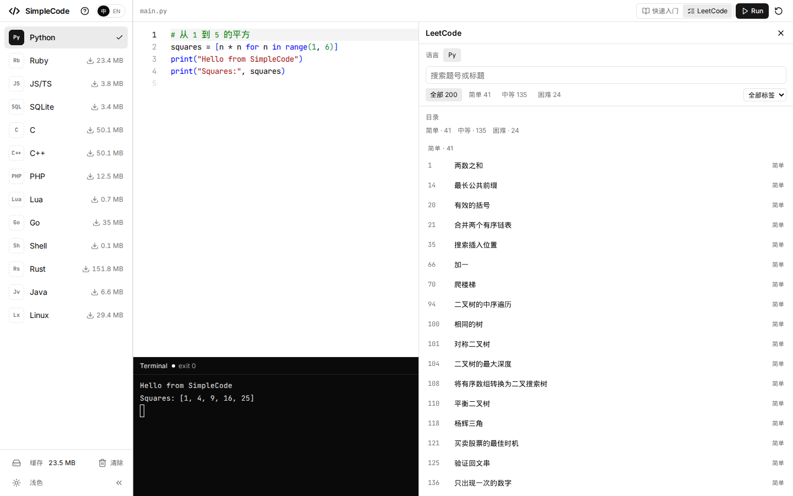
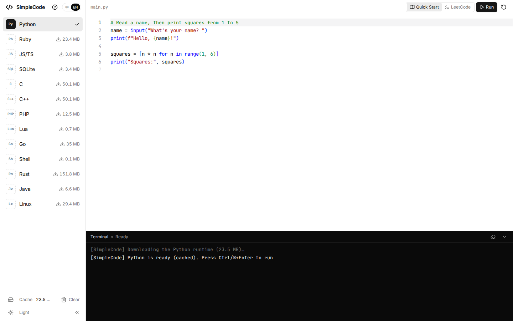

[中文](README.md)

# SimpleCode

**An in-browser code playground.** Python, Rust, Go, Java, Lua, and the rest run locally in WebAssembly. There is no execution server and no sign-up.

**[Open the live demo](https://simple-code-liard.vercel.app)**


Pick a language on the left, edit in Monaco, read output in the terminal. Run stays in this tab. A language runtime downloads the first time you select it, with the progress bar on the bottom edge of that button. After that it lives in the browser cache.

## Why this exists

SimpleCode is a playground. It is a static page that executes code, not a hosted IDE and not an official judge.

- **Execution stays in the browser.** WASI languages run in a Web Worker on `@runno/wasi`. C and C++ compile with clang 8, shipped as wasm. Rust compiles with the `rustc.wasm` committed in this repo (weblings, Cranelift rustc); the resulting module runs on the same WASI host. Java's javac and runtime both live in a TeaVM worker. Linux is a v86 guest on the main thread. Source is not posted to a backend.
- **No account.** Drafts, the selected language, and the UI language sit in `localStorage`.
- **Runtimes download on demand.** The sidebar shows size, percent, and a cached check. WASI and Linux use the Cache API name `simplecode-wasm-v1`, Rust uses `simplecode-rustc-v1`, Java uses `simplecode-teavm-v1`.
- **Stdin is real.** Keystrokes cross a `SharedArrayBuffer` into the program, so the page has to be cross-origin isolated.
- **Practice is built in.** Thirteen Quick Start books, in Chinese and English, and 200 LeetCode-style problems. Solutions stay hidden until you open them.

Once a runtime is cached, the open tab can run that language with no further download. The site is not an offline app: `coi-serviceworker.js` only injects isolation headers. A reload still needs the static files.

| | SimpleCode | Replit, CodeSandbox | Compiler Explorer | Online judges |
|---|---|---|---|---|
| Where it runs | Wasm in the browser | A cloud container | Their compile servers | Their judge |
| Account | None | Built around accounts and cloud workspaces | Open it and compile; the compiler is remote | Submitting usually requires a login |
| Compilers | clang, rustc, and javac in the browser | Full toolchains in the cloud | Many compilers in the cloud, aimed at assembly | Whatever the judge runs |
| Running again | Cached runtimes are not downloaded again; code stays local | Needs the cloud | Needs the cloud | Needs the cloud |
| Built-in material | Quick Starts + 200 problems (Python solutions today) | Cloud projects | Assembly diffs | Official statements and judging |
| Limits | One file; Java is not OpenJDK; the guest has no network | Multi-file projects and collaboration | Compile output | Server-side judging |

## Screenshots









## Features

- Thirteen languages. Runtimes load lazily. The progress bar is `inset-x-0 bottom-0 h-0.5`, the full width of the button.
- Monaco. Body text is 14px; comments are 13px. An untouched sample switches only its comments when you toggle 中 / EN.
- An xterm terminal. The toolbar and the documentation code blocks share one Run button.
- Quick Starts: Chinese in `docs/<book>/`, English in `docs/en/<book>/`, same filenames. This build reports 726 chapters (363 each) and 2,098 runnable blocks (1,049 each).
- LeetCode mode shares the drawer with Quick Start and does not cover Run. 200 problems: 41 Easy, 135 Medium, 24 Hard. Titles and summaries exist in both languages. Official statements are not stored. The drawer shows a short summary written for this repo, a small sample, and links to the official pages.
- Solutions stay collapsed until 查看题解. The checked-in solutions are Python. Another downloaded language that can run problems shows “No solution for this language yet.” You can run the sample, or load a solution into the editor and run it.
- JS and TS share one wasmedge-quickjs module. Sucrase loads only when TypeScript runs, strips types, and does not type-check.
- The chrome is grayscale. Syntax color is Monaco’s. UI copy is in `src/i18n`, Chinese by default.

## Languages

Sizes match the sidebar. `formatMB` is bytes ÷ 1048576, one decimal. Byte counts come from `vendor/prebuilt/CONTENTS.txt`. Rust and Java come from `scripts/sources.lock.json`.

| Language | Runtime / compiler | Download | Notes |
|---|---|---|---|
| Python | CPython 3.11.3, WASI | 23.5 MB (24,605,501) | Interpreter plus the stdlib archive |
| Ruby | Ruby 3.2.0, WASI | 23.4 MB (24,496,687) | |
| JS/TS | wasmedge-quickjs | 3.8 MB (3,974,159) | TypeScript is type-stripping only |
| SQLite | SQLite 3 | 3.4 MB (3,573,220) | |
| C | clang 8 + wasm-ld | 50.1 MB (52,495,428) | Shared with C++; downloaded once |
| C++ | clang 8, about gnu++14 | same | Runnable samples skip `throw`, threads, and `<filesystem>` |
| PHP | PHP 8.2 cgi, `php -q` | 12.5 MB (13,128,903) | WASI stdin is not visible to PHP |
| Lua | Lua 5.4.9 | 0.7 MB (720,144) | wasi-sdk 33, `pcall` works |
| Go | Yaegi 0.16.1 | 35.0 MB (36,736,740) | Standard library only, no `go get` |
| Shell | wasi-sh | 0.1 MB (55,023) | Builtins and pipes. Use Linux for `ls` and `cd` |
| Rust | weblings rustc (Cranelift) | 151.8 MB (159,184,722) | Same-origin files in `wasm/rust/`; the page does not fetch a remote compiler |
| Java | TeaVM 0.16.0 javac | 6.6 MB (6,896,057) | Needs Wasm GC. Not OpenJDK. The only public class must be `Main` |
| Linux | v86 0.5.471, kernel 6.8.12, BusyBox 1.36.1 | 29.4 MB (30,804,135) | 64 MiB RAM. Includes the prebuilt `linux-state.zst` (18,201,083 bytes). A new snapshot changes that number |

The Rust pair is `rustc.wasm` at 87,871,387 bytes and `sysroot-wasip1.bundle` at 71,313,335 bytes. The four Java files add up to 6,896,057 bytes.

## Use cases

- **Learning.** Each Quick Start is short sections. A code block can run in place.
- **Teaching.** Students open a static page. Programs run in their browsers, so the room does not need an execution server.
- **Interviews and LeetCode practice.** 200 problems grouped by difficulty, solutions hidden first. Samples can run. Solutions today are Python.
- **A quick snippet.** One file, no account. Switching languages stops the previous runtime and clears the terminal.

## Quick start

Live demo: <https://simple-code-liard.vercel.app>

Locally:

```bash
git clone https://github.com/linkxzhou/SimpleCode.git
cd SimpleCode
./build.sh install          # yarn install
./build.sh vendor           # build if it can; otherwise unpack vendor/prebuilt
./build.sh dev              # http://localhost:5173 with COOP/COEP
```

```bash
./build.sh build            # vue-tsc, then vite build into dist/ (including dist/wasm)
./build.sh preview          # or ./build.sh run — http://localhost:4173
./build.sh test             # unit tests, the monochrome check, hello-world, and docs smoke
```

`./build.sh vendor` first tries to copy Runno runtimes and compile Lua, Go, Shell, and Linux. This repo does not include `thirdparty/runno/`, so that attempt fails on a fresh clone. The script then checks `vendor/prebuilt/SHA256SUMS`, unpacks the committed gzip tarballs, and rewrites `wasm/manifest.json` from the files on disk. The manifest is not committed.

Java is outside that default archive. `./build.sh vendor --java` downloads the pinned TeaVM files, and falls back to `vendor/prebuilt/wasm-vendor-1-java.tar.gz` if the download fails. `./build.sh build` takes the same path when `wasm/java/` is missing.

Rust is already in `wasm/rust/`. `./build.sh vendor --rust` skips when the files match the pin. `--refresh` downloads them again from the GitHub Release.

Packages are yarn 4. `./build.sh clean` removes `dist/`. `--all` also removes `node_modules/` and generated `wasm/` files, and keeps the committed Rust toolchain.

## Deployment

You do not run an execution backend. You serve `dist/` as static files and make the page cross-origin isolated. Without that, `SharedArrayBuffer` is missing and stdin cannot work.

The dev server and `./build.sh preview` send:

```
Cross-Origin-Opener-Policy: same-origin
Cross-Origin-Embedder-Policy: require-corp
```

A static host that does not send those headers still works. `public/coi-serviceworker.js` registers on the same origin, reloads once if needed, and adds the headers. `file://` and private mode have no service worker, so the page stays on the explanation screen. Open it over `http://localhost` or https:

```bash
./build.sh build
python3 -m http.server 4173 -d dist
```

On Vercel, `yarn build` is `bash ./build.sh build`. The build image cannot compile Lua, Go, or Shell, and `thirdparty/runno/` is not in the repo, so vendor falls back to `vendor/prebuilt/`. The current site, <https://simple-code-liard.vercel.app>, does not send COOP/COEP on the document response; isolation comes from the service worker. If the host sends the headers itself, the page sees that it is already isolated and does not register the worker.

For a subpath deploy, set Vite `base` to that path. Wasm and the service worker are relative to `base`. A missing `/wasm/**` file must 404. If it falls through to the homepage, the browser caches HTML as wasm.

## Layout

```
src/                 Vue app: sidebar, Monaco, terminal, drawer
src/core/            WASI session, wasm loader, terminal, v86
src/rustc/           in-browser rustc
src/teavm/           TeaVM javac
src/i18n/            UI copy, zh / en
docs/<book>/         Chinese Quick Starts
docs/en/<book>/      English Quick Starts
docs/leetcode/       200 problems, solutions, licenses
wasm/rust/           committed rustc and sysroot
vendor/prebuilt/     wasm tarballs used when vendor cannot build
scripts/             build, manifest, docs prerender, problem import
plan/                design, language, tutorial, and problem notes
```

`wasm/manifest.json` is generated by `scripts/write-manifest.mjs` from the files on disk. Do not commit it.

## Stack

Vue 3, Vite, TypeScript, Pinia, Tailwind, shadcn-vue, Monaco 0.52, xterm 5, `@runno/wasi`. Packages are installed with yarn.

## Roadmap

From [plan/LEETCODE.md](plan/LEETCODE.md). Two stages are still open:

- Stage 3: solutions for Ruby, JavaScript, C, C++, Lua, Go, Rust, and Java, in that order, one language per change. Python is the only solution set in the tree today.
- Stage 4: fill the `extended` list, capped at 500. A problem with no solution shows the summary and the links.

Shell, SQLite, PHP, and Linux stay out of the problem runner. The plan records why.

## Contributing

If this playground is useful, star the repo so other people can find it.

Changes land through a pull request. `./build.sh build` and `./build.sh test` should pass before merge. Conventions are in [AGENTS.md](AGENTS.md). Design notes are in `plan/`. A proposed GitHub description and topic list is in [docs/GITHUB_META.md](docs/GITHUB_META.md). It has not been applied to the repository settings.

## Credits and licenses

There is no application license file at the repo root. Tutorial prose is CC BY-SA 4.0 and sample code is MIT; see [docs/LICENSE](docs/LICENSE). Runtime and solution notices are in [LICENSES/THIRD_PARTY.md](LICENSES/THIRD_PARTY.md).

Runtimes:

| Piece | License |
|---|---|
| Runno `@runno/wasi`, Sucrase, Lua, wasi-sh | MIT |
| Yaegi | Apache-2.0; the embedded Go standard library is BSD-3-Clause |
| CPython 3.11.3 | PSF |
| Ruby 3.2.0 | Ruby License / BSD-2-Clause |
| PHP 8.2 | PHP License 3.01 |
| wasmedge-quickjs | Apache-2.0 (QuickJS itself is MIT) |
| SQLite | Public Domain |
| clang / wasm-ld (LLVM 8) | Apache-2.0 with LLVM exceptions |
| rustc, Cranelift, weblings | MIT OR Apache-2.0; weblings is MIT |
| TeaVM | Apache-2.0. The javac inside `compiler.wasm` is GPLv2 with the Classpath Exception |
| v86 | BSD-2-Clause. The guest kernel and BusyBox are GPL-2.0 |

LeetCode solutions were copied from four repositories, retrieved 2026-10-18. Each file header records the repo, commit, and edits. An adaptation of a doocs file stays CC BY-SA 4.0. That share-alike duty covers the solution file only, not the UI and not the runtimes.

| Repository | Commit | License |
|---|---|---|
| [neetcode-gh/leetcode](https://github.com/neetcode-gh/leetcode) | `d5ebb3ea8bd4b52d605bc7aa179e22af684d31bb` | MIT |
| [kamyu104/LeetCode-Solutions](https://github.com/kamyu104/LeetCode-Solutions) | `8e29ccd49e73439f0dc36b6bdd0f3bded259c7b3` | MIT |
| [tiationg-kho/leetcode-pattern-500](https://github.com/tiationg-kho/leetcode-pattern-500) | `c3ee9ee6e40d386600e0a3545844350a264c5b56` | MIT |
| [doocs/leetcode](https://github.com/doocs/leetcode) | `88c8c2c29f19c186d7cc05c9db17245d9ae3df43` | CC BY-SA 4.0 |

本项目著作权归 GitHub 开源社区 Doocs 所有，商业转载请联系 @yanglbme 获得授权，非商业转载请注明出处。 That sentence applies to solution files adapted from doocs.

## Star history

[](https://star-history.com/#linkxzhou/SimpleCode&Date)
