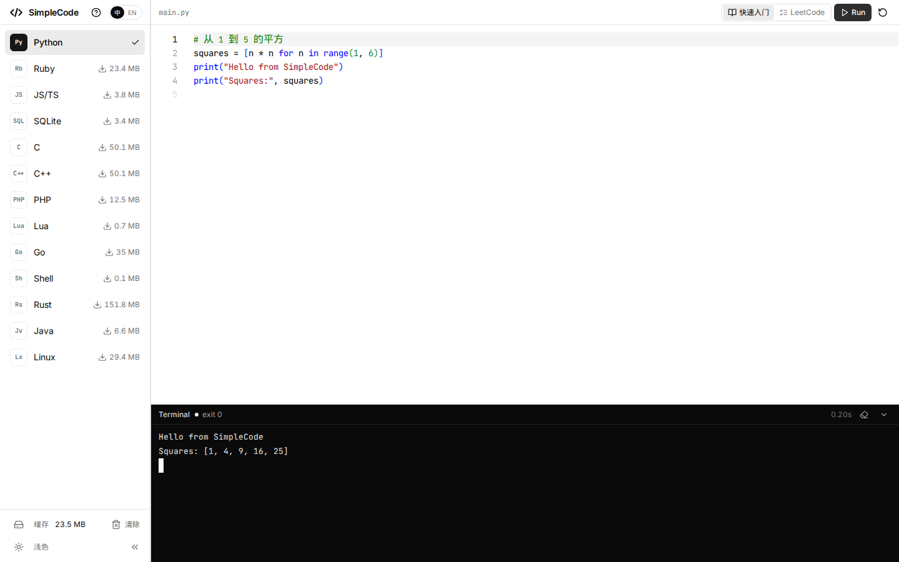
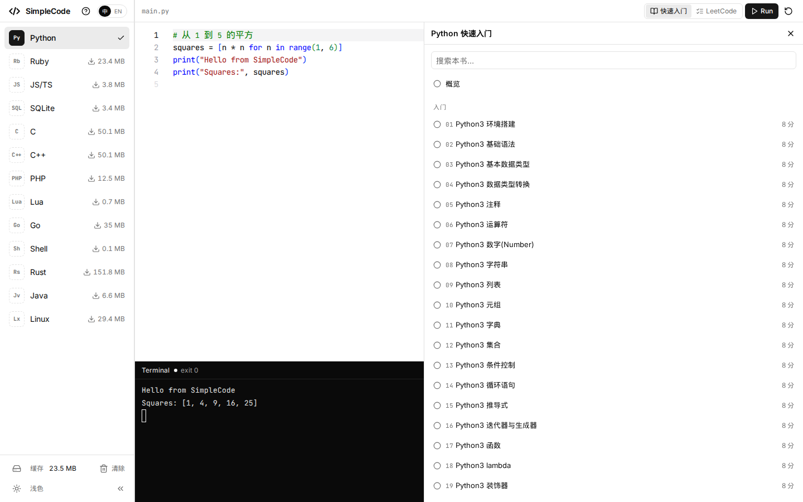
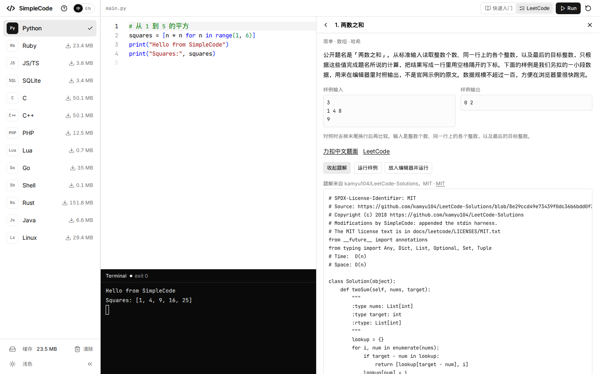

[English](README.en.md)

# SimpleCode

**浏览器里的在线代码运行器。** Python、Rust、Go、Java、Lua 和其他语言用 WebAssembly 在本机跑完，没有执行服务器，也不用注册。

**[打开在线演示](https://simple-code-liard.vercel.app)**



左边选语言，中间是 Monaco，下面是终端。点 Run，程序就在这个标签页里执行。第一次点一门语言才下载它的运行时，进度条贴在按钮底边；下载完放进浏览器缓存，再跑不再为这门语言拉 wasm。

## 为什么用它

它是一个 playground，不是云端 IDE，也不是官方判题站。

- **执行留在浏览器里。** WASI 语言跑在 Web Worker 的 `@runno/wasi` 里。C / C++ 先用 wasm 里的 clang 8 编译。Rust 用随仓库提交的 `rustc.wasm`（weblings 的 Cranelift rustc）在浏览器里编译，产物再交给同一个 WASI 宿主。Java 的 javac 和运行都在 TeaVM 的 Worker 里。DeepLearning 是另一路：Pyodide 314 加 NumPy 跑在自己的 Worker 里，不走 WASI 那份 CPython。Linux 是主线程上的 v86 客户机。没有把源码送到后端。
- **没有账号。** 草稿、语言和界面语言记在 `localStorage`。
- **运行时按需下载。** 侧栏按钮上能看到体积、下载百分比和缓存完成。WASI 与 Linux 进 Cache API `simplecode-wasm-v1`，Rust 是 `simplecode-rustc-v1`，Java 是 `simplecode-teavm-v1`。
- **标准输入是真的。** 终端按键经 `SharedArrayBuffer` 送进程序，所以页面要跨源隔离。
- **练习是内置的。** 十五本中英「快速入门」（含 NumPy 和 DeepLearning），以及 200 道 LeetCode 风格的题。题解默认收起。

已经打开的页面，在运行时进缓存之后，断网也可以再跑这门语言。整站不是离线安装包：`coi-serviceworker.js` 只补隔离响应头，不缓存 HTML。刷新页面仍然要能取到静态文件。

| | SimpleCode | Replit、CodeSandbox | Compiler Explorer | 在线判题站 |
|---|---|---|---|---|
| 程序在哪跑 | 浏览器里的 Wasm | 云端容器 | 对方的编译服务器 | 对方的判题机 |
| 账号 | 没有 | 产品围绕账号和云端工作区 | 打开就能用，编译在服务器 | 提交通常要登录 |
| 编译器 | 浏览器内的 clang、rustc、javac | 云端完整工具链 | 云端多种编译器，用来看汇编 | 云端 |
| 再跑一次 | 运行时已缓存则不再下载；代码不出本机 | 依赖云端 | 依赖云端 | 依赖云端 |
| 自带内容 | 快速入门 + 200 题（题解现为 Python） | 云端项目 | 汇编对照 | 官方题面和判题 |
| 边界 | 单文件；Java 不是 OpenJDK；客户机没有网络 | 多文件、协作、完整系统 | 看编译结果 | 服务端判题 |

## 界面








## 功能

- 十四门语言，运行时懒加载。侧栏进度条是 `inset-x-0 bottom-0 h-0.5`，和按钮同宽。DeepLearning 这一行标明 Python (NumPy)，和 WASI 版 Python 分开。
- Monaco 编辑。正文字号 14px，注释 13px。未改过的示例在「中 / EN」切换时只换注释。
- xterm 终端。Run 在工具栏和文档代码块里是同一个按钮。
- 快速入门：中文 `docs/<book>/`，英文 `docs/en/<book>/`，同一文件名。这次构建是 770 章（中英各 385）、2186 个可运行块（中英各 1093）。NumPy 和 DeepLearning 各 11 章，围栏语言是 `numpy`，走 Pyodide。
- LeetCode 模式和快速入门共用一扇抽屉，不盖住 Run。200 题：简单 41、中等 135、困难 24。中英题名和摘要都有。题面不入库，抽屉里是自写短摘要、自写样例和官网链接。
- 「查看题解」才展开代码。现在入库的题解是 Python。其他已下载、可刷题的语言会显示「这门语言还没有题解」。可以「运行样例」，也可以把题解放进编辑器再跑。
- JS/TS 共用一份 wasmedge-quickjs。跑 TypeScript 时才加载 Sucrase，去掉类型后再执行，不做类型检查。
- 界面黑白。语法色只出现在 Monaco 里。文案在 `src/i18n`，默认中文。

## 支持的语言

下载体积和侧栏一致：`formatMB` 用字节数 ÷ 1048576，保留一位小数。字节来自 `vendor/prebuilt/CONTENTS.txt`，Rust 和 Java 来自 `scripts/sources.lock.json`。

| 语言 | 运行时 / 编译器 | 下载 | 说明 |
|---|---|---|---|
| Python | CPython 3.11.3，WASI | 23.5 MB（24,605,501） | 解释器加标准库归档 |
| Ruby | Ruby 3.2.0，WASI | 23.4 MB（24,496,687） | |
| JS/TS | wasmedge-quickjs | 3.8 MB（3,974,159） | TS 只去类型 |
| SQLite | SQLite 3 | 3.4 MB（3,573,220） | |
| C | clang 8 + wasm-ld | 50.1 MB（52,495,428） | 与 C++ 共用，只下一份 |
| C++ | clang 8，大约 gnu++14 | 同上 | `throw`、线程、`<filesystem>` 不在可运行示例里 |
| PHP | PHP 8.2 cgi，`php -q` | 12.5 MB（13,128,903） | WASI 标准输入读不到 |
| Lua | Lua 5.4.9 | 0.7 MB（720,144） | wasi-sdk 33，`pcall` 可用 |
| Go | Yaegi 0.16.1 | 35.0 MB（36,736,740） | 只解释标准库，不能 `go get` |
| Shell | wasi-sh | 0.1 MB（55,023） | 内建命令和管道。要 `ls`、`cd` 用 Linux |
| Rust | weblings rustc（Cranelift） | 151.8 MB（159,184,722） | `wasm/rust/` 同源文件，页面不向远端要编译器 |
| Java | TeaVM 0.16.0 的 javac | 6.6 MB（6,896,057） | 要 Wasm GC。不是 OpenJDK，`Main` 必须是唯一的 public 类 |
| DeepLearning | Pyodide 314.0.7 + NumPy 2.4.6 | 20.2 MB（21,201,739） | 侧栏文案中英都是 DeepLearning，版本行是 Python (NumPy)。和 WASI CPython 分开。含 Fashion-MNIST 子集 4,710,012 字节 |
| Linux | v86 0.5.471，内核 6.8.12，BusyBox 1.36.1 | 29.4 MB（30,804,135） | 64 MiB 内存。29.4 MB 含预构建包里那份 `linux-state.zst`（18,201,083 字节）；重新生成快照后这个数会变 |

Rust 两份文件是 `rustc.wasm` 87,871,387 字节和 `sysroot-wasip1.bundle` 71,313,335 字节。Java 四份文件合计 6,896,057 字节。

## 适合谁

- **自学。** 每本快速入门按短节写，代码块可以就地 Run。
- **上课。** 学生打开静态页面即可，程序在他们自己的浏览器里跑，教室不用准备执行服务器。
- **面试和刷题。** 200 题按难度分组，题解先藏着。样例输入可以跑。目前题解只有 Python。
- **试一小段。** 单文件、无账号。换语言会停掉上一个运行时并清掉终端。

## 快速开始

在线演示：<https://simple-code-liard.vercel.app>

本地：

```bash
git clone https://github.com/linkxzhou/SimpleCode.git
cd SimpleCode
./build.sh install          # yarn install
./build.sh vendor           # 编得出就用新产物；失败则解开 vendor/prebuilt
./build.sh dev              # http://localhost:5173 ，自带 COOP/COEP
```

```bash
./build.sh build            # vue-tsc，再 vite build 到 dist/（含 dist/wasm）
./build.sh preview          # 或 ./build.sh run ，http://localhost:4173
./build.sh test             # 单元测试、单色检查、hello-world 和文档冒烟
```

`./build.sh vendor` 会先尝试从 Runno 拷贝运行时并编译 Lua、Go、Shell、Linux。本仓库不带 `thirdparty/runno/`，这一步失败是预期情况：脚本校验 `vendor/prebuilt/SHA256SUMS`，解开已提交的 gzip tar，再按磁盘文件重写 `wasm/manifest.json`。清单不入库。

Java 不在默认包里。`./build.sh vendor --java` 按 pin 下载 TeaVM；下载失败则解开 `vendor/prebuilt/wasm-vendor-1-java.tar.gz`。`./build.sh build` 发现 `wasm/java/` 缺文件时也会走这一步。

Rust 已经在 `wasm/rust/`。`./build.sh vendor --rust` 在文件和 pin 一致时跳过；`--refresh` 才从 GitHub Release 重新拉取。

包管理是 yarn 4。`./build.sh clean` 删 `dist/`，`--all` 再删 `node_modules/` 和生成的 `wasm/`（已提交的 Rust 工具链保留）。

## 部署

执行不需要你自己的后端。需要的是把 `dist/` 以静态文件提供，并让页面处于跨源隔离，否则 `SharedArrayBuffer` 用不上，标准输入起不来。

开发服务器和 `./build.sh preview` 会送：

```
Cross-Origin-Opener-Policy: same-origin
Cross-Origin-Embedder-Policy: require-corp
```

没有这两项头的静态站也可以。`public/coi-serviceworker.js` 在同源注册，需要时刷新一次，自己补上同样的头。`file://` 和隐私模式没有 Service Worker，会停在说明页。用 `http://localhost` 或 https 打开即可：

```bash
./build.sh build
python3 -m http.server 4173 -d dist
```

Vercel 上 `yarn build` 就是 `bash ./build.sh build`。构建镜像编不了 Lua / Go / Shell，也没有 `thirdparty/runno/`，vendor 会退回 `vendor/prebuilt/`。当前站点 <https://simple-code-liard.vercel.app> 的文档响应没有自带 COOP/COEP，隔离靠这个 Service Worker。若托管方直接送上述响应头，页面检测到已经隔离，就不再注册 worker。

子目录部署时把 Vite 的 `base` 设成该路径。wasm 和 Service Worker 都相对 `base`。缺失的 `/wasm/**` 必须是 404，不能回退成首页，否则浏览器会把 HTML 当成 wasm 缓存。

## 目录

```
src/                 Vue 应用：侧栏、Monaco、终端、抽屉
src/core/            WASI 会话、wasm 加载、终端、v86
src/rustc/           浏览器内 rustc
src/teavm/           TeaVM javac
src/i18n/            界面文案 zh / en
docs/<book>/         中文快速入门
docs/en/<book>/      英文快速入门
docs/leetcode/       200 题、题解、许可证
assets/screenshots/  README 配图，只给 GitHub 渲染
wasm/rust/           已提交的 rustc 和 sysroot
vendor/prebuilt/     vendor 失败时的 wasm 包
scripts/             构建、清单、文档预渲染、题库导入
plan/                设计、语言、教程、题库的记录
```

`wasm/manifest.json` 由 `scripts/write-manifest.mjs` 按磁盘文件生成，不要提交。

## 技术栈

Vue 3、Vite、TypeScript、Pinia、Tailwind、shadcn-vue、Monaco 0.52、xterm 5、`@runno/wasi`。包管理用 yarn。

## 路线图

记录在 [plan/LEETCODE.md](plan/LEETCODE.md)，还没做的是后两段：

- 阶段 3：按 Ruby、JavaScript、C、C++、Lua、Go、Rust、Java 的顺序补题解。每种语言单独提交。现在只有 Python。
- 阶段 4：把题单扩到 `extended`（上限 500）。没有题解的题只显示摘要和链接。

Shell、SQLite、PHP、Linux 不进入刷题语言，原因也写在那份计划里。

## 参与

这个练习场如果帮到你，请给仓库一颗 Star，GitHub 上的人会因此看见它。

改代码请开 Pull Request。合并前跑 `./build.sh build` 和 `./build.sh test`。约定在 [AGENTS.md](AGENTS.md)，方案在 `plan/`。仓库描述和 topics 的建议稿在 [docs/GITHUB_META.md](docs/GITHUB_META.md)，还没有写回 GitHub。

## 许可与致谢

仓库根目录没有单独的应用许可证。教程正文是 CC BY-SA 4.0，示例代码是 MIT，见 [docs/LICENSE](docs/LICENSE)。运行时和题解的通知在 [LICENSES/THIRD_PARTY.md](LICENSES/THIRD_PARTY.md)。

运行时方面：

| 组件 | 许可证 |
|---|---|
| Runno `@runno/wasi`、Sucrase、Lua、wasi-sh | MIT |
| Yaegi | Apache-2.0；其中的 Go 标准库是 BSD-3-Clause |
| CPython 3.11.3 | PSF |
| Ruby 3.2.0 | Ruby License / BSD-2-Clause |
| PHP 8.2 | PHP License 3.01 |
| wasmedge-quickjs | Apache-2.0（QuickJS 本身是 MIT） |
| SQLite | Public Domain |
| clang / wasm-ld（LLVM 8） | Apache-2.0，带 LLVM 例外 |
| rustc、Cranelift、weblings | MIT OR Apache-2.0；weblings 为 MIT |
| TeaVM | Apache-2.0。`compiler.wasm` 里的 javac 是 GPLv2 + Classpath Exception |
| v86 | BSD-2-Clause。客户机内核与 BusyBox 是 GPL-2.0 |

LeetCode 题解从四个仓库拷贝，检索日 2026-10-18。每份文件头写仓库、commit 和修改。doocs 的改编仍是 CC BY-SA 4.0，只覆盖那份题解，不覆盖界面和运行时。

| 仓库 | Commit | 许可证 |
|---|---|---|
| [neetcode-gh/leetcode](https://github.com/neetcode-gh/leetcode) | `d5ebb3ea8bd4b52d605bc7aa179e22af684d31bb` | MIT |
| [kamyu104/LeetCode-Solutions](https://github.com/kamyu104/LeetCode-Solutions) | `8e29ccd49e73439f0dc36b6bdd0f3bded259c7b3` | MIT |
| [tiationg-kho/leetcode-pattern-500](https://github.com/tiationg-kho/leetcode-pattern-500) | `c3ee9ee6e40d386600e0a3545844350a264c5b56` | MIT |
| [doocs/leetcode](https://github.com/doocs/leetcode) | `88c8c2c29f19c186d7cc05c9db17245d9ae3df43` | CC BY-SA 4.0 |

本项目著作权归 GitHub 开源社区 Doocs 所有，商业转载请联系 @yanglbme 获得授权，非商业转载请注明出处。这一句只约束改编自 doocs 的题解文件。

## Star

[](https://star-history.com/#linkxzhou/SimpleCode&Date)
