# 用一个叫 SimpleCode 的机器人，把 SimpleCode 做出来

作者 [linkxzhou](https://github.com/linkxzhou) · 2026-10-17

仓库：[github.com/linkxzhou/SimpleCode](https://github.com/linkxzhou/SimpleCode)

2026 年 10 月 15 日到 17 日，这个仓库合进 `main` 的 pull request 一共 24 个。浏览器里的语言从七门变成十三门，快速入门从没有书，写成中文、英文各 363 章。我大部分时间在 Grok Bot 里和一个叫 **SimpleCode** 的机器人聊天：想法先写进 `plan/`，云端代理开 PR，我看完点一下合并，再在自己的 Mac 上拉下来跑。中间有过真的报错。修法还是这条路。做完回头看，这种手感很接近我希望一个私人代理该有的样子。

下面按仓库里的提交和已合并 PR 来写。时间是 GitHub 上的合并时间（UTC）。没有聊天记录里的原话，Grok Bot 自己的界面我也还没截进这篇文章，文中留了位置。

<!-- TODO: Grok Bot 聊天截图 -->

## SimpleCode 是什么

SimpleCode 是浏览器里的多语言练习场。没有后端。页面是 Vue 3、Vite、TypeScript，中间一块 Monaco，下面一块 xterm，工具栏上一个 Run，代码就在本机浏览器里执行。

前十门语言是 WASI preview1 的命令模块，由 `@runno/wasi` 的 `WASIWorkerHost` 在 Web Worker 里跑。标准输入走 `SharedArrayBuffer`，所以页面要跨源隔离。Rust 的编译器是 weblings 的 Cranelift rustc，在另一个 Worker 里编译，编出来的 wasm 再交给同一个宿主。Java 的编译和运行都在 TeaVM 自己的 Worker 里，产物不交给这个宿主。Linux 是 v86 客户机，跑在主线程，串口接到同一份终端。

侧栏现在有十三项：Python、Ruby、JS/TS、SQLite、C、C++、PHP、Lua、Go、Shell、Rust、Java、Linux。界面文案可以在「中 / EN」之间切换，默认中文。每种语言有一本「快速入门」。Markdown 在构建时预渲染。当前 `./build.sh build` 的索引是 **726 章、2098 个可运行代码块**，中英各 363 章、各 1049 块。其中 Python 有一处 `while True` 标了 `smoke=skip`，默认的文档冒烟不跑它；Rust 和 Java 的书默认也不跑，要单独打开开关。

运行时不跟仓库走。选中一门语言才下载，侧栏按钮上能看到百分比，底边有一条进度。下过的字节进 Cache API。Rust 的编译器大约 152 MB，Java 的四份 TeaVM 文件大约 6.6 MB，都不在默认的 `./build.sh vendor` 里。

界面是黑白的。侧栏、工具栏、按钮、抽屉、终端只用中性灰。Monaco 的语法色是唯一的例外。

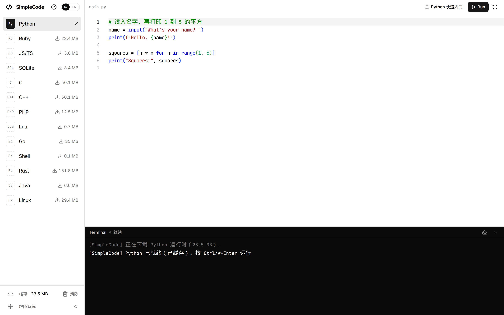

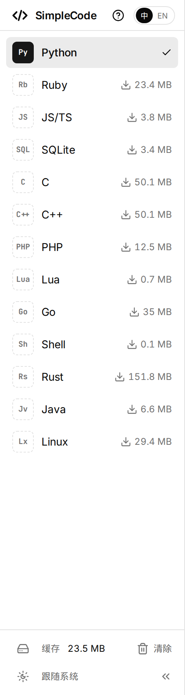

折叠以后侧栏大约 56 像素，只剩图标。缓存、清除、主题和展开都在底部。标题那一行放不下「?」和语言胶囊，这两项会挪到页脚。

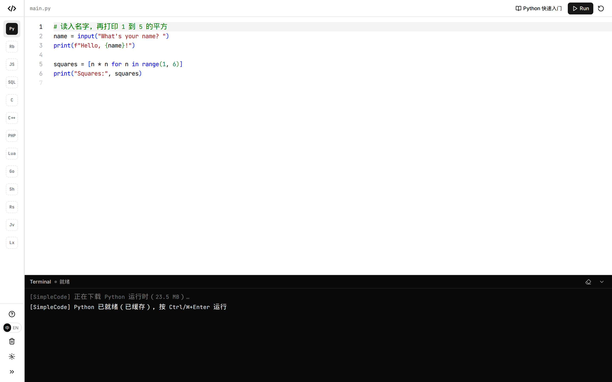

跑一段 Python，在终端里输入 `Ada`，回车之后打印 `Hello, Ada from Python`。编辑器、终端、Run 都在同一页上，没有把代码送到远处的机器。

快速入门从工具栏打开，抽屉的顶边停在工具栏下面，Run 和语言切换还点得着。书按章排开，代码块上有 Run，点下去会把示例装进编辑器再执行。

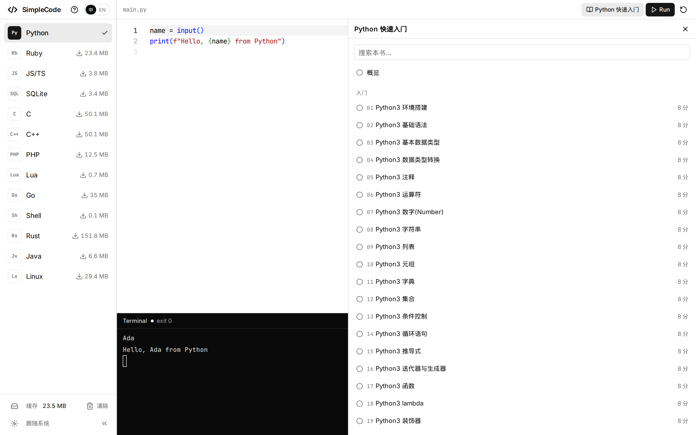

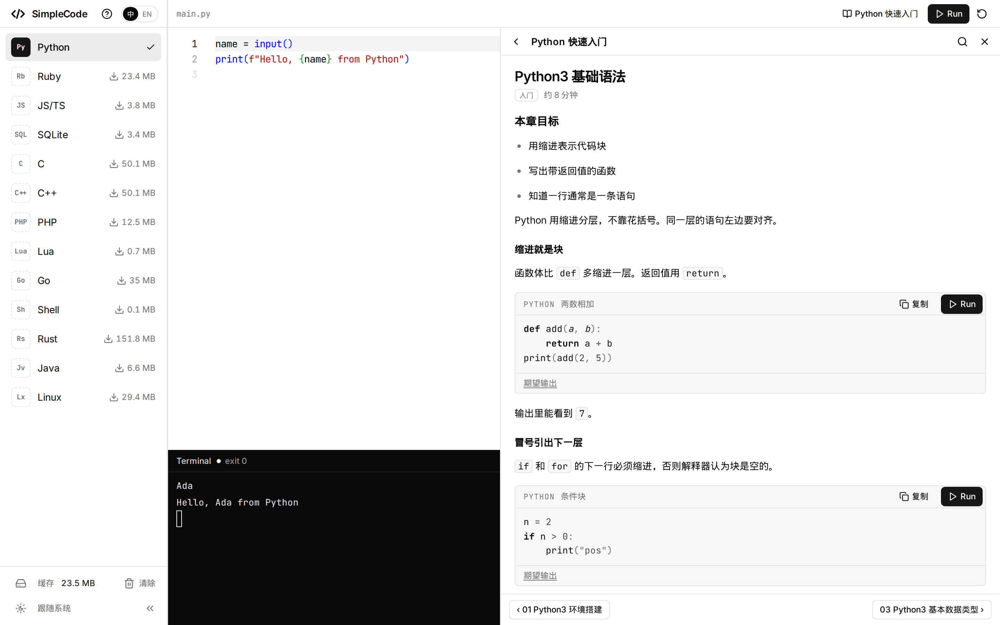

界面切到 EN 之后，同一章读英文。程序、期望输出和标准输入跟中文那一章相同，注释换成英文。

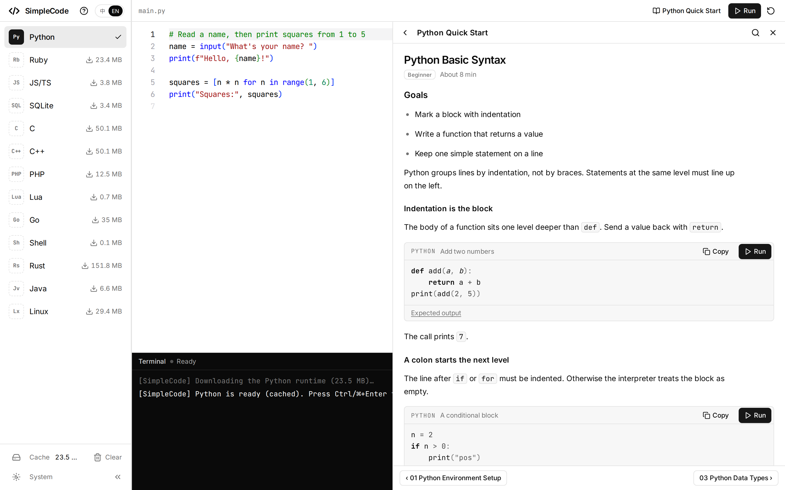

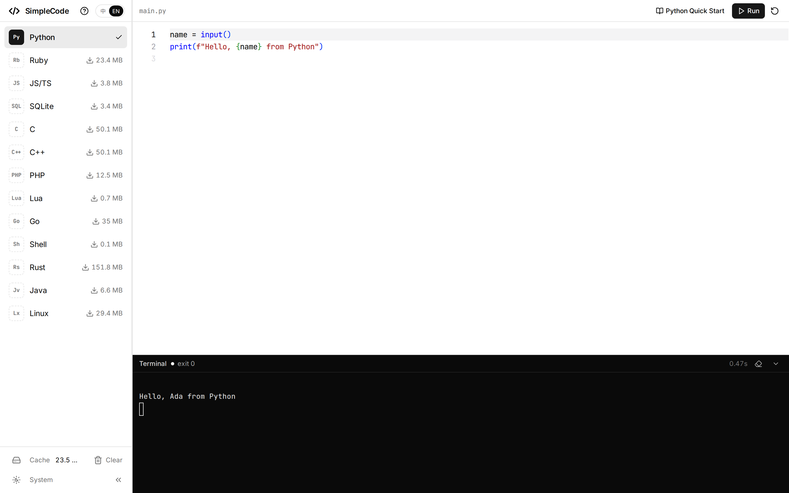

侧栏标题右边的「?」打开关于弹层，用同一套中性灰说明这十三门语言、懒加载、编辑器、终端和快速入门。

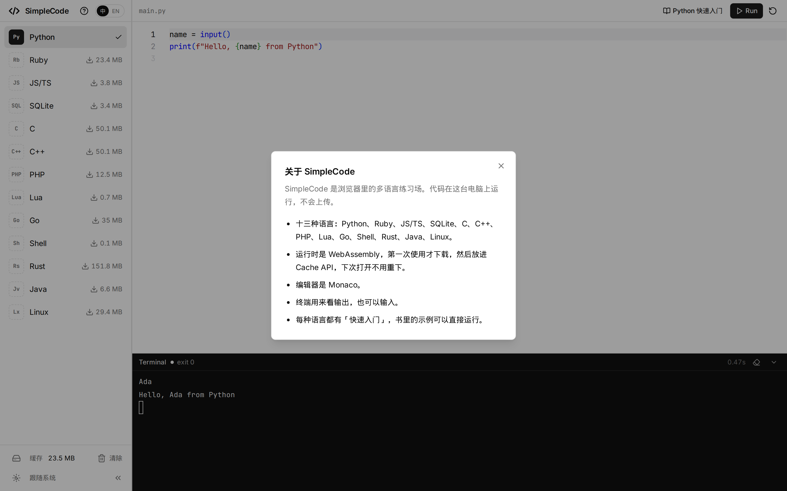

第一次点到还没缓存的语言，按钮上会出百分比。下面这张是 Go 的运行时下到 8% 的时候，进度条贴着按钮底边，左右和按钮一样宽。

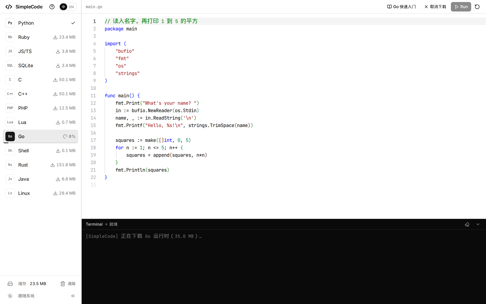

Linux 是客户机，不是又一个 wasm 命令。Run 之后串口上能看到脚本自己的输出，这里是 `Hello from Linux`，以及 `uname` 打出来的 `Linux 6.8.12 i686`。

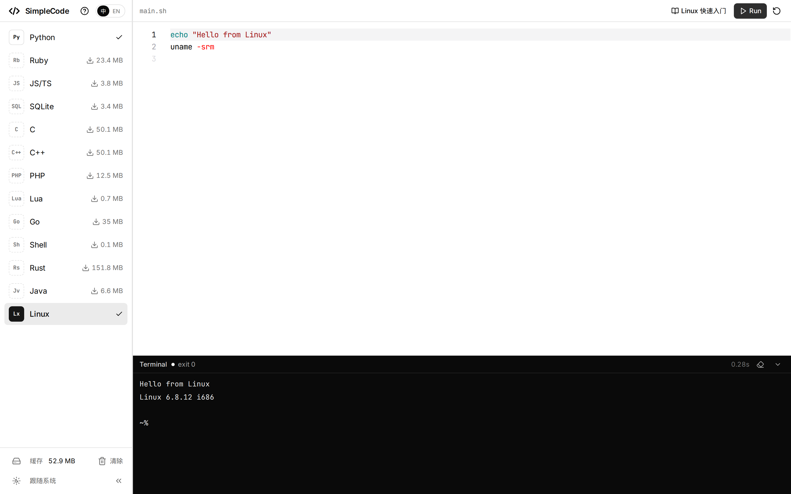

Java 的入口类叫 `Main`。同一页上编译并运行，终端里是 `Hello from Java 42`。

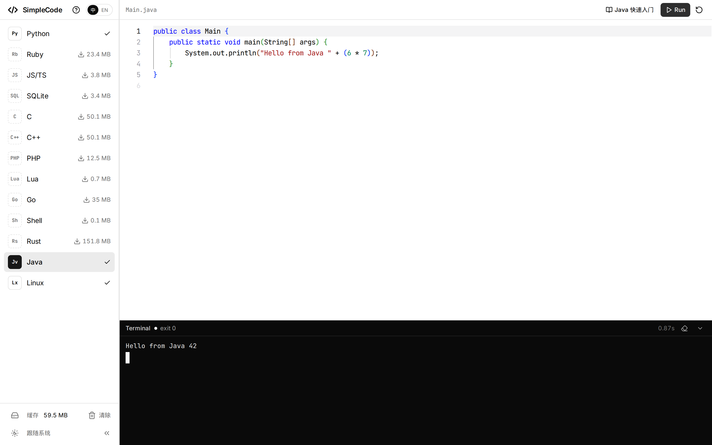

## 我这边看到的 Grok Bot

Grok Bot 是我自己的代理桌面应用。用起来就是跟一个有名字的机器人聊天。做这个仓库时，机器人的名字就叫 SimpleCode。它记得这个项目的规矩和已经做过的决定：先写计划再改代码，界面保持单色，运行时有哪些事做不到。这些记忆跟着这个机器人走，换一个话题不会把 SimpleCode 的约束冲掉。

它能在我的 Mac 上跑命令，用来 `git pull`、本地构建和调试。每一条命令执行前要我点允许。写代码的时候，它去启动 Cursor 的云端代理。代理在一台虚拟机上改仓库，推分支，打开 GitHub PR。我在 PR 里看 diff 和它附上的截图，然后在对话里点一下合并。合并走 GitHub 连接器，合完它再在 Mac 上把 `main` 拉下来，下一件事从新的代码开始。

它另外还有一台 Linux 电脑，上面有浏览器，用来打开页面、截图，好让我在聊天里直接看界面，而不必每次都自己切到浏览器。

<!-- TODO: Grok Bot 批准本机命令的截图 -->

<!-- TODO: Grok Bot 一键合并 PR 的截图 -->

<!-- TODO: Grok Bot 用 Linux 电脑里的浏览器回传截图 -->

人能看见的这条链路是这样的：

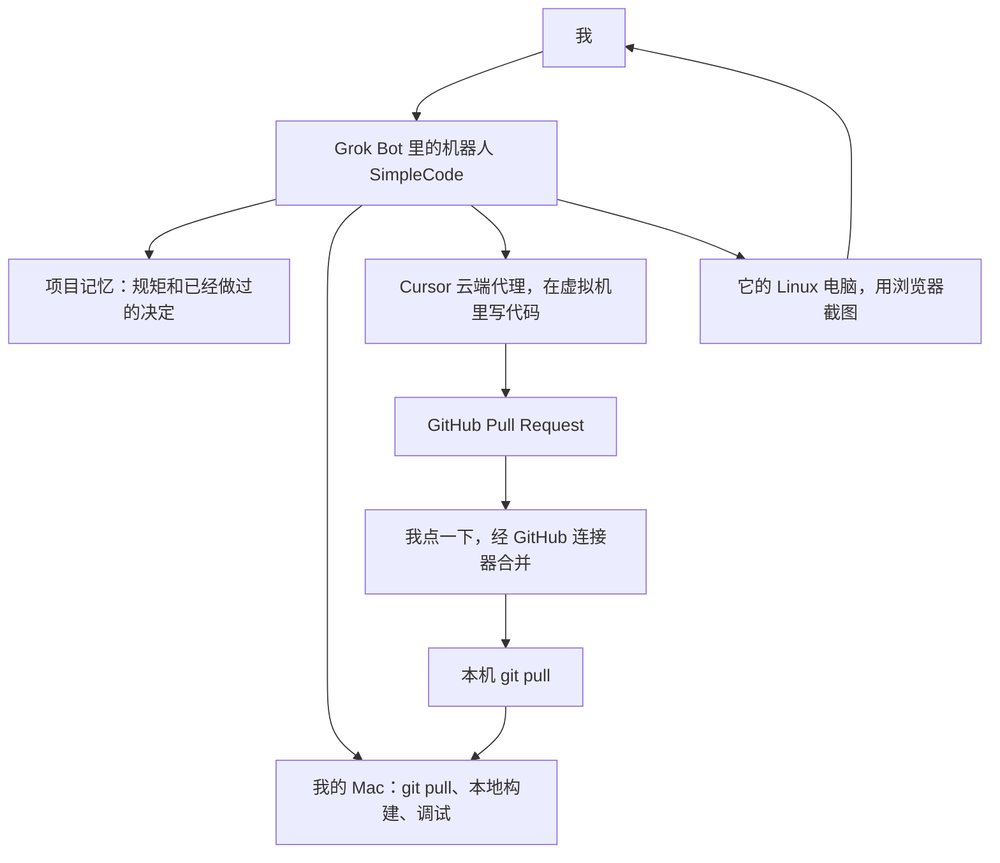

云端代理在虚拟机里干活的时候，对话还在。我可以接着补充约束，或者先去看上一份 PR。本地构建留在我自己的机器上，因为 wasm 体积、浏览器隔离和「我眼见为实」都在这边。

## 这两天实际是怎么走的

固定的节奏是：想法，写成 `plan/LANGUAGES.md` 或 `plan/LEARN.md`，云端代理按计划开 PR，我看完，合并，本机 pull，再谈下一件。24 个 PR 的分支都是 `cursor/` 开头。下面这张表是合并记录，后面只展开我后来会反复用到的几步。

| PR | 合并时间 (UTC) | 落到仓库里的事 |
|---|---|---|
| [#1](https://github.com/linkxzhou/SimpleCode/pull/1) | 10-15 03:26 | 侧栏收成黑白，折叠后只剩图标 |
| [#2](https://github.com/linkxzhou/SimpleCode/pull/2) | 10-15 05:07 | Lua 5.4.9 和 Go（Yaegi） |
| [#3](https://github.com/linkxzhou/SimpleCode/pull/3) | 10-15 06:07 | Lua / Go 能在 macOS 和 Linux arm64 上构建 |
| [#4](https://github.com/linkxzhou/SimpleCode/pull/4) | 10-15 06:01 | QuickJS 改称 JS/TS，浏览器里去掉类型 |
| [#5](https://github.com/linkxzhou/SimpleCode/pull/5) | 10-15 06:43 | Python、JavaScript、Go 的 101 抽屉 |
| [#6](https://github.com/linkxzhou/SimpleCode/pull/6) | 10-15 07:38 | 抽屉让开工具栏，三本书加长 |
| [#7](https://github.com/linkxzhou/SimpleCode/pull/7) | 10-15 08:34 | 清单按磁盘生成；补上 Ruby、SQL、C、C++、PHP、Lua |
| [#8](https://github.com/linkxzhou/SimpleCode/pull/8) | 10-15 08:43 | Shell（wasi-sh） |
| [#9](https://github.com/linkxzhou/SimpleCode/pull/9) | 10-15 11:52 | 十本书改成散文，名字定为快速入门 |
| [#10](https://github.com/linkxzhou/SimpleCode/pull/10) | 10-15 12:55 | Go 改成短节 |
| [#11](https://github.com/linkxzhou/SimpleCode/pull/11) | 10-15 14:24 | 其余九本改成短节 |
| [#12](https://github.com/linkxzhou/SimpleCode/pull/12) | 10-16 01:31 | Linux 方案，并写下 `AGENTS.md` |
| [#13](https://github.com/linkxzhou/SimpleCode/pull/13) | 10-16 02:36 | Rust 调研 |
| [#14](https://github.com/linkxzhou/SimpleCode/pull/14) | 10-16 03:30 | v86 Linux 客户机，和 Linux 快速入门 |
| [#15](https://github.com/linkxzhou/SimpleCode/pull/15) | 10-16 03:48 | weblings Rust，和 Rust 快速入门 |
| [#16](https://github.com/linkxzhou/SimpleCode/pull/16) | 10-16 05:50 | 关于弹层、中 / EN、换语言时终端重绑 |
| [#17](https://github.com/linkxzhou/SimpleCode/pull/17) | 10-16 06:38 | 当时十二本书的英文版 |
| [#18](https://github.com/linkxzhou/SimpleCode/pull/18) | 10-16 06:38 | 下载进度条上下留出 8px |
| [#19](https://github.com/linkxzhou/SimpleCode/pull/19) | 10-16 09:14 | 进度条贴住按钮底边；示例代码只用 ASCII |
| [#20](https://github.com/linkxzhou/SimpleCode/pull/20) | 10-16 10:01 | Java 调研，建议 TeaVM |
| [#21](https://github.com/linkxzhou/SimpleCode/pull/21) | 10-16 13:14 | 普通静态服务器也能跨源隔离 |
| [#22](https://github.com/linkxzhou/SimpleCode/pull/22) | 10-16 13:14 | TeaVM Java，和中英 Java 快速入门 |
| [#23](https://github.com/linkxzhou/SimpleCode/pull/23) | 10-16 17:10 | Java 的空下载不再报成锁文件不一致 |
| [#24](https://github.com/linkxzhou/SimpleCode/pull/24) | 10-17 03:42 | 本机没有 Rust 工具链时，404 一次就改走上游 |

### 一开始的七门语言

10 月 15 日的第一笔提交是练习场本身：Vue 3、Monaco、xterm、`@runno/wasi`。侧栏里有 Python、Ruby、QuickJS、SQLite、C、C++、PHP。同一天我又收过一版单色界面和终端字体。从 [#1](https://github.com/linkxzhou/SimpleCode/pull/1) 起，侧栏的样子是云端代理交上来的：白底、展开时一行一种语言、折叠后只剩图标，缓存和主题留在底部。

往上加语言之前，先有一份评估。`plan/LANGUAGES.md` 按当时的 TIOBE 名单写过：现有宿主只吃 WASI preview1 命令模块，远程编译不算数。Lua 和 Go 被判成可以接进来，[#2](https://github.com/linkxzhou/SimpleCode/pull/2) 就加了 Lua 5.4.9 和 Yaegi 0.16.1。Lua 的 `pcall` 要靠异常处理；Go 是解释器，标准库之外不能 `go get`，`time.Sleep` 在这个宿主里等不回来。这些限制写在计划里，后面写书的时候就避开。

[#3](https://github.com/linkxzhou/SimpleCode/pull/3) 把构建从「只能在 Linux x86_64 上跑」放开。脚本守着 bash 3.2，按 `uname` 选 linux / darwin 和 x86_64 / arm64 的工具链。Apple Silicon 上编出来的 Lua 摘要和 Linux 不一样，锁文件里就按宿主分开记，没有钉死的宿主保留二进制并打印摘要，不把 vendor 打失败。

[#4](https://github.com/linkxzhou/SimpleCode/pull/4) 把侧栏上的 QuickJS 改成 JS/TS。运行时还是那一份 wasmedge-quickjs，只执行 JavaScript。选 TS 的时候才懒加载 Sucrase，把类型去掉再交给 QuickJS。这不是完整的类型检查。

### 快速入门，以及后来改成短节

教学是同一天里另一条线。`plan/LEARN.md` 先写抽屉、课程和单色规范，[#5](https://github.com/linkxzhou/SimpleCode/pull/5) 才做出「{语言} 101」：Python、JavaScript、Go 三本书，代码块可以 Run，会把示例装进主编辑器。Ruby、SQL、C、C++、PHP、Lua 当时还显示即将推出。

[#6](https://github.com/linkxzhou/SimpleCode/pull/6) 是看过界面之后的修改。抽屉原来从视口顶边铺下来，Run 点不到。顶边改成和工具栏同一条偏移。Shiki 在代码行之间多插的换行也在这里去掉，不然高亮结果会多出空行。

[#7](https://github.com/linkxzhou/SimpleCode/pull/7) 补完那六本书，并停掉一件会反复咬人的事：`wasm/manifest.json` 不再提交。清单改由磁盘上的文件重算 `size` 和 `sha256`。以前把清单提交进 git，换一台机器 pull 回来，体积对不上，下载检查就失败。脚本开头也不能留 shebang，不然 Vite 把它当模块导入会失败。

到这里书还叫 101。[#9](https://github.com/linkxzhou/SimpleCode/pull/9) 把十本书改成散文，可见的名字换成「快速入门」，内部 id 不动。散文写完，标准又改了。[#10](https://github.com/linkxzhou/SimpleCode/pull/10) 只动 Go，按菜鸟教程的目录形状重写成 29 个短章：正式章名，一节一件事，句子自己写。[#11](https://github.com/linkxzhou/SimpleCode/pull/11) 把其余九本也改成这个形状。构建索引变成 277 章、810 个可运行块。运行时做不到的例子标 `norun`，旁边写原因，例如 C++ 的 `std::sort` 会缺 `__lttf2`，PHP 读不到 WASI 的标准输入，Shell 没有函数和外部命令。

这一段最能说明「先写计划、看过再改」。101、散文、短节是三次不同的写作标准，每一次都先记在 `plan/LEARN.md` 里，再整本书换掉。短节留下来了，现在十三本书都是这个形状。

### Shell

Shell 是 [#8](https://github.com/linkxzhou/SimpleCode/pull/8)。公开的 bash 和 BusyBox wasm 带 JS 胶水，或者还要 `fork` / `exec` 那类接口，现有的 `WASIWorkerHost` 接不住。所以 Shell 是仓库里的 `wasi-sh`：`echo`、`printf`、`read`、`cat`、`test`、赋值、`if` / `while` / `for`，以及内建命令之间的管道和重定向。没有 `cd`，没有命令替换，外部命令退出 127。`$$` 固定打印 `1`。体积只有大约 55 KB。真要 `ls` 和 `cd`，留给后来的 Linux，而不是再塞一份 BusyBox wasm 进同一个宿主。

### Linux

[#12](https://github.com/linkxzhou/SimpleCode/pull/12) 只有计划。`plan/LANGUAGES.md` 第 10 节写 v86 客户机：串口接到现有的 xterm，脚本走 9p，用快照加快启动。Shell 继续留在 wasi-sh。同一次 PR 加了 `AGENTS.md`，把架构、`./build.sh`、界面规矩、加语言的步骤、写书的标准和已经踩过的坑收成一份给后来的人、也给后来的代理看的说明。这是项目记忆里终于落进仓库的那一份。机器人自己记得的规矩，和仓库里这份文件，从这里开始对着同一套决定。

[#14](https://github.com/linkxzhou/SimpleCode/pull/14) 才把 Linux 放进侧栏，短标签 `Lx`。客户机是钉住的上游镜像：i686、内核 6.8.12、Buildroot 2024.05.2、BusyBox 1.36.1，内存必须是 64 MiB。32 MiB 时内核解压停在半路，串口不再出字。每次 Run 从 zstd 压缩的快照恢复，围栏之间不共享 `/tmp`。退出码认串口上最后一次 `__SC_EXIT:` 后面的数字。压缩之后六份文件合计 30,888,868 字节。`docs/linux/` 是 30 章的快速入门。没有网络，所以 `apt`、`yum`、`ssh`、`vim` 只供阅读。

### Rust

[#13](https://github.com/linkxzhou/SimpleCode/pull/13) 也是只调研。要的是浏览器里的真编译器，而且产物最好只导入 `wasi_snapshot_preview1`，好交给已经有的宿主。记下的选择是 weblings 的 Cranelift rustc，当时看到的压缩包是 95,941,921 字节，大约 96 MB。官方 rustc 放进 v86 太重，Playground 的 API 会把源码送出浏览器，一份很小的解释器又 cover 不住日常的 Rust。这几条都写在计划里，实现时没有再走一遍。

[#15](https://github.com/linkxzhou/SimpleCode/pull/15) 把这条路接上。编译器留在自己的 Worker 里，链接出来的 wasm 交给原来的 Run。选中 Rust 才下载，Cache API 的名字是 `simplecode-rustc-v1`，不进默认 vendor。落到浏览器里的体积比那个压缩包大：`rustc.wasm` 87,871,387 字节，加上 sysroot，一共 159,184,722 字节，大约 152 MB。书是 28 章。限制也写死了：单个 `main.rs`，没有 Cargo，没有 crates.io，没有 `std::thread` 和 `sleep`。

### 关于弹层、中英界面，然后是英文书

[#16](https://github.com/linkxzhou/SimpleCode/pull/16) 在标题右边加了「?」和「中 / EN」。文案放在 `src/i18n`，选择记在 `localStorage` 的 `simplecode:locale`，默认中文。当时英文书还没有，界面是 EN 时打开快速入门，会看到 English Quick Start is under construction，可以点回去看中文，界面语言不变。同一次还规定：换编程语言时先停掉上一个运行时，卸掉终端上的串口和标准输入，清屏，再绑新的。下载或运行途中换走，旧的完成回调不能再写屏幕。换界面语言时，系统句子按新语言重画，程序已经打印的内容留在原处。

[#17](https://github.com/linkxzhou/SimpleCode/pull/17) 把当时的十二本书都写成英文，文件在 `docs/en/<book>/`，文件名和中文对齐。可运行围栏的程序、`expect` 和 `stdin` 与中文相同。两边加在一起是 670 章、1932 个可运行块。Java 的英文是后来 [#22](https://github.com/linkxzhou/SimpleCode/pull/22) 跟中文一起加的，所以现在是 726 章、2098 块。

[#18](https://github.com/linkxzhou/SimpleCode/pull/18) 给下载进度条上下留了 8px。[#19](https://github.com/linkxzhou/SimpleCode/pull/19) 看过之后改了：间距去掉，进度条改成贴在语言按钮的底边，高度 2px，左右和按钮同宽。同一份 PR 把快速入门、默认示例和冒烟样例里的标识符、字符串、打印结果收成 ASCII。注释仍按书的语言写，中文注释对英文注释。编辑器里还没改过的默认示例，在「中 / EN」切换时只换注释。

### Java

[#20](https://github.com/linkxzhou/SimpleCode/pull/20) 再次只写计划。问题是：用户在 Monaco 里写的 Java，要在浏览器里编译，输出进现有的终端。比较过 TeaVM、CheerpJ（JavaFiddle 用的那条）、几条在构建机上做 AOT 的编译器，以及想做成 WASI 命令的 rjvm 和 jacobin。GitHub 上按主题扫过一轮，能在浏览器里从用户源码走到标准输出的，TeaVM 最合适。没有一条能把 hello 交给现有的 WASI 宿主。`teavm.org` 没有 CORS，不能当页面的下载地址，所以文件要钉在同源。

测量写在 PR 里：四份文件合计 6,896,057 字节，本机已有文件时，无头 Chrome 里 `Hello from Java 42` 用了 811.9 毫秒。产物是 Wasm GC 加 JS，不是 preview1 命令。

[#22](https://github.com/linkxzhou/SimpleCode/pull/22) 按这个方案做了侧栏上的 Java，短标签 `Jv`。`./build.sh vendor --java` 把四份钉住的 TeaVM 0.16.0 文件放到 `wasm/java/`。选中之后进 Cache API `simplecode-teavm-v1`。`Main.java` 在 TeaVM 自己的 Worker 里编译并运行。`System.in` 从终端接进去，`Thread.sleep` 要等 Worker 里的计时器走完。中英各 28 章。Java 的文档冒烟默认不跑，`SIMPLECODE_JAVA_DOCS=1` 才执行，当时 166 块都通过了。

### 普通静态服务器

开发服务器和 preview 会自己送 `Cross-Origin-Opener-Policy: same-origin` 和 `Cross-Origin-Embedder-Policy: require-corp`。用 `python -m http.server` 或 GitHub Pages 打开 `dist/` 时没有这两项头，`SharedArrayBuffer` 用不了，页面会停在隔离说明上。[#21](https://github.com/linkxzhou/SimpleCode/pull/21) 在挂载前注册同源的 `coi-serviceworker.js`，需要时刷新一次，把同样的两枚头补上。已经隔离的开发服务器不注册。`file://` 和隐私模式没有 Service Worker，说明页还在，文案改成写明 `http://localhost` 或 https 上的普通静态服务器可以打开。

Worker 用 `require-corp`，和开发服务器一致。字体、wasm、Linux 镜像和 vendored 的 Rust 都是同源的。Worker 只转发正文，下载的字节数不能变，不然清单里的体积检查会失败。

### AGENTS.md

[#12](https://github.com/linkxzhou/SimpleCode/pull/12) 写下来的 `AGENTS.md`，后来每次踩坑都在加厚。现在打开它，能看到语言 id、哪份书在哪个目录、Run 按钮只能有一种样子、抽屉不能盖住工具栏、示例代码只用 ASCII、Java 不要改去用 CheerpJ、缺失的 `/wasm` 不能回成首页。云端代理下一份 PR 开工时读的是这份文件，加上 `plan/` 里还没做完的设计。机器人聊天里的记忆负责把这些决定记住；仓库里的文件负责让下一个代理、也让我自己，不用再从聊天记录里翻。

## 报错贴回去，修完再合

顺，包括出错的时候手感还在。我把控制台里的报错贴回对话，机器人对照仓库判断，云端代理补上测试并开 PR，我再合并、拉取。10 月 16 日下午到 17 日凌晨的三份 PR 是这个循环本身。

### [#21](https://github.com/linkxzhou/SimpleCode/pull/21)：`python -m http.server` 上的跨源隔离

静态站点打开 `dist/` 时，控制台侧的问题是页面没有跨源隔离，`crossOriginIsolated` 起不来，WASI 宿主一构造就要 `SharedArrayBuffer`，直接被挡住。开发服务器没这个问题，因为它自己带了 COOP 和 COEP。

修复是上面的 service worker：注册、刷新一次、补上和开发服务器相同的头，并用 `sessionStorage` 防止刷新循环。`tests/coi-static.mjs` 检查静态服务器本身不送这两枚头，刷新一次之后 `crossOriginIsolated === true`，再刷新不会循环，Python 的 `input()` 仍打印 `Hello, Ada from Python`。PR 里附了这张静态服务器上的运行截图。

这次合并之后，`./build.sh build` 的 `dist/` 可以用普通静态服务器打开。后面的 Java 和 Rust 问题，都是在这条路上接着出现的。

### [#23](https://github.com/linkxzhou/SimpleCode/pull/23)：Java 的 `compiler.wasm` 显示 0 kB，终端却说和锁文件不一致

选中 Java 时，Chrome 开发者工具里 `compiler.wasm` 可以显示 **0 kB transferred**，同一地址用 curl 却是完整的 4,294,850 字节。0 kB 是 `transferSize`。内存缓存命中（`Cache-Control` 带很长的 `max-age`），或者 service worker 用 `new Response` 重新做了一份响应，都会让这个数字变成 0。正文仍可能是完整文件。

终端报错的是页面真正读到的字节。空的、变短的、或者以前把首页 `index.html` 当成 wasm 缓存下来的，都会被说成 `compiler.wasm` 与 `sources.lock.json` 不一致。开发服务器或 preview 如果在文件还不存在时把 `/wasm/java/compiler.wasm` 回成首页，响应是 200，还可能被缓存一天。磁盘上后来有了正确文件，普通请求仍读到那份 HTML。

[#23](https://github.com/linkxzhou/SimpleCode/pull/23) 把这几件事拆开：

- 同源的钉住文件带上 `?v=`，值是 sha256 的前 12 位。先 `cache: "no-cache"`，缺文件、HTML、空正文、短正文或摘要不对，再用 `cache: "reload"` 重试一次。上游的 Rust 地址不加这个查询参数。
- 空正文或短正文算下载不完整，文案写明得到的字节数、期望的字节数和 sha256。只有体积相同、摘要不同，才说和锁文件不一致。
- 开发服务器和 preview 对缺失的 `/wasm/**` 直接 404，`Cache-Control: no-store`，不回首页。存在的文件由它们自己送出，`Cache-Control: no-cache`。
- service worker 丢掉 `Content-Encoding`。Worker 里的 `fetch` 已经解开正文，再把编码头交回页面，页面会再解一次，可能得到空缓冲。原来带编码时，连 `Content-Length` 一起删。200 且没有 body，用 `cache: "reload"` 再请求一次。读流的时候立刻把每个分块复制出来，避免缓冲区被复用后摘要算错。

测试包括：用可缓存的 HTML 冒充 `compiler.wasm`，再重载到真文件并跑通 Java hello；在 Vite 开发服务器上确认读到的 wasm 是 4,294,850 字节且摘要与锁一致；第一次给空正文仍能跑通 hello；正文一直是空的，则报下载不完整，写明得到 0 字节和期望的大小。

### [#24](https://github.com/linkxzhou/SimpleCode/pull/24)：Rust 的 `AbortError`，和 404 被请求了两次

[#23](https://github.com/linkxzhou/SimpleCode/pull/23) 的重试在 Java 上是对的，套到 Rust 上多了一次请求。Rust 默认不 vendor。用 `python -m http.server` 加上 [#21](https://github.com/linkxzhou/SimpleCode/pull/21) 的 service worker 打开页面，再点 Rust，本机的 `/wasm/rust/rustc.wasm` 和 `sysroot-wasip1.bundle` 本来就该 404，然后改去下载钉住的 weblings 地址。

非 2xx 的响应被无条件再请求一次，于是每个缺失文件打了两遍日志：`/wasm/rust/rustc.wasm?v=41412081eefc` 和 `/wasm/rust/sysroot-wasip1.bundle?v=6dba13d6077c`。真正的 404 重试之后还是 404。与此同时，任何 `AbortError` 都被当成这次下载失败，上游地址不再尝试。`AbortController.abort()` 不带原因时，浏览器报的就是 `AbortError: signal is aborted without reason`。侧栏把选择语言的 Promise 交给了 Vue，拒绝会变成点选时的未捕获错误。换语言会中止正在进行的下载；再去等那个已经中止的 Promise，下一次选择也会失败。

[#24](https://github.com/linkxzhou/SimpleCode/pull/24) 改成：确认是 HTTP 404 就只请求一次，不读正文，然后落到钉住的上游地址，进度照样显示。空正文和 HTML 仍走原来的重试。调用方的信号已经中止时，把这个错误吞掉，不再冒到界面上。`tests/rust-static-download.spec.mjs` 在没有 COOP/COEP 的静态服务器上检查：每个文件本地 404 一次，切到 Shell 时不再出现 `AbortError`，随后从上游下到编译器，并跑出 `Hello from Rust 42`。

三份 PR 连在一起看，就是私人代理把同一件事做完的方式。第一次让静态服务器能开；第二次分清「缓存里的空文件 / 首页」和「锁文件真的不一致」；第三次发现第二次的重试让 Rust 的预期 404 走偏了，再把上游退路接回去。每一次都有测试，每一次都是合并之后才在我机器上的 `main` 里出现。

## 为什么这像一个私人代理

我在意的是手感，不是某一个模型会不会写 Vue。

**它记得我已经定过的事。** 单色、抽屉不能盖住 Run、清单不入库、示例代码用 ASCII、Java 走 TeaVM、Shell 不要再换一份 BusyBox wasm。这些话我说一次，写进计划和 `AGENTS.md`，下一份 PR 还在。聊天里的机器人记着项目，仓库里的文件让云端那台虚拟机也能读到。两边对着同一份决定，我不用在每个任务里把约束重贴一遍。

**它先写计划。** Linux、Rust、Java 都是先有 `plan/LANGUAGES.md` 的一节，再有侧栏上的那一项。没走通的路留在计划里：公开的 bash wasm、把源码送到站外的 Playground、CheerpJ、构建机上的 AOT。实现 PR 因此很窄。看 diff 的时候我是在核对方案，而不是在一份大补丁里找它偷偷换了运行时。

**同意是一次点击，活是异步的。** Mac 上的命令要我点允许，合并 PR 也是点一下。云端代理写代码的几十分钟里，对话还开着，我可以看上一份 PR 的截图，或者把下一件事的约束补上。截图尤其有用。侧栏、抽屉、Run 的结果都在 PR 里，很多界面问题是看图发现的：抽屉盖住工具栏、进度条的间距、进度条后来改成贴住按钮底边。

**出错也不换一条流程。** [#21](https://github.com/linkxzhou/SimpleCode/pull/21)、[#23](https://github.com/linkxzhou/SimpleCode/pull/23)、[#24](https://github.com/linkxzhou/SimpleCode/pull/24) 都是我贴报错、它改代码、我合并。不需要为了修 bug 另开一套工具。

限度也具体。

代理会把「重试一次」写成对所有失败都重试，[#24](https://github.com/linkxzhou/SimpleCode/pull/24) 就是这样从 [#23](https://github.com/linkxzhou/SimpleCode/pull/23) 里长出来的。进度条的 8px 留白我看过又改掉了，这种偏好它第一次做不对，要我看界面。草稿 PR 在 GitHub 上不能进 `main`，准备合并时要先标成可评审。云端虚拟机不一定有我本机的 `wasm/`，Rust 和 Java 默认还不在 vendor 里，所以「我在 Mac 上跑一遍」仍然算数。Rust 的 Safari 没有测过。Java 不是 OpenJDK。`file://` 仍然开不了 Service Worker。

我后面会继续这样用，有几条是这次才站稳的：

1. 多步的事先写进 `plan/DESIGN.md`、`plan/LANGUAGES.md` 或 `plan/LEARN.md`。稳定下来的规矩再收进 `AGENTS.md`，让下一份 PR 不用翻聊天记录。
2. 一份 PR 一件事。语言的书按语言分提交，diff 才看得完。
3. 报错贴原文。0 kB、`AbortError: signal is aborted without reason`、和锁文件不一致，这三句指向的是三件不同的事。
4. 先看 PR 里的截图和测试，再点合并，然后本机 pull，自己 Run 一次。云端绿了，只说明那台虚拟机上是绿的。
5. 运行时做不到的事写在计划里，并在书里标成只供阅读。不要在可运行示例里碰它，也不要换一条会把源码送出浏览器的后备。

SimpleCode 现在是一页网站：十三门语言或环境，中英两套快速入门，运行时按需下载。Grok Bot 这边，它是一个记得这个仓库的机器人，能在我点头之后动我的电脑，能把活派到云端，也能把浏览器里的样子截回来。两天做完这些，中间还有三次真修 bug。流程没有散。这就是我觉得私人代理应该有的顺。
