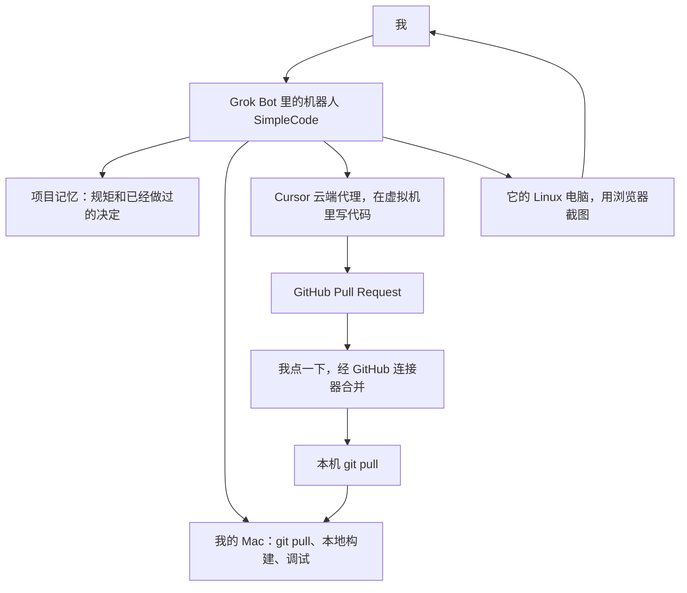

# Grok Bot 使用手记：两天做出一个叫 SimpleCode 的多语言练习场

作者 [linkxzhou](https://github.com/linkxzhou) · 2026-10-17

仓库：[github.com/linkxzhou/SimpleCode](https://github.com/linkxzhou/SimpleCode)

这篇想讲清楚一件事：**Grok Bot 用起来是什么手感**。为了不空谈，我用一个真实的例子从头走到尾——2026 年 10 月 15 日到 17 日，我靠 Grok Bot 里的一个机器人把 SimpleCode 做出来了：浏览器里的语言从七门变成十三门，快速入门从没有写成中英各 363 章，一共合进 `main` 24 个 pull request。中间有过三次真的报错，修法还是同一条路。做完回头看，这种手感很接近我期望一个私人代理该有的样子。

下面按仓库里的提交和已合并 PR 来写。时间是 GitHub 上的合并时间（UTC）。没有聊天记录里的原话，Grok Bot 自己的界面我也还没截进这篇文章，文中留了位置。

<!-- TODO: Grok Bot 聊天截图 -->

## Grok Bot 是什么

Grok Bot 是我自己的代理桌面应用。用起来就一句话：跟一个有名字的机器人聊天。做这个仓库时，机器人的名字就叫 SimpleCode。我大部分时间就泡在对话里：想法先写进 `plan/`，云端代理开 PR，我看完点一下合并，再在自己的 Mac 上拉下来跑。

它有四样东西，凑成整个工作流。

**第一，它记得这个项目的规矩。** 先写计划再改代码，界面保持单色，运行时有哪些事做不到——这些话我说一次，它就记住，换一个话题也不会把 SimpleCode 的约束冲掉。记忆跟着这个机器人走，是它自己的，不是靠我在每条消息里重贴一遍。

**第二，它能在我的 Mac 上跑命令。** 用来 `git pull`、本地构建和调试。每一条命令执行前要我点允许。

**第三，它能派活到云端。** 写代码的时候，它去启动 Cursor 的云端代理。代理在一台虚拟机上改仓库，推分支，打开 GitHub PR。我在 PR 里看 diff 和它附上的截图，然后在对话里点一下合并。合并走 GitHub 连接器，合完它再在 Mac 上把 `main` 拉下来，下一件事从新的代码开始。

**第四，它还有一台 Linux 电脑，上面有浏览器。** 用来打开页面、截图，好让我在聊天里直接看界面，不必每次都自己切到浏览器。

<!-- TODO: Grok Bot 批准本机命令的截图 -->

<!-- TODO: Grok Bot 一键合并 PR 的截图 -->

<!-- TODO: Grok Bot 用 Linux 电脑里的浏览器回传截图 -->

人能看见的这条链路是这样的：

云端代理在虚拟机里干活的时候，对话还在。我可以接着补充约束，或者先去看上一份 PR。本地构建留在我自己的机器上，因为 wasm 体积、浏览器隔离和「我眼见为实」都在这边。

## 一个具体例子：SimpleCode

SimpleCode 是浏览器里的多语言练习场。没有后端。页面是 Vue 3、Vite、TypeScript，中间一块 Monaco，下面一块 xterm，工具栏上一个 Run，代码就在本机浏览器里执行。

前十门语言是 WASI preview1 的命令模块，由 `@runno/wasi` 的 `WASIWorkerHost` 在 Web Worker 里跑。标准输入走 `SharedArrayBuffer`，所以页面要跨源隔离。Rust 的编译器是 weblings 的 Cranelift rustc，在另一个 Worker 里编译，编出来的 wasm 再交给同一个宿主。Java 的编译和运行都在 TeaVM 自己的 Worker 里。Linux 是 v86 客户机，跑在主线程，串口接到同一份终端。

侧栏现在有十三项：Python、Ruby、JS/TS、SQLite、C、C++、PHP、Lua、Go、Shell、Rust、Java、Linux。界面文案可以在「中 / EN」之间切换，默认中文。每种语言有一本「快速入门」。当前 `./build.sh build` 的索引是 **726 章、2098 个可运行代码块**，中英各 363 章、各 1049 块。

界面是黑白的。侧栏、工具栏、按钮、抽屉、终端只用中性灰，Monaco 的语法色是唯一的例外。运行时不跟仓库走，选中一门语言才下载，下过的字节进 Cache API。

这个项目本身的细节不重要，重要的是：上面每一张截图、每一项功能，都是 Grok Bot 按下面这套节奏推着往前走出来的。

## 两天实际是怎么走的

固定的节奏是：想法，写成 `plan/LANGUAGES.md` 或 `plan/LEARN.md`，云端代理按计划开 PR，我看完，合并，本机 pull，再谈下一件。24 个 PR 的分支都是 `cursor/` 开头。下面是合并记录，后面只展开我后来会反复用到的几步。

| PR | 合并时间 (UTC) | 落到仓库里的事 |
|---|---|---|
| [#1](https://github.com/linkxzhou/SimpleCode/pull/1) | 10-15 03:26 | 侧栏收成黑白，折叠后只剩图标 |
| [#2](https://github.com/linkxzhou/SimpleCode/pull/2) | 10-15 05:07 | Lua 5.4.9 和 Go（Yaegi） |
| [#3](https://github.com/linkxzhou/SimpleCode/pull/3) | 10-15 06:07 | Lua / Go 能在 macOS 和 Linux arm64 上构建 |
| [#4](https://github.com/linkxzhou/SimpleCode/pull/4) | 10-15 06:01 | QuickJS 改称 JS/TS，浏览器里去掉类型 |
| [#5](https://github.com/linkxzhou/SimpleCode/pull/5) | 10-15 06:43 | Python、JavaScript、Go 的 101 抽屉 |
| [#6](https://github.com/linkxzhou/SimpleCode/pull/6) | 10-15 07:38 | 抽屉让开工具栏，三本书加长 |
| [#7](https://github.com/linkxzhou/SimpleCode/pull/7) | 10-15 08:34 | 清单按磁盘生成；补上 Ruby、SQL、C、C++、PHP、Lua |
| [#8](https://github.com/linkxzhou/SimpleCode/pull/8) | 10-15 08:43 | Shell（wasi-sh） |
| [#9](https://github.com/linkxzhou/SimpleCode/pull/9) | 10-15 11:52 | 十本书改成散文，名字定为快速入门 |
| [#10](https://github.com/linkxzhou/SimpleCode/pull/10) | 10-15 12:55 | Go 改成短节 |
| [#11](https://github.com/linkxzhou/SimpleCode/pull/11) | 10-15 14:24 | 其余九本改成短节 |
| [#12](https://github.com/linkxzhou/SimpleCode/pull/12) | 10-16 01:31 | Linux 方案，并写下 `AGENTS.md` |
| [#13](https://github.com/linkxzhou/SimpleCode/pull/13) | 10-16 02:36 | Rust 调研 |
| [#14](https://github.com/linkxzhou/SimpleCode/pull/14) | 10-16 03:30 | v86 Linux 客户机，和 Linux 快速入门 |
| [#15](https://github.com/linkxzhou/SimpleCode/pull/15) | 10-16 03:48 | weblings Rust，和 Rust 快速入门 |
| [#16](https://github.com/linkxzhou/SimpleCode/pull/16) | 10-16 05:50 | 关于弹层、中 / EN、换语言时终端重绑 |
| [#17](https://github.com/linkxzhou/SimpleCode/pull/17) | 10-16 06:38 | 当时十二本书的英文版 |
| [#18](https://github.com/linkxzhou/SimpleCode/pull/18) | 10-16 06:38 | 下载进度条上下留出 8px |
| [#19](https://github.com/linkxzhou/SimpleCode/pull/19) | 10-16 09:14 | 进度条贴住按钮底边；示例代码只用 ASCII |
| [#20](https://github.com/linkxzhou/SimpleCode/pull/20) | 10-16 10:01 | Java 调研，建议 TeaVM |
| [#21](https://github.com/linkxzhou/SimpleCode/pull/21) | 10-16 13:14 | 普通静态服务器也能跨源隔离 |
| [#22](https://github.com/linkxzhou/SimpleCode/pull/22) | 10-16 13:14 | TeaVM Java，和中英 Java 快速入门 |
| [#23](https://github.com/linkxzhou/SimpleCode/pull/23) | 10-16 17:10 | Java 的空下载不再报成锁文件不一致 |
| [#24](https://github.com/linkxzhou/SimpleCode/pull/24) | 10-17 03:42 | 本机没有 Rust 工具链时，404 一次就改走上游 |

### 一开始的七门语言

10 月 15 日的第一笔提交是练习场本身：Vue 3、Monaco、xterm、`@runno/wasi`。侧栏里有 Python、Ruby、QuickJS、SQLite、C、C++、PHP。从 [#1](https://github.com/linkxzhou/SimpleCode/pull/1) 起，侧栏的样子是云端代理交上来的：白底、展开时一行一种语言、折叠后只剩图标。

往上加语言之前，先有一份评估。`plan/LANGUAGES.md` 按当时的 TIOBE 名单写过：现有宿主只吃 WASI preview1 命令模块，远程编译不算数。Lua 和 Go 被判成可以接进来，[#2](https://github.com/linkxzhou/SimpleCode/pull/2) 就加了 Lua 5.4.9 和 Yaegi 0.16.1。Lua 的 `pcall` 要靠异常处理；Go 是解释器，标准库之外不能 `go get`，`time.Sleep` 在这个宿主里等不回来。这些限制写在计划里，后面写书的时候就避开。

[#3](https://github.com/linkxzhou/SimpleCode/pull/3) 把构建从「只能在 Linux x86_64 上跑」放开。脚本守着 bash 3.2，按 `uname` 选 linux / darwin 和 x86_64 / arm64 的工具链。[#4](https://github.com/linkxzhou/SimpleCode/pull/4) 把侧栏上的 QuickJS 改成 JS/TS，选 TS 时才懒加载 Sucrase，把类型去掉再交给 QuickJS。

### 快速入门，以及后来改成短节

教学是同一天里另一条线。`plan/LEARN.md` 先写抽屉、课程和单色规范，[#5](https://github.com/linkxzhou/SimpleCode/pull/5) 才做出「{语言} 101」。[#6](https://github.com/linkxzhou/SimpleCode/pull/6) 是看过界面之后的修改：抽屉原来从视口顶边铺下来，Run 点不到，顶边改成和工具栏同一条偏移。[#7](https://github.com/linkxzhou/SimpleCode/pull/7) 补完那六本书，并停掉一件会反复咬人的事：`wasm/manifest.json` 不再提交，清单改由磁盘上的文件重算。

这一段最能说明「先写计划、看过再改」。101、散文、短节是三次不同的写作标准，每一次都先记在 `plan/LEARN.md` 里，再整本书换掉。短节留下来了，现在十三本书都是这个形状。

### Shell、Linux、Rust、Java

Shell 是 [#8](https://github.com/linkxzhou/SimpleCode/pull/8)。公开的 bash 和 BusyBox wasm 带 JS 胶水，现有的 `WASIWorkerHost` 接不住，所以 Shell 是仓库里的 `wasi-sh`，体积只有大约 55 KB。

Linux 和 Rust 都是先只写调研，再落地。`plan/LANGUAGES.md` 第 10 节写 v86 客户机，[#14](https://github.com/linkxzhou/SimpleCode/pull/14) 才把 Linux 放进侧栏。Rust 那边，[#13](https://github.com/linkxzhou/SimpleCode/pull/13) 只调研，定下 weblings 的 Cranelift rustc——官方 rustc 放进 v86 太重，Playground 的 API 会把源码送出浏览器，一份很小的解释器又 cover 不住日常 Rust。[#15](https://github.com/linkxzhou/SimpleCode/pull/15) 把这条路接上，落到浏览器里的编译器大约 152 MB。

Java 也是 [#20](https://github.com/linkxzhou/SimpleCode/pull/20) 只写计划，比较过 TeaVM、CheerpJ、构建机上的 AOT 之后，定下 TeaVM，[#22](https://github.com/linkxzhou/SimpleCode/pull/22) 落地。

### 中英界面、AGENTS.md，和收尾

[#16](https://github.com/linkxzhou/SimpleCode/pull/16) 在标题右边加了「?」和「中 / EN」，文案放 `src/i18n`，选择记在 `localStorage`。[#17](https://github.com/linkxzhou/SimpleCode/pull/17) 把当时的十二本书都写成英文。进度条先在 [#18](https://github.com/linkxzhou/SimpleCode/pull/18) 留了 8px，[#19](https://github.com/linkxzhou/SimpleCode/pull/19) 看过之后又改掉，贴住按钮底边。

`AGENTS.md` 是 [#12](https://github.com/linkxzhou/SimpleCode/pull/12) 写下来的，后来每次踩坑都在加厚。打开它能看到：语言 id、哪份书在哪个目录、Run 按钮只能有一种样子、抽屉不能盖住工具栏、示例代码只用 ASCII、Java 不要改去用 CheerpJ。云端代理下一份 PR 开工时读的是这份文件，加上 `plan/` 里还没做完的设计。**机器人聊天里的记忆负责把这些决定记住；仓库里的文件负责让下一个代理、也让我自己，不用再从聊天记录里翻。** 这是 Grok Bot 的记忆和仓库文件第一次对着同一套决定。

## 报错贴回去，修完再合

顺，包括出错的时候手感还在。我把控制台里的报错贴回对话，机器人对照仓库判断，云端代理补上测试并开 PR，我再合并、拉取。10 月 16 日下午到 17 日凌晨的三份 PR 是这个循环本身。

### [#21](https://github.com/linkxzhou/SimpleCode/pull/21)：`python -m http.server` 上的跨源隔离

静态站点打开 `dist/` 时，页面没有跨源隔离，`crossOriginIsolated` 起不来，WASI 宿主一构造就要 `SharedArrayBuffer`，直接被挡住。开发服务器没这个问题，因为它自己带了 COOP 和 COEP。

修复是注册一个 service worker：刷新一次、补上同样的头，用 `sessionStorage` 防止刷新循环。`tests/coi-static.mjs` 检查静态服务器本身不送这两枚头，刷新一次之后 `crossOriginIsolated === true`。PR 里附了运行截图。

### [#23](https://github.com/linkxzhou/SimpleCode/pull/23)：Java 的 `compiler.wasm` 显示 0 kB，终端却说和锁文件不一致

选中 Java 时，Chrome 开发者工具里 `compiler.wasm` 可以显示 **0 kB transferred**，同一地址用 curl 却是完整的 4,294,850 字节。0 kB 是 `transferSize`，内存缓存命中或者 service worker 重做响应都会让这个数字变 0，正文仍可能是完整文件。

终端报错的是页面真正读到的字节。空正文、变短的、或者以前把首页 `index.html` 当成 wasm 缓存下来的，都会被说成和 `sources.lock.json` 不一致。

[#23](https://github.com/linkxzhou/SimpleCode/pull/23) 把这几件事拆开：钉住文件带上 `?v=`（sha256 前 12 位）；空正文或短正文算下载不完整，文案写明得到的字节数、期望的字节数和 sha256；开发服务器对缺失的 `/wasm/**` 直接 404 不回首页；service worker 丢掉 `Content-Encoding`，读流时立刻复制每个分块避免摘要算错。

### [#24](https://github.com/linkxzhou/SimpleCode/pull/24)：Rust 的 `AbortError`，和 404 被请求了两次

[#23](https://github.com/linkxzhou/SimpleCode/pull/23) 的重试在 Java 上是对的，套到 Rust 上多了一次请求。Rust 默认不 vendor，本机的 `/wasm/rust/rustc.wasm` 本来就该 404，然后改去下载钉住的 weblings 地址。但非 2xx 的响应被无条件再请求一次，于是每个缺失文件打了两遍日志；与此同时，任何 `AbortError` 都被当成下载失败，上游地址不再尝试。

[#24](https://github.com/linkxzhou/SimpleCode/pull/24) 改成：确认是 HTTP 404 就只请求一次，落到钉住的上游地址；调用方的信号已经中止时，把这个错误吞掉。

三份 PR 连在一起看，就是私人代理把同一件事做完的方式。第一次让静态服务器能开；第二次分清「缓存里的空文件 / 首页」和「锁文件真的不一致」；第三次发现第二次的重试让 Rust 的预期 404 走偏了，再把上游退路接回去。每一次都有测试，每一次都是合并之后才在我机器上的 `main` 里出现。

## 为什么这像一个私人代理

我在意的是手感，不是某一个模型会不会写 Vue。

**它记得我已经定过的事。** 单色、抽屉不能盖住 Run、清单不入库、示例代码用 ASCII、Java 走 TeaVM。这些话我说一次，写进计划和 `AGENTS.md`，下一份 PR 还在。我不用在每个任务里把约束重贴一遍。

**它先写计划。** Linux、Rust、Java 都是先有 `plan/LANGUAGES.md` 的一节，再有侧栏上的那一项。没走通的路留在计划里：公开的 bash wasm、把源码送到站外的 Playground、CheerpJ、构建机上的 AOT。实现 PR 因此很窄，看 diff 的时候我是在核对方案，而不是在一份大补丁里找它偷偷换了运行时。

**同意是一次点击，活是异步的。** Mac 上的命令要我点允许，合并 PR 也是点一下。云端代理写代码的几十分钟里，对话还开着，我可以看上一份 PR 的截图，或者把下一件事的约束补上。截图尤其有用——侧栏、抽屉、Run 的结果都在 PR 里，很多界面问题是看图发现的：抽屉盖住工具栏、进度条的间距、进度条后来改成贴住按钮底边。

**出错也不换一条流程。** 报错贴回去、它改代码、我合并，不需要为了修 bug 另开一套工具。

限度也具体。代理会把「重试一次」写成对所有失败都重试，[#24](https://github.com/linkxzhou/SimpleCode/pull/24) 就是这样从 [#23](https://github.com/linkxzhou/SimpleCode/pull/23) 里长出来的。进度条的 8px 留白我看过又改掉了，这种偏好它第一次做不对，要我看界面。云端虚拟机不一定有我本机的 `wasm/`，Rust 和 Java 默认还不在 vendor 里，所以「我在 Mac 上跑一遍」仍然算数。Rust 的 Safari 没有测过。Java 不是 OpenJDK。`file://` 仍然开不了 Service Worker。

我后面会继续这样用，有几条是这次才站稳的：

1. 多步的事先写进 `plan/DESIGN.md`、`plan/LANGUAGES.md` 或 `plan/LEARN.md`。稳定下来的规矩再收进 `AGENTS.md`，让下一份 PR 不用翻聊天记录。
2. 一份 PR 一件事。语言的书按语言分提交，diff 才看得完。
3. 报错贴原文。0 kB、`AbortError: signal is aborted without reason`、和锁文件不一致，这三句指向的是三件不同的事。
4. 先看 PR 里的截图和测试，再点合并，然后本机 pull，自己 Run 一次。云端绿了，只说明那台虚拟机上是绿的。
5. 运行时做不到的事写在计划里，并在书里标成只供阅读。不要换一条会把源码送出浏览器的后备。

## 收尾

Grok Bot 这边的样子，现在是一个记得这个仓库的机器人：能在我点头之后动我的电脑，能把活派到云端，也能把浏览器里的样子截回来。两天做完这些，中间还有三次真修 bug，流程没有散。

这就是我觉得私人代理应该有的顺。