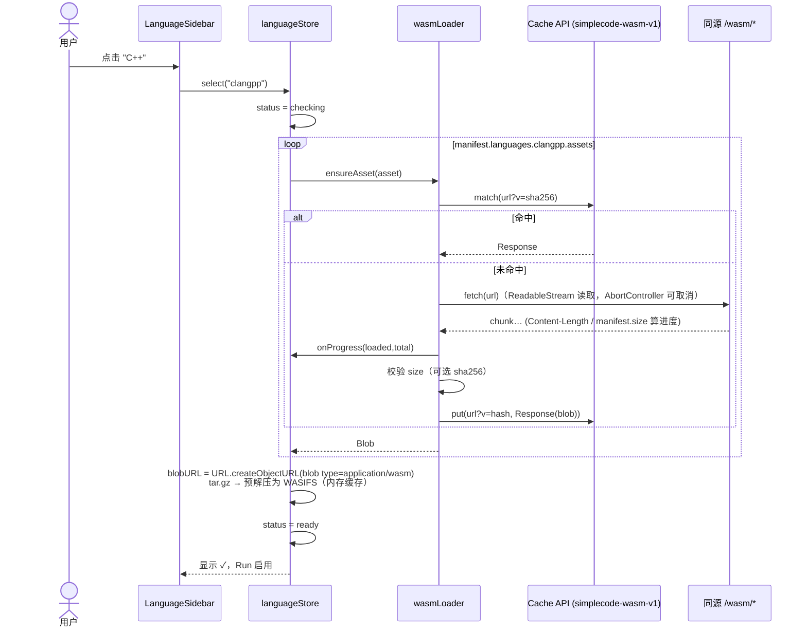

# SimpleCode 设计方案（DESIGN）

> 状态：设计稿，尚未编码。基于 2026-10-15 对 `thirdparty/runno`（上游 https://github.com/taybenlor/runno ，`@runno/runtime` / `@runno/wasi` 版本 0.10.3，MIT）实际代码的阅读。
> 标注「⚠️ 不确定」处需在实现时验证。

---

## 1. 目标与非目标

### 1.1 目标
1. 一个纯浏览器端的多语言代码运行器，界面类似 Runno embed：上方代码编辑器、Run 按钮、下方黑色终端输出。
2. 与 Runno 的差异：**无顶栏**；**左侧为可折叠语言侧栏**（展开 240px / 折叠 56px 图标栏）；右侧主区 = 上编辑器 / 下终端（可拖拽分割）。
3. 所有语言 wasm 统一放在本地 `wasm/` 目录（构建后由同源静态服务提供），点击语言才**首次下载**，显示进度；下载后缓存（Cache API），再次进入秒开。
4. 支持语言：`python`、`ruby`、`quickjs`、`sqlite`、`clang`(C)、`clangpp`(C++)、`php-cgi`。
5. 支持交互式 stdin（终端输入、Ctrl+D 发送 EOF）、Stop 终止。
6. 技术栈：Vue 3 + TypeScript + Vite + Tailwind CSS + shadcn-vue，简洁极简风格，支持深色/浅色。

### 1.2 非目标
- 不提供服务端执行、包管理（pip/gem/npm 安装）、网络访问；不支持的库在运行时自然报错即可。
- 不做多文件项目/文件树（v1 仅单文件 `/program`；保留扩展点）。
- 不重新编译各语言 wasm（直接复用 Runno 仓库 `langs/` 中现成二进制）。
- 不追求 IE/旧浏览器；需要支持 `SharedArrayBuffer` 的现代浏览器。
- 不做账号、分享链接（可作为后续里程碑）。

---

## 2. Runno 代码架构分析（基于克隆代码）

### 2.1 仓库结构
```
thirdparty/runno/
├── langs/                     # ★ 语言二进制（已随仓库提供，非 WAPM 实时拉取）
│   ├── python-3.11.3.wasm     20.5 MB  + python-3.11.3.tar.gz 4.1 MB（标准库 /usr/local/lib/...）
│   ├── ruby-3.2.0.wasm        24.5 MB  + ruby-3.2.0.tar.gz    174 B（仅 /ruby-3.2.0/.rubyopts.rb）
│   ├── wasmedge_quickjs.wasm   4.0 MB
│   ├── sqlite.wasm             3.6 MB
│   ├── php-cgi-8.2.0.wasm     13.1 MB
│   ├── clang.wasm             31.2 MB  + clang-fs.tar.gz 1.8 MB（sysroot：/sys/include, /sys/lib/...）
│   └── wasm-ld.wasm           19.5 MB
├── packages/
│   ├── wasi/      @runno/wasi   —— 纯 TS 的 WASI preview1 实现 + Web Worker 宿主（核心可复用）
│   ├── runtime/   @runno/runtime —— Lit Web Components（runno-run / editor / terminal / controls）+ headless API
│   ├── website/   runno.dev 站点（public/langs 是指向 ../../../langs 的符号链接）
│   ├── sandbox/   Node 端沙箱（@runno/sandbox，用不到）
│   └── mcp/       MCP server（用不到）
├── firebase.json              # 生产部署 COOP/COEP 头示例
└── LICENSE (MIT)
```

**重要发现**：任务描述中提到的 “languages map to WAPM” 在当前代码里已不成立——`packages/runtime/lib/commands.ts` 直接从 `${import.meta.env.VITE_HOST}/langs/*.wasm` 取二进制，注释标明来源：
| Runtime | 二进制 | 来源（代码注释） |
|---|---|---|
| python | python-3.11.3.wasm + tar.gz | VMware webassembly-language-runtimes |
| ruby | ruby-3.2.0.wasm + tar.gz | VMware webassembly-language-runtimes |
| quickjs | wasmedge_quickjs.wasm | second-state/wasmedge-quickjs |
| sqlite | sqlite.wasm | WAPM sqlite/sqlite（历史来源） |
| php-cgi | php-cgi-8.2.0.wasm | （VMware WLR，代码未注释 ⚠️） |
| clang / clangpp | clang.wasm + wasm-ld.wasm + clang-fs.tar.gz | binji/wasm-clang（LLVM 8.0.1） |

### 2.2 关键模块

**`packages/runtime/lib/types.ts`**
- `Runtime = "python"|"quickjs"|"sqlite"|"clang"|"clangpp"|"ruby"|"php-cgi"` —— 与本项目语言列表完全一致。
- `RunResult = CompleteResult | CrashResult | TerminatedResult | TimeoutResult`；`CompleteResult` 含 `stdout/stderr/tty/fs/exitCode`。

**`packages/runtime/lib/commands.ts`**（语言 → 命令映射，本项目 manifest 的直接来源）
- `Command = { binaryURL | fsPath, binaryName, args?, env?, baseFSURL? }`；`RuntimeCommands = { prepare?: Command[], run: Command }`。
- python：`python /program`，baseFS = python tar.gz。
- ruby：`ruby -r /ruby-3.2.0/.rubyopts.rb /program`。
- quickjs：`quickjs /program`。
- sqlite：`sqlite -cmd ".read /program"`（之后读 stdin，交互式时需 Ctrl+D 结束 ⚠️）。
- php-cgi：`php /program`（CGI 版会输出 `X-Powered-By`/`Content-type` 头 ⚠️，可考虑加 `-q` 抑制头，需验证）。
- clang：prepare 两步：① `clang -cc1 ... -emit-obj -o /program.o /program`（加载 clang-fs）；② `wasm-ld ... -lc -o /program.wasm`；run 用 `fsPath: /program.wasm`（转 Blob URL 执行）。clangpp 额外 `-x c++`、`-internal-isystem /sys/include/c++/v1`、`-lc++ -lc++abi`。
- `getBinaryPathFromCommand`：fsPath 时用 `new Blob([...], {type:"application/wasm"})` → `URL.createObjectURL`。**这证明 WASIWorkerHost 可直接消费 Blob URL**，是本项目缓存方案的关键依据。

**`packages/runtime/lib/headless.ts`**
- `headlessRunCode(runtime, code, stdin?)` → 构造 `{"/program": {mode:"string", content: code, ...}}` → `headlessRunFS`。
- `headlessPrepareFS`：顺序执行 prepare 命令，任一非零退出抛 `PrepareError`（含累计 stdout/stderr）。
- 非交互：stdin 一次性 `pushStdin + pushEOF`。

**`packages/runtime/lib/helpers.ts` / `tar.ts`**
- `fetchWASIFS(url)`：fetch → `extractTarGz`（pako inflate + `@obsidize/tar-browserify`）→ `BinaryWASIFS`（文件名补前导 `/`）。
- `runtimeToSyntax`：runtime → 编辑器语法。

**`packages/runtime/lib/elements/terminal.ts`**（交互运行的参考实现）
- xterm 4 + fit addon；`isTTY: true`；stdout/stderr 直接 `terminal.write`。
- `onData`：`\r`→`\n`，本地回显（`echoStdin`），`workerHost.pushStdin(data)`；Ctrl+D → `pushEOF()`。
- 被 kill 时捕获 `WASIWorkerHostKilledError` → `terminated`；崩溃时写 `[Crashed] Type: message`。

**`packages/wasi/lib/worker/wasi-host.ts`（WASIWorkerHost）**
- 构造：`new WASIWorkerHost(binaryURL, {args, env, fs, isTTY, stdout, stderr, debug})`。
- `stdinBuffer = new SharedArrayBuffer(8 * 1024)` —— **强制需要 crossOriginIsolated**。
- Worker 以 `?worker&inline` 内联打包（无需单独托管 worker 文件）。
- `start()` 只能调用一次；`kill()` terminate worker；`pushStdin` 协议：前 4 字节 Int32 为长度，-1 表示 EOF，`Atomics.notify`。
- 注意：单次 push 超过 ~8KB 会越界 ⚠️（本项目需分块写入）。

**`packages/wasi/lib/worker/wasi-worker.ts`**
- `WASI.start(fetch(binaryURL), new WASIContext(...))` —— 每次运行都在 Worker 内 `fetch` + `instantiateStreaming`（需 `application/wasm` MIME）。
- `getStdin` 用 `Atomics.wait` 同步阻塞，只能在 Worker 中进行。

**COOP/COEP**：`runtime/vite.config.js`、`website/vite.config.js` 均有中间件设置 `Cross-Origin-Opener-Policy: same-origin` + `Cross-Origin-Embedder-Policy: require-corp`；`firebase.json` 生产环境同样配置。

### 2.3 复用策略（决策）
| 方案 | 评价 |
|---|---|
| A. 直接用 `@runno/runtime` 的 `<runno-run>` | Lit + 自带 UI，无法做左侧语言栏/自定义样式；`baseURL` 依赖 `VITE_HOST` 编译期变量；不选 |
| B. 用 `@runno/runtime` 的 `headlessRunCode` | 非交互（stdin 一次性），且内部 fetch 无法接入进度/缓存；仅可做测试参考 |
| **C. 依赖 `@runno/wasi`（npm 0.10.3）的 `WASIWorkerHost`，自行移植 commands/headless/tar 逻辑（约 300 行）** | ✅ 选定。完全掌控下载、缓存、进度、stdin、UI |

移植内容：`commands.ts` → JSON manifest；`headlessPrepareFS` → `runner/prepare.ts`；`tar.ts` → `runner/tar.ts`（同样依赖 pako + @obsidize/tar-browserify）；`terminal.ts` 的 stdin/EOF/kill 逻辑 → `useTerminal` + `RunSession`。
备选：若 npm 版 `@runno/wasi` 与克隆源码不一致，可在 vite 中 alias 到 `thirdparty/runno/packages/wasi/lib/main.ts` 直接源码引用（需其 `?worker&inline` 被 Vite 处理——本项目也用 Vite，可行）。

---

## 3. UI 布局草图（ASCII）

> 布局：**左侧 = 可折叠语言侧栏**（展开 240px / 折叠 56px 图标栏），**右侧 = 主区**（上编辑器 / 下终端）。

### 3.1 侧栏展开（默认）
```
┌──────────────────┬───────────────────────────────────────────────────────────┐
│ SimpleCode       │ main.py                        [▶ Run] [■ Stop] [⟲ Reset] │
│──────────────────│───────────────────────────────────────────────────────────│
│▌● Python  ✓ 3.11 │  1  name = input("Name? ")                                │
│   Ruby     ↓     │  2  print(f"Hello, {name}!")                              │
│   QuickJS  ↓     │  3                                                        │
│   SQLite   ✓     │  4                                                        │
│   C        ↓     │                    (Monaco 编辑器)                        │
│   C++      ↓     │                                                           │
│   PHP      ↓     │                                                           │
│                  │═══════════════════════ ⋯ 拖拽分割条 ⋯ ═════════════════════│
│                  │ ▌Terminal                      exit 0 · 0.42s  [清空]     │
│                  │ $ python main.py                                          │
│ ──────────────── │ Name? Ada                                                 │
│ 缓存 45 MB [清除]│ Hello, Ada!                                               │
│ ☾/☀ 主题     [«] │ █                                                         │
└──────────────────┴───────────────────────────────────────────────────────────┘
 ✓ = 已缓存   ↓ = 未下载（点击下载）   ● = 当前选中   [«] = 向左折叠
```

### 3.2 侧栏折叠
```
┌────┬──────────────────────────────────────────────────────────────────────┐
│[Py]│ main.py                                          [▶ Run] [⟲]         │
│ Rb │──────────────────────────────────────────────────────────────────────│
│ JS │  1  print("hello")                                                   │
│ SQL│                                                                      │
│ C  │                                                                      │
│ C++│══════════════════════════════════════════════════════════════════════│
│ PHP│ Terminal ● exit 0                                     0.12s  [⌫] [v] │
│    │ hello                                                                │
│ 🗑 │                                                                      │
│ ☾  │                                                                      │
│ [»]│                                                                      │
└────┴──────────────────────────────────────────────────────────────────────┘
  折叠后为左侧 56px 仅图标栏（28px 语言图标方块，无文字；Tooltip 在右侧弹出显示全名）；底部为清除缓存 / 主题 / [»] 展开，三枚居中图标按钮
```

### 3.2b 终端折叠
```
┌──────────────────┬───────────────────────────────────────────────────────────┐
│ SimpleCode       │ main.py                                [▶ Run] [⟲]        │
│ [Py] Python    ✓ │───────────────────────────────────────────────────────────│
│ ...              │  1  print("hello")                                        │
│                  │                     （编辑器占满剩余高度）                  │
│ 缓存 27 MB [清除]│═══════════════════════════════════════════════════════════│
│ ☾ 跟随系统   [«] │ Terminal ● 就绪                              [⌫] [^]      │ ← 仅 32px 标题栏
└──────────────────┴───────────────────────────────────────────────────────────┘
```

### 3.3 加载状态（首次点击 C++）
```
┌──────────────────┬───────────────────────────────────────────────────────────┐
│ SimpleCode       │ main.cpp                    [▶ Run(禁用)] [✕ 取消下载]     │
│   Python   ✓     │───────────────────────────────────────────────────────────│
│▌● C++   ◌ 38%    │  1  #include <iostream>     (编辑器可编辑，Run 禁用)        │
│   ▓▓▓▓▓░░░░░░░   │  2  int main(){ std::cout << "hi\n"; }                    │
│   20.1/52.5 MB   │═══════════════════════════════════════════════════════════│
│                  │ ▌Terminal                                                 │
│                  │ [SimpleCode] 正在下载 C++ 工具链（clang+wasm-ld+sysroot）   │
│                  │   clang.wasm        ▓▓▓▓▓▓▓░░░  62%   19.4/31.2 MB        │
│                  │   wasm-ld.wasm      ░░░░░░░░░░   0%                       │
│                  │   clang-fs.tar.gz   ▓▓▓▓▓▓▓▓▓▓ 100%   ✓                   │
└──────────────────┴───────────────────────────────────────────────────────────┘
 下载完成后：终端提示 “C++ 已就绪（已缓存），按 Ctrl/⌘+Enter 运行”
```

### 3.4 运行状态
```
┌──────────────────┬───────────────────────────────────────────────────────────┐
│ ...              │ main.c                     [◌ Running…] [■ Stop]          │
│                  │───────────────────────────────────────────────────────────│
│                  │  ...                                                      │
│                  │═══════════════════════════════════════════════════════════│
│                  │ ▌Terminal              ● compiling… / ● running  1.2s     │
│                  │ [compile] clang -cc1 ... ✓                                │
│                  │ [link]    wasm-ld ... ✓                                   │
│                  │ Enter n: 5█        ← 光标在终端，可输入；Ctrl+D 发送 EOF    │
└──────────────────┴───────────────────────────────────────────────────────────┘
 结束后状态栏显示：exit 0 · 1.83s（非 0 显示红色 exit 1）；被停止显示 “已终止”
```

---

## 4. 架构（Mermaid）

### 4.1 组件树
```mermaid
graph TD
  App[App.vue<br/>TooltipProvider + 主题] --> Shell[AppShell.vue<br/>ResizablePanelGroup horizontal<br/>顺序: Sidebar → Handle → Main]
  Shell --> Side[LanguageSidebar.vue<br/>左侧·第 1 个 ResizablePanel<br/>collapsible 240px/56px]
  Shell --> SHandle[ResizableHandle<br/>侧栏与主区之间]
  Shell --> Main[MainArea.vue<br/>右侧·第 2 个 ResizablePanel<br/>内嵌 ResizablePanelGroup vertical]
  Main --> Toolbar[EditorToolbar.vue<br/>文件名/Run/Stop/Reset]
  Main --> Editor[CodeEditor.vue<br/>Monaco Editor（本地打包）]
  Main --> Handle[ResizableHandle]
  Main --> Term[TerminalPane.vue<br/>xterm.js]
  Term --> TermHeader[TerminalHeader.vue<br/>状态/耗时/清空]
  Side --> Item[LanguageItem.vue × 7<br/>状态徽标/进度]
  Side --> Footer[SidebarFooter.vue<br/>缓存占用/清除/主题]
  subgraph Stores[Pinia stores]
    LS[useLanguageStore<br/>manifest/选中/下载状态]
    RS[useRunStore<br/>运行状态/会话]
    ES[useEditorStore<br/>各语言代码草稿 localStorage]
  end
  subgraph Core[非 UI 核心 src/core]
    WM[wasmLoader.ts<br/>fetch+进度+Cache API]
    RN[runner.ts<br/>prepare/run 基于 WASIWorkerHost]
    TAR[tar.ts]
  end
  Side -.-> LS --> WM
  Toolbar -.-> RS --> RN --> WASI[@runno/wasi WASIWorkerHost<br/>Web Worker]
  RN --> TAR
```

### 4.2 wasm 加载时序


### 4.3 运行流程
```mermaid
flowchart TD
  A[点击 Run / Ctrl+Enter] --> B{语言 ready?}
  B -- 否 --> B1[触发下载并等待] --> B
  B -- 是 --> C[终止旧会话 kill]
  C --> D[构造 fs: /program = 编辑器代码]
  D --> E{有 prepare?}
  E -- 是 clang/clangpp --> F[合并 baseFS clang-fs<br/>WASIWorkerHost clang -cc1 → /program.o]
  F --> G{exit==0?}
  G -- 否 --> X[终端红色显示编译错误<br/>状态: 编译失败]
  G -- 是 --> H[WASIWorkerHost wasm-ld → /program.wasm]
  H --> I[run.binary = Blob(/program.wasm)]
  E -- 否 --> J[合并 baseFS 如 python stdlib]
  I --> K[WASIWorkerHost isTTY=true 启动]
  J --> K
  K --> L[stdout/stderr → xterm.write]
  M[终端键入] -->|pushStdin 分块≤8KB| K
  N[Ctrl+D] -->|pushEOF| K
  O[Stop] -->|kill| P[terminated]
  K --> Q[result exitCode] --> R[状态栏 exit N · 耗时]
  K -->|crash| S[显示 Crashed Type: message]
```

---

## 5. 目录结构（建议）
```
SimpleCode/
├── plan/DESIGN.md                 # 本文件
├── thirdparty/runno/              # 上游源码（只读参考，不修改）
├── wasm/                          # ★ 语言二进制（脚本从 thirdparty/runno/langs 复制；.gitignore 或 Git LFS）
│   ├── manifest.json              # 由脚本生成（含 size/sha256）
│   ├── python-3.11.3.wasm  python-3.11.3.tar.gz
│   ├── ruby-3.2.0.wasm     ruby-3.2.0.tar.gz
│   ├── wasmedge_quickjs.wasm  sqlite.wasm  php-cgi-8.2.0.wasm
│   └── clang.wasm  wasm-ld.wasm  clang-fs.tar.gz
├── scripts/
│   ├── vendor-wasm.mjs            # 复制 + 计算 sha256 + 生成 manifest.json
│   └── check-headers.mjs          # 部署后检查 COOP/COEP
├── public/                        # favicon 等
├── src/
│   ├── main.ts  App.vue  style.css（Tailwind + CSS 变量）
│   ├── components/
│   │   ├── ui/                    # shadcn-vue 生成的组件（button, tooltip, progress, badge, resizable, scroll-area, separator, dropdown-menu, sonner, alert-dialog, kbd 自定义）
│   │   ├── AppShell.vue  MainArea.vue  EditorToolbar.vue  CodeEditor.vue
│   │   ├── TerminalPane.vue  TerminalHeader.vue
│   │   ├── LanguageSidebar.vue  LanguageItem.vue  SidebarFooter.vue
│   │   └── IsolationGuard.vue     # crossOriginIsolated 检测失败时的全屏提示
│   ├── core/
│   │   ├── manifest.ts            # 类型 + 加载 /wasm/manifest.json
│   │   ├── wasmLoader.ts          # 下载/进度/缓存/取消
│   │   ├── tar.ts                 # 移植自 runno runtime/lib/tar.ts
│   │   ├── runner.ts              # RunSession：prepare + run（移植 headless.ts）
│   │   └── stdin.ts               # 分块写入、行缓冲回显
│   ├── stores/  language.ts  run.ts  editor.ts
│   ├── composables/ useTerminal.ts  useTheme.ts  useHotkeys.ts
│   ├── samples/                   # 每种语言默认示例代码
│   └── lib/utils.ts               # shadcn cn()
├── tests/  unit/  e2e/
├── index.html  vite.config.ts  tailwind.config.ts（或 Tailwind v4 @theme）  components.json
├── package.json  tsconfig.json
├── LICENSES/                      # 第三方许可证汇总
└── README.md
```

---

## 6. wasm manifest 格式

`wasm/manifest.json`（脚本生成，命令参数从 runno `commands.ts` 移植，路径相对 `/wasm/`）：
```jsonc
{
  "version": 1,
  "generatedAt": "2026-10-15T00:00:00Z",
  "source": "thirdparty/runno/langs",
  "assets": {
    "python-wasm":   { "file": "python-3.11.3.wasm",   "size": 20538911, "sha256": "…", "kind": "wasm" },
    "python-fs":     { "file": "python-3.11.3.tar.gz", "size": 4066590,  "sha256": "…", "kind": "fs" },
    "clang-wasm":    { "file": "clang.wasm",           "size": 31214472, "sha256": "…", "kind": "wasm" },
    "wasm-ld":       { "file": "wasm-ld.wasm",         "size": 19490094, "sha256": "…", "kind": "wasm" },
    "clang-fs":      { "file": "clang-fs.tar.gz",      "size": 1790862,  "sha256": "…", "kind": "fs" }
    // ruby / quickjs / sqlite / php …
  },
  "languages": [
    {
      "id": "python", "label": "Python", "short": "Py", "version": "3.11.3",
      "syntax": "python", "fileName": "main.py",
      "run": { "asset": "python-wasm", "binaryName": "python", "args": ["{entry}"], "env": {}, "baseFS": "python-fs" }
    },
    {
      "id": "ruby", "label": "Ruby", "short": "Rb", "version": "3.2.0", "syntax": "ruby", "fileName": "main.rb",
      "run": { "asset": "ruby-wasm", "binaryName": "ruby", "args": ["-r", "/ruby-3.2.0/.rubyopts.rb", "{entry}"], "baseFS": "ruby-fs" }
    },
    { "id": "quickjs", "label": "QuickJS", "short": "JS", "syntax": "js", "fileName": "main.js",
      "run": { "asset": "quickjs-wasm", "binaryName": "quickjs", "args": ["{entry}"] } },
    { "id": "sqlite", "label": "SQLite", "short": "SQL", "syntax": "sql", "fileName": "main.sql",
      "run": { "asset": "sqlite-wasm", "binaryName": "sqlite", "args": ["-cmd", ".read {entry}"] }, "autoEOF": true },
    { "id": "php-cgi", "label": "PHP", "short": "PHP", "version": "8.2.0", "syntax": "php", "fileName": "main.php",
      "run": { "asset": "php-wasm", "binaryName": "php", "args": ["{entry}"] } },
    {
      "id": "clang", "label": "C", "short": "C", "syntax": "cpp", "fileName": "main.c",
      "prepare": [
        { "step": "compile", "asset": "clang-wasm", "binaryName": "clang", "baseFS": "clang-fs",
          "args": ["-cc1","-Werror","-triple","wasm32-unkown-wasi","-isysroot","/sys","-internal-isystem","/sys/include",
                   "-internal-isystem","/sys/lib/clang/8.0.1/include","-ferror-limit","4","-fmessage-length","80",
                   "-fcolor-diagnostics","-O2","-emit-obj","-o","/program.o","{entry}"] },
        { "step": "link", "asset": "wasm-ld", "binaryName": "wasm-ld",
          "args": ["--no-threads","--export-dynamic","-z","stack-size=1048576","-L/sys/lib/wasm32-wasi",
                   "/sys/lib/wasm32-wasi/crt1.o","/program.o","-lc","-o","/program.wasm"] }
      ],
      "run": { "fsPath": "/program.wasm", "binaryName": "program", "args": [] }
    }
    // clangpp：同上，compile 参数加 -internal-isystem /sys/include/c++/v1、-x c++；link 加 -lc++ -lc++abi
  ]
}
```
约定：
- `{entry}` 运行时替换为 `/program`（与 runno 一致，文件名无扩展名；clang 用 `-x c++` 已显式指定语言；C 模式下 clang -cc1 对无扩展名文件按 C 处理——与 runno 行为一致）。
- 注意 runno 原文 `wasm32-unkown-wasi` 是拼写错误但上游一直可用，**原样保留**，不要“修正” ⚠️。
- `autoEOF`（自定义）：sqlite 读完 `.read` 后会等待 stdin，开启后在运行开始时不自动 EOF，而是提示用户 Ctrl+D；或直接自动 pushEOF。v1 建议 **sqlite 自动 EOF**，避免“卡住”的错觉（需验证）。
- 语言的总下载量 = 其所有引用 asset 去重 size 之和（C 与 C++ 共享 clang 资产，下载一次两者均 ready）。

---

## 7. 缓存与加载策略
1. **触发**：仅在点击语言（或首次 Run 该语言）时下载；启动时只拉 `manifest.json`（no-cache）。启动后检查 Cache 中已存在的 asset，标记 ✓。
2. **下载**：`fetch(url)` + `response.body.getReader()` 累加字节；total 取 `Content-Length`，缺失时用 manifest `size`。多个 asset 并行（最多 3 个），聚合进度显示在侧栏条目和终端。`AbortController` 支持取消；同一 asset 并发请求去重（Map<assetId, Promise>）。
3. **缓存**：Cache API，cache 名 `simplecode-wasm-v1`，key = `/wasm/<file>?v=<sha256 前 12 位>`；manifest 中 hash 变化即自动失效，旧条目在启动时清理。选择 Cache API 而非 IndexedDB：原生存 Response、大文件友好、代码少。调用 `navigator.storage.persist()` 请求持久化（失败不影响）。
4. **装载**：
   - `.wasm` → `Blob(type: application/wasm)` → `URL.createObjectURL`，作为 `WASIWorkerHost` 的 `binaryURL`（runno 自身对 `/program.wasm` 已这样做，已证实可行）。Blob URL 在 COEP require-corp 下同源可用。每个语言 ready 后保留 URL，页面生命周期内复用。
   - `.tar.gz` → 下载后立即 `extractTarGz` 成 `BinaryWASIFS`，内存缓存（python stdlib 解压后约 4 MB）。
   - 注意：WASIWorkerHost 每次运行仍会在 Worker 里 `instantiateStreaming` 重新编译（clang 31 MB 编译可能数百 ms~数秒）。v1 接受；v2 可选：fork wasi-worker 支持传入 `WebAssembly.Module`（Module 可 postMessage 到 Worker），并缓存编译产物。⚠️
5. **存储占用**：全部语言约 **122 MB**（见 §14）。侧栏底部显示 `navigator.storage.estimate()` 与本应用缓存大小，提供「清除缓存」（AlertDialog 二次确认）。
6. **离线**：v1 不做 Service Worker；资产已缓存时离线仍可运行（页面本身需可访问）。v2 可加 SW 预缓存外壳。

---

## 8. COOP/COEP 与 SharedArrayBuffer
`WASIWorkerHost` 构造时即 `new SharedArrayBuffer(...)`，未隔离页面会直接抛 `ReferenceError`。必须：
```
Cross-Origin-Opener-Policy: same-origin
Cross-Origin-Embedder-Policy: require-corp
```
- **开发**（vite.config.ts）：`server.headers` 与 `preview.headers` 均设置以上两个头（比 runno 的中间件写法更简洁，效果相同）。同时 `/wasm/*` 设置 `Content-Type: application/wasm`（Vite 默认已能识别 .wasm）。开发时用中间件把 `/wasm/*` 映射到根目录 `wasm/`（或在 vite `publicDir` 外用 `vite-plugin-static-copy`；推荐：构建时复制 `wasm/` → `dist/wasm/`，开发时自定义中间件 serve）。
- **生产**：
  - Nginx：`add_header Cross-Origin-Opener-Policy same-origin always; add_header Cross-Origin-Embedder-Policy require-corp always;` `types { application/wasm wasm; }`；`/wasm/` 加 `Cache-Control: public, max-age=31536000, immutable`（文件名不带 hash 时改为 `max-age=86400` + 依赖 `?v=`）；开启 gzip/brotli 对 .wasm（压缩率约 3~4 倍，大幅降低首次下载；注意此时 Content-Length 为压缩后大小，进度改用 manifest size 估算 ⚠️）。
  - Netlify/Cloudflare Pages：`_headers` 文件；Vercel：`vercel.json headers`；Firebase：参考 runno `firebase.json`。
  - **GitHub Pages 不支持自定义头** → 需 `coi-serviceworker` 方案（备选，记录在开发指南）。
- 运行时检测 `window.crossOriginIsolated`，为 false 时 `IsolationGuard` 显示说明，Run 禁用。
- 副作用：COEP 下引入第三方资源（字体/CDN 图片）需 CORP/CORS；**所有字体与资源本地打包**。

---

## 9. stdin 处理
- 终端始终 `isTTY: true`；运行中终端获得焦点。
- **行缓冲编辑**（改进 runno 的 TODO）：xterm `onData` 本地维护当前行缓冲，支持可打印字符回显、Backspace（`\x7f` → 删除并写 `\b \b`）、Enter（写 `\r\n`，把 `line + "\n"` push 到 stdin）、粘贴多行（按行拆分逐个 push）。这样避免程序收到退格字符。
- `Ctrl+D`：先 flush 当前缓冲（不带换行）再 `pushEOF()`；`Ctrl+C`：等同 Stop（kill）。
- 分块：`pushStdin` 单次限制 8KB-4 字节，`stdin.ts` 按 UTF-8 字节切 ≤ 4KB 块顺序 await。
- 未运行时键入：忽略（终端显示为只读）。
- 可选（v2）：工具栏「stdin 预填」输入框，非交互模式一次性传入（参考 headlessRunCode）。

---

## 10. 错误处理
| 场景 | 表现 |
|---|---|
| 非 crossOriginIsolated | 全屏 IsolationGuard，说明需 COOP/COEP 头 |
| manifest 加载失败 | Toast（sonner）+ 侧栏空态「重试」 |
| asset 下载失败/中断/404 | 条目显示红色「失败 · 重试」，终端写 `[SimpleCode] 下载 xxx 失败：HTTP 404`；不写缓存 |
| 大小/sha256 不匹配 | 视为失败，删除缓存条目 |
| 存储配额不足 (QuotaExceededError) | 降级为仅内存（本次会话可用）+ Toast 提示清理 |
| 编译失败（prepare exit≠0） | 终端显示 clang 彩色诊断（`-fcolor-diagnostics` ANSI 由 xterm 渲染），状态「编译失败」，不执行 run |
| 运行时非零退出 | 状态栏红色 `exit N` |
| Worker crash（如 wasm trap、未实现的 WASI 调用） | 终端红色 `[Crashed] Type: message`，状态 `crash` |
| 用户 Stop | `WASIWorkerHostKilledError` → 灰色 `[已终止]` |
| 不支持的库（import numpy 等） | 由语言自身报错输出到 stderr，正常显示 |
| 死循环 | 无自动超时（v1）；提供 Stop；可选设置超时（默认关闭） |
stderr 输出以红色（`\x1b[31m…\x1b[0m`）包装写入，但若内容已包含 ANSI（clang 诊断）则不再包装。

---

## 11. 前端样式规范

### 11.1 设计原则
**黑白单色（monochrome）**：整个应用（侧栏、工具栏、按钮、进度、状态点、终端）只使用中性黑 / 白 / 灰（HSL 饱和度 0），浅色与深色模式均无任何强调色。**唯一例外是 Monaco 编辑器**，保留其语法高亮配色。状态差异通过形状（实心 / 空心环 / 虚线边框 / 脉冲动画）与明暗区分，而非颜色。极简、内容优先：细边框（1px）+ 微弱底色区分区域，无阴影（浮层仅 `shadow-sm`）。

### 11.2 设计令牌（shadcn-vue CSS 变量，Neutral 0% 饱和度）
| Token | Light | Dark | 用途 |
|---|---|---|---|
| `--background` | `0 0% 100%` | `0 0% 4%` | 页面/编辑器底 |
| `--foreground` | `0 0% 4%` | `0 0% 98%` | 正文 |
| `--muted` | `0 0% 97%` | `0 0% 7%` | 弱化底（侧栏不用此色，见 11.4） |
| `--muted-foreground` | `0 0% 45%` | `0 0% 64%` | 次要文字 |
| `--border` / `--input` | `0 0% 89%` | `0 0% 15%` | 分割线 |
| `--primary` | `0 0% 9%` | `0 0% 98%` | Run 按钮、选中图标底（反色） |
| `--accent` | `0 0% 92%` | `0 0% 15%` | hover / 选中行 |
| `--destructive` | 同 primary（`0 0% 9%`） | `0 0% 98%` | 不使用红色 |
| `--success` / `--warning` | `0 0% 9%` / `0 0% 45%` | `0 0% 98%` / `0 0% 64%` | 仅为兼容保留，均为灰阶 |
| `--terminal-bg` | `#0a0a0a` | `#000000` | 终端在两种主题下都为黑色 |
| `--radius` | `0.5rem` | | 圆角 |

### 11.3 字体与排版
- UI：`Inter` → `system-ui, -apple-system, "PingFang SC", "Microsoft YaHei", sans-serif`（当前未打包 Inter，使用系统字体）。
- 代码/终端：`JetBrains Mono` → `ui-monospace, SFMono-Regular, Menlo, monospace`。
- 字号：UI 正文 14px；侧栏品牌标题「SimpleCode」为 `text-sm font-semibold tracking-tight text-foreground`（不再使用全大写小标 “Languages”）；编辑器 14px / 行高 22px；终端 13px / 行高 1.4。

### 11.4 间距与尺寸
- 工具栏高 `h-10`(40px)，`px-3`。**Run 按钮为紧凑尺寸 `size="xs"`（h-7 / 28px，px-2.5，text-xs，图标 14px）**；Stop、取消下载同为 xs；重置为 28px 图标按钮。
- **左侧侧栏**：背景为 `--background`（浅色纯白 `0 0% 100%`，深色近黑 `0 0% 4%`），与主区同色，仅 `border-r` 分隔；禁止彩色强调。展开 240px（可拖 200–320），折叠为 56px 仅图标栏（reka-ui `SplitterPanel sizeUnit="px"`）。头部高 40px，底部分割线与右侧工具栏对齐。条目高 40px、`rounded-md`、左右内边距 8px（导航再垫 8px）；图标 28px。
- **终端面板**：默认高度约视口 28%（`max(140px, 0.28 × innerHeight)`，px 单位），最小 96px；**可折叠**，折叠后仅保留 32px 标题栏；折叠状态存 `localStorage("simplecode:terminal-collapsed")`；开始运行时若已折叠会自动展开以显示输出。
- 分割条可视 1px，可点击热区 7px，hover `bg-primary/20`。

### 11.5 使用的 shadcn-vue 组件
`Button`（variants: default / ghost / outline / secondary / ghost-destructive(灰阶)；sizes: default / sm / **xs** / icon）、`Tooltip`、`Progress`（前景色填充）、`Resizable`（SplitterGroup/Panel/Handle）、`Badge`。图标：`lucide-vue-next`（Play、Square、RotateCcw、ChevronsLeft/Right、ChevronUp/Down、Download、Check、Loader2、AlertCircle、Trash2、Eraser、Sun/Moon/SunMoon）。

### 11.6 组件状态
**LanguageIcon（语言图标）**：28×28 圆角方块，内为等宽字母缩写（Py / Rb / JS / SQL / C / C++ / PHP），作为语言“图标”，展开与折叠侧栏通用。
| 状态 | 视觉 |
|---|---|
| idle（未下载） | 虚线边框 + 灰色字 |
| cached / ready | 实线边框 + 前景色字 |
| downloading | 方块内自下而上灰色填充表示进度 |
| error | 虚线前景色边框 + 右上角实心小点 |
| selected | 反色：`bg-primary text-primary-foreground` |

**侧栏头部**：展开时为品牌标记（与 favicon 相同的代码括号）+ 标题「SimpleCode」。折叠时标记居中，标题保留给读屏（`sr-only`），Tooltip 为 “SimpleCode”。
**LanguageItem**：展开时 = 圆角行（固定 `h-10`）+ 图标 + 名称 + 行尾状态（`Download`+大小 / `Loader2`+百分比 / `Check` / `AlertCircle 重试`），下载进度是行底 2px 细条，不撑高行。选中行 `bg-accent font-medium`，图标反色。**折叠时只显示图标**（40px 圆角点击区，居中；无文字、徽标、进度文字），详细信息通过右侧 Tooltip 显示。
**侧栏底部**：展开时两行、左缘与语言图标对齐、右缘对齐——第一行缓存（`HardDrive` + “缓存” + 体积）与「清除」；第二行主题（图标 + “跟随系统 / 浅色 / 深色”）与折叠按钮。折叠为图标轨时，底部只有三枚 **32×32、居中、纵向堆叠** 的图标按钮（清除缓存、主题、展开），无文字、不溢出、不截断；说明由右侧 Tooltip 给出。窄宽度下 CSS 容器查询会强制隐藏 `.sidebar-expanded-only` 文案，避免折叠动画或宽度不同步时把 “跟随系统 / 清除” 挤成截断文字。**折叠/展开按钮固定在侧栏底部**（展开态 `ChevronsLeft`，折叠态 `ChevronsRight`），快捷键 `⌘/Ctrl+B`，状态持久化 localStorage。侧栏 `border-r` 分隔主区。
**Run 按钮**：default（primary 反色，xs 尺寸）；disabled（语言下载中）；loading（`Loader2` + “Running…/Compiling…”）。**Stop**：ghost xs，仅运行中显示。
**TerminalHeader**（32px）：“Terminal” + 状态点 + 文本 + 耗时 + 清空 + **折叠/展开按钮**（展开态 `ChevronDown`，折叠态 `ChevronUp`；双击标题栏同样切换）。状态点（灰阶）：idle 深灰、preparing/compile/link 中灰脉冲、run 白色脉冲、done 白色实心、failed/crash 空心环、terminated 中灰。

### 11.7 终端样式
- 背景 `#000`/`#0a0a0a`，前景 `#e5e5e5`，光标 `#fafafa`，选区 `#404040`。
- **ANSI 16 色全部映射为灰阶**（red/yellow/magenta → `#d4d4d4`，blue/cyan → `#a3a3a3`，green → `#fafafa`，bright* → 更亮灰/白），因此 clang 彩色诊断也显示为黑白。
- stderr 以粗体亮灰（`\x1b[1;37m`）区分（已带 ANSI 的内容不再包装）；系统消息 `[SimpleCode]` 使用 dim。
- 内边距 12px / 8px；`convertEol: true`；运行时光标闪烁。

### 11.8 深浅色
- `useTheme`：`system | light | dark`，`<html class="dark">` 切换；两种模式都是纯黑白灰。Monaco 主题 `simplecode-light`（基于 vs，白底）/ `simplecode-dark`（基于 vs-dark，`#09090b` 底）保留语法颜色；终端两种模式都是黑色。

## 12. 编辑器（Monaco）
- **Monaco Editor**（`monaco-editor@0.52.2`，固定版本），**完全本地打包，不使用 CDN / `@monaco-editor/loader`**（COEP `require-corp` 下跨源脚本会被拦截）。
  - 入口 `src/core/monaco.ts`：`import * as monaco from "monaco-editor/esm/vs/editor/editor.api"` + `editor.all`（查找、折叠等编辑器功能）+ 按需引入 `basic-languages/{python,ruby,javascript,sql,cpp,php}/*.contribution`（Monarch 高亮，`cpp` 同时注册 `c`）。
  - Worker：仅需基础 `editor.worker`，通过 Vite `import EditorWorker from "monaco-editor/esm/vs/editor/editor.worker?worker"` 打包为同源资产，在 `self.MonacoEnvironment.getWorker` 中返回；不引入 ts/json/css/html 语言服务 worker（体积大且无需）。同源 Worker 在 COOP/COEP 下可正常加载。
  - codicon 字体由 Vite 作为同源资产打包（`dist/assets/codicon-*.ttf`）。
  - 每种语言一个 `ITextModel`（切换语言 `setModel` 保留撤销栈），`onDidChangeContent` 写回 localStorage；`automaticLayout: true` 适配分割条拖拽；关闭 minimap。
- 每种语言独立草稿，存 localStorage（`simplecode:code:<id>`）；首次使用加载 `src/samples/<id>.*`（示例含 stdin 读取以展示交互）。
- 快捷键：`Mod-Enter` 运行、`Mod-.` 停止（均通过 `editor.addCommand` 注册）、`Mod-B` 折叠/展开左侧语言栏（window capture 阶段监听，避免被 Monaco 吞掉）、Tab 缩进。

---

## 13. 实施里程碑
| M | 内容 | 验收 |
|---|---|---|
| M0 | 脚手架：Vite + Vue3 + TS + Tailwind + shadcn-vue init；COOP/COEP 头；IsolationGuard | `crossOriginIsolated === true` |
| M1 | `scripts/vendor-wasm.mjs` + manifest；dev/build 提供 `/wasm/` | `curl -I /wasm/sqlite.wasm` 正确 MIME 与头 |
| M2 | core：wasmLoader（进度/缓存/取消）、tar、runner（无 UI 的 vitest/playwright 冒烟） | 7 种语言 hello world 通过 |
| M3 | UI 布局：AppShell（左侧栏 + 右主区）、Resizable、侧栏折叠、编辑器、终端 | 布局符合 §3 |
| M4 | 下载状态 UI、交互 stdin、Stop、状态栏、错误处理 | §9/§10 场景通过 |
| M5 | 主题、快捷键、缓存管理、示例代码、打磨与可访问性 | Lighthouse a11y ≥ 90 |
| M6 | 测试完善、部署配置（Nginx/Netlify 示例）、README/许可证 | CI 绿 |

---

## 14. 风险与发现
1. **体积**：语言二进制总计约 122 MB（未压缩）：python 24.6、ruby 24.5、php 13.1、quickjs 4.0、sqlite 3.6、C/C++ 共享 52.5 MB。必须按需下载 + 缓存 + 服务端 brotli/gzip。单个文件 >25 MB（clang 31 MB）超过 Cloudflare Pages 单文件 25 MiB 限制 ⚠️，部署平台需注意；放入 git 建议 Git LFS 或不入库（脚本生成）。
2. **许可证**：runno 为 MIT。二进制各有许可：CPython（PSF）、Ruby（Ruby License/BSD-2）、PHP（PHP License 3.01）、VMware WLR 构建脚本（Apache-2.0）、wasmedge-quickjs（Apache-2.0；QuickJS 本体 MIT）、SQLite（Public Domain）、binji wasm-clang / LLVM 8（Apache-2.0 with LLVM exception；旧版 LLVM 8 部分为 UIUC License ⚠️）、wasi-libc/libc++（MIT/Apache）。需在 `LICENSES/` 汇总并在 UI「关于」中列出。⚠️ 需逐一核对来源。
3. **头要求**：COOP/COEP 是硬依赖；会影响嵌入第三方 iframe/资源、OAuth 弹窗等；GitHub Pages 需 coi-serviceworker。
4. **php-cgi** 输出可能带 CGI 响应头 ⚠️，需实测，必要时加 `-q`。
5. **sqlite** 会读 stdin，可能看起来“卡住” ⚠️。
6. **clang 旧版本**（LLVM 8.0.1，C++17 部分支持，无 C++20），`-Werror` 让警告变错误（沿用上游；可考虑去掉 ⚠️）；无线程、无网络、无 `exceptions`？（wasm-clang 对 C++ 异常支持有限 ⚠️）。
7. **quickjs** 为 wasmedge 版，部分 wasmedge 专有模块不可用；`console.log` 正常；ES module 语法支持需验证 ⚠️。
8. **性能**：每次运行都重新 `instantiateStreaming`；clang 编译慢（数秒级）。
9. **Ruby tar.gz 只有 174 B**（仅 `.rubyopts.rb`），说明 Ruby 标准库嵌在 wasm 内——无需额外 FS。
10. **stdin 8KB 缓冲**上限需分块写入。
11. **npm 包与源码一致性**：`@runno/wasi` 0.10.3 应与克隆源码一致；否则 alias 源码。
12. **移动端**：大 wasm 内存占用可能导致 iOS Safari 崩溃 ⚠️，v1 仅保证桌面。

---

## 15. 测试
- **单元（Vitest）**：manifest 解析与 `{entry}` 替换；wasmLoader（mock fetch 流：进度回调、缓存命中、hash 失效、abort、去重）；stdin 分块与行编辑（退格、多行粘贴、UTF-8 中文）；tar 解压。
- **组件（@vue/test-utils）**：LanguageItem 各状态渲染；侧栏折叠持久化；Run 禁用逻辑。
- **E2E（Playwright，Chromium + Firefox + WebKit）**：dev server 带 COOP/COEP；每种语言 hello world；Python `input()` 交互；C 编译错误显示；C++ `std::cout`；Stop 死循环；刷新后语言仍为 ✓（缓存命中，无网络请求）；清除缓存。
- **部署检查**：`scripts/check-headers.mjs <url>` 验证两个头和 wasm MIME。

---

## 16. 使用手册（用户）
1. 打开页面。左侧是语言列表，未下载的语言显示下载图标与大小。
2. 点击一种语言（如 Python）：首次会下载运行时，条目与终端显示进度；完成后显示 ✓，之后再访问无需重新下载（已存入浏览器缓存）。C 与 C++ 共用编译器，下载一次两者都可用。
3. 在上方编辑器编写代码。每种语言的代码会自动保存在本浏览器。
4. 点击 **Run**（或 `Ctrl/⌘ + Enter`）运行。C/C++ 会先编译再运行，终端显示编译错误（如有）。
5. 程序需要输入时，直接在下方终端键入并回车；`Ctrl + D` 表示输入结束（EOF）；`Ctrl + C` 或 **Stop** 终止程序。
6. 拖动编辑器与终端之间的分割条调整高度；点击左侧侧栏顶部的 `«`（或 `Ctrl/⌘ + B`）向左折叠为图标栏，再点 `»` 展开。编辑器与运行终端位于右侧。
7. 侧栏底部可查看缓存占用、清除缓存、切换深浅色主题。
8. 限制：所有代码在浏览器内运行，没有网络与第三方包（如 numpy、gem、npm 包），导入不存在的库会报错；C++ 编译器为 LLVM 8（C++17 子集）。需使用最新版 Chrome/Edge/Firefox/Safari 桌面版。

---

## 17. 开发者指南

### 17.1 环境
Node ≥ 22，pnpm 或 npm。

### 17.2 初始化与运行
```bash
cd /Volumes/my/github/SimpleCode
npm install
npm run vendor:wasm     # node scripts/vendor-wasm.mjs：thirdparty/runno/langs → wasm/ 并生成 manifest.json
npm run dev             # Vite 开发服务器（已带 COOP/COEP 头），访问 http://localhost:5173
npm run build           # 产物 dist/（包含 dist/wasm/）
npm run preview         # 本地预览生产构建（同样带头）
npm test                # vitest；npm run test:e2e → playwright
```

### 17.3 vendor-wasm.mjs 行为
1. 读取 `scripts/languages.config.mjs`（语言定义：命令参数、引用的源文件名，内容移植自 runno `commands.ts`）。
2. 从 `thirdparty/runno/langs/` 复制所需文件到 `wasm/`（`--link` 选项用符号链接，节省空间）。
3. 校验文件头：wasm 魔数 `\0asm`、gzip 魔数 `1f8b`（防止 Git LFS 指针文件）。
4. 计算 size + sha256，写 `wasm/manifest.json`。
5. 可选 `--source <url>`：从上游 `https://raw.githubusercontent.com/taybenlor/runno/main/langs/<file>` 下载（⚠️ 大文件是否走 LFS 需确认）。

### 17.4 添加一门新语言
1. 准备 WASI preview1（`wasi_snapshot_preview1`）兼容的 `.wasm`；若需要标准库/资源文件，打包成 ustar `.tar.gz`（路径即运行时绝对路径）。
2. 放入 `thirdparty/runno/langs/` 或任意目录，在 `scripts/languages.config.mjs` 中添加条目：`id/label/short/syntax/fileName/run{binaryName,args,env,baseFS}`，如需编译加 `prepare[]`（每步非零退出即中止）。
3. `npm run vendor:wasm` 重新生成 manifest。
4. 在 `src/samples/` 添加示例代码；在 `src/core/monaco.ts` 引入对应 `monaco-editor/esm/vs/basic-languages/<lang>/<lang>.contribution`，manifest 中 `syntax` 填 Monaco 语言 id。
5. 添加 E2E hello world 用例；在 `LICENSES/` 补充许可证。
注意：@runno/wasi 不支持 WASIX 线程/socket（WASIX 提供者另有接口，v1 不用），依赖这些系统调用的二进制会 crash。

### 17.5 部署
- 任意静态托管，必须配置 §8 的两个响应头与 `application/wasm` MIME；推荐对 `/wasm/` 开启 brotli 与长缓存。
- 提供 `deploy/nginx.conf`、`public/_headers`（Netlify/Cloudflare）、`vercel.json` 示例。

---

## 18. 待确认事项（实现前）
- php-cgi 是否输出 CGI 头、是否需 `-q`；sqlite 自动 EOF 是否合理；clang `-Werror` 是否保留。
- `@runno/wasi` npm 0.10.3 的 `WASIWorkerHost` 对 Blob URL 在 Firefox/Safari 下的表现（理论可行，上游 clang 路径已在用）。
- 部署平台单文件大小限制与 brotli 支持。
- wasm 二进制的确切上游版本与许可证文本。

---

## 19. 实现记录（v0.1，2026-10-15）
与设计的差异 / 实测结论：
- 编辑器改为 **Monaco**（见 §12），本地打包；主 bundle 约 3.8 MB（gzip ~1 MB），后续可改为动态 import 懒加载。
- shadcn-vue 组件（Button / Tooltip / Progress / Resizable / Badge）按 shadcn-vue new-york 风格手写于 `src/components/ui/`，底层 `reka-ui` 2.x；Tailwind 采用 v3 + CSS 变量（`components.json` 已配置，可用 `npx shadcn-vue add` 继续添加）。
- 侧栏使用 reka-ui `SplitterPanel` 的 `sizeUnit="px"`，精确实现 240px / 56px；确认左侧 0–240px、主区从 242px 起。
- `@runno/wasi` 使用 npm 0.10.0（与克隆源码 0.10.3 的 WASIWorkerHost API 一致）。
- **sqlite** 增加 `-batch`（去掉 banner 与 `sqlite>` 提示），并 autoEOF；**php-cgi** 增加 `-q`（实测去掉 `X-Powered-By`/`Content-type` 头）。
- `.tar.gz` 资产在 `vite preview`（sirv）下可能被以 `Content-Encoding: gzip` 透明解压，因此仅对 wasm 校验字节大小；`extractTarGz` 对已解压数据自动回退。
- 冒烟测试 `tests/smoke.mjs`（Playwright）：7 种语言 hello world 全部通过，Python / C 含 stdin 交互。
- v0.2（2026-10-15）：全应用黑白单色（Monaco 除外）；折叠侧栏仅显示语言图标；折叠/展开按钮移至侧栏底部；Run 按钮改为 xs（h-7）；终端默认 ~28% 高度并可折叠为标题栏。
- v0.3（2026-10-15）：字体本地打包（`@fontsource/inter`、`@fontsource/jetbrains-mono`，latin 子集）；新增 `@font-face "SimpleCode CJK"`（`local()` 系统 CJK 字体 + `size-adjust: 120%`），使 CJK 字形正好占 xterm 两个单元格（`|abcdefghij|` 与 `|一二三四五|` 等宽）；xterm 在字体加载后重新测量。stderr 改为非粗体暗灰（`38;5;247`），且只对完整行着色——未以换行结束的 stderr 片段（如 CPython 在 TTY 下写到 stderr 的 `input()` 提示）40ms 内无后续则按普通文本输出。
- v0.4（2026-10-15）：侧栏底改为 `--background`（浅色纯白、深色近黑，无强调色）。标题由 “Languages” 改为品牌名 “SimpleCode”。展开态为圆角等高语言行 + 对齐的缓存/主题/折叠页脚；折叠态底部为居中的纯图标按钮（清除缓存、主题、展开）与右侧 Tooltip。
