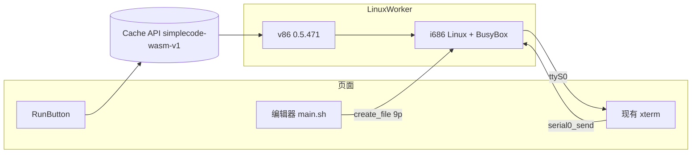

# SimpleCode 多语言扩展评估（LANGUAGES）

> 日期：2026-10-15。语言排名来源：**TIOBE Index, October 2026**（https://www.tiobe.com/tiobe-index/ ，2026-10-15 抓取）。
> 评估标准：能否在 SimpleCode 现有架构下**完全在浏览器内**运行——`@runno/wasi` 的 `WASIWorkerHost`（WASI preview1、Web Worker、SharedArrayBuffer stdin）、xterm 终端交互、COOP/COEP 隔离、资源同源本地托管（`wasm/` + Cache API）。**不允许**远程编译/执行后备（如 play.rust-lang.org）。
> 下文所有链接已于 2026-10-15 通过真实 HTTP 请求验证（均返回 200）；体积、许可证等未亲自核实的项标注 ⚠️。

---

## 0. 结论速览

| TIOBE | 语言 | 推荐方案 | 类型 | 约体积 | 许可证 | 结论 |
|---|---|---|---|---|---|---|
| 1 | Python | CPython 3.11（VMware WLR，已集成） | WASI | 24.6 MB | PSF / Apache-2.0 | ✅ 已支持 |
| 2 | C | clang 8 + wasm-ld（binji，已集成） | WASI | 52.5 MB（与 C++ 共享） | Apache-2.0 w/ LLVM exc. | ✅ 已支持 |
| 3 | C++ | 同上 | WASI | 同上 | 同上 | ✅ 已支持 |
| 4 | Java | TeaVM-javac（javac 21 + TeaVM，浏览器内编译为 Wasm） | JS/Wasm（非 WASI） | ⚠️ 约 10–30 MB | Apache-2.0（TeaVM）+ GPLv2+CPE（javac） | 🟡 可行（需适配） |
| 5 | C# | Roslyn + .NET WebAssembly（Mono）运行时（Blazor 式） | .NET wasm（非 WASI） | ⚠️ 约 20–40 MB | MIT | 🟡 可行（工作量大） |
| 6 | JavaScript / TypeScript | QuickJS（wasmedge）+ 浏览器内 Sucrase 去类型 | WASI + JS | 3.8 MB（运行时） | MIT / Apache-2.0；Sucrase MIT | ✅ 已支持 |
| 7 | Visual Basic | Roslyn VB 编译器 + .NET wasm（与 C# 共用） | .NET wasm | 与 C# 共享 +⚠️数 MB | MIT | 🟡 可行（随 C#） |
| 8 | R | webR | Emscripten | ⚠️ 约 20–40 MB 起 | GPL-2.0+（R）⚠️ | 🟡 可行（需适配） |
| 9 | SQL | SQLite 3.26（已集成） | WASI | 3.4 MB | Public Domain | ✅ 已支持 |
| 10 | Rust | rubrc（rustc+LLVM → WASI threads）/ weblings（rustc+cranelift）/ rubri（Miri） | WASI + wasi-threads | ⚠️ 100 MB–数百 MB | MIT/Apache-2.0 | 🟠 可行但代价高（实验性） |
| 11 | Go | Yaegi 0.16.1，`GOOS=wasip1`（已集成） | **WASI** | **35.0 MB**（36,736,740 B） | Apache-2.0 + Go BSD-3 | ✅ 已支持（见 §8） |
| 12 | PHP | php-cgi 8.2（已集成） | WASI | 12.5 MB | PHP License 3.01 | ✅ 已支持 |
| 13 | Fortran | LFortran（Emscripten / 直接 Wasm 后端） | Emscripten | ⚠️ 约 30–60 MB | BSD-3-Clause | 🟡 可行（需适配） |
| 14 | Swift | 无浏览器内 swiftc（SwiftWasm 只做交叉编译） | — | — | — | ❌ 不可行 |
| 15 | Scratch | 图形化积木语言，不适用于编辑器+终端模型 | — | — | — | ❌ 不适用 |
| 16 | COBOL | GnuCOBOL（cobc→C）+ 现有 clang + libcob(wasi) | WASI（需自建） | ⚠️ 未知 | GPL-3 / LGPL-3 | 🟠 理论可行，需大量自建 |
| 17 | Perl | zeroperl（Perl 5.42，WASI reactor） | WASI（reactor + EH） | ⚠️ 约 10–20 MB | Artistic/GPL；包装 ⚠️ | 🟡 可行（需 reactor 适配） |
| 18 | Julia | 仅实验（WebAssemblyCompiler.jl / julia-wasm） | — | — | MIT | ❌ 暂不可行 |
| 19 | Delphi/Object Pascal | Pas2JS 编译器（Wasm）→ JS 执行 | JS/Wasm | ⚠️ 约 5–15 MB | LGPL + 链接例外 ⚠️ | 🟡 可行（需适配） |
| 20 | MATLAB | MATLAB 闭源不可行；替代：GNU Octave（xeus-octave / emscripten-forge） | Emscripten | ⚠️ 约 50–150 MB | GPL-3.0 | 🟠 以 Octave 替代，代价高 |
| 35 | **Lua** | 自编译 Lua 5.4.9 + wasi-sdk 33（setjmp/EH） | **WASI** | **0.7 MB**（720,144 B） | MIT | ✅ 已支持，`pcall` 可用（见 §8） |

图例：✅ 已支持/可直接支持；🟡 可行（需新运行时适配器或中等工作量）；🟠 可行但代价高/实验性；❌ 不可行。

**要点**
- 现架构（WASI 命令模块 + `WASIWorkerHost`）可**零改动**接入的只有“真正的 WASI preview1 命令程序”。**Lua 5.4.9 与 Go（Yaegi wasip1）已按此接入**（§8）。Perl 仍需 reactor 适配。
- 其余（Java/C#/VB/R/Fortran/Pascal/Octave）都是 Emscripten / .NET / JS 产物，需要引入 **Runtime 适配层**（§2）。
- Rust 能做到“浏览器内编译”，但依赖 wasi-threads、体积巨大、仍属实验，建议作为后期“实验语言”。
- **Shell / Java / Rust 的 2026-10-15 复核**（体积、许可证、与 `WASIWorkerHost` 是否兼容、建议顺序）见 §9。结论：先做 Shell（WASI 命令），Java 单独评估适配器，Rust 暂缓。
- **Linux（v86 + Buildroot）** 是另一条运行时，规划见 §10（2026-10-16）。本轮只写设计，不改侧栏、不改 `docs/`。

---

## 1. 逐语言详情

### 1.1 已支持（Python / C / C++ / JavaScript / SQL / PHP）
见 `plan/DESIGN.md` §2、§6。来源：Runno `langs/`（VMware webassembly-language-runtimes、binji/wasm-clang、second-state/wasmedge-quickjs、SQLite）。
- 可选升级：VMware WLR 已发布 Python 3.12.0、PHP 8.2.6、Ruby 3.2.2（https://github.com/vmware-labs/webassembly-language-runtimes ），可替换以获得新版本（需重测 baseFS 布局）。

### 1.2 Java（#4）— 🟡（2026-10-15 复核见 §9.2）
- **TeaVM-javac**：https://github.com/konsoletyper/teavm-javac ；在线演示 https://teavm.org/playground.html （作者 2025-06 发布，javac 21 + TeaVM 打包为一个 Wasm 模块，`compiler.wasm`）。流程：`addSourceFile` → `compile()` → `generateWebAssembly({mainClass})` → 得到用户程序 wasm（TeaVM 的 Wasm GC 输出 + JS 运行时）。
- 类型：非 WASI；需在 Worker 中加载 TeaVM 运行时 JS。用户程序 `System.out` 可接到回调；**交互式 `System.in`** 需要 TeaVM classlib 支持同步读取 ⚠️（可用 SharedArrayBuffer+Atomics.wait 在 Worker 中实现阻塞读，需验证 TeaVM 的 stdin 钩子）。
- 限制：TeaVM 限制反射、类加载等；标准库子集。依赖浏览器 **Wasm GC** 支持（Chrome 119+/Firefox 120+/Safari 18.2+）⚠️。
- 备选：CheerpJ（https://cheerpj.com ，完整 JVM，但**商业许可**，且需加载其 CDN 运行时——与“本地托管”冲突）→ 不选。
- 工作量：中（新增 `teavm` 适配器 + stdin 桥接）。

### 1.3 C#（#5）与 Visual Basic（#7）— 🟡
- 方案：在 .NET WebAssembly（Mono 运行时，`dotnet/runtime` 的 browser-wasm）中运行 **Roslyn**（`Microsoft.CodeAnalysis.CSharp` / `.VisualBasic`），`CSharpCompilation.Create(..., concurrentBuild:false)` 编译到内存程序集后在同一运行时内 `Assembly.Load` 执行。参考：Blazor 内 Roslyn 编译（StackOverflow 74351536）、`ubercellogeek/blazoryn`。
- 类型：.NET wasm（自带 JS 引导 `dotnet.js`），非 WASI；需 `dotnet` 适配器。
- `Console.ReadLine` 交互：需在 Worker 中运行 .NET 并以 SAB 阻塞读重定向 `Console.In` ⚠️。
- 体积：运行时 + 裁剪后的 BCL 引用程序集 + Roslyn ≈ 20–40 MB ⚠️。许可证 MIT。
- 工作量：大（需要单独的 .NET 构建工程产出静态资源；C# 与 VB 共享运行时）。

### 1.4 R（#8）— 🟡
- **webR**：https://github.com/r-wasm/webr ，演示 https://webr.r-wasm.org/latest/ 。R 编译为 Emscripten Wasm，提供 Worker 化的 JS API，支持 SharedArrayBuffer 通道（与我们的 COOP/COEP 一致）。
- 适配：`emscripten` 适配器（或直接使用 webR 的 npm 包，在 Worker 内运行，stdout/stderr 回调到终端，`readline()` 走其 stdin 通道）。
- 体积：基础 R ≈ 数十 MB ⚠️；扩展包按需（默认从其仓库 CDN 安装 → 需本地托管或禁用）。许可证 R 为 GPL-2.0+（webR 本身 MIT？⚠️ 需核实）。
- 工作量：中。

### 1.5 Rust（#10）— 🟠 详见 §4；2026-10-15 复核见 §9.3

### 1.6 Go（#11）— ✅ 已集成（原评估 🟡）
- **Yaegi**（Go 解释器，Traefik）：https://github.com/traefik/yaegi ，Apache-2.0，纯 Go 实现，支持几乎完整的 Go 规范与标准库（反射实现）。
- 关键：Go 1.21+ 原生支持 `GOOS=wasip1 GOARCH=wasm`，编译出的就是 **WASI preview1 命令模块** → 可直接用 `WASIWorkerHost` 运行：`yaegi /program`（或自写 20 行 main：读取 `/program` 并 `interp.Eval`）。stdin/stdout 走 WASI，xterm 交互天然可用。
- 已有先例（JS/wasm 版）：LiveCodes Go(Wasm)（https://livecodes.io/docs/languages/go-wasm ）。
- 风险：Go wasip1 产物较大（标准库符号表 ⚠️ 15–40 MB），性能为解释执行；`goroutine` 在单线程 wasm 中可用（Go 运行时调度）；Go wasip1 在缺少 `poll_oneoff` 完整实现时 `time.Sleep` 可能有问题 ⚠️（@runno/wasi 已实现 poll_oneoff 的时钟订阅？需验证）。
- 工作量：小–中（构建脚本 + manifest 条目）。

### 1.7 Fortran（#13）— 🟡
- **LFortran**：https://lfortran.org ，浏览器演示 https://dev.lfortran.org/ ，JupyterLite 内核 xlfortran（Emscripten）；构建见 https://github.com/lfortran/wasm_builds 。LFortran 带**直接 Wasm 后端**：在浏览器内把 Fortran 编译成 wasm 后执行。
- 适配：`emscripten` 适配器加载编译器；生成的程序 wasm 的导入接口是 LFortran 自定义 JS 运行时 ⚠️（非 WASI），需按其 demo 实现。
- 许可证 BSD-3。成熟度：Alpha/Beta（LFortran 仍在完善 Fortran 语义）⚠️。工作量：中。

### 1.8 Swift（#14）— ❌
- SwiftWasm（https://swiftwasm.org/ ）与官方 Swift Wasm SDK 只提供**宿主机上的交叉编译**，没有可在浏览器中运行的 swiftc；swift-frontend 依赖 LLVM 且体量巨大，无人移植。第三方“MiniSwift”为非官方子集实现 ⚠️，不纳入。

### 1.9 Scratch（#15）— ❌ 不适用
- 积木式图形语言，需 scratch-gui/scratch-vm 舞台渲染，与“代码编辑器 + 终端”模型不符。可作为独立嵌入功能，不在本规划内。

### 1.10 COBOL（#16）— 🟠
- 路线：GnuCOBOL `cobc -C` 把 COBOL 翻译为 C → 用**我们现有的浏览器内 clang** 编译链接 libcob（需预先为 wasm32-wasi 交叉编译 libcob + GMP）。
- 参考：Cloudflare cobweb（https://github.com/cloudflare/cobweb ，Workers 用，Emscripten）、浏览器 PoC https://github.com/moxon6/cobol-js-emscripten （COBOL Pong）。但这些都是**宿主机预编译**；要在浏览器内编译用户代码，需把 `cobc` 本身编译为 WASI（无先例 ⚠️）。
- 工作量：大；建议仅作远期实验。

### 1.11 Perl（#17）— 🟡
- **zeroperl**：https://github.com/6over3/zeroperl （Perl 5.42，wasi-sdk 构建，产物 `zeroperl.wasm` 为 **reactor + asyncify** 模块），TS 包装 https://github.com/6over3/zeroperl-ts （npm `@6over3/zeroperl-ts`）。
- 差异：reactor（无 `_start`，导出 `eval` 等函数）+ 使用 Wasm **exception-handling**（exnref）提案——浏览器较新版本支持，wasmtime 不支持；`@runno/wasi` 的 `WASI.start` 只支持命令模块 → 需新增 `wasi-reactor` 适配器（直接用 zeroperl-ts 在 Worker 中运行，或自行实例化并调用导出）。
- 备选：WebPerl（Emscripten，Perl 5.28，较旧 ⚠️）。
- 工作量：中。

### 1.12 Julia（#18）— ❌（暂不可行）
- 仅有实验性项目：WebAssemblyCompiler.jl（https://github.com/tshort/WebAssemblyCompiler.jl ，编译 Julia 子集）、julia-wasm（https://github.com/Keno/julia-wasm ，早期移植）。完整 Julia（LLVM JIT）无法在浏览器运行。持续观察。

### 1.13 Delphi / Object Pascal（#19）— 🟡
- **Pas2JS**：Free Pascal 官方 Live-Pascal（https://live.freepascal.org/ ，源码 https://gitlab.com/freepascal.org/fpc/live-pascal ），**编译器本身以 Wasm 在 Web Worker 中运行**，把 Object Pascal 编译为 JavaScript 执行。
- 适配：`js-codegen` 适配器：编译器 wasm 生成 JS → 在隔离 Worker 中 `new Function`/模块执行 → `writeln` 接终端；`readln` 需 SAB 阻塞读 ⚠️（pas2js RTL 的 `readln` 默认基于浏览器 prompt/异步）。
- 许可证：FPC 编译器 GPL，RTL 为 LGPL+静态链接例外 ⚠️。工作量：中。

### 1.14 MATLAB（#20）— 🟠（以 Octave 替代）
- MATLAB 闭源，无可在浏览器运行的实现 → ❌。替代：**GNU Octave** Emscripten 构建，已用于 JupyterLite（xeus-octave：https://github.com/jupyter-xeus/xeus-octave ，2025 Jupyter 博客介绍）；另有 rwl/octave-wasm（Octave 7.2）⚠️。
- 体积极大（含 LAPACK/Fortran 运行时）⚠️，GPL-3。仅建议远期“Octave（MATLAB 兼容）”实验。

---

## 2. 架构改造

### 2.1 Runtime 适配器抽象
当前 `src/core/runner.ts` 直接绑定 `WASIWorkerHost`。改为：

```ts
// src/core/runtime/types.ts
export interface RuntimeIO {
  stdout(text: string): void;
  stderr(text: string): void;
  phase(p: "load" | "compile" | "link" | "run"): void;
}
export interface RunHandle {
  pushStdin(data: string): Promise<void>;
  pushEOF(): Promise<void>;
  kill(): void;
  done: Promise<RunOutcome>;
}
export interface RuntimeAdapter {
  kind: string;                                   // "wasi" | "wasi-reactor" | "emscripten" | "dotnet" | "js-codegen" | "teavm" | "v86"
  prepare?(lang: LanguageSpec, assets: AssetMap): Promise<void>; // 一次性初始化（如加载编译器）
  run(lang: LanguageSpec, code: string, io: RuntimeIO): RunHandle;
}
```
- `WasiCommandAdapter`：现有逻辑（prepare 链 + run），覆盖 Python/Ruby/QuickJS/SQLite/PHP/C/C++/Lua/Go。
- `WasiReactorAdapter`：实例化 reactor，调用约定导出（Perl）。
- `EmscriptenAdapter`：在专用 Worker 中加载 `*.js + *.wasm (+ .data)`，`Module.print/printErr` → io，`stdin` 回调走 SAB 阻塞读（R/Fortran/Octave）。
- `DotnetAdapter`、`TeaVMAdapter`、`JsCodegenAdapter`（Pascal：编译出 JS 后在沙箱 Worker 执行）。
- **统一 stdin 通道**：抽出 `StdinChannel`（SharedArrayBuffer + Atomics，与 `@runno/wasi` 协议一致：Int32 长度头 + 数据，-1 = EOF），所有 Worker 侧适配器共用；UI 层（xterm 行编辑）不变。
- **Worker 隔离**：非 WASI 运行时一律放进独立 Worker，Stop = `worker.terminate()`，与现有语义一致；COOP/COEP 下同源 Worker/Blob Worker 均可用。
- **`v86`（规划）**：完整 i686 Linux，串口接到现有 xterm，脚本经 9p 进出。不走 `WASIWorkerHost`。设计、体积和阶段见 §10。

### 2.2 Manifest schema 扩展（向后兼容，version: 2）
```jsonc
{
  "id": "go", "label": "Go", "short": "Go", "syntax": "go", "fileName": "main.go",
  "runtime": "wasi",                     // 新增：适配器类型，缺省 "wasi"
  "features": ["wasi-threads", "exception-handling", "wasm-gc"],  // 新增：浏览器能力需求，启动前检测
  "stdin": "interactive",                // interactive | batch | none
  "license": "Apache-2.0", "homepage": "https://github.com/traefik/yaegi",
  "experimental": false,
  "run": { "asset": "yaegi-wasm", "binaryName": "yaegi", "args": ["run", "{entry}"] },
  "adapterOptions": { }                  // 适配器私有配置（如 emscripten 的 locateFile 映射、dotnet 引用程序集列表）
}
```
- `assets` 增加 `kind: "bundle"`（多文件目录打包为 tar/zip，解压到 Cache/内存；如 .NET `_framework/*`、webR 的 R 库）。
- `features` 检测：`wasm-gc`/`exception-handling` 用 `WebAssembly.validate` 探测小模块；`wasi-threads` 要求 `crossOriginIsolated` + 共享内存。不满足时侧栏条目禁用并提示原因。
- 侧栏增加“实验”标记（单色，虚线描边图标）。

### 2.3 资源与构建
- `scripts/vendor-wasm.mjs` → 支持多来源：`thirdparty/runno/langs`、npm 包（`node_modules/@antonz/lua-wasi/dist/lua.wasm` 等）、`scripts/builders/<lang>/`（Dockerfile/脚本，如 Lua+wasi-sdk、Yaegi wasip1）产物、HTTP 下载（带 sha256 锁定，`scripts/sources.lock.json`）。
- 大体积运行时（Rust/Octave/.NET）**不进入默认构建**：通过 `./build.sh vendor --with rust,octave` 显式启用；部署时注意单文件大小限制（>25 MiB 的托管限制，见 DESIGN §14）。
- 第三方许可证随 manifest 生成 `LICENSES/THIRD_PARTY.md`。

---

## 3. Lua 详细集成方案（Phase 1，优先）

### 3.1 候选
| 方案 | 链接 | 类型 | 体积 | 许可证 | 备注 |
|---|---|---|---|---|---|
| A. `@antonz/lua-wasi` 5.4.6 | https://github.com/nalgeon/lua-wasi （已归档）/ npm `@antonz/lua-wasi` | WASI 命令 | 329 KB（实测） | MIT | wasienv 构建；**无 pcall/错误恢复**、语法错误信息不完整 |
| B. 自编译 Lua 5.4.7 + wasi-sdk（推荐） | 脚本参考 https://github.com/singlestore-labs/lua-wasi | WASI 命令 | 约 0.3–0.5 MB ⚠️ | MIT | 开启 wasi-sdk 的 setjmp/longjmp 支持（基于 Wasm EH，`-mllvm -wasm-enable-sjlj` + `-lsetjmp`，wasi-sdk ≥ 22 ⚠️）以恢复 `pcall`/`error` |
| C. Fengari | https://github.com/fengari-lua/fengari | 纯 JS（Lua 5.3） | ~200 KB | MIT | 需 JS 适配器；stdin 需桥接 |
| D. wasmoon | npm `wasmoon` | Emscripten | ~200 KB ⚠️ | MIT | 需 Emscripten 适配器 |

### 3.2 实测（2026-10-15，本机，现有 runner，未提交代码）
- 下载 `https://unpkg.com/@antonz/lua-wasi/dist/lua.wasm`（329,167 B，`\0asm` 魔数正确），临时加入 manifest：`run: { binaryName: "lua", args: ["{entry}"] }`。
- 测试程序：`io.read("l")` 读取 stdin、字符串拼接、table、`pcall(error)`。
- 结果：`Hello, Ada from Lua 42`、`1,4,9` **正确输出，交互式 stdin 正常**；执行到 `pcall(function() error("boom") end)` 时以**非零退出**结束（与该构建 README 所述“不支持 pcall 异常处理”一致）。
- 结论：架构零改动可用；需要**方案 B** 修复 `pcall`/`error`（Lua 的错误机制基于 `setjmp/longjmp`，wasienv 旧工具链不支持）。

### 3.3 实施步骤
1. `scripts/builders/lua/build.sh`：Docker 中下载 wasi-sdk（固定版本）与 Lua 源码（固定版本 + sha256），`make CC="clang --target=wasm32-wasi" MYCFLAGS="-DLUA_USE_POSIX? -mllvm -wasm-enable-sjlj" MYLIBS="-lsetjmp"`，去掉 `os.execute`/`io.popen`/`tmpfile` 等不可用接口（编译期宏或补丁）⚠️。
2. 产物 `lua-5.4.x.wasm` 进入 `wasm/`；manifest 条目：`syntax: "lua"`（Monaco 自带 `basic-languages/lua`），`fileName: main.lua`，`features: ["exception-handling"]`（若采用 EH 方案）。
3. 回退：若 EH 方案在某浏览器不可用，退到方案 A 并在 UI 提示“pcall 不可用”。
4. 测试：smoke 增加 Lua 用例（stdin、`pcall`、`string.format`、语法错误信息）。
- 工作量：约 0.5–1 天。

---

## 4. Rust 详细评估与方案（Phase 3，实验）

### 4.1 选项对比
| 方案 | 链接 | 原理 | 产物/执行 | 依赖 | 体积 | 成熟度 |
|---|---|---|---|---|---|---|
| R1. rubrc | https://github.com/oligamiq/rubrc | rustc（LLVM 后端）+ cargo + clang/llvm 编译为 WASI（`wasm32-wasip1-threads`），在 Worker 中运行 | 生成 `wasm32-wasip1` 可执行文件 → 我们的 `WASIWorkerHost` 可直接运行产物 | **wasi-threads**（`thread-spawn`）、共享内存、COOP/COEP；作者的 browser_wasi_shim-threads | ⚠️ 数百 MB（rustc_opt/llvm_opt 等） | 实验（作者自述 WIP，线程缺失时很慢） |
| R2. weblings | https://github.com/AngelOnFira/weblings | bjorn3 补丁版 rustc → cranelift → waffle → wasm 目标文件 → 自研链接器 | 浏览器内产出 wasm 可执行 | rustc wasm 构建（bjorn3/wasm-rustc），sysroot rlibs | ⚠️ 100+ MB | 实验 |
| R3. rubri（Miri 解释器） | https://github.com/LyonSyonII/rubri | Miri 编译到 wasm，解释执行 MIR | 解释执行，无需链接 | rustc 前端 + Miri | ⚠️ 100+ MB | 实验；运行慢，但无需 codegen/链接 |
| R4. 远程 play.rust-lang.org | — | 服务器编译 | — | 网络 | — | ❌ 违反“完全浏览器内”约束 |

基础：bjorn3 的 rustc→WASI 工作（https://github.com/bjorn3/wasm-rustc 、https://github.com/bjorn3/browser_wasi_shim 示例 `rustc.html`）。

### 4.2 与我们架构的差距
- `@runno/wasi` **不实现 wasi-threads**（无 `wasi.thread-spawn` 导入、无共享内存实例化）→ rustc/LLVM 无法在现有 `WASIWorkerHost` 中运行；需新增 `WasiThreadsAdapter`（可基于 browser_wasi_shim-threads，或给 @runno/wasi 增补：共享 `WebAssembly.Memory` + 每线程一个 Worker + `wasi_thread_start`）。
- 文件系统：rustc 需要 sysroot（std/core/alloc rlibs，数十 MB）只读挂载；@runno/wasi 的 WASIFS 是“整份复制进 Worker”，大 sysroot 传递开销大 → 需按需/共享（OPFS 或 SharedArrayBuffer 只读 FS）⚠️。
- 内存：rustc 编译 hello world 需要数百 MB–1 GB+ 线性内存 ⚠️；移动端不可用。
- 编译耗时：数秒到数十秒（取决于线程可用性）⚠️。

### 4.3 推荐路线
1. **调研原型（独立页面）**：直接集成 rubrc 的预构建 wasm 资产与其 threads shim，在 SimpleCode 中以 `rust-experimental` 适配器运行 `rustc --target wasm32-wasip1 main.rs -o /main.wasm`，产物交给现有 `WASIWorkerHost` 运行（复用 stdin/终端）。
2. 测量：首次下载体积、编译时间、内存峰值、Chrome/Firefox/Safari 兼容性。
3. 若体积/耗时不可接受 → 评估 R3（Miri）作为“教学模式”（无需 LLVM/链接，体积相对小，但执行慢）。
4. 默认构建不包含 Rust；`./build.sh vendor --with rust` 启用，UI 标记“实验”。
- 结论：**可行但代价高**；放在 Phase 3，前置条件是 Runtime 适配器与 wasi-threads 支持。

---

## 5. 分阶段路线图

| 阶段 | 内容 | 优先级 | 预估 |
|---|---|---|---|
| Phase 0 | Runtime 适配器抽象（`WasiCommandAdapter` 迁移现有 7 语言，行为不变）、manifest v2（runtime/features/license/experimental）、vendor 多来源 + sources.lock | P0 | 2–3 天 |
| Phase 1 | **Lua**（自编译 + sjlj）、**Go**（Yaegi wasip1）——均为纯 WASI，零适配器新增 | P0 | **已完成**（§8） |
| Phase 1.5 | Python/PHP/Ruby 升级到 VMware WLR 新版本（3.12 / 8.2.6 / 3.2.2） | P2 | 1 天 |
| Phase 2 | `EmscriptenAdapter` + 统一 StdinChannel → **R（webR）**、**Fortran（LFortran）**；`WasiReactorAdapter` → **Perl（zeroperl）** | P1 | 1–2 周 |
| Phase 2.5 | `TeaVMAdapter` → **Java**；`JsCodegenAdapter` → **Pascal（Pas2JS）** | P1 | 1–2 周 |
| Phase 3 | `DotnetAdapter` → **C# / VB**；`WasiThreadsAdapter` → **Rust（实验）** | P2 | 2–4 周 |
| Phase 4（远期） | Octave（MATLAB 替代）、COBOL（cobc→clang 链路）、Julia 观察 | P3 | 视情况 |
| 不做 | Swift、Scratch、MATLAB 本体 | — | — |

---

## 6. 风险
1. **体积**：Java/.NET/R/Octave/Rust 单语言数十至数百 MB；需按需下载、显式启用、服务端压缩；注意托管平台单文件限制。
2. **浏览器能力差异**：Wasm GC（TeaVM）、exception-handling/exnref（zeroperl、Lua sjlj）、wasi-threads/共享内存（Rust）在 Safari/旧版浏览器支持不一 ⚠️ → manifest `features` 探测 + 降级提示。
3. **stdin 交互**：Emscripten/.NET/TeaVM/Pas2JS 默认使用异步或 `prompt()`；统一的 SAB 阻塞读需要在其 Worker 中替换 I/O 钩子，个别运行时可能只能做“批量 stdin”⚠️。
4. **许可证**：GPL 运行时（R、Octave、GnuCOBOL、javac GPLv2+CPE）随站点分发需提供源码获取方式与许可证文本；CheerpJ 商业许可排除。
5. **维护性**：多个上游为个人/实验项目（rubrc、weblings、rubri、lua-wasi 已归档、zeroperl），需锁定版本并自建构建脚本以防上游消失。
6. **COEP 约束**：所有资源必须同源或带 CORP/CORS；上游默认从 CDN 加载（webR 包仓库、zeroperl CDN、TeaVM classlib URL）的地方都要改为本地托管。
7. **安全**：JS 代码生成类运行时（Pas2JS、TeaVM JS 运行时）执行用户生成的 JS，必须放在专用 Worker（无 DOM、可 terminate），不得在主线程 `eval`。

---

## 7. 参考链接（2026-10-15 验证，HTTP 200）
- TIOBE Index：https://www.tiobe.com/tiobe-index/
- VMware WLR：https://github.com/vmware-labs/webassembly-language-runtimes
- Lua：https://github.com/nalgeon/lua-wasi ・ https://unpkg.com/@antonz/lua-wasi/dist/lua.wasm ・ https://github.com/singlestore-labs/lua-wasi ・ https://github.com/fengari-lua/fengari
- Rust：https://github.com/oligamiq/rubrc ・ https://github.com/AngelOnFira/weblings ・ https://github.com/LyonSyonII/rubri ・ https://github.com/bjorn3/wasm-rustc ・ https://github.com/bjorn3/browser_wasi_shim
- Go：https://github.com/traefik/yaegi ・ https://livecodes.io/docs/languages/go-wasm
- Java：https://github.com/konsoletyper/teavm-javac ・ https://teavm.org/playground.html ・ https://cheerpj.com/docs/overview.html
- C#/VB：https://github.com/dotnet/runtime ・ https://github.com/ubercellogeek/blazoryn
- R：https://github.com/r-wasm/webr ・ https://webr.r-wasm.org/latest/
- Fortran：https://dev.lfortran.org/ ・ https://github.com/lfortran/wasm_builds
- Perl：https://github.com/6over3/zeroperl ・ https://github.com/6over3/zeroperl-ts
- Pascal：https://live.freepascal.org/ ・ https://gitlab.com/freepascal.org/fpc/live-pascal
- Octave：https://github.com/jupyter-xeus/xeus-octave
- COBOL：https://github.com/cloudflare/cobweb ・ https://github.com/moxon6/cobol-js-emscripten
- Julia：https://github.com/tshort/WebAssemblyCompiler.jl ・ https://github.com/Keno/julia-wasm
- Swift：https://swiftwasm.org/

---

## 8. Phase 1 实现记录（2026-10-15）

Lua、Go 与 Shell 已接入现有 `WASIWorkerHost`，没有新增 Runtime 适配器。二进制不入库；`./build.sh vendor` 按 `scripts/sources.lock.json` 下载并校验 sha256 后构建。构建机可以是 **Linux 或 macOS** 的 x86_64 / arm64（见 §8.3）。

### 8.1 Lua 5.4.9
- 脚本：`scripts/builders/lua/build.sh`。wasi-sdk **33.0**（按宿主选择压缩包，Linux x86_64 为 `0ba8b5bf…`）+ Lua **5.4.9**（`2335b6c5…`）。产物 `lua-5.4.9.wasm`，720,144 字节，sha256 `06a6f1aa34d854386f962b270720373bd5a3951aac441e22323295b720ad1adb`。
- 关键参数：`--target=wasm32-wasip1 -mllvm -wasm-enable-sjlj -mllvm -wasm-use-legacy-eh=false`，链接 `-lsetjmp`。**不定义 `LUA_USE_POSIX`**，否则 `ldo.c` 使用 `_setjmp`/`_longjmp`，LLVM 的 sjlj pass 不会改写它们，`pcall` 仍然无效。
- 实测（`@runno/wasi`，需 Wasm `exnref`）：`pcall(error)` 捕获错误并继续执行；嵌套 `pcall` 正常；语法错误输出 `lua: /program:2: unexpected symbol near <eof>` 并以退出码 1 结束；`io.read("*l")` 走 WASI stdin。
- 浏览器需要**标准** Wasm 异常处理（`try_table`，不是旧版 legacy EH）。Playwright 附带的 Chromium 156 可通过。缺少该特性的浏览器会在实例化阶段失败。
- 沙箱里没有的接口：`os.execute`（无 shell）、`io.popen`（Lua 报错）、`io.tmpfile` / `os.tmpname`（失败）、动态库加载。`os.clock` 使用 wasi-sdk 的进程时钟模拟。
- 未采用 `@antonz/lua-wasi` 5.4.6：那份预编译包在本运行器里能跑 stdin，但 `pcall` 会以非零退出结束。

### 8.2 Go（Yaegi 0.16.1，Go 1.22.12）
- 脚本：`scripts/builders/go/build.sh`。官方 Go **1.22.12**（按宿主选择压缩包，Linux x86_64 为 `4fa4f869…`），不使用系统上的 `go`。`GOOS=wasip1 GOARCH=wasm`，`-mod=readonly -buildvcs=false -trimpath -ldflags="-s -w -buildid="`，`GOTOOLCHAIN=local`。Yaegi 模块校验和在 `scripts/builders/go/go.sum`。
- 包装程序 `scripts/builders/go/main.go`：`interp.Use(stdlib.Symbols)` 后 `EvalPath` 解释 `/program`（必须是 `package main` 且含 `func main`）。manifest 参数为 `yaegi {entry}`。
- 产物 `yaegi-0.16.1.wasm`，36,736,740 字节（35.0 MB），sha256 `570999c368119300b76785385555683355fb1a474819f30c603675070ee9db7d`。同一源码在仓库内和仓库外各构建一次，摘要一致。
- 已在 `@runno/wasi` 上验证：`fmt`、`strings`、`bufio`/`os.Stdin`、`time.Now()`、向带缓冲 channel 发送的 goroutine。
- 限制：
  - 解释执行，只有标准库。没有模块下载，`import` 第三方包会失败。
  - **`time.Sleep` 不会返回。** `@runno/wasi` 的 `poll_oneoff` 对时钟订阅是忙等，和 Go wasip1 运行时的调度方式对不上；10ms 的 `Sleep` 在节点上超过 8 秒仍未结束。`time.Now()` 正常。
  - 无网络（`sock_*` 为 ENOSYS）。
  - 单文件 35 MB，超过部分静态托管的 25 MiB 上限（与 clang.wasm 同类问题）。
- 不采用 `GOOS=js`：那份产物依赖 `wasm_exec.js`，不能作为 `WASIWorkerHost` 的命令模块。Yaegi v0.16.1 的标准库符号与 Go 1.22 可以一起编译；更新 Go 大版本前需要重测符号是否仍能编译。

### 8.3 构建机：Linux 与 macOS

`scripts/builders/*.sh` 用 `uname -s` 与 `uname -m` 选择工具链（测试可设 `SIMPLECODE_UNAME_S` / `SIMPLECODE_UNAME_M`）：

| 宿主 | wasi-sdk 33.0 | Go 1.22.12 |
| --- | --- | --- |
| linux-x86_64 | `wasi-sdk-33.0-x86_64-linux.tar.gz` `0ba8b5bf…` | `go1.22.12.linux-amd64.tar.gz` `4fa4f869…` |
| linux-arm64 | `wasi-sdk-33.0-arm64-linux.tar.gz` `4f98ee73…` | `go1.22.12.linux-arm64.tar.gz` `fd017e64…` |
| darwin-arm64 | `wasi-sdk-33.0-arm64-macos.tar.gz` `85c997a2…` | `go1.22.12.darwin-arm64.tar.gz` `416c3521…` |
| darwin-x86_64 | `wasi-sdk-33.0-x86_64-macos.tar.gz` `18f3f201…` | `go1.22.12.darwin-amd64.tar.gz` `e7bbe07e…` |

脚本按 bash 3.2 编写（macOS `/bin/bash`）。校验和用 `sha256sum` 或 `shasum -a 256`，解压用 `tar -xzf`。编译 Lua 前去掉 `SDKROOT` 等变量，避免 clang 去找 Xcode SDK。Go 设置 `GOTOOLCHAIN=local`。

`outputSha256` 是 Linux x86_64 上的参考摘要。Lua 用相对路径 `-include wasi-lua.h`；Go 使用 `-trimpath -buildvcs=false -buildid=`。Go 的 wasm 在 Linux x86_64 与 Linux arm64（qemu-user 跑官方 arm64 工具链）上摘要相同，因此 `go.outputSha256ByHost` 登记了这两个宿主。四个宿主包里的 `libc.a` / `libsetjmp.a` 字节相同；darwin-x86_64 的 wasi sysroot 与 compiler-rt 也和 Linux x86_64 相同。darwin-arm64 的 `libclang_rt.builtins.a` 有 142/149 个成员不同，Apple Silicon 上编出来的 Lua 摘要可能不一样。

`outputSha256ByHost` 里登记过的宿主摘要不符则失败。还没登记的宿主（例如 darwin-arm64 的 Lua）若摘要不同，脚本打印实际摘要并保留刚编译的文件，下次 vendor 会再编一次；把该摘要写进 lock 后即可跳过。`SIMPLECODE_STRICT_WASM_DIGEST=1` 改为失败。

本地编译失败，或系统不在上表中时，下载 `prebuiltUrl` 的 wasm，sha256 必须等于 `outputSha256`。默认地址是 GitHub Release `wasi-runtimes-1` 的 `lua-5.4.9.wasm` 与 `yaegi-0.16.1.wasm`（需要发布后备用下载才会成功）：

```bash
gh release create wasi-runtimes-1 --title "WASI runtimes" wasm/lua-5.4.9.wasm wasm/yaegi-0.16.1.wasm wasm/wasi-sh.wasm
```

临时改地址：`SIMPLECODE_LUA_PREBUILT_URL`、`SIMPLECODE_GO_PREBUILT_URL`、`SIMPLECODE_SHELL_PREBUILT_URL`。`scripts/builders/self-check.sh` 检查宿主选择、校验和与失败后退回预编译文件；`SIMPLECODE_INSPECT_TOOLCHAINS=1` 会解压四个宿主的工具链并核对 ELF / Mach-O。

### 8.4 Shell（wasi-sh）

公开的 bash / BusyBox wasm 不能交给 `WASIWorkerHost`（导入了 `nimbus_proc`、`env` 或 Emscripten 胶水，见 §9.1）。因此 Shell 是本仓库的 `scripts/builders/shell/wasi-sh.c`，用 §8.3 的 wasi-sdk 33 编成 preview1 命令。脚本：`scripts/builders/shell/build.sh`。产物 `wasi-sh.wasm`，55,023 字节，sha256 `0dcaeccb81ad6ae506674171cfae935697ea2e6b5687067357bf38fd6d4e3807`（Linux x86_64，同一源码在两个目录各编一次，摘要一致）。导入只有 `wasi_snapshot_preview1`，导出 `_start` 与 `memory`。许可证 MIT。预编译备用地址与 Lua/Go 相同，文件名 `wasi-sh.wasm`（需要发布后才下载得到）。

能做的事（已在 Node `node:wasi` preview1 上跑过）：

- 内建：`echo`（`-n`）、`printf`（`%s` `%d` `%%` 和 `\n` `\t`）、`read`、`cat`、`true` / `false` / `:`、`exit`、`test` 与 `[ ]`（`-z` `-n`、字符串 `=` `!=`、整数 `-eq` `-ne` `-lt` `-le` `-gt` `-ge`）。
- 赋值 `NAME=value`，展开 `$VAR` `${VAR}` `$?` `$#` `$$`（固定为 `1`）`$0`–`$9`。单引号按字面，双引号里展开变量。
- `if` / `elif` / `else` / `fi`，`while` / `do` / `done`，`for NAME in …; do` / `done`，`;` 与换行，`&&` 与 `||`。
- 内建之间的管道（内存缓冲，左结合，例如 `echo a | cat | cat`）。重定向 `<` `>` `>>` 走 WASI 预打开的文件系统。
- 外部命令写到 stderr：`shell: NAME: external commands are not available (no fork)`，退出码 127。语法错误退出码 2。`while` / `for` 超过 100000 次会停下来。

做不到的事，因为 preview1 没有进程和管道系统调用，这个宿主也没有补：

- `fork`、`exec`、后台 `&`、真正的 OS 管道、`cd`（没有 `chdir`）、命令替换 `$(…)`、算术 `$((…))`、子 shell、通配、here-doc、函数、`source`。
- 管道右边如果是外部程序，同样是 127；左边的输出不会交给宿主去启动另一个 wasm。

### 8.5 清单跟磁盘上的文件走

`wasm/manifest.json` 不入库。`.gitignore` 忽略整个 `wasm/`。`scripts/write-manifest.mjs` 读取已经放在 `wasm/` 里的每个文件，写入它的真实 `size` 和 `sha256`。资产名和语言列表来自 `scripts/languages.config.mjs`，所以 Shell 的 `wasi-sh.wasm` 和 Lua、Go 一样写进这份清单。下面三处都会调用它：

- `./build.sh vendor` 在复制或编译结束之后。
- `./build.sh dev` 与 `./build.sh build` 在启动 Vite 之前。缺文件时才去 vendor，文件在但清单过期时只重写清单。
- Vite 插件在 dev server 启动和 `buildStart` 时再写一次，然后把 `wasm/` 拷进 `dist/wasm`。`./build.sh preview` 会再同步一次，避免预览一份旧的 `dist/wasm`。

下载时的大小检查仍对照清单里的 `size`（`src/core/wasmLoader.ts`）。清单和被提供的文件来自同一目录，所以 Apple Silicon 上 Lua 从 720144 字节变成 720592 字节不会再报「大小不匹配」。不要把清单提交回来，也不要用 `git checkout -- wasm/manifest.json` 恢复某一台机器的摘要。`tests/manifest-refresh.test.mjs` 用一份故意写错的清单确认重写后的 `size` 等于文件字节数，并确认 `wasm/manifest.json` 不在 git 索引里。

---

## 9. Java、Rust 与 Shell（2026-10-15 复核）

本节只回答三件事：有哪些浏览器内方案、和现有 `@runno/wasi` `WASIWorkerHost`（只提供 `wasi_snapshot_preview1`）能不能直接跑、建议的顺序。链接在 2026-10-15 用 HTTP 或包内清单核对过；返回非 200 的页面会单独注明。WASI preview1 是扁平的 `wasi_snapshot_preview1` 导入，没有创建进程的调用（没有 `fork` / `exec` / `pipe`）。来源：https://wasi.dev/releases/wasi-p1 （200）。

建议顺序：**Shell → Java（评估，不在本轮做适配器）→ Rust 暂缓。**

### 9.1 Shell

要接进现有侧栏，二进制必须是 WASI preview1 **命令模块**（导出 `_start`，导入只有 `wasi_snapshot_preview1`）。下面三份公开产物都不是这样：

| 产物 | 体积（实测字节） | 许可证 | 导入 | 能否用于 `WASIWorkerHost` |
|---|---|---|---|---|
| [mayflower/busybox-wasm](https://github.com/mayflower/busybox-wasm/releases/tag/v1.37.1) `v1.37.1` 的 `busybox.wasm` | 226,326；sha256 `7fc7e424188eb9edf966a74c87390b3652b726f1edec9c0e120a957127284012` | 上游 BusyBox 为 GPLv2（https://busybox.net/license.html ，200） | 模块名被压成 `a`，配套 `busybox.js`（77,468 字节） | 否。这是给 JS 胶水用的，不是 preview1 命令 |
| [@nimbus-sh/runtime-bash](https://registry.npmjs.org/@nimbus-sh/runtime-bash) `5.2.37-3` 的 `bash.async.wasm` | 3,896,320；sha256 `dcfd8bb774351e890c2b0fef70809564ea574a1c27f276f381748c2aa0d92362` | 包声明 `GPL-3.0-or-later AND GPL-2.0-only`（registry JSON，200）。GNU bash 文档：https://www.gnu.org/software/bash/manual/bash.html （200） | `wasi_snapshot_preview1` **加上** `env`（`getuid`、`dlopen` 等）和 `nimbus_proc`（`fork`、`execve`、`pipe`、`waitpid`、`dup2` 等），并导出 Asyncify 符号 | 否。实例化时缺 `nimbus_proc` / `env` |
| 同包 `coreutils/busybox.wasm`（BusyBox 1.37.0） | 293,648；sha256 `51a04c6e0fa2dad05cd4b6fc729615e7765b3bb76842ab9528916ae2eaac7475` | 同上，BusyBox 部分为 GPL-2.0-only | `wasi_snapshot_preview1` **加上** `nimbus_proc`（`chmod`、`chown` 等） | 否 |
| [agentskillmania/busybox-wasi](https://github.com/agentskillmania/busybox-wasi) | 未取二进制 | 仓库未标 SPDX | 说明文字写的是 **WASI Preview 2** | 否。Preview 2 组件不能交给 preview1 宿主 |

Nimbus 仓库：https://github.com/AshishKumar4/Nimbus （200）。这些包要的进程模型（`fork` / `exec` / 管道）正是 preview1 没有的系统调用，所以不能靠“再包一层下载”接进 `WASIWorkerHost`。

可行做法：用已有的 wasi-sdk 33（Linux / macOS、x86_64 / arm64，见 §8.3）编一个 **只导入 preview1** 的 shell 命令。内建命令在同一个 wasm 实例里跑；内建之间的管道用内存接起来。外部程序、`fork`、真正的子进程管道做不到，失败要写在终端里。许可证选 MIT（自写）比把 GPLv2 BusyBox 或 GPLv3 bash 打进站点更干净；若以后换上游 BusyBox，必须按 GPLv2 提供对应源码（https://busybox.net/license.html ）。

### 9.2 Java

| 方案 | 许可证 | 形态 | 体积 | 与 preview1 宿主 |
|---|---|---|---|---|
| [TeaVM](https://github.com/konsoletyper/teavm) + [teavm-javac](https://github.com/konsoletyper/teavm-javac) | TeaVM **Apache-2.0**（GitHub API）。自带类库，不用 OpenJDK；类库来源含 Apache Harmony、Joda-Time、jzlib（仓库 README，200）。javac 本体是 GPLv2+CPE | 浏览器里把源码编成 Wasm GC + JS 运行时。演示 https://teavm.org/playground.html （200） | 仍约 10–30 MB ⚠️（本轮没有独立称到 `compiler.wasm`） | 否。不是 `_start` 命令模块 |
| [CheerpJ 4.3](https://labs.leaningtech.com/blog/cheerpj-4.3) | 商业软件；FOSS、个人项目、一人公司可免费使用（该文，200）。自托管 CheerpJ Core 需要商业许可或技术评估，社区许可不能自托管（https://cheerpj.com/licensing/ ；本机 `curl` 对该站返回 403，条文来自同一天的页面检索） | 浏览器内 Wasm JVM + 未修改的 OpenJDK，Java 8 / 11 / 17 | 典型下载约 10–20 MB（https://labs.leaningtech.com/docs/cheerpj2/guides/Startup-time-optimization ）；有人测 BrowserCraft 首屏约 32 MB（公开讨论，未复测）⚠️ | 否。JS 库 + 按需字节区间，不是 WASI 命令 |

TeaVM 曾经有 WASI 草稿（https://github.com/konsoletyper/teavm/pull/610 ）。GitHub API：`state=closed`，`merged_at=null`，没有并进主线。草稿自己也写了类库仍要非 WASI 的宿主导入（时区、大小写、数学函数）。因此 Java **不能**零改动接上 `WASIWorkerHost`。若要做，TeaVM 的许可证和“完全在浏览器内编译”更接近本项目；CheerpJ 更完整，但自托管和商业条款与 `wasm/` 本地分发冲突。这是评估项，不是本轮实现。

### 9.3 Rust

| 方案 | 许可证 | 体积 | 与 preview1 宿主 |
|---|---|---|---|
| [weblings](https://github.com/AngelOnFira/weblings) | MIT（GitHub API） | 说明写 rustc（Cranelift）+ sysroot 约 **187 MB**（仓库 Actions 工作流注释，https://github.com/AngelOnFira/weblings ） | 否。浏览器里的整套编译器，不是一条 WASI 命令 |
| [rubrc](https://github.com/oligamiq/rubrc) | README 写 MIT OR Apache-2.0（GitHub API 的 license 字段为空） | rustc + LLVM + Cargo + clang，远大于单语言 wasm ⚠️ | 否。依赖其 `browser_wasi_shim-threads` / wasi-threads，不是 preview1 单线程宿主 |
| [rubri](https://github.com/LyonSyonII/rubri) | MIT（GitHub API）。描述：“Rust interpreter that runs in the browser!” | 解释器，无独立称重 ⚠️ | 仍是浏览器应用，不是 `_start` 命令。Miri 维护者认为编到 Wasm 不是官方支持，而且慢：https://github.com/rust-lang/miri/issues/722 （200） |

Rust 工具链的许可证（MIT / Apache-2.0）没问题，卡在体积、线程和实验状态。默认构建不收录。维持 §4 的“实验语言”，排在 Shell 和 Java 之后。

### 9.4 顺序

1. **Shell**：唯一能留在 `WASIWorkerHost` 里的。用 wasi-sdk 编 preview1 命令，内建 + 内建管道；明确没有 `fork`。
2. **Java**：下一轮评估 TeaVM 适配器（新的 JS/Wasm GC 宿主、stdin 桥、本地托管）。不选 CheerpJ 作为默认。
3. **Rust**：暂缓。不下载 100 MB 以上的实验编译器，也不为 wasi-threads 改宿主。

Shell 仍留在 `WASIWorkerHost`。要 `ls`、`cd`、管道和外部命令时走 §10 的 Linux，两门语言并存。

---

## 10. Linux：v86 + Buildroot（规划，2026-10-16）

本节只定方案。不改 `scripts/languages.config.mjs`，不往 `wasm/` 放新文件，不增加 `docs/linux/`，也不把 Linux 放进 `SHIPPED_BOOKS`。下面标了字节数的项，是 2026-10-16 对本机发出的 HTTP 响应或 GitHub contents API 的测量。镜像启动时间和我们自己的 bzImage 体积尚未测量，标为未测。

### 10.1 为什么单开一门 Linux

§8.4 的 Shell 是 `wasi-sh`：内建命令和内建之间的管道可以跑，外部程序退出 127，没有 `cd`、`fork`、`exec`。§9.1 量过三份公开的 bash / BusyBox wasm，它们带 `nimbus_proc`、Emscripten 胶水或 WASI Preview 2，`WASIWorkerHost` 实例化不了。

Linux 这一门要的是 BusyBox 用户空间：`ls`、`cd`、管道接到外部命令、脚本的退出码。那是一台 32 位客户机，不是 preview1 命令模块，所以适配器放在 `WASIWorkerHost` 旁边，kind 为 `v86`（§2.1）。Shell 保持原样。

### 10.2 v86 是什么

[copy/v86](https://github.com/copy/v86) 在浏览器里模拟一台 x86 PC：CPU 加硬件，而不是一层 Linux 系统调用。机器码先解释执行，热点页再编译成 Wasm 模块（单个函数、`brtable` 加 stackifier）。模块之间没有 Wasm 链接，主循环在模块之间切换。分页完全模拟（没有 `mmap`）。4 MB 的缓存扮演 TLB。80 位浮点走 Berkeley SoftFloat。来源：[docs/how-it-works.md](https://github.com/copy/v86/blob/master/docs/how-it-works.md)。

README 写明：Linux 可用，**64 位内核不支持**。推荐用 [Buildroot](https://buildroot.org/) 做最小镜像，并指向 [humphd/browser-vm](https://github.com/humphd/browser-vm) 和 [darin755/browser-buildroot](https://github.com/Darin755/browser-buildroot)。SkiffOS、Alpine（`tools/docker/alpine/`）、Arch Linux 32 也能跑。官网演示：[copy.sh/v86](https://copy.sh/v86/)。

许可证是 BSD-2-Clause（[LICENSE](https://github.com/copy/v86/blob/master/LICENSE)；npm `v86@0.5.471` 的 `license` 字段同为 `BSD-2-Clause`）。随仓库带入的第三方：`lib/softfloat`、`lib/zstd`、kvm-unit-tests、qemutests，以及 `src/floppy.js` 里移植自 QEMU 的 MIT 片段（README 的 License 段）。状态压缩用内置 zstd。9p / 文件系统 / UART 的思路来自 jor1k（README Credits）。

客户机侧：Linux 内核 GPL-2.0，BusyBox 在 Buildroot 2026.08 的 `package/busybox/busybox.mk` 里是 **1.38.0**，许可证 **GPL-2.0**（另有 bzip2-1.0.6）。SeaBIOS 仓库里有 `COPYING.LESSER`。镜像和 BIOS 必须在 `LICENSES/THIRD_PARTY.md` 里写明，defconfig 与 BusyBox 配置入库，以便按 GPLv2 提供对应源码。v86 自己的 BSD-2-Clause 文本随 `libv86` 一起放进 `LICENSES/`。

### 10.3 体积（2026-10-16 测量）

npm 当前版本是 **0.5.471**（`registry.npmjs.org/v86/latest`）。jsDelivr 上该版本构建产物的 `Content-Length` 或下载字节数：

| 文件 | 字节 | 角色 |
|---|---:|---|
| `build/v86.wasm` | 2,007,347 | 运行时 JIT 用的 Wasm |
| `build/v86-fallback.wasm` | 2,040,034 | 回退 Wasm，默认路径不用 |
| `build/libv86.js` | 359,839 | 浏览器脚本 |
| `build/libv86.mjs` | 359,801 | ESM，实现时用这份，动态 `import`，不进首屏包 |
| `v86.d.ts` | 24,740 | 类型，不部署 |

BIOS 来自 GitHub `copy/v86` `master` 的 contents API（与 npm 包不一定同一提交，锁定时改记 tag 上的摘要）：

| 文件 | 字节 |
|---|---:|
| `bios/seabios.bin` | 131,072 |
| `bios/vgabios.bin` | 36,352 |

官方资料表把 “Buildroot Linux” 写成 **4.9 MB**、32 位 bzImage，“Minimal Linux with Lua, ping, curl, telnet”（[index.html](https://github.com/copy/v86/blob/master/index.html) 与 [在线资料页](https://copy.sh/v86/?profile=buildroot)）。同一天 `https://i.copy.sh/buildroot-bzimage68.bin` 的 `Content-Length` 是 **10,068,480**。两数都记下来：4.9 MB 是页面上的资料标签，10,068,480 是现在这份演示内核的响应头。我们的教学镜像单独构建，体积未测，目标是去掉 Lua、curl、ping 和网络之后小于这份演示内核。

`v86.d.ts` 写明：`bios`、`initial_state`、`bzimage`、`initrd`、`multiboot`、软盘**总是同步加载**。`.zst` 状态由内置 zstd 解开。因此教学路径先用 Cache API 下完整文件，再把 `ArrayBuffer` 交给构造函数，不靠它的 URL 加载器边下边启动。

Buildroot 源码包：稳定系列 2026.08（[下载页](https://buildroot.org/download.html)，发布说明 2026-09-04）。`buildroot-2026.08.tar.xz` 的 `Content-Length` 为 6,115,596，本机下载后的 sha256 为 `87aaca4164ea9d5c8085854953018263f7963f07c22e73a2a2185cc98c581c34`。同目录的 `.sha256` 侧车文件返回 404，所以摘要以这次下载为准，写进 `scripts/sources.lock.json` 时再对一次。

### 10.4 和另外四条路

| 方案 | 做什么 | 和本项目 | 来源 |
|---|---|---|---|
| **v86 + Buildroot** | 模拟整台 32 位 PC，BusyBox 用户空间 | 选定方案。BSD-2-Clause 运行时，镜像可本地托管，能 `ls` / `cd` / 管道 | https://github.com/copy/v86 |
| **JSLinux** | Fabrice Bellard 的整机模拟。x86_64 Alpine、Windows 2000、FreeDOS、riscv64 Buildroot 等 | 同属整机模拟，是网站而不是可锁定进 `wasm/` 的库 | https://bellard.org/jslinux/ |
| **WebVM / CheerpX** | x86→Wasm JIT，加上 Linux 系统调用层（用户态）。磁盘按 HTTP Range 拉取，IndexedDB 缓存，镜像可到约 2 GB。有网络和桌面 | 能力更全，许可证是商业产品。和 §9.2 对 CheerpJ 的结论一样：不作为默认、不从 CDN 拉运行时 | [CheerpX 1.0](https://labs.leaningtech.com/blog/cx-10)、[概述](https://cheerpx.io/docs/overview)、[WebVM 2.0](https://labs.leaningtech.com/blog/webvm-20) |
| **container2wasm** | 把现成容器放进 Bochs / TinyEMU / QEMU（浏览器路径用 QEMU Wasm），支持 x86_64 与 AArch64 | 适合分发容器。WasmCon 2024 幻灯片写明：浏览器路径当时没有网络，也没有 Wizer 预初始化，冷启动因此更慢 | [仓库](https://github.com/container2wasm/container2wasm)、[幻灯片](https://static.sched.com/hosted_files/wasmcon24/dd/c2w.pdf) |
| **linux-wasm** | 把内核编译成 Wasm 架构，不模拟 CPU。NOMMU：没有 `fork`（只有 `vfork`），`mmap` 受限 | 实验端口，教不了普通 Linux 的进程和文件语义 | [joelseverin/linux-wasm](https://github.com/joelseverin/linux-wasm)、[WasmLinux 笔记](https://zenn.dev/okuoku/articles/89a96bcee4cc93) |

2026-10-16 检索公开网页时，没有找到一篇能打开原文、又带启动时间或体积数字的 X 帖。启动时间的公开叙述用 Simon Willison 的工具页和博客（§10.6）。

### 10.5 镜像怎么构建

产物是一颗 **i686** bzImage（initramfs 打在里面）加上空的 9p 目录，不单独发布 initrd。内核必须是 32 位。

钉死的版本：

- Buildroot **2026.08**，源码包摘要见 §10.3。
- BusyBox **1.38.0**，取自该 tag 的 `package/busybox/busybox.mk`（https://gitlab.com/buildroot.org/buildroot/-/raw/2026.08/package/busybox/busybox.mk）。
- v86 **0.5.471** 的 `libv86.mjs` 与 `v86.wasm`。
- 内核版本在 `scripts/builders/linux/` 的 defconfig 里写死一条 i686 配置（2026.08 的发布说明包含 6.12 与 6.1 等系列，[LWN](https://lwn.net/Articles/1092913/)）。具体小版本在第一次成功构建时写入 `sources.lock.json`，本节不预填。

客户机配置（提交到仓库，不生成进 git 的二进制）：

- `BR2_i386=y`，静态 BusyBox，有 `sh`、`ls`、`cd` 所用的 shell 内建、`mkdir`、`cp`、`mv`、`rm`、`cat`、`chmod`、`grep`、`ps`、`echo`、`pwd`。
- 没有包管理器、没有网络工具、没有编译器、没有完整 vim。
- 内核打开 9p 所需的选项，使下面这条挂载成立（命令来自 [docs/filesystem.md](https://github.com/copy/v86/blob/master/docs/filesystem.md)）：`mount -t 9p -o trans=virtio,version=9p2000.L host9p /mnt/host`。计划中的配置片段：`CONFIG_NET_9P`、`CONFIG_NET_9P_VIRTIO`、`CONFIG_VIRTIO`、`CONFIG_VIRTIO_PCI`、`CONFIG_9P_FS`。
- `/etc/fstab` 在启动时挂上 `/mnt/host`。`/etc/inittab` 在 `ttyS0` 上自动登录 root（v86 Alpine 示例是 `agetty --autologin root -s ttyS0`，见 [讨论 #1046](https://github.com/copy/v86/discussions/1046)）。
- 内核命令行：`console=ttyS0 quiet`。串口是唯一控制台，启动横幅不灌进 xterm。
- 不设置 `network_relay_url`。镜像里可以有 `ping` 二进制也不去配网卡。

构建在 Linux 上原生进行，或在任何宿主上用 Linux 容器跑同一份脚本。macOS 不在本机跑 Buildroot：`uname` 为 Darwin 时走 Docker；没有 Docker 时下载 `prebuiltUrl` 并核对 sha256，和 §8.3 的 Lua / Go / Shell 同一模式。脚本保持 bash 3.2（`sha256sum` 或 `shasum -a 256`，不用 bash 4 语法）。两次构建的 bzImage 摘要必须相同，写进 `scripts/sources.lock.json`。二进制不入库。`./build.sh vendor` 结束后由 `scripts/write-manifest.mjs` 按磁盘文件重写 `wasm/manifest.json`。

步骤（实现时放进 `scripts/builders/linux/build.sh`，本轮不执行）：

```bash
curl -fsSL -o buildroot-2026.08.tar.xz https://buildroot.org/downloads/buildroot-2026.08.tar.xz
echo "87aaca4164ea9d5c8085854953018263f7963f07c22e73a2a2185cc98c581c34  buildroot-2026.08.tar.xz" | sha256sum -c
tar -xf buildroot-2026.08.tar.xz
# 树外构建：make O=../out BR2_EXTERNAL=../external simplecode_defconfig && make
# 产物：bzImage。用 v86 0.5.471 启动到串口提示符，save_state，再压成 .zst
```

### 10.6 启动、快照、9p、串口

`memory_size` 必须是 2 的幂。`v86.d.ts` 的默认值是 64 MiB，示例注释里出现过 16 MiB；`vga_memory_size` 默认 8 MiB。教学机先用 **32 MiB** 内存和 **2 MiB** 显存（[examples/save_restore.html](https://github.com/copy/v86/blob/master/examples/save_restore.html) 用 32 MiB / 2 MiB VGA；[Simon Willison 的页面](https://github.com/simonw/tools/blob/main/v86.html) 用 64 MiB / 2 MiB）。界面不显示 VGA 画布。冷启动仍带 SeaBIOS 和 VGA BIOS，因为官方串口示例两者都传了（[examples/serial.html](https://github.com/copy/v86/blob/master/examples/serial.html)）。

冷启动时间：Simon Willison 的工具写 “typically 10-30 seconds depending on your connection and device”（[工具页](https://tools.simonwillison.net/v86)，[2026-01-06 的说明](https://simonwillison.net/2026/Jan/6/v86/)）。他 2026-03 的研究笔记描述的是 Buildroot 2024.05.2、约 39 MB RAM、BusyBox、Lua 5.4.6，并且没有配网络中继（[研究列表](https://simonwillison.net/elsewhere/research/)）。这是别人的镜像和机器，我们的镜像未测。

快照用来跳过这段冷启动。`save_state()` 返回整个模拟器状态的 `ArrayBuffer`（CPU、内存、设备）。`restore_state` / `initial_state` 要求构造参数与保存时一致；**状态格式会随 v86 版本变化**（`v86.d.ts` 对 `restore_state` 的说明）。维护者在[讨论 #855](https://github.com/copy/v86/discussions/855) 里确认：从状态恢复时不再使用 BIOS。流程是构建机冷启动一次，等到 `ttyS0` 上出现 shell 提示符，调用 `save_state`，用 zstd 压成 `linux-state.zst`，和 bzImage 一起钉摘要。运行时优先 `initial_state`。v86 升级必须重做快照。快照体积未测；32 MiB 内存的未压缩状态会落在同一数量级，页面上只放压缩后的文件。

9p 是脚本进出的通道。`filesystem` 省略 `basefs` / `baseurl` 时得到空的 9p（filesystem.md）。构造之后：

- `create_file("/main.sh", bytes)` 把编辑器或文档块写进客户机的 `/mnt/host/main.sh`。
- 有 stdin 时再写 `/mnt/host/stdin.bin`。
- `read_file` 只在需要把客户机写回的文件交给检查时使用。文档运行的标准输出走串口，不走这个读回。

`handle9p` 自定义服务器不会提供 `create_file`，也不随快照自动对齐（filesystem.md）。教学路径用内置空 9p，不用 WebSocket 代理。

串口接到**已经存在的** xterm（`src/core/terminal.ts`），不在页面上再挂一个终端。v86 0.5.471 的 `serial_console.type` 可以是 `textarea`、`xtermjs` 或 `none`，也有 `set_serial_container_xtermjs`。我们的 xterm 还要服务 Python、C、Shell，所以用编程接口：`serial0-output-byte` 写入 xterm，xterm 的 `onData` 调用 `serial0_send`。`serial_console.type = "none"`，不把 v86 自带的 xterm 装进 DOM。交互行编辑仍由现有终端负责（DESIGN §9）。

退出码。v86 没有“进程退出码”回调，客户机把码打到串口：

```sh
sh /mnt/host/main.sh < /mnt/host/stdin.bin
echo __SC_EXIT:$?
```

适配器在串口流里认出最后一行 `__SC_EXIT:`，把数字交给现有的 `RunOutcome.exitCode`，并从终端文本里去掉这行哨兵。脚本的标准输入来自文件，避免和这一行命令抢串口。没有 stdin 的块用空文件，相当于 EOF。超时或 Stop 则 `worker.terminate()`，结果为 `terminated`。

每次文档 Run 都 `new` 一个带同一份 `initial_state` 和空 9p 的实例，跑完销毁。这样上一次的 `cd` 和 `/mnt/host` 文件不会留到下一次。操场上的交互终端是另一条寿命：切到 Linux 后保持这一台，直到 Stop、换语言或再次从文档 Run（文档 Run 仍用新实例，避免把读者的主目录写脏）。脚本里的 `cd` 只影响该脚本；要看目录变化，示例写成 `cd /tmp && pwd`。人在终端里敲的 `cd` 留在这台交互虚拟机里。

### 10.7 页面上的位置

```
┌ 侧栏 ────────┬ 工具栏：Run（h-7）·「Linux 快速入门」─────────────┐
│ Linux   Lx   │ 编辑器 main.sh（Monaco shell 高亮）                │
│ （折叠仅图标）├──────────────────────────────────────────────────┤
│              │ xterm                                            │
│ 底部：缓存   │   $ ls / | head                                  │
│ 清除、主题   │   bin                                            │
│ 折叠         │   exit 0                                         │
└──────────────┴──────────────────────────────────────────────────┘
        文档 Run                         交互终端
             │                                │
             ▼                                ▼
      新 V86 + initial_state            已启动的同一台
      create_file(main.sh)             serial0_send(按键)
      serial0_send(包装命令)            serial0-output-byte → xterm
      解析 __SC_EXIT:
```



### 10.8 接进现有代码的位置

实现时才改这些文件。本轮一个都不动。

| 位置 | 做什么 |
|---|---|
| `scripts/languages.config.mjs` | 增加 `id: "linux"`，`label: "Linux"`，`short: "Lx"`，`syntax: "shell"`，`fileName: "main.sh"`。资产是一组文件（`libv86.mjs`、`v86.wasm`、`seabios.bin`、`vgabios.bin`、bzImage、`linux-state.zst`），没有 `run.asset` 那种 WASI 命令 |
| `scripts/sources.lock.json` | 钉 Buildroot 2026.08、BusyBox 1.38.0、v86 0.5.471、BIOS 与产物的 sha256。宿主差异走 `prebuiltUrl`，和 Lua 一样允许 Apple Silicon 的构建机差异，但镜像摘要必须全平台一致（构建发生在 Linux 容器里） |
| `scripts/builders/linux/build.sh` | 上面的可重复构建。`scripts/vendor-wasm.mjs` 在 `./build.sh vendor` 时调用它 |
| `scripts/write-manifest.mjs` | 仍从磁盘写 `size` 和 `sha256`。`wasm/manifest.json` 继续 gitignore |
| `src/core/runner.ts` | 今天 `RunSession` 只 `new WASIWorkerHost`。Linux 走旁边的 `V86Session`：同样的 `stdout` / `stderr` / `phase` / `kill` / `done`。标准输入不走那条 8 KB `SharedArrayBuffer` |
| `src/core/wasmLoader.ts` | `CACHE_NAME` 仍是 `simplecode-wasm-v1`，键带 sha256 前缀。Linux 的多个文件在第一次点 Run 时下载，带现有进度条。不进首屏 JS |
| `src/core/terminal.ts` | 复用同一 xterm。Linux 运行期间字节来自串口 |
| `src/docs/runtime.ts` | 成书时再加 book id `linux`、围栏语言 `linux`、`BOOK_LABEL`「Linux」。`sh` / `bash` 继续映射到 Shell（wasi-sh）。在这之前把 `ls` 放进 `sh` 围栏会在 docs-smoke 里得到退出码 127 |
| `LICENSES/THIRD_PARTY.md` | v86 BSD-2-Clause、SeaBIOS、Linux、BusyBox GPL-2.0，并指向可重建的 defconfig |

侧栏文案是 **Linux**。折叠后只剩图标 **Lx**，缓存、清除、主题、折叠仍在底部（DESIGN §11，PR #1）。Run 继续用 `RunButton`（`size="xs"`，高 28px，文案 `Run`）。文档抽屉的 `top` 保持 `var(--editor-toolbar-h)`，不盖住工具栏。界面仍是黑白；Monaco 的 shell 语法色是唯一例外。终端字体继续用 `JetBrains Mono` 加 `SimpleCode CJK`（`size-adjust: 120%`），中文占两格。

### 10.9 COOP/COEP、缓存、内存、手机

页面已经为 `WASIWorkerHost` 发送 `Cross-Origin-Opener-Policy: same-origin` 和 `Cross-Origin-Embedder-Policy: require-corp`（DESIGN §8）。`IsolationGuard` 在 `crossOriginIsolated` 为假时挡住 Run。v86 的基本串口示例不分配 `SharedArrayBuffer`；同一页仍保持隔离，因为别的语言需要它。

COEP 下跨源脚本需要 CORP 或 CORS。v86 的 wasm 和脚本**从本站 `wasm/` 提供**，和现有运行时一样，不从 jsDelivr 或 copy.sh 加载。Worker 同源。字体已经本地化（`src/style.css`）。

缓存：每个文件第一次使用时下载，`src/core/wasmLoader.ts` 用清单里的 `size` 核对字节数，不匹配就失败。侧栏「清除」删掉 `simplecode-wasm-v1`，Linux 文件一起消失。清单不提交，避免 Mac 上的体积差和 `git pull` 冲突（§8.5）。

内存：客户机 32 MiB（2 的幂）加 2 MiB VGA，加上约 2 MB 的 `v86.wasm` 和尚未称重的 bzImage、压缩快照。JIT 还会按热点页再分配模块（how-it-works.md：模块太多时浏览器内存会涨，`MAX_PAGES` 因此偏低）。手机上这组数字可能顶到标签页上限。第一版把手机标为未测：串口控制台、小内存、快照恢复、不画 VGA。验收不要求手机在本轮通过。

### 10.10 界面行为

选中 Linux 之后，编辑器是 `main.sh`，终端是这台机器的 shell。读者可以输入 `ls`、`cd`、`pwd`，也可以 `ls / | head`。BusyBox 的外部 applet 能被管道接上。Stop 销毁 Worker。

文档块和工具栏 Run 把缓冲区当成脚本跑完，并在按钮旁显示退出码，和其他语言相同。交互终端里已经 `cd` 过的目录不影响下一次文档 Run。

### 10.11 风险

| 风险 | 处理 |
|---|---|
| 冷启动 10–30 秒（他人测量） | 发布 `initial_state`；v86 升级就重做快照 |
| 状态格式绑定 v86 版本 | `sources.lock.json` 同时钉 v86 与 `linux-state.zst` |
| bzImage / BIOS 在构造时同步读入 | 先下到缓存再构造 |
| 9p 与快照不一致 | 每次文档 Run 用新实例和空 9p |
| 哨兵字符串出现在脚本输出里 | 只认末行的 `__SC_EXIT:`；脚本正文里的同名字符串原样显示 |
| BusyBox 与 GNU 的 `ls` / `ps` 输出不同 | 教程的 `expect` 按 BusyBox 写，并在章内说明 |
| GPL 客户机 | defconfig 入库，`THIRD_PARTY.md` 记录版本与源码包地址 |
| 手机内存 | 32 MiB 客户机；手机验收单列，未测前不承诺 |
| 网络、`apt`、`yum`、`ssh`、改密码、装 vim | 教程标 `norun`。默认不配 `network_relay_url` |
| 串口在启动时很慢 | `quiet`，快照取在提示符出现之后 |
| COEP 误用 CDN | 审查时禁止 `libv86` 的跨源 URL |

### 10.12 验收（实现完成时，不是本轮）

1. 侧栏有 Linux。下载只在第一次 Run 发生，进度可见，刷新后 Cache API 命中，字节数与清单一致。
2. 交互终端里 `ls`、`cd`、`pwd`、管道到 BusyBox 命令有输出；`cd` 在这台交互机里保持到 Stop。
3. 文档 Run 执行脚本，退出码等于哨兵。带 `stdin` 的块从 9p 文件读入。连续两次 Run 看不到对方创建的文件。
4. Stop 在启动和运行中都能结束，终端可再次 Run。
5. 页面仍要求 COOP/COEP；Linux 资源全部同源。现有十门语言的 `./build.sh test` 保持通过。
6. `./build.sh vendor` 在 Linux 上打出锁定的 bzImage；Darwin 通过 Docker 或预编译文件得到同一摘要。
7. 快照恢复后出现 shell 提示符。冷启动秒数和快照秒数记进本节，替换「未测」。
8. 成书后 `linux` 围栏进入 docs-smoke；`sh` 围栏仍只跑 wasi-sh。

### 10.13 阶段

不估日历。每一阶段的产物如下，做完再开下一阶段。

1. **钉版本。** 把 §10.3 的 v86 与 Buildroot 摘要写进 lock。单独 HTML 用本地文件启动 `i.copy.sh` 那颗演示内核的拷贝（先称重再锁定），串口打出 `uname`。不进侧栏。
2. **自己的镜像。** `scripts/builders/linux/` 在 Linux 与 macOS（Docker 或预编译）上打出同一 sha256 的 i686 bzImage，BusyBox 1.38.0，9p 挂到 `/mnt/host`，`ttyS0` 自动登录，无网络。
3. **快照。** 提示符出现后 `save_state`，压缩，用 `initial_state` 恢复。记录冷启动和恢复的秒数。
4. **脚本与退出码。** `create_file`、stdin 文件、`__SC_EXIT:`。两次运行互不可见。
5. **接进应用。** `V86Session` 与 `RunSession` 并列，侧栏、Cache API、现有 xterm、Run 按钮。hello-world 冒烟：`echo hello && ls /mnt/host`。
6. **书。** 按 `plan/LEARN.md` §20 写 `docs/linux/`，围栏语言 `linux`，docs-smoke 通过。`sh` 仍是 Shell。

### 10.14 来源

2026-10-16 打开或测量过的页面：

- https://github.com/copy/v86 （README、LICENSE、`docs/how-it-works.md`、`docs/filesystem.md`、`examples/serial.html`、`examples/save_restore.html`、`bios/` contents API）
- https://www.npmjs.com/package/v86 对应 registry 版本 0.5.471；jsDelivr 上 `v86.wasm`、`libv86.js`、`libv86.mjs` 的字节数
- https://copy.sh/v86/ 与资料页 `?profile=buildroot`；https://i.copy.sh/buildroot-bzimage68.bin 的 `Content-Length`
- https://github.com/copy/v86/discussions/855 （恢复状态时不用 BIOS）
- https://github.com/copy/v86/discussions/1046 （串口提示符后 `save_state`，`ttyS0` 自动登录）
- https://buildroot.org/download.html 与 `buildroot-2026.08.tar.xz`；https://gitlab.com/buildroot.org/buildroot/-/raw/2026.08/package/busybox/busybox.mk
- https://lwn.net/Articles/1092913/
- https://tools.simonwillison.net/v86 与 https://simonwillison.net/2026/Jan/6/v86/ 与 https://simonwillison.net/elsewhere/research/
- https://bellard.org/jslinux/
- https://labs.leaningtech.com/blog/cx-10 、https://labs.leaningtech.com/blog/webvm-20 、https://cheerpx.io/docs/overview
- https://github.com/container2wasm/container2wasm 与 https://static.sched.com/hosted_files/wasmcon24/dd/c2w.pdf
- https://github.com/joelseverin/linux-wasm 与 https://zenn.dev/okuoku/articles/89a96bcee4cc93
- https://www.runoob.com/linux/linux-tutorial.html （书的目录见 LEARN §20）

---

## 11. Rust 在浏览器里怎么跑（调研，2026-10-16）

本节只做调研。不改 `scripts/languages.config.mjs`，不往 `wasm/` 放文件，也不写 `docs/`。§1.5、§4、§9.3 保持原样；§10 的 Linux 方案也不改。下面凡是写了字节数的，都是 2026-10-16 的 HTTP 响应头、GitHub Release API 的 `size`，或本机编译产物。作者自己的耗时只当引用，不写成我们测过。

要接进今天的 `WASIWorkerHost`，模块必须导出 `_start`，导入只有 `wasi_snapshot_preview1`（`AGENTS.md`）。`@runno/wasi` 没有 `wasi.thread-spawn`，也没有共享内存。COOP/COEP 已经开着，那只解决 `SharedArrayBuffer`，不给 rustc 补进程或线程。

### 11.1 对比

| 方案 | 许可证 | 压缩下载（实测或发布资产） | 启动 / 编译 | `std` | 能接受多少真 Rust | 维护（GitHub `pushed_at`） | 进 `WASIWorkerHost` |
|---|---|---|---|---|---|---|---|
| **weblings**（Cranelift rustc） | MIT（API） | Release `artifacts-test-7` 共 **95,941,921** 字节 zstd。`rustc-wasm.tar.zst` 17,206,482；`std-sysroot.tar.zst` 34,472,965；`wasip1-sysroot.tar.zst` 43,403,178；`riscv64-sysroot.tar.zst` 858,946；`SHA256SUMS` 350 | 作者在公开帖里写小程序大多 **&lt;100ms**（本机打开帖子 JSON 返回 403，没有复测）。README 写 Cranelift 比 LLVM 快，但是「没有测过」 | 有，随 `std-sysroot` | 真 rustc。缺 LLVM 后端才有的部分未逐项测 | 仓库 2026-07-25；产物 2026-07-22 | 编译器不是 preview1 命令。**产物**若只导入 preview1，运行段可以交给现有宿主。导入表还没在本机打开 |
| **rubrc**（LLVM rustc + Cargo） | README 写 MIT OR Apache-2.0。API 的 license 字段是空的（根目录没有被识别的 LICENSE） | `oligamiq/rust_wasm` `v0.2.1-release`（2026-08-29）：`rustc_opt.wasm.br` **19,774,341**；`llvm_opt.wasm.br` **20,794,577**；`wasm32-wasip1.tar.br` **18,933,366**。三者合计 59,502,284。该 Release 的资产名里没有 cargo / lsp | 作者写某一工作流从约 61s 降到 12s（`RELEASE.md`，2026-07-20）。不是本机数字 | 有，目标 sysroot 是单独的 tar | 真 rustc。`wasm32-wasip1` 与 `x86_64-unknown-linux-musl` 能链接。无 crates.io、无过程宏 | **2026-10-15**。README 标明 v2 预发布，单人维护 | 否。要 `browser_wasi_shim-threads` 和共享内存，不是一条 preview1 命令 |
| bjorn3 `wasm-rustc` + `browser_wasi_shim` | shim 为 Apache-2.0 OR MIT。`wasm-rustc` 仓库 API 无许可证 | 本轮没有称到 demo 里的 `rustc.wasm` | `examples/rustc.html` 写明：没有外部进程，rustc 没有内置链接器，demo 会在链接前失败 | 页面列出一批 rlib | 补丁版 rustc，`wasm32-wasip1-threads` | wasm-rustc **2024-04-11**；shim **2026-02-03** | 否。示例还要 `wasi` 的 `thread-spawn` 和共享 `Memory` |
| **rubri**（Miri） | MIT | Release `1.78-dev`（2024-09-07）27 个文件共 **109,087,810** 字节，最大的是 `libcore` 46,461,066 和 `libstd` 13,351,706。资产列表里没有 `.wasm` | README：关了 UB 检查仍慢；2000 次打印要 2–3 秒 | 解释 MIR，不是链接后的 std 二进制 | 真前端，无多文件、无 crates、README 写没有 I/O | 仓库 2025-11-19。Miri 本体 2026-10-15，但 [issue 722](https://github.com/rust-lang/miri/issues/722) 仍 open（更新 2026-02-24）：官方不支持编到 Wasm，而且慢 | 否。浏览器包装，不是 `_start` 命令 |
| `rustc_codegen_cranelift` | Apache-2.0 | 它是 rustc 的代码生成插件，不是独立下载。猜的 preview 压缩包 URL 返回 404，体积不记 | 要跟着 rustc 跑 | 取决于外面的 rustc | 真后端，不读源码 | 2026-10-14 | 不适用。weblings 才是把它放进 Wasm 的那一层 |
| rust-analyzer | Apache-2.0 或 MIT（仓库 Apache-2.0） | nightly（2026-10-16）18 个资产，**没有 wasm**。`rust-analyzer-x86_64-unknown-linux-gnu.gz` 15,063,869 | 不编译、不运行用户程序 | 分析用，历史讨论里的 wasm demo 没有 std（playground issue 357，未复测那份 7MiB） | 只做前端诊断 | 2026-10-16 | 否 |
| evcxr | Cargo.toml 为 MIT OR Apache-2.0（API 字段是 `NOASSERTION`） | 无 wasm 发布 | 本机调 rustc | 全 | 全，因为它就是调用 rustc | 2026-10-14 | 否。不是 Wasm |
| **subrust** | MIT OR Apache-2.0 | 源码 crate 185,883。本机 `rustc 1.83.0`、`--release --target wasm32-wasip1`：**2,690,926** 字节 wasm，gzip -9 **150,652**。sha256 `3c2bf8bd36c949c1b8e5dbe2f97d7fff750645c97d6b4371ab6e0c00bebdc0af` | 实例化这一份 2.6MB。`node:wasi` 上 `print_u64(6*7)` 退出码 0，标准输出 `42\n`。没有在浏览器里另计时 | **没有**堆和 `std`。输出走宿主函数 `print_u64` 等 | 严格子集。`println!` 报 `error[S032D]: unknown macro`，退出码 1。无闭包、泛型、trait、堆、`async`、`unsafe` | 0.1.1，仓库 2026-07-18，14 star，crates.io 近期下载 13 | **能**。导入只有 `wasi_snapshot_preview1`，导出 `_start` |
| Rhai 1.26.1 | MIT OR Apache-2.0 | 源码 crate **501,003**（2026-09-10）。没有称 wasm | 未编 wasm | 动态类型，不是 Rust `std` | 不是 Rust | 仓库 2026-10-13 | 库能编到 preview1，但那是另一门语言 |
| Rune 0.14.2 | MIT OR Apache-2.0 | 源码 crate **2,771,441**（2026-05-22） | 未编 wasm | 动态语言，自带 VM | 语法像 Rust，不是 rustc 能编的程序 | 2026-10-11 | 同 Rhai，不能当成 Rust |
| v86 里跑官方 rustc | rustc / cargo 为 MIT OR Apache-2.0；内核与 BusyBox 见 §10 | 稳定版清单日期 **2026-10-15**，Rust **1.99.1**。`i686-unknown-linux-gnu`：整包 `rust-*.tar.xz` **299,622,536**；`rustc` **104,959,116**；`rust-std` **30,051,452**；`cargo` **12,846,540**。三者合计 147,857,108，还没算镜像里的 libc | **未测**。§10.2：v86 不跑 64 位内核，所以只能用这份 i686 宿主。解释执行再叠加 rustc，交互式 hello 不现实 | 全 | 全 | 官方工具链，当天有包 | 否。客户机是 PC，不是 preview1 命令 |
| Playground API | 服务端是 rustc（MIT OR Apache-2.0）。不是本仓库要分发的二进制 | 浏览器不下载编译器 | 本机 `POST /execute`：墙钟 **1.42s**，响应里 `Finished … in 0.40s`，`stdout` 为 `Hello from Rust 42` | 全，外加 `/meta/crates` 的 **490** 个 crate | 全（stable / edition 2024 已打通） | playground 仓库 2026-10-14 | 否。代码离开浏览器 |

`itszzl-sudo/rust-wasm-web-ide` 自称解释器 wasm 69KB，1 star，API 无许可证，没有打开那份 wasm，不进入上表。`mrustc`（MIT，2026-10-13）是 C++ 写的另一套编译器，没有找到浏览器构建。`rphle/tzap` 的 README 写的是队列语言，不是 Rust。

### 11.2 真编译器

**weblings**（https://github.com/AngelOnFira/weblings ，演示 https://weblings.forest-anderson.ca/ 返回 200）把补丁版 rustc 编成 Wasm，后端是 Cranelift：CLIF → [waffle](https://github.com/bytecodealliance/waffle) → wasm 目标文件 → 自带链接器。钉死的产物在 https://github.com/AngelOnFira/wasm-rustc/releases/tag/artifacts-test-7 ，`artifacts.lock` 里有 sha256。演示页当天停在 “Downloading the Rust toolchain”，本机没有把整套工具链下进浏览器再编一次。作者在 https://www.reddit.com/r/rust/comments/1v4pfv6/rust_compilation_in_the_browser_with_wasm/ 写小程序的编译、链接、执行大多不到 100ms；本机取该帖 JSON 得到 403，所以这句只当作者声称。

**rubrc**（https://github.com/oligamiq/rubrc ，演示 https://rubrc.pages.dev/ 返回 200）走 LLVM。`rustc`、`llvm`、Cargo、`rust-analyzer` 是多份 Wasm，由 `wasi_virt_layer` 在 Worker 里调度，不是操作系统进程。README 写明需要 COOP/COEP，外部依赖和过程宏不行，命令偶发把会话打坏。预编译文件的说明在 https://github.com/oligamiq/rust_wasm 。`v0.2.1-release` 把大于 20MB 的文件在 Cloudflare Pages 上拆开；GitHub Release 上是完整的 `.br`。

**bjorn3** 的 https://github.com/bjorn3/wasm-rustc 和 https://github.com/bjorn3/browser_wasi_shim 是上面两套的地基。shim 的 README 写 preview1 只实现了一个子集。`examples/rustc.html` 自己创建共享 `Memory`，并提供 `wasi.thread-spawn`。这和 `WASIWorkerHost` 的实例化方式不是同一个对象。

Cranelift 仓库 https://github.com/rust-lang/rustc_codegen_cranelift 只是后端。单独把它放进 Wasm 并不能读 `.rs`。浏览器里的 Cranelift 路径就是 weblings。

### 11.3 解释器

官方解释器是 Miri（https://github.com/rust-lang/miri ，Apache-2.0）。它解释 MIR，用来查未定义行为，不是 REPL。issue 722 里维护者写：编到 Wasm 不是官方支持的目标；Miri 很慢，不适合拿来跑程序。rubri（https://github.com/LyonSyonII/rubri ，https://garriga.dev/rubri/ 返回 200）关掉了检查，README 仍把 2000 次打印写成 2–3 秒，并且没有 I/O 和 crates。发布的是 rlib，不是一条可以丢给 `WASIWorkerHost` 的命令。

**subrust**（https://github.com/orbitalhigh/subrust ，crate 0.1.1）是本轮唯一测通的 preview1 命令。库是 `no_std`、无分配、无依赖；命令行 `subrust run <file.rs>` 用 std 读文件。本机命令：

```text
rustc 1.83.0 (90b35a623 2024-11-26)
cargo build --release --target wasm32-wasip1
```

稳定版已经是 1.99.1，换编译器后字节数可能变。接受的程序必须也能被 rustc 编译并得到同一结果（README 的 L1/L2），所以它是 Rust 的子集，不是另一种语法。用户能写的是整数、`bool`、`f64`、函数、`if` / `while`、结构体、定长数组、无字段的 `enum` 和穷尽的 `match`、`assert!`。没有 `Vec`、`String`、`println!`、trait、闭包、堆。默认 `run` 的宿主 API 叫 `test`，打印用 `print_u64`。这够做沙箱脚本，不够做一门叫 Rust 的课。

Rhai（https://github.com/rhaiscript/rhai）和 Rune（https://github.com/rune-rs/rune）是嵌入式动态语言。Rhai 接近 JS；Rune 的块和作用域看起来像 Rust。两边都过不了 `rustc`。拿它们标成 Rust，侧栏会名不副实。

evcxr（https://github.com/evcxr/evcxr）是本机求值器，内部还是启动 rustc。没有 Wasm 形态。

### 11.4 不放进浏览器的两条

**v86。** §10 已经选定 v86 跑 32 位 BusyBox，并且写明 64 位内核不支持。官方仍提供 `i686-unknown-linux-gnu` 的 rustc 1.99.1，所以「客户机里装一个编译器」在包装上说得通，体积上说不通：光 `rustc` + `rust-std` + `cargo` 的 xz 就是 148MB，整包 rust xz 是 299,622,536 字节，解开后更大。v86 先解释 x86，热点页再编成 Wasm（https://github.com/copy/v86/blob/master/docs/how-it-works.md ）。rustc 自己就要数百 MB 到 1GB 级内存（§4.2）。两层叠在一起，不作为 Rust 的路径。Linux 继续按 §10 做 Shell 的外部命令，不在镜像里塞 rustc。

**Playground。** `POST https://play.rust-lang.org/execute`，正文是 `channel` / `mode` / `edition` / `crateType` / `tests` / `backtrace` / `code`。当天请求：

```json
{"channel":"stable","mode":"debug","edition":"2024","crateType":"bin","tests":false,"backtrace":false,"code":"fn main(){ println!(\"Hello from Rust {}\", 6*7); }\n"}
```

响应 200，255 字节，`success: true`，标准输出 `Hello from Rust 42\n`。帮助页写的 crate 政策是 crates.io 下载量前 100、Rust Cookbook，以及它们的依赖（https://play.rust-lang.org/help ）。`/meta/crates` 当天返回 490 个名字。`OPTIONS` 和 `GET /execute`（405）都带 `access-control-allow-origin: *`，响应头里没有 `Cross-Origin-Resource-Policy`。COEP 页面里用 CORS `fetch` 有机会通过，用 no-cors 不行。本轮没有在带 COEP 的页面里再打一次。这是唯一「完整 Rust、马上能跑」的办法，也是唯一把用户源码送出浏览器的办法。

### 11.5 推荐

**开源、并且真的是 Rust：weblings 的 Cranelift 工具链（`artifacts-test-7`），两段执行。** 编译器留在它自己的 Worker 里；链出来的 wasm 若只导入 `wasi_snapshot_preview1`，再交给现有 `WASIWorkerHost`。选它而不是 rubrc，是因为产物有 sha256、许可证 API 能识别、压缩包里没有再塞一份 LLVM，而且链接目标已经单独打了 wasip1 sysroot。rubrc 更新更勤（2026-10-15），也明确写出 `wasm32-wasip1`。weblings 的产物导入如果不是 preview1，再改评 rubrc，而不是先改宿主。

**最小、并且今天就能进现有宿主：subrust 那份 2,690,926 字节的 wasm。** gzip 后约 151KB。它是子集，不是 Rust 侧栏。不要把 `id` 做成 `rust`，也不要把它写进 101 本书。

默认构建仍然不带 Rust。Playground 只做显式开关的后备，不能当离线语言。

### 11.6 接入（推荐路径，本轮不写代码）

1. 侧栏项先不要加。下载 `artifacts-test-7` 的 `rustc-wasm.tar.zst`、`std-sysroot.tar.zst`、`wasip1-sysroot.tar.zst`，按 `artifacts.lock` 对 sha256。
2. 在独立页面里用 weblings 自己的宿主跑 `println!("Hello from Rust {}", 6 * 7);`，目标 `wasm32-wasip1`，`-C panic=abort`。记下产物的导入模块、解压后的字节、编译秒数、内存峰值。
3. 导入只有 `wasi_snapshot_preview1` 且导出 `_start` 时，把字节交给现有 `RunSession`，标准输入仍走 xterm。这一步和 C 的「先产出 wasm，再当命令跑」同一形状，编译器本身不注册成 `languages.config.mjs` 里的 `run` 资产。
4. 清单继续由 `write-manifest.mjs` 按磁盘文件写。编译器包不进默认 `./build.sh vendor`。实验开关再下载，Cache API 单独一个名字，避免和十门语言的 `simplecode-wasm-v1` 互相挤掉。
5. 许可证：weblings MIT；Cranelift / rustc 为 Apache-2.0 与 MIT；若运行段确认能进现有宿主，再写 `LICENSES/THIRD_PARTY.md`。
6. subrust 若以后要做，就是一条普通命令：`subrust run {entry}`。界面文案写明子集，示例用 `print_u64`，不要用 `println!`。那是另一张单，不在这条推荐里。

### 11.7 风险

1. weblings 是一个人的仓库，标签叫 `artifacts-test-7`，链接器 README 写明用了 AI 辅助。上游停更时要靠已经钉住的 zstd，不能假设演示站一直在。
2. Cranelift 后端和 LLVM 不是同一集合。`async`、unwind、部分 `std` 可能编过或能编但不能跑。第 11.6 步第 2 点没做完之前，不要承诺与 play.rust-lang.org 相同。
3. 编译器 Wasm 的内存仍是数百 MB 这一档（§4.2）。手机和低内存浏览器会失败。要有「实验、桌面」的提示。
4. 若 rustc 模块要 threads / 共享内存，Safari 和没有 COOP/COEP 的部署会在编译段失败。运行段不应再依赖 threads。
5. 把 subrust 标成 Rust，用户写 `Vec` 和 `println!` 会得到子集错误，看起来像运行时坏了。
6. Playground 把源码送到 `play.rust-lang.org`。断网、限流、服务条款都在对方。COEP 下的 CORS 还要在真页面上试一次。
7. rubrc、weblings、rubri、subrust 都是个人项目。和 §6 第 5 条一样，要锁版本。

### 11.8 阶段

不估日历。做完一步再开下一步。

1. **称产物。** 只下载 weblings 的三份 zstd，编 hello，把导入表和秒数写回本节，替换「还没在本机打开」。不进侧栏。
2. **运行段。** 导入表合格才接到 `WASIWorkerHost`。冒烟：`println!` 得到 42，再从 xterm 读一行。
3. **缓存和许可证。** sha256 进 lock，默认 vendor 不拉这些文件。
4. **侧栏实验项。** 文案标明实验。不成书，直到 `println!`、循环、结构体、`String` 在浏览器里和 rustc 一致。
5. **停损。** 产物不能进 preview1 宿主就停。改评 rubrc 的链接结果，或者只保留 subrust，并且不使用语言 id `rust`。
6. **Playground 开关。** 与离线路径分开。请求前说明源码会离开本机。先在 COEP 页面里确认 `fetch` 不被挡。

### 11.9 来源

2026-10-16 打开或测量过：

- https://github.com/AngelOnFira/weblings （README、`artifacts.lock`、API：MIT，`pushed_at` 2026-07-25）
- https://github.com/AngelOnFira/wasm-rustc/releases/tag/artifacts-test-7 （五个资产的 `size`，`published_at` 2026-07-22）
- https://weblings.forest-anderson.ca/ （200）
- https://www.reddit.com/r/rust/comments/1v4pfv6/rust_compilation_in_the_browser_with_wasm/ （作者声称 &lt;100ms；本机 JSON 403）
- https://github.com/oligamiq/rubrc （README、`RELEASE.md`；API license 为空；`pushed_at` 2026-10-15）
- https://github.com/oligamiq/rust_wasm `v0.2.1-release`（2026-08-29）的 `rustc_opt.wasm.br`、`llvm_opt.wasm.br`、`wasm32-wasip1.tar.br`
- https://rubrc.pages.dev/ （200）
- https://github.com/bjorn3/wasm-rustc （`pushed_at` 2024-04-11）
- https://github.com/bjorn3/browser_wasi_shim （README、`examples/rustc.html`；`pushed_at` 2026-02-03）
- https://github.com/rust-lang/rustc_codegen_cranelift （Apache-2.0，`pushed_at` 2026-10-14）
- https://github.com/bytecodealliance/waffle
- https://github.com/rust-lang/miri/issues/722 （open，更新 2026-02-24）
- https://github.com/LyonSyonII/rubri （README、Release `1.78-dev`）
- https://garriga.dev/rubri/ （200）
- https://github.com/rust-lang/rust-analyzer/releases/tag/nightly （2026-10-16，无 wasm 资产）
- https://github.com/rust-lang/rust-playground/issues/357
- https://github.com/evcxr/evcxr `evcxr/Cargo.toml` 的 `license`
- https://github.com/orbitalhigh/subrust 与 crates.io `subrust` 0.1.1
- 本机 `subrust.wasm`（rustc 1.83.0，wasm32-wasip1，2,690,926 字节）和 `node:wasi` 的 `print_u64` / `println!` 两次运行
- https://github.com/rhaiscript/rhai 与 crates.io `rhai` 1.26.1
- https://github.com/rune-rs/rune 与 crates.io `rune` 0.14.2
- https://github.com/thepowersgang/mrustc
- https://static.rust-lang.org/dist/channel-rust-stable.toml （`date = 2026-10-15`，Rust 1.99.1）及四个 `i686-unknown-linux-gnu` 的 `.tar.xz` `Content-Length`
- https://play.rust-lang.org/execute 与 https://play.rust-lang.org/meta/crates 与 https://play.rust-lang.org/help
- https://github.com/copy/v86/blob/master/docs/how-it-works.md

没有找到可引用的 X 帖。检索词包括 rubrc、weblings 和 in-browser rustc，结果为空或打不开。

### 11.10 接入（2026-10-16，门已通过）

§11.1 到 §11.9 保持调研原文。下面是按 §11.5 把 weblings 接进侧栏时的测量。WASI 宿主没有改。

**压缩包。** `artifacts-test-7` 的三份 zstd 与 weblings `artifacts.lock` 的 sha256 一致：`rustc-wasm.tar.zst` 17,206,482（`a96f6d53afff3c95d6387def27f6ddb53a02575679dc6c981d60797c32dcd022`），`wasip1-sysroot.tar.zst` 43,403,178（`4eedff7b0cd4330bfe226734b67751a97fac5572ac55392e93f9d3e4886a277d`），`std-sysroot.tar.zst` 34,472,965（`28f48b7b6159ee8be2c474d420e3695ac97069c01434510a2d1bde568b2afb2b`）。第三份是 x86_64 宿主 sysroot，浏览器不用；`./build.sh vendor --rust` 只校验后丢弃。

**解包后给浏览器的两份。** `rustc.wasm` 87,871,387，sha256 `41412081eefc3e08ec5664ed0748902a7e575e1f267898dcc64d412702df7e83`。导入只有 `wasi_snapshot_preview1`（27 个函数），导出 `memory` 与 `_start`。定义内存最小 158 页，无上限，非共享。Chrome 里 `WebAssembly.compile` 约 185 ms。`sysroot-wasip1.bundle` 71,313,335，sha256 `6dba13d6077cb7936ed6661cd1087bc9e92dc1d8b35903ecf22881c97ac3980b`，魔数 `RIWB1`，不是 gzip，所以不能登记成清单里的文件系统资产。两份合计 159,184,722 字节，侧栏按 1024 进制显示约 151.8 MB。§11.1 的约 96 MB 是含 `std-sysroot` 的 zstd 总和，不是这条进度条。

**编译门。** 在 weblings 自己的 Worker（`browser_wasi_shim`，不是 `WASIWorkerHost`）里，参数为 `--target wasm32-wasip1 --edition 2024 -O -C panic=abort`。下列产物的导入模块都只有 `wasi_snapshot_preview1`，导出 `memory`、`_start`、`__main_void`。门通过，继续接入。

| 程序 | 标准输出或失败 | wasm 字节 | compile / link / 合计（ms） |
|---|---|---|---|
| `println` hello | `Hello from Rust 42` | 561,001 | 479.6 / 33 / 534.7 |
| `Vec` 求和 | `42` | 570,864 | 233.7 / 25 / 274.9 |
| `String` | `Rust 42` | 572,503 | 170.6 / 27 / 212 |
| `HashMap` | `42` | 621,410 | 348.3 / 23 / 388.6 |
| trait | `42` | 560,982 | 193.2 / 22 / 228.6 |
| 闭包 | `42` | 560,982 | 146.8 / 21 / 179.8 |
| `panic!("boom")` | 未正常退出。运行错误 `unreachable`，标准错误含 `panicked at` 与 `boom` | — | 100.1 / 23 / 约 126 |

`WASIWorkerHost` 把 `WebAssembly.RuntimeError` 记成退出码 134。panic 因此是失败，不是另写一套宿主。

**下载。** 带 COEP 的页面 `fetch` GitHub Release 失败：`release-assets.githubusercontent.com` 没有 `Access-Control-Allow-Origin`。同一页面能读 `https://weblings.forest-anderson.ca/rustc/assets-meta.json`，体积与上面两份解包一致。2026-10-16 用浏览器 UA 把演示站的 `rustc.wasm` 和 `sysroot-wasip1.bundle` 下到本机，sha256 与 lock 相同。页面先找同源 `wasm/rust/`，再找这两条演示 URL，然后核对 sha256。缓存名 `simplecode-rustc-v1`，与 `simplecode-wasm-v1` 分开。Node 侧的 `vendor --rust` 仍从 GitHub 下 zstd，不受页面 COEP 限制。

**运行段。** 编译器留在自己的 Worker：它要整份 sysroot 和 `CLIF2WASM_OBJECT=1`，不是一条交给现有宿主的命令。成功后的字节写到 `/program.wasm`，`RunSession` 用原来的 `fsPath` 执行。编译错误打到终端。侧栏文案是 Rust，图标是单色 `Rs`，默认文件 `main.rs`。

**书。** `docs/rust/` 28 章，目录形状对照菜鸟教程，正文原创。`docs-smoke` 默认跳过 Rust，避免 CI 每次都拉这 152 MB。`SIMPLECODE_RUST_DOCS=1` 才跑书里的块。

**还做不到。** 没有 Cargo、crates.io、过程宏、多文件、`std::thread`。`sleep` 会卡在宿主 `poll_oneoff` 的时钟空转上，可运行块里不写。Safari 没有测。编译器非线程，不靠 `SharedArrayBuffer`；跑用户程序的那一步和别的语言一样要 COOP/COEP。88 MB 的模块在手机上可能被拒绝。subrust 没有接进侧栏。

