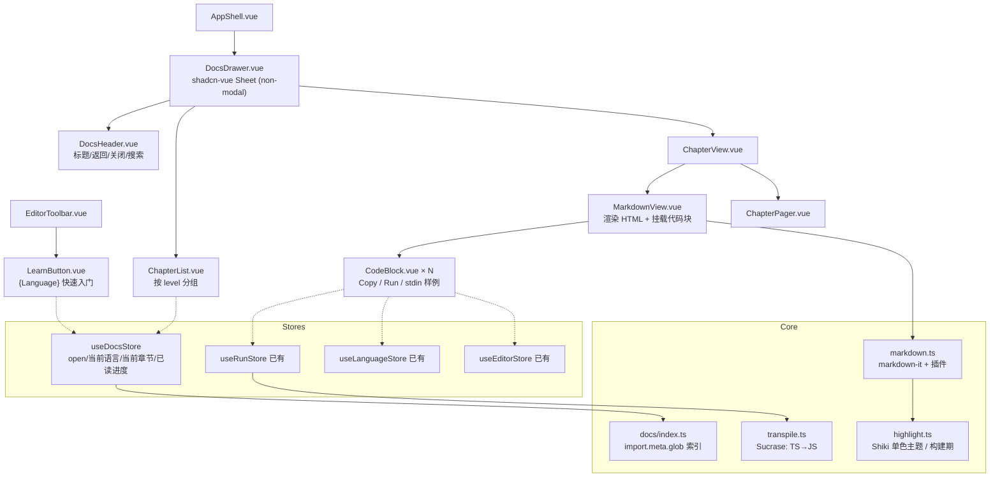
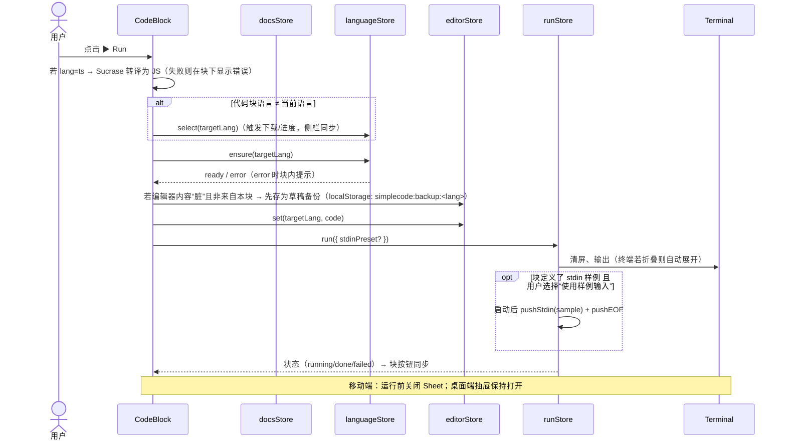

# SimpleCode「{Language} 快速入门」教学系统设计（LEARN）

> 状态：§19 的短节正在铺到其余语言。Go、Python、JavaScript、Ruby、SQL、C、C++、PHP 已按菜鸟教程的章名改完，其余仍是 §18 的短文，直到各自的提交落地。界面文案仍是「快速入门」。
> 原始调研与许可证核对：[`plan/learn-research.md`](learn-research.md)。


## 目录
1. 目标与非目标 · 2. UI 草图 · 3. 架构 · 4. 组件设计 · 5. 样式规范（摘要，详见 §13）· 6. 文档目录与 frontmatter · 7. 各语言课程 · 8. 实现要点 · 9. 写作规范 · 10. 参考资料 · 11. 里程碑 · 12. 风险
- **§13 [文档 UI 黑白主题规范](#13-文档-ui-黑白主题规范)** —— 需求（4）：文档 UI 与主界面一致、纯黑白（token、配色表、排版、Shiki 单色主题、组件、状态、ASCII）
- **§14 [代码块运行按钮设计](#14-代码块运行按钮设计)** —— 需求（5）：每个代码块的「复制 / 运行」按钮，复制到主编辑器并运行（状态、行为、边界、时序图、API、语法、无障碍、测试）
- **§15 [完成情况](#15-完成情况)** —— 各里程碑与语言的交付状态
- **§16 [优化：工具栏、行距、Run 按钮与加厚正文](#16-优化工具栏行距run-按钮与加厚正文)** —— 本轮问题、根因、布局与章节模板、验收
- **§17 [其余六本书](#17-其余六本书)** —— Ruby、SQL、C、C++、PHP、Lua 的运行时限制、章节目录、篇幅与验收
- **§18 [按 The Little Go Book 重写](#18-按-the-little-go-book-重写)** —— 文风分析、每章汉字下限、十种语言的章节大纲、验收
- **§19 [按菜鸟教程改章节](#19-按菜鸟教程改章节)** —— 正式标题、小标题分节、Go 先行，其余语言以后再改

---

## 1. 目标与非目标

### 1.1 目标
1. 工具栏 Run 按钮旁新增 **「{Language} 快速入门」** 按钮（如 “Python 快速入门”），打开右侧抽屉（Sheet），展示当前语言的教程。
2. 每种语言一本“小书”：**概览 + ≥10 章**，难度递进：入门（beginner）→ 进阶（intermediate）→ 高级（advanced）。
3. 文档为 Markdown，存放在 `docs/<language>/`（一语言一目录），随应用打包、离线可读（无网络依赖，符合 COEP）。
4. 文档 UI 完全遵循应用的黑白单色主题（shadcn-vue + Tailwind tokens）。
5. 文档中**每个代码块都有 Run 按钮**：点击 → 把代码写入主编辑器（必要时切换语言、触发运行时下载）→ 自动运行；另有 Copy 按钮。**详细设计见 §14 代码块运行按钮设计。**
6. 覆盖语言：python、ruby、js/ts（QuickJS；TS 先转译）、sqlite、c（clang）、c++（clangpp）、php（php-cgi）、lua、go（Yaegi）。
7. 每个可运行代码块都被自动化测试实际运行验证（smoke），确保教程示例在我们的运行时里可运行。

### 1.2 非目标
- 不做在线课程平台功能（账号、进度云同步、评分、证书）。进度仅存 localStorage。
- 不在浏览器内做类型检查（TS 只转译）；不做自动判题（v1 练习只给参考答案，可选 “期望输出” 对比，见 §7.4）。
- 不复制任何版权受限资料原文；第三方资料仅作参考与外链（见 §10）。

---

## 2. UI 草图（ASCII）

### 2.1 抽屉关闭（工具栏新增按钮）
```
┌──────────────────┬──────────────────────────────────────────────────────────────┐
│ Languages        │ main.py                   [📖 Python 快速入门] [▶ Run] [⟲]        │
│ [Py] Python    ✓ │──────────────────────────────────────────────────────────────│
│ [Rb] Ruby      ↓ │  1  print("hello")                                           │
│ ...              │                                                              │
│                  │══════════════════════════════════════════════════════════════│
│                  │ Terminal ● 就绪                                   [⌫] [v]    │
└──────────────────┴──────────────────────────────────────────────────────────────┘
  “Python 快速入门” = ghost xs 按钮（BookOpen 图标 + 文字），切换语言时文字随之变化；快捷键 ⌘/Ctrl+J
```

### 2.2 抽屉打开 —— 目录（章节列表）
```
┌──────────────┬──────────────────────────────┬──────────────────────────────────┐
│ Languages    │ main.py   [📖][▶ Run]        │ Python 快速入门                  [×]  │
│ [Py] Python  │──────────────────────────────│──────────────────────────────────│
│ ...          │  1 print("hello")            │ [🔍 搜索本书…]                    │
│              │                              │ 概览                              │
│              │   （编辑器仍可见/可编辑）      │ ───────── 入门 ─────────          │
│              │                              │ ✓ 01 你好，Python                │
│              │                              │ ✓ 02 变量与类型                   │
│              │══════════════════════════════│ ● 03 字符串与输入输出    ← 当前    │
│              │ Terminal                     │ ○ 04 列表与元组                   │
│              │ hello                        │ ───────── 进阶 ─────────          │
│              │                              │ ○ 07 函数与作用域 …               │
│              │                              │ ───────── 高级 ─────────          │
│              │                              │ ○ 10 生成器与迭代器 …             │
└──────────────┴──────────────────────────────┴──────────────────────────────────┘
  抽屉宽 min(560px, 45vw)，可拖拽 400–760px；非模态（不遮罩），编辑器/终端仍可操作
  ✓ 已读  ● 当前  ○ 未读（单色符号，不用颜色）
```

### 2.3 抽屉打开 —— 章节阅读
```
┌──────────────────────────────────┐
│ ← 目录   03 字符串与输入输出  [×] │
│ 入门 · 约 10 分钟                 │
│──────────────────────────────────│
│ ## 本章目标                       │
│ - 掌握 f-string 格式化            │
│ - 用 input() 读取用户输入          │
│                                  │
│ ┌──────────────────────────────┐ │
│ │ python          [⧉][▶ Run]  │ │ ← 代码块头：语言标签 + Copy + Run
│ │ name = input("名字？")        │ │
│ │ print(f"你好，{name}！")       │ │
│ │──────────────────────────────│ │
│ │ stdin 示例：Ada               │ │ ← 可选：frontmatter/块属性给出的输入样例
│ └──────────────────────────────┘ │
│ > 💡 提示（单色引用块）            │
│                                  │
│ ## 练习                           │
│ 1. …  [展开参考答案]               │
│──────────────────────────────────│
│ [‹ 上一章 02]          [下一章 04 ›]│
└──────────────────────────────────┘
```

### 2.4 代码块 Run 状态
> 完整状态与行为见 §14.2–§14.4。
```
│ python               [⧉ 已复制][◌ Running…] │   运行中：Run 变为 loading，主工具栏同步
│ python   需要下载 Ruby 23 MB  [▶ 下载并运行] │   跨语言且未缓存：按钮文字提示下载
│ go       ⚠ 示例仅供阅读（不可运行）          │   runnable=false 的块：无 Run，仅 Copy
```

### 2.5 移动端（< 768px）
```
┌──────────────────────────┐
│ ≡  main.py  [📖][▶ Run]  │   侧栏默认折叠为图标栏/隐藏
│──────────────────────────│
│ （编辑器）                 │
│══════════════════════════│
│ Terminal                 │
└──────────────────────────┘
        点击 📖 ↓
┌──────────────────────────┐
│ Python 快速入门          [×]  │   抽屉变为底部全屏 Sheet（side="bottom", 高 92vh）
│ ← 目录 / 章节内容 …       │   点击代码块 Run → 自动关闭 Sheet，聚焦终端显示输出
└──────────────────────────┘
```

---

## 3. 架构

### 3.1 组件树


### 3.2 文档加载
```mermaid
flowchart LR
  A["docs/&lt;lang&gt;/*.md"] -->|"import.meta.glob('/docs/*/*.md', { query: '?raw', import: 'default' })"| B[懒加载函数表]
  A -->|"import.meta.glob(..., { eager: true }) 仅 frontmatter<br/>（Vite 插件预解析为 JSON）"| C[章节索引 index.json]
  C --> D[ChapterList：标题/level/顺序/时长]
  B -->|打开章节时 import()| E[markdown-it 渲染]
  E --> F[HTML + 代码块占位 data-block-id]
  F --> G[MarkdownView 用 Vue 渲染 CodeBlock 组件替换占位]
```
- **按语言拆分 chunk**：每章一个懒加载模块（`?raw` 字符串），首次打开抽屉只加载索引（标题/元数据，几 KB）。
- **frontmatter 预解析**：自定义 Vite 插件 `vite-plugin-docs`（约 60 行）：对 `docs/**/*.md` 生成虚拟模块 `virtual:docs-index`（全部 frontmatter + 标题 + 代码块计数），并在构建时校验 schema（缺字段直接构建失败）。
- **高亮**：两方案：
  - A（推荐）**构建期 Shiki**：插件在构建时把 Markdown 预渲染为 HTML（markdown-it + `@shikijs/markdown-it`），运行时零高亮开销、不增加主包体积；自定义**单色主题**（关键字加粗、注释斜体灰、字符串中灰，无彩色）。
  - B 运行时复用 **Monaco `monaco.editor.colorize`**（已在包内，零新增依赖），但会带入 Monaco 彩色主题 → 与“文档单色”要求冲突，需自定义 Monaco 单色主题仅用于 colorize。
  - 结论：A。代码块原始源码另存在 `data` 中供 Run/Copy 使用（不从 HTML 反解）。
- **搜索（可选，M4）**：构建期为每语言生成轻量倒排索引（标题 + 小节标题 + 正文前 N 字），用 MiniSearch（MIT，~7KB gzip ⚠️）在抽屉内搜索。

### 3.3 从文档运行的时序
> 精确版本（含停止确认、TS 转译、备份撤销、expect 比对）见 §14.5；API 契约见 §14.6。

- **覆盖保护**：编辑器内容被替换前，若与上次保存/示例不同，toast 提示「已备份你的代码，[恢复]」（单色 Sonner），避免误覆盖。
- `runStore.run()` 需扩展一个可选参数 `{ stdin?: string }`（实现阶段改动，现阶段仅规划）。

---

## 4. 组件设计

| 组件 | 职责 | 关键 props/状态 | shadcn-vue |
|---|---|---|---|
| `LearnButton` | 工具栏按钮，文字 `${label} 快速入门`，有文档才显示 | 当前语言是否有 docs | Button(ghost, xs) + Tooltip |
| `DocsDrawer` | 非模态 Sheet，右侧（桌面）/底部（移动）；宽度可拖拽并记忆 | `open`、`view: toc\|chapter`、`width` | Sheet / SheetContent / SheetHeader |
| `DocsHeader` | 标题（Python 快速入门）、返回目录、关闭、搜索框 | — | Button(icon)、Input |
| `ChapterList` | 概览 + 章节按 level 分组，显示已读状态、时长 | 索引、进度 | ScrollArea、Separator |
| `ChapterView` | 渲染章节、记录滚动位置、标记已读（滚动到底或停留 >30s） | chapterId | ScrollArea |
| `MarkdownView` | 输入预渲染 HTML + blocks 元数据，挂载 CodeBlock | html、blocks[] | — |
| `CodeBlock` | 语言标签、Copy、Run、stdin 样例、期望输出（折叠） | `lang`、`code`、`runnable`、`stdin?`、`expect?` | Button(xs)、Collapsible |
| `ChapterPager` | 上一章/下一章 | — | Button(outline, xs) |

状态：
- **CodeBlock.Run**：idle → (跨语言未缓存) “下载并运行” → downloading(百分比) → running(Loader2) → done(✓ exit 0，2s 后复位) / failed(空心圆 + exit N)。全部单色。
- **Copy**：⧉ → “已复制”（1.5s）。
- **ChapterList 项**：○ 未读 / ● 当前 / ✓ 已读；hover `bg-accent`；focus-visible ring。
- 键盘：`⌘/Ctrl+J` 开关抽屉；抽屉内 `[`/`]` 上/下一章；代码块内 `⌘/Ctrl+Enter` 运行该块（焦点在块上时）。
- 可访问性：Sheet `aria-label="Python 快速入门 教程"`；代码块 Run `aria-label="运行此示例（Python）"`。

---

## 5. 样式规范（单色）
> 本节为摘要；**完整规范（实际 token 值、明暗配色表、排版、Shiki 主题、组件与状态）见 §13。**
- 完全使用现有 tokens（`--background/--foreground/--muted/--border/--accent/--primary`），**无任何彩色**；深/浅色同 DESIGN §11。
- 抽屉：`bg-background border-l border-border`，宽 `min(560px,45vw)`，标题栏 h-10，内容 `px-5 py-4`。
- 排版（`prose` 自定义，不用 @tailwindcss/typography 默认色）：正文 14px/1.7；h1 20px semibold；h2 16px semibold + 上间距 24px；h3 14px semibold；列表 `pl-5`；链接 `underline underline-offset-2`；引用块 `border-l-2 border-foreground/30 pl-3 text-muted-foreground`；表格 1px 边框、表头 `bg-muted`；行内代码 `bg-muted px-1 rounded font-mono text-[13px]`。
- 代码块：`rounded-md border border-border bg-muted`（浅色）/ `bg-[#0a0a0a]`（深色）；头部 h-8 `border-b`，左侧语言标签 `text-xs font-mono uppercase text-muted-foreground`，右侧 Copy（icon xs）+ Run（default xs, h-7）；代码 13px JetBrains Mono，行高 1.6，`overflow-x-auto`；行号可选关闭。
- Shiki 单色主题 `simplecode-mono-light/dark`：关键字 **粗体 foreground**，字符串 `foreground/75`，数字 `foreground/75`，注释 *斜体* `muted-foreground`，标点 `foreground/60`。
- 提示框（Markdown 容器 `::: tip / warning / note`）：单色边框 + 图标（lucide Info/AlertTriangle/Lightbulb），不使用颜色区分。
- 动画：Sheet 滑入 200ms；遵守 `prefers-reduced-motion`。

---

## 6. 文档目录与 frontmatter 约定

### 6.1 目录
```
docs/
├── _shared/                 # 通用片段（如“如何使用 Run 按钮”）
├── python/
│   ├── index.md             # 概览（chapter: 0）
│   ├── 01-hello.md
│   ├── …
│   └── 12-mini-project.md
├── ruby/  js/  sqlite/  c/  cpp/  php/  lua/  go/
└── README.md                # 写作规范（§9 摘要）
```
- 目录名 = 文档语言 id；与运行时 id 映射：`js→quickjs`（`ts` 代码块也在 js 书中）、`c→clang`、`cpp→clangpp`、`php→php-cgi`，其余同名。映射写在 `docs/index.ts`（或 manifest 增加 `docs: "python"` 字段）。

### 6.2 frontmatter schema
```yaml
---
language: python          # 必填，目录语言 id
chapter: 3                # 必填，0 = 概览
title: 字符串与输入输出     # 必填
level: beginner           # beginner | intermediate | advanced
minutes: 10               # 预计阅读时长
goals:                    # 本章目标（渲染为列表）
  - 掌握 f-string
  - 用 input() 读取输入
runtime: python           # 可选，默认按目录映射；用于覆盖
sources:                  # 参考资料 id（见 docs/sources.yaml），仅链接
  - python-tutorial
  - lxiy-python
updated: 2026-10-15
---
```

### 6.3 代码块属性（fenced info string）
````markdown
```python run stdin="Ada" expect="你好，Ada！"
name = input("名字？")
print(f"你好，{name}！")
```

```go norun
// 仅供阅读：Yaegi 不支持的写法示例
```

```ts run
const add = (a: number, b: number): number => a + b;
console.log(add(1, 2));
```
````
- `run`（默认对可运行语言为 true）、`norun`（只读）、`stdin="..."`（样例输入，`\n` 分隔多行）、`expect="..."`（期望输出子串，用于测试与可选的“检查输出”）、`lang` 可与书语言不同（例如 SQL 书中也可出现 python 块，Run 时自动切换语言）。
- 解析：markdown-it 的 `fence` 规则读取 info 字符串（`markdown-it-attrs` 风格或自写 parser，≈30 行）。

### 6.4 来源登记 `docs/sources.yaml`
```yaml
gobyexample: { title: Go by Example, url: https://gobyexample.com/, license: CC-BY-3.0, adapt: true }
little-go-book: { title: The Little Go Book, url: https://github.com/karlseguin/the-little-go-book, license: CC-BY-NC-SA-4.0, adapt: false }
```
`adapt:false` 的资料只能在章节末“延伸阅读”中链接；CI 校验：章节正文中出现大段与 adapt:false 来源相同的文本时报警（可选，见 §11）。

---

## 7. 各语言课程（每语言 1 概览 + ≥10 章）

> 约束总述（所有示例必须遵守）：无网络、无文件持久化（每次运行全新虚拟 FS，只有 `/program`）、无多线程并行、无第三方包、单文件程序；交互输入通过终端 stdin。

### 7.1 Python 快速入门（CPython 3.11）
| # | 标题 | 级别 | 要点 | 示例程序 | 练习 |
|---|---|---|---|---|---|
| 0 | 概览：Python 是什么 | — | 解释执行、REPL 思维、在 SimpleCode 中运行与输入 | `print("你好")` | 改写问候语 |
| 1 | 你好，Python | 入门 | print、注释、缩进 | 打印名片 | 打印三角形 |
| 2 | 变量与类型 | 入门 | int/float/str/bool、type()、类型转换 | 温度换算 | 计算 BMI（stdin） |
| 3 | 字符串与输入输出 | 入门 | f-string、切片、input() | 问候（stdin） | 回文判断 |
| 4 | 条件与循环 | 入门 | if/elif、for/range、while、break | 猜数字（固定种子 random） | FizzBuzz |
| 5 | 列表与元组 | 入门 | 增删改查、切片、推导式 | 成绩统计 | 去重保序 |
| 6 | 字典与集合 | 入门 | dict 方法、集合运算、Counter | 词频统计 | 字母异位词分组 |
| 7 | 函数 | 进阶 | 参数/默认值/*args/**kwargs、作用域、lambda | 计算器函数 | 递归阶乘/斐波那契 |
| 8 | 异常处理 | 进阶 | try/except/finally、raise、自定义异常 | 安全除法 | 解析数字输入 |
| 9 | 模块与标准库 | 进阶 | math、random、datetime、itertools、collections | 日期差计算 | 排列组合 |
| 10 | 面向对象 | 进阶 | class、__init__、继承、dataclass、__repr__ | 银行账户 | 形状面积多态 |
| 11 | 迭代器与生成器 | 高级 | yield、生成器表达式、itertools 管道 | 无限素数生成器 | 滑动窗口 |
| 12 | 装饰器与上下文管理器 | 高级 | 闭包、functools.wraps、with/contextlib | 计时装饰器 | 缓存装饰器 |
| 13 | 类型标注与小项目 | 高级 | typing、dataclass、命令行小游戏 | 井字棋（stdin） | 扩展 AI |
限制说明：不讲 pip/requests/threading/文件写入持久化；`random` 示例固定 seed 以保证测试可复现。来源：Python Tutorial、Learn X in Y（改编）、Think Python / Automate（仅链接）。

### 7.2 Ruby 快速入门（Ruby 3.2）
| # | 标题 | 级别 | 要点 | 示例 | 练习 |
|---|---|---|---|---|---|
| 0 | 概览 | — | 一切皆对象、irb 思维 | `puts "你好"` | — |
| 1 | 输出与变量 | 入门 | puts/print/p、字符串插值 | 名片 | 单位换算 |
| 2 | 数字、字符串与符号 | 入门 | Integer/Float、String 方法、Symbol | 字符串变换 | 首字母大写 |
| 3 | 条件与循环 | 入门 | if/unless、case/when、times/each/while | 成绩等级 | FizzBuzz |
| 4 | 数组 | 入门 | each/map/select/reduce | 统计 | 二维数组转置 |
| 5 | 哈希 | 入门 | Hash 字面量、遍历、默认值 | 词频（gets） | 分组 |
| 6 | 方法与块 | 进阶 | def、默认参数、yield、block_given? | 自定义 each | 计时块 |
| 7 | Proc 与 Lambda | 进阶 | 闭包、&block、method(:x) | 函数组合 | 柯里化 |
| 8 | 类与模块 | 进阶 | class、attr_accessor、include、Comparable | 向量类 | 排序自定义对象 |
| 9 | 异常 | 进阶 | begin/rescue/ensure/retry | 输入校验 | 重试逻辑 |
| 10 | Enumerable 进阶 | 高级 | lazy、each_slice、zip、group_by | 惰性素数 | 滑动平均 |
| 11 | 元编程入门 | 高级 | send、define_method、method_missing | 动态属性 | DSL |
| 12 | 小项目：文字冒险 | 高级 | 状态机、stdin 交互 | 冒险游戏 | 增加房间 |
来源：Ruby in Twenty Minutes（链接）、Ruby Koans（仅借鉴“公案”练习形式，不复制）、Poignant Guide（CC BY-SA，可少量改编）。

### 7.3 JavaScript / TypeScript 快速入门（QuickJS）
| # | 标题 | 级别 | 要点 | 示例 | 练习 |
|---|---|---|---|---|---|
| 0 | 概览 | — | JS 引擎 vs 浏览器、QuickJS 环境（无 DOM） | `console.log` | — |
| 1 | 值与变量 | 入门 | let/const、类型、typeof | 类型表 | 交换变量 |
| 2 | 运算与字符串 | 入门 | 模板字符串、== vs === | 格式化 | 反转单词 |
| 3 | 控制流 | 入门 | if/switch/for/for…of | FizzBuzz | 九九乘法表 |
| 4 | 函数 | 入门 | 声明/箭头函数、默认参数、闭包 | 计数器 | 记忆化 |
| 5 | 数组 | 进阶 | map/filter/reduce/sort | 成绩处理 | 扁平化 |
| 6 | 对象与解构 | 进阶 | 展开、可选链、JSON | 配置合并 | 深拷贝 |
| 7 | 类与原型 | 进阶 | class、extends、getter、原型链 | 形状 | 栈/队列 |
| 8 | 错误处理 | 进阶 | try/catch、Error 子类 | 解析 JSON | 自定义错误 |
| 9 | 迭代器与生成器 | 高级 | Symbol.iterator、function* | 范围生成器 | 斐波那契 |
| 10 | Promise 与 async | 高级 | Promise 链、async/await（仅微任务，避免依赖 setTimeout ⚠️） | 异步流水线 | Promise.all |
| 11 | TypeScript 入门 | 高级 | 类型标注、interface、联合类型（`ts` 块，Sucrase 去类型后运行，无类型检查） | 类型化 TODO | 泛型函数 |
| 12 | TS 进阶与小项目 | 高级 | 泛型、类型收窄、枚举（Sucrase 支持 enum ⚠️） | 状态机 | 扩展 |
限制：无 DOM/fetch/模块导入（单文件）；stdin 读取在 QuickJS 版本中能力有限 ⚠️ → JS 书示例**不依赖 stdin**（实现阶段验证 `std`/`os` 模块后再决定）。来源：MDN（CC BY-SA，可改编）、TS Handbook（CC BY 4.0 ⚠️）、javascript.info / Eloquent JS（仅链接）。

### 7.4 SQL 快速入门（SQLite 3.26）
| # | 标题 | 级别 | 要点 | 示例 | 练习 |
|---|---|---|---|---|---|
| 0 | 概览 | — | 关系模型、每次运行=全新内存库、`.mode box` | 建表+查询 | — |
| 1 | SELECT 基础 | 入门 | SELECT/FROM、列别名 | 电影表 | 选列 |
| 2 | 过滤与排序 | 入门 | WHERE、AND/OR、LIKE、ORDER BY、LIMIT | 筛选电影 | Top 3 |
| 3 | 建表与写入 | 入门 | CREATE TABLE、INSERT、类型亲和性 | 学生表 | 批量插入 |
| 4 | 更新与删除 | 入门 | UPDATE/DELETE、事务 BEGIN/COMMIT | 调薪 | 回滚演示 |
| 5 | 聚合与分组 | 进阶 | COUNT/SUM/AVG、GROUP BY、HAVING | 销售统计 | 每类最高 |
| 6 | 多表连接 | 进阶 | INNER/LEFT JOIN、外键 | 订单-客户 | 未下单客户 |
| 7 | 子查询与 CTE | 进阶 | IN/EXISTS、WITH | 高于平均 | 递归 CTE 生成序列 |
| 8 | 约束与索引 | 进阶 | PRIMARY KEY/UNIQUE/CHECK、CREATE INDEX、EXPLAIN QUERY PLAN | 约束违反示例 | 观察查询计划 |
| 9 | 窗口函数 | 高级 | ROW_NUMBER/RANK/LAG、OVER(PARTITION BY)（3.25+ 可用） | 排名 | 移动平均 |
| 10 | 视图与触发器 | 高级 | CREATE VIEW、TRIGGER | 审计日志 | 自动更新时间 |
| 11 | 小项目：图书馆 | 高级 | 建模 + 报表查询 | 借阅报表 | 逾期统计 |
限制：不用 `RETURNING`、`STRICT`、`->>`、`UPSERT … DO UPDATE`（3.24 起支持，可用 ⚠️需测）、`generate_series`（扩展未编入）；不依赖文件库。来源：SQLite 官方文档（公有领域，可改编）、SQLBolt / Select Star SQL（仅链接，借鉴循序渐进结构）。

### 7.5 C 快速入门（clang 8 + wasi-libc）
| # | 标题 | 级别 | 要点 | 示例 | 练习 |
|---|---|---|---|---|---|
| 0 | 概览 | — | 编译→链接→运行（终端显示阶段）、`-Werror` 含义 | hello | — |
| 1 | 第一个程序 | 入门 | main、printf、返回值 | 名片 | 格式化表格 |
| 2 | 类型与运算 | 入门 | int/char/double、sizeof、整数溢出 | 类型大小 | 温度换算 |
| 3 | 输入与控制流 | 入门 | scanf、if/switch/for/while | 求和（stdin） | 质数判断 |
| 4 | 函数 | 入门 | 原型、递归、static | 阶乘 | 汉诺塔 |
| 5 | 数组与字符串 | 进阶 | 数组、char[]、string.h | 反转字符串 | 冒泡排序 |
| 6 | 指针 | 进阶 | &、*、指针运算、数组退化 | swap | 指针遍历 |
| 7 | 结构体与枚举 | 进阶 | struct、typedef、enum、union | 学生记录 | 链表节点 |
| 8 | 动态内存 | 进阶 | malloc/free、realloc | 动态数组 | 链表 |
| 9 | 预处理与多文件思维 | 高级 | #define、宏陷阱、#if（单文件内模拟头文件） | 断言宏 | 泛型 max 宏 |
| 10 | 位运算与未定义行为 | 高级 | 位操作、UB 示例与避免 | 位集合 | 计数 1 的个数 |
| 11 | 小项目：栈式计算器 | 高级 | 逆波兰表达式（stdin） | RPN 计算器 | 支持变量 |
限制：`-Werror` → 示例必须零警告（例如 `int main(void)`、检查 scanf 返回值）；无线程/信号/fork/文件持久化；`printf` 后提示前需 `fflush(stdout)`。来源：Beej / Modern C / learn-c.org（仅链接）。

### 7.6 C++ 快速入门（clang 8 + libc++）
| # | 标题 | 级别 | 要点 | 示例 | 练习 |
|---|---|---|---|---|---|
| 0 | 概览 | — | C++ 与 C、本环境 C++17 部分支持 | hello | — |
| 1 | iostream 与变量 | 入门 | cout/cin、auto、引用 | 名片 | 交换 |
| 2 | string 与控制流 | 入门 | std::string、范围 for | 单词计数 | 回文 |
| 3 | vector 与算法 | 入门 | vector、sort、find、<algorithm> | 成绩排序 | 去重 |
| 4 | 函数与重载 | 入门 | 重载、默认参数、const 引用 | 重载 area | 模板前奏 |
| 5 | 类与对象 | 进阶 | 构造/析构、成员函数、访问控制 | 计数器 | 分数类 |
| 6 | 运算符重载 | 进阶 | operator+、<<、比较 | 向量 | 复数 |
| 7 | 继承与多态 | 进阶 | virtual、override、抽象类 | 形状 | 动物 |
| 8 | 模板 | 进阶 | 函数/类模板 | 泛型栈 | 泛型 max |
| 9 | STL 容器 | 高级 | map/set/unordered_map/deque | 词频 | LRU（list+map） |
| 10 | RAII 与智能指针 | 高级 | unique_ptr/shared_ptr、移动语义 | 资源守卫 | 链表 |
| 11 | Lambda 与现代 C++ | 高级 | lambda、std::function、结构化绑定（C++17） | 自定义排序 | 函数组合 |
| 12 | 小项目：库存管理 | 高级 | 综合 | 命令行库存 | 扩展 |
限制：避免 C++20（concepts/ranges/format）、`std::filesystem`、`std::thread`；异常（throw/try）是否可用 **需实测** ⚠️，若不可用则相关内容标 `norun` 并说明。来源：LearnCpp、cppreference（仅链接）、C++ Core Guidelines（可引用条目编号）。

### 7.7 PHP 快速入门（php-cgi 8.2）
| # | 标题 | 级别 | 要点 | 示例 | 练习 |
|---|---|---|---|---|---|
| 0 | 概览 | — | `<?php`、CLI 式运行（-q 无头） | echo | — |
| 1 | 变量与输出 | 入门 | $var、echo/print、字符串插值 | 名片 | heredoc |
| 2 | 类型与运算 | 入门 | 弱类型、严格比较、`declare(strict_types=1)` | 比较表 | 类型转换 |
| 3 | 控制流 | 入门 | if/match/for/foreach | FizzBuzz | 等级 match |
| 4 | 数组 | 入门 | 索引/关联数组、array_* 函数 | 成绩 | 分组 |
| 5 | 函数 | 进阶 | 类型声明、默认值、箭头函数、闭包 | 计算器 | 柯里化 |
| 6 | 字符串处理 | 进阶 | sprintf、str_*、preg_* | 模板替换 | 校验邮箱 |
| 7 | 面向对象 | 进阶 | class、构造器提升、readonly、接口 | 账户 | 形状 |
| 8 | 异常与错误 | 进阶 | try/catch、自定义异常 | 安全除法 | 校验 |
| 9 | 枚举与 match（8.1+） | 高级 | enum、backed enum | 订单状态 | 状态机 |
| 10 | 生成器与迭代器 | 高级 | yield、IteratorAggregate | 惰性范围 | 分页 |
| 11 | 小项目：JSON 报表 | 高级 | json_encode/decode、array 处理 | 报表 | 排序输出 |
限制：无网络/数据库/会话/HTTP 请求处理；stdin 读取方式需实测（`fgets(STDIN)` vs `php://stdin`）⚠️，确认前 PHP 书示例不依赖 stdin。来源：PHP 手册（CC BY 3.0 ⚠️，可改编署名）、PHP The Right Way（仅链接）。

### 7.8 Lua 快速入门（Lua 5.4.9）
| # | 标题 | 级别 | 要点 | 示例 | 练习 |
|---|---|---|---|---|---|
| 0 | 概览 | — | 轻量嵌入式语言、5.4 特性 | print | — |
| 1 | 值与变量 | 入门 | nil/boolean/number/string、local | 类型表 | 交换 |
| 2 | 字符串 | 入门 | `..`、string 库、模式匹配基础 | 格式化 | 单词计数 |
| 3 | 控制流 | 入门 | if、while、repeat、数值/泛型 for | FizzBuzz | 质数 |
| 4 | 表（数组） | 入门 | 序列、`#`、table.insert/concat/sort | 成绩 | 反转 |
| 5 | 表（字典） | 入门 | pairs/ipairs、嵌套表 | 词频（io.read） | 分组 |
| 6 | 函数与闭包 | 进阶 | 多返回值、可变参数、闭包、高阶函数 | 计数器 | map/filter |
| 7 | 错误处理 | 进阶 | error/pcall/xpcall/assert（本构建可用） | 安全解析 | 带回溯的 xpcall |
| 8 | 元表与 OOP | 进阶 | setmetatable、__index、__add、__tostring | 向量类 | 继承 |
| 9 | 模块思维 | 进阶 | 返回表的模块模式（单文件内） | 工具模块 | 命名空间 |
| 10 | 协程 | 高级 | coroutine.create/resume/yield、生产者-消费者 | 生成器 | 管道 |
| 11 | 字符串模式进阶 | 高级 | gsub/gmatch/捕获 | 模板引擎 | CSV 解析 |
| 12 | 小项目：文字冒险 | 高级 | 状态机 + io.read | 冒险游戏 | 存档（内存） |
限制：无 `io.popen`/`os.execute`/`io.tmpfile`/`os.tmpname`、无 `require` C 模块。来源：Lua 5.4 手册（引用条目）、Learn Lua in Y（CC BY-SA，可改编）、Programming in Lua（仅链接）。

### 7.9 Go 快速入门（Yaegi 0.16.1 解释器）
| # | 标题 | 级别 | 要点 | 示例 | 练习 |
|---|---|---|---|---|---|
| 0 | 概览 | — | Go 特点；本环境为解释执行（Yaegi），仅标准库 | hello | — |
| 1 | 包、变量与常量 | 入门 | package main、:=、const、iota | 名片 | 单位换算 |
| 2 | 基本类型与格式化 | 入门 | int/float64/string/rune、fmt.Printf | 类型表 | 字符计数（rune） |
| 3 | 控制流 | 入门 | if/for/switch、defer | FizzBuzz | 质数 |
| 4 | 数组、切片与 map | 入门 | append、copy、range、map | 词频（bufio.Scanner 读 stdin） | 去重 |
| 5 | 函数与闭包 | 进阶 | 多返回值、可变参数、闭包 | 计数器 | 记忆化 |
| 6 | 结构体与方法 | 进阶 | struct、值/指针接收者、嵌入 | 账户 | 矩形 |
| 7 | 接口 | 进阶 | 隐式实现、类型断言、Stringer | 形状 | error 接口 |
| 8 | 错误处理 | 进阶 | error、errors.Is/As、fmt.Errorf %w、panic/recover | 解析数字 | 自定义错误 |
| 9 | goroutine 与 channel | 高级 | go、chan、select、sync.WaitGroup（单线程调度，演示并发而非并行） | 流水线 | 扇入扇出 |
| 10 | 泛型 | 高级 | 类型参数、约束（Yaegi 泛型支持有限 ⚠️ → 仅简单示例，复杂者标 norun） | Map/Filter | 泛型栈 |
| 11 | 标准库精选 | 高级 | strings、sort、strconv、time（避免依赖真实 Sleep 时长）、encoding/json | JSON 编解码 | 排序结构体 |
| 12 | 小项目：命令行待办 | 高级 | 综合 + stdin | TODO | 持久化（内存） |
限制：无 `go get`/第三方模块/cgo/网络；Yaegi 与官方编译器存在语义差异（个别反射/泛型/unsafe）⚠️；每个示例必须是完整 `package main`。来源：Go by Example（**CC BY 3.0，可改编，须署名**）、A Tour of Go（⚠️ 许可证待确认，先仅链接）、The Little Go Book（CC BY-NC-SA，仅链接）、Learn Go with Tests（MIT，测试驱动思路）。

---

## 8. 实现要点（供后续实现参考）
- 依赖（预计）：`markdown-it`（MIT）、`@shikijs/markdown-it` + `shiki`（MIT，构建期）、`gray-matter` 或 `front-matter`（MIT，构建期）、`sucrase`（MIT，运行时，懒加载）、可选 `minisearch`（MIT）。运行时新增 JS 约：markdown 运行时 0（预渲染）+ sucrase ~200KB（仅 TS 块首次运行时加载）⚠️。
- shadcn-vue 组件：Sheet、ScrollArea、Separator、Input、Collapsible、Sonner（按需 `npx shadcn-vue add`）。
- Store：`useDocsStore`（open、lang、chapterId、progress: Record<lang, Set<chapter>>、scroll 位置，持久化 localStorage）。
- `runStore.run({ stdin })` 扩展；`CodeEditor` 无需修改（已监听 editorStore 外部变更）。
- 与语言切换联动：抽屉打开时切换左侧语言 → 抽屉跟随切到该语言的书（保持各书最近阅读位置）。

---

## 9. 内容写作规范
1. **中文原创**：所有正文由我们撰写；参考资料只取知识点与章节顺序，不翻译、不复制原文；CC BY / CC BY-SA / MIT / 公有领域资料的**代码示例**可改编，须在章节末“参考与致谢”注明来源与许可证（SA 资料改编的片段同协议）。
2. 每章结构：`本章目标 → 讲解（小节 2–5 个）→ 可运行示例（≥3 个）→ 常见错误 → 练习（2–3 题，带折叠参考答案）→ 延伸阅读（链接）`。
3. **示例必须可运行**：单文件、无网络/文件依赖、输出确定（固定随机种子、不打印时间戳/地址）；需要输入的示例必须提供 `stdin=` 样例；预期输出写进 `expect=`。
4. 运行时差异要说明：例如 “本环境 C++ 为 LLVM 8，不支持 C++20”，“Go 由 Yaegi 解释执行”。
5. 代码风格：Python PEP 8、Go gofmt、C/C++ 4 空格、Lua 2 空格；示例 ≤ 40 行；注释中文。
6. 术语表：每本书 `index.md` 末尾维护中英术语对照。
7. **测试**：`tests/docs-smoke.mjs`：遍历 `docs/**/*.md` 的所有 `run` 代码块，按语言分组，用现有 Playwright smoke 流程（或抽出 headless runner）逐块运行：断言 exit 0（或 frontmatter 声明的期望非 0）、`expect` 子串命中、超时 30s；`norun` 块跳过但统计数量；CI 失败即阻止合并。`./build.sh test` 增加 `--docs`。
8. 审校清单：可运行性、正确性、术语一致、无版权文本、许可证标注。

---

## 10. 参考资料与许可证（详见 learn-research.md）
| 资料 | 链接 | 许可证 | 使用方式 |
|---|---|---|---|
| Learn X in Y minutes | https://learnxinyminutes.com/ | CC BY-SA 3.0 ✔ | 可改编（署名+SA） |
| Python Tutorial | https://docs.python.org/3/tutorial/ | PSF ⚠️ | 参考/链接 |
| Think Python 3e | https://greenteapress.com/wp/think-python-3rd-edition/ | CC BY-NC-SA 4.0 ⚠️ | 仅链接 |
| A Byte of Python | https://python.swaroopch.com/ | CC BY-SA 4.0 ⚠️ | 可改编 |
| Ruby in Twenty Minutes | https://www.ruby-lang.org/en/documentation/quickstart/ | ⚠️ | 链接 |
| Ruby Koans | https://github.com/edgecase/ruby_koans | CC BY-NC-SA 3.0 ✔ | 仅链接 |
| Why's (Poignant) Guide | https://poignant.guide/ | CC BY-SA 2.5 ⚠️ | 可少量改编 |
| javascript.info | https://javascript.info/ | CC BY-NC-SA 4.0 ⚠️ | 仅链接 |
| Eloquent JavaScript | https://eloquentjavascript.net/ | CC BY-NC 3.0 ⚠️ | 仅链接 |
| MDN JS Guide | https://developer.mozilla.org/en-US/docs/Web/JavaScript/Guide | CC BY-SA 2.5 / 代码 CC0 ⚠️ | 可改编 |
| TypeScript Handbook | https://www.typescriptlang.org/docs/handbook/intro.html | CC BY 4.0 ⚠️ | 可改编 |
| SQLite 文档 | https://www.sqlite.org/lang.html | Public Domain ✔ | 可改编 |
| SQLBolt | https://sqlbolt.com/ | 版权保留 | 仅链接 |
| Select Star SQL | https://selectstarsql.com/ | ⚠️ | 仅链接 |
| Beej's Guide to C | https://beej.us/guide/bgc/ | CC BY-NC-ND 3.0 ⚠️ | 仅链接 |
| Modern C | https://gustedt.gitlabpages.inria.fr/modern-c/ | ⚠️ NC-ND | 仅链接 |
| learn-c.org | https://www.learn-c.org/ | ⚠️ | 仅链接 |
| LearnCpp | https://www.learncpp.com/ | 版权保留 | 仅链接 |
| C++ Core Guidelines | https://github.com/isocpp/CppCoreGuidelines | MIT 风格 ⚠️ | 引用条目 |
| PHP Manual | https://www.php.net/manual/en/ | CC BY 3.0 ⚠️ | 可改编 |
| PHP The Right Way | https://github.com/codeguy/php-the-right-way | CC BY-NC-SA 3.0 ✔ | 仅链接 |
| Programming in Lua (1st ed.) | https://www.lua.org/pil/ | 版权保留 | 仅链接 |
| Lua 5.4 Manual | https://www.lua.org/manual/5.4/ | Lua.org ⚠️ | 引用 |
| Go by Example | https://gobyexample.com/ | CC BY 3.0 ✔ | 可改编（署名） |
| A Tour of Go | https://go.dev/tour/ | ⚠️ | 链接 |
| The Little Go Book | https://github.com/karlseguin/the-little-go-book | CC BY-NC-SA 4.0 ✔ | 仅链接 |
| Effective Go | https://go.dev/doc/effective_go | ⚠️ | 链接 |
| Learn Go with Tests | https://github.com/quii/learn-go-with-tests | MIT ✔ | 可改编 |
| Teach Yourself Programming in Ten Years | https://norvig.com/21-days.html | 版权保留 | 设计理念参考 |
✔ = 本次从仓库 README/LICENSE 实际抓取确认；⚠️ = 基于已知信息，落地前需逐一核实。

---

## 11. 里程碑
| M | 内容 | 验收 |
|---|---|---|
| L0 | docs 目录骨架、frontmatter schema、`vite-plugin-docs`（索引 + 校验 + 预渲染）、单色 Shiki 主题 | `yarn build` 生成索引，schema 错误会失败 |
| L1 | UI：LearnButton、DocsDrawer（桌面+移动）、ChapterList、ChapterView、CodeBlock（Copy/Run） | 打开/关闭/切章/跨语言运行可用 |
| L2 | `runStore.run({stdin})`、覆盖备份 toast、TS 转译（Sucrase 懒加载） | ts 块可运行；stdin 样例可用 |
| L3 | 内容第一批：Python、Go、Lua、SQL（各 1 概览 + ≥10 章） | docs-smoke 全绿 |
| L4 | 内容第二批：C、C++、Ruby、PHP、JS/TS；运行时能力实测（PHP stdin、QuickJS stdin/timers、C++ 异常） | docs-smoke 全绿 |
| L5 | 搜索（MiniSearch）、阅读进度、快捷键、无障碍、截图回归 | Lighthouse a11y ≥ 90 |

---

## 12. 风险
1. **内容工作量**：9 本 × ≥11 篇 ≈ 100+ 篇中文原创、300+ 可运行示例；需分批交付并以 docs-smoke 保证质量。
2. **运行时差异**：clang 8 / SQLite 3.26 / Yaegi / QuickJS-wasmedge 与主流版本不同，读者照搬到本地可能行为不同 → 每本书概览注明版本与限制。
3. **未验证能力** ⚠️：QuickJS 的 stdin 与定时器、PHP CGI 的 STDIN、C++ 异常、Yaegi 泛型、`time.Sleep`——在 L4 前实测，不通过的主题改写或标 `norun`。
4. **许可证**：大量优质资料为 NC/ND，只能链接；改编 CC BY-SA 内容会使对应文件需以 CC BY-SA 发布 → 建议 docs 整体采用 **CC BY-SA 4.0**，代码示例 **MIT**，在 `docs/LICENSE` 声明。
5. **体积**：预渲染 HTML + 索引随语言数线性增长（估计每本 200–400 KB，按章懒加载可接受）。
6. **覆盖用户代码**：Run 文档示例会替换编辑器内容 → 必须有备份与恢复。
7. **与并行开发冲突**：实现阶段需改 EditorToolbar/AppShell/runStore（其他 PR 也在改）→ 实现前 rebase，并以新增组件为主、最小化对既有文件的修改。

---

## 13. 文档 UI 黑白主题规范

> 对应需求（4）：文档 UI 与主界面主题**完全一致**，纯黑白灰。本节所有取值均来自现有代码：`src/style.css`（CSS 变量，HSL 三元组，饱和度全部为 0）、`tailwind.config.js`（颜色映射 `hsl(var(--x))`、字体栈）、`src/main.ts`（本地打包字体）、`src/components/ui/button`（尺寸 variants）。文档组件**不得新增任何颜色变量**，只能组合以下 token 与其透明度（如 `foreground/60`）。

### 13.1 铁律：文档中不使用任何强调色
- 禁止 `text-red-*`/`blue-*`/`green-*`/`yellow-*`… 等任何带色相的 Tailwind 类，禁止十六进制彩色、禁止 Shiki/Monaco 默认彩色主题、禁止 emoji 作为状态指示（正文 emoji 可保留但不承担语义）。
- 状态差异只用：**明度**（foreground / muted-foreground / 透明度）、**字重**（400/500/600）、**形状**（实心●/空心○/✓/虚线边框）、**动画**（pulse/spin）。
- 校验：CI 增加 `scripts/check-mono.mjs`：扫描 `src/components/docs/**` 与 Shiki 主题 JSON，若出现饱和度 > 0 的颜色值或彩色 Tailwind 类则失败。
- 唯一允许“有色”的区域仍只有主编辑器 Monaco（不在抽屉内）。

### 13.2 复用的设计 token（实际值）
| CSS 变量（`src/style.css`） | Light（`:root`） | Dark（`.dark`） | Tailwind 类 |
|---|---|---|---|
| `--background` | `0 0% 100%`（#FFFFFF） | `0 0% 4%`（#0A0A0A） | `bg-background` |
| `--foreground` | `0 0% 4%`（#0A0A0A） | `0 0% 98%`（#FAFAFA） | `text-foreground` |
| `--muted` | `0 0% 97%`（#F7F7F7） | `0 0% 7%`（#121212） | `bg-muted` |
| `--muted-foreground` | `0 0% 45%`（#737373） | `0 0% 64%`（#A3A3A3） | `text-muted-foreground` |
| `--accent` | `0 0% 92%`（#EBEBEB） | `0 0% 15%`（#262626） | `bg-accent` |
| `--secondary` | `0 0% 96%` | `0 0% 15%` | `bg-secondary` |
| `--primary` / `--primary-foreground` | `0 0% 9%` / `0 0% 98%` | `0 0% 98%` / `0 0% 9%` | `bg-primary text-primary-foreground` |
| `--border` / `--input` | `0 0% 89%`（#E3E3E3） | `0 0% 15%`（#262626） | `border-border` |
| `--ring` | `0 0% 9%` | `0 0% 83%` | `ring-ring` |
| `--popover` | `0 0% 100%` | `0 0% 4%` | `bg-popover`（Tooltip/菜单） |
| `--terminal-bg` | `#0a0a0a` | `#000000` | `bg-terminal`（仅终端，不用于文档） |
| `--radius` | `0.5rem` | 同 | `rounded-lg`=8px / `rounded-md`=6px / `rounded-sm`=4px |
（`--success/--warning/--destructive` 在本应用中也是灰阶，但文档组件不使用它们，避免语义混淆。）

### 13.3 文档元素配色表
| 元素 | Light | Dark | 实现 |
|---|---|---|---|
| 抽屉背景 | `--background` #FFF | `--background` #0A0A0A | `bg-background` |
| 抽屉左边框 / 分隔线 | `--border` #E3E3E3 | `--border` #262626 | `border-l border-border` |
| 抽屉标题栏 | 背景 `--background`，下边框 `--border` | 同 | `h-10 border-b` |
| 正文文字 | `--foreground` | `--foreground` | `text-foreground` |
| 次要文字（元信息、时长、页脚） | `--muted-foreground` #737373 | #A3A3A3 | `text-muted-foreground` |
| 标题 h1/h2/h3 | `--foreground`，600 | 同 | `font-semibold` |
| 链接 | `--foreground` + 下划线；hover 下划线加粗、`foreground/80` | 同 | `underline underline-offset-2 decoration-foreground/40 hover:decoration-foreground` |
| 行内代码 | 背景 `--muted`，文字 `--foreground`，1px `--border` | 背景 `--accent` #262626 | `rounded-sm bg-muted px-1 py-px font-mono text-[13px] border` |
| 代码块背景 | `--muted` #F7F7F7 | `--muted` #121212 | `bg-muted` |
| 代码块边框 / 头部分隔 | `--border` | `--border` | `border rounded-md`，头部 `border-b` |
| 代码块语言标签 | `--muted-foreground` | 同 | `text-[11px] font-mono uppercase tracking-wider` |
| 表格边框 | `--border` | `--border` | `border-collapse border` |
| 表头 | 背景 `--muted`，600 | 背景 `--muted` | `bg-muted font-semibold` |
| 表格斑马纹 | 偶数行 `muted/50` | 同 | `even:bg-muted/50` |
| 引用块 blockquote | 左边框 2px `foreground/30`，文字 `--muted-foreground` | 同 | `border-l-2 border-foreground/30 pl-3` |
| 提示框 tip/note/warning | 1px `--border`、背景 `--background`、左侧 lucide 图标（Lightbulb/Info/AlertTriangle）`foreground`；warning 用**2px 实线边框**区分，不用颜色 | 同 | `rounded-md border p-3`（warning：`border-2 border-foreground/60`） |
| 列表标记 | `--muted-foreground` | 同 | `marker:text-muted-foreground` |
| 有序列表数字 | `--muted-foreground`，tabular-nums | 同 | — |
| 分隔线 hr | 1px `--border` | 同 | `border-t my-6` |
| 章节列表：hover | `--accent` | `--accent` | `hover:bg-accent` |
| 章节列表：当前章 | `--accent` 背景 + 500 字重 + 左侧 2px `--foreground` 竖条 | 同 | `bg-accent font-medium border-l-2 border-foreground` |
| 章节状态符号 | 已读 ✓（foreground）/ 当前 ●（foreground）/ 未读 ○（muted-foreground） | 同 | lucide Check / Circle(fill) / Circle |
| 分组标题（入门/进阶/高级） | `--muted-foreground`，11px uppercase | 同 | 与侧栏 “LANGUAGES” 标题一致 |
| 滚动条 thumb / track | thumb `foreground/20`（hover `/35`），track 透明，宽 8px，圆角 4px | thumb `foreground/25` | ScrollArea 的 `ScrollAreaThumb` 类：`bg-foreground/20 rounded-full` |
| 选区 | `foreground/15` | `foreground/25` | `selection:bg-foreground/15` |
| 搜索命中高亮 | 文字加粗 + 下划线（不用黄色 mark） | 同 | `mark { background: transparent; font-weight:600; text-decoration: underline }` |

### 13.4 字体与排版（实际已打包字体）
- 已打包：`@fontsource/inter` latin 400/500/600、`@fontsource/jetbrains-mono` latin 400（`src/main.ts`；实现时需追加 `latin-700.css` 供代码关键字加粗，约 +20KB）；CJK 使用系统字体：UI 文本走 `tailwind.config.js` 的 `sans` 栈（`Inter, system-ui, -apple-system, "PingFang SC", "Microsoft YaHei", sans-serif`），代码走 `mono` 栈（`"JetBrains Mono", "SimpleCode CJK", ui-monospace, SFMono-Regular, Menlo, monospace`，其中 `SimpleCode CJK` 为 `local()` 系统字体 + `size-adjust:120%`）。
- 文档字号阶梯（px / 行高 / 字重）：
| 用途 | 字号 | 行高 | 字重 | 其它 |
|---|---|---|---|---|
| 抽屉标题（Python 快速入门） | 14 | 20 | 600 | — |
| 章节 h1 | 20 | 28 | 600 | `tracking-tight`，下方元信息 12px muted |
| h2 | 16 | 24 | 600 | 上间距 28，下 8 |
| h3 | 14 | 20 | 600 | 上间距 20，下 6 |
| 正文 p / li | 14 | 24（1.7） | 400 | 段间距 12 |
| 小字（元信息、表格注） | 12 | 16 | 400 | muted |
| 行内代码 | 13 | — | 400 | mono |
| 代码块 | 13 | 21（1.6） | 400 | mono；粗体关键字 700（需追加打包 JetBrains Mono 700） |
| 章节列表项 | 13 | 20 | 400 / 当前 500 | — |
| 分组标题 | 11 | 16 | 500 | uppercase、`tracking-wider` |

### 13.5 间距与尺寸
- 4px 网格。抽屉宽默认 `min(560px, 45vw)`，拖拽范围 400–760px；标题栏 `h-10 px-3`（与编辑器工具栏同高 40px）；内容区 `px-5 py-4`；正文最大行宽 68ch。
- 代码块：外边距 `my-4`，头部 `h-8 pl-3 pr-1`，代码区 `px-3 py-2.5`；按钮间距 `gap-1`。
- 章节列表项 `h-9 px-3`（与侧栏条目节奏一致）；分组标题 `px-3 pt-4 pb-1`。
- 圆角：代码块/提示框 `rounded-md`(6px)，行内代码 `rounded-sm`(4px)，按钮沿用 Button（`rounded-md`）。

### 13.6 单色 Shiki 主题 `simplecode-mono-{light,dark}`
| Scope（TextMate） | Light | Dark | 字形 |
|---|---|---|---|
| 默认文本 `editor.foreground` | #0A0A0A | #FAFAFA | 400 |
| `keyword`, `storage`, `keyword.control` | #0A0A0A | #FAFAFA | **700** |
| `entity.name.function`, `support.function` | #0A0A0A | #FAFAFA | 500（下划线不用） |
| `entity.name.type`, `support.type`, `entity.name.class` | #262626 | #E5E5E5 | 600 |
| `string`, `string.template` | #525252 | #C4C4C4 | 400 |
| `constant.numeric`, `constant.language` | #404040 | #D4D4D4 | 400 |
| `comment` | #737373（= muted-foreground） | #A3A3A3 | *italic* |
| `punctuation`, `meta.brace` | #737373 | #8A8A8A | 400 |
| `variable.parameter` | #0A0A0A | #FAFAFA | *italic* |
| `invalid` | #0A0A0A | #FAFAFA | 下划线 wavy |
| 背景 `editor.background` | 透明（由代码块 `bg-muted` 提供） | 透明 | — |
- 主题 JSON 中所有颜色均为灰阶（R=G=B），`check-mono.mjs` 校验。
- 构建期生成 light/dark 两套 class（Shiki dual themes：`themes: { light, dark }`，输出 CSS 变量，随 `<html class="dark">` 切换），无需运行时重新高亮。

### 13.7 使用的 shadcn-vue 组件（新增 `npx shadcn-vue add` 的标注 *新增*）
| 组件 | 用途 | 关键类 |
|---|---|---|
| **Sheet**（*新增*，reka-ui Dialog） | 抽屉：桌面 `side="right"` 非模态（`:modal="false"`、无遮罩），移动 `side="bottom"` 模态 | `SheetContent class="w-[min(560px,45vw)] p-0 border-l"` |
| **ScrollArea**（*新增*） | 章节列表 / 正文滚动，统一灰阶滚动条 | thumb `bg-foreground/20` |
| **Button**（已有） | 复制/运行（`size="xs"`=h-7）、关闭/返回（`size="icon"` 收紧为 h-7 w-7）、上一章/下一章（`variant="outline" size="xs"`） | 见 §14 |
| **Tooltip**（已有） | 图标按钮说明、语言下载提示 | `bg-primary text-primary-foreground text-xs` |
| **Separator**（*新增*） | 分组间分隔、页脚分隔 | `bg-border` |
| **Input**（*新增*） | 书内搜索 | `h-8 text-sm border-input focus-visible:ring-1 ring-ring` |
| **Collapsible**（*新增*） | 练习“参考答案”、代码块“期望输出 / stdin 样例” | 触发器 `text-xs underline` |
| **Badge**（已有） | 章节级别（入门/进阶/高级）、时长 | 单色描边 |
| **Sonner / Toast**（*新增*） | “已替换编辑器内容 [撤销]” | `bg-primary text-primary-foreground`（反色，单色） |
| **Kbd**（自建，已在 Tooltip 中使用 `<kbd>`） | 快捷键提示 | `font-mono text-[10px] opacity-70` |

### 13.8 交互状态（所有文档可交互元素）
| 状态 | 规则 |
|---|---|
| hover | 背景 `bg-accent`；文字不变；链接下划线变实 |
| focus-visible | `ring-2 ring-ring ring-offset-1 ring-offset-background`（与 Button 一致），列表项为 `ring-inset` |
| active / pressed | 背景 `bg-accent` + `translate-y-px`（按钮）；主按钮 `bg-primary/90` |
| selected（当前章） | `bg-accent font-medium border-l-2 border-foreground` |
| disabled | `opacity-50 pointer-events-none`，Tooltip 说明原因 |
| loading | lucide `Loader2 animate-spin`；文字改为进行时 |
| reduced motion | `motion-reduce:animate-none`，Sheet 动画关闭 |

### 13.9 ASCII：抽屉与渲染后的章节（浅色 / 深色）
浅色（白底、灰边、黑字）：
```
┌────────────────────────────────────────────┐  bg #FFFFFF  border-l #E3E3E3
│ ← 目录   Python 快速入门              [⌕] [×]   │  h-10, 14px/600, 下边框 #E3E3E3
├────────────────────────────────────────────┤
│ 03 字符串与输入输出                         │  h1 20px/600 #0A0A0A
│ 入门 · 约 10 分钟                           │  12px #737373  [入门] Badge 描边
│                                            │
│ 本章目标                                    │  h2 16px/600
│  • 掌握 f-string 格式化                     │  marker #737373
│  • 用 input() 读取输入                      │
│                                            │
│ 用 `input()` 读取一行文本……                 │  行内代码 bg #F7F7F7 + 1px #E3E3E3
│ ┌────────────────────────────────────────┐ │  代码块 bg #F7F7F7 border #E3E3E3
│ │ PYTHON                [复制] [运行 ▷]  │ │  头部 h-8，标签 11px #737373
│ ├────────────────────────────────────────┤ │
│ │ name = input("名字？")                 │ │  关键字/函数黑 700，字符串 #525252
│ │ print(f"你好，{name}！")  # 输出问候    │ │  注释 #737373 斜体
│ └────────────────────────────────────────┘ │
│ ▎ 提示：input() 总是返回字符串。            │  blockquote 左边 2px foreground/30
│ ────────────────────────────────────────── │  hr #E3E3E3
│ [‹ 02 变量与类型]        [04 列表与元组 ›]  │  outline xs 按钮
└────────────────────────────────────────────┘
```
深色（近黑底、深灰边、白字）：
```
┌────────────────────────────────────────────┐  bg #0A0A0A  border-l #262626
│ ← 目录   Python 快速入门              [⌕] [×]   │  文字 #FAFAFA
├────────────────────────────────────────────┤
│ 03 字符串与输入输出                         │  #FAFAFA
│ 入门 · 约 10 分钟                           │  #A3A3A3
│ ┌────────────────────────────────────────┐ │  代码块 bg #121212 border #262626
│ │ PYTHON                [复制] [运行 ▷]  │ │  [运行 ▷] = 反色：白底黑字
│ │ name = input("名字？")                 │ │  字符串 #C4C4C4，注释 #A3A3A3 斜体
│ └────────────────────────────────────────┘ │
└────────────────────────────────────────────┘
```
章节列表（浅色）：
```
│ 入门                                       │  11px uppercase #737373
│ ✓ 01 你好，Python                    5 分 │
│ ✓ 02 变量与类型                      8 分 │
│▌● 03 字符串与输入输出               10 分 │  bg #EBEBEB + 2px 黑竖条 + 500
│ ○ 04 列表与元组                     12 分 │  ○ 为 #737373
```

---

## 14. 代码块运行按钮设计

> 对应需求（5）：文档中**每个代码块**都有运行按钮；点击后把代码复制到**当前主界面编辑器**并运行。本节定义外观、状态、精确行为、边界情况、API 契约、语法、无障碍与测试。现有可复用 API（main@b6a1c07 实际代码）：`useLanguageStore().select(id)` / `.ensure(id): Promise<boolean>` / `.states[id].status`（`idle|cached|downloading|ready|error`，含 `loaded/total`）；`useEditorStore().get(id)` / `.set(id, code)`；`useRunStore().run()` / `.stop()` / `.running` / `.status` / `.exitCode`；`terminal`（`src/core/terminal.ts`）`.focus()` / `.transcript`。

### 14.1 外观（与主工具栏 Run 一致：Button `size="xs"` = `h-7 px-2.5 text-xs`，图标 14px）
```
┌──────────────────────────────────────────────────────────┐
│ PYTHON  · 需要输入                     [⧉ 复制] [运行 ▷] │  头部 h-8；[复制]=ghost xs，[运行 ▷]=default xs（反色）
├──────────────────────────────────────────────────────────┤
│ name = input("名字？")                                   │
│ print(f"你好，{name}！")                                  │
├──────────────────────────────────────────────────────────┤
│ ▸ 样例输入：Ada        ▸ 期望输出                         │  Collapsible，12px muted，可选
└──────────────────────────────────────────────────────────┘
```
- 按钮顺序固定：`[复制]` 在左、`[运行 ▷]` 在右（主操作最右，与工具栏一致）；图标 lucide `Copy` / `Play`。
- 窄抽屉（< 420px）时按钮只显示图标，Tooltip 显示文字。
- 语言标签使用代码块 info 中的语言（大写 11px muted），跨语言时追加 `→ 切换到 Ruby` 提示（muted 小字）。

### 14.2 状态
| 状态 | 按钮呈现 | 说明 |
|---|---|---|
| idle（目标语言已缓存/就绪） | `[运行 ▷]` | 可点击 |
| idle（目标语言未下载） | `[下载并运行 ▷ 23 MB]` | Tooltip：“首次运行需下载 Ruby 运行时（23.4 MB）” |
| downloading | `[◌ 下载 38%]`（Loader2 spin + 百分比，取 `states[id].loaded/total`），按钮宽度固定避免抖动；旁边 `[取消]` ghost xs | 侧栏条目同步显示进度 |
| preparing / compile / link / running | `[◌ 运行中…]`，右侧出现 `[■ 停止]` ghost xs | 状态取 `runStore.status`（仅当本块为“当前运行来源”时显示） |
| done | `[✓ exit 0]` 2 秒后回到 idle | 形状区分，单色 |
| failed / crash | `[○ exit 1]`（空心圆）或 `[○ 编译失败]`，2 秒后回 idle；不自动消失的说明在终端 | — |
| download error | `[○ 下载失败 · 重试]` | 点击重试 |
| disabled — `norun` 块 | 无运行按钮，仅 `[复制]`；头部右侧 `仅供阅读` muted 文本 | — |
| disabled — 语言不支持 | 无运行按钮，`[复制]` 保留；标签旁 `不可运行` | 见 §14.4 |
| disabled — 页面未隔离（!crossOriginIsolated） | `[运行 ▷]` disabled，Tooltip 说明 | 与 IsolationGuard 一致 |
| 复制 | `[⧉ 复制]` → `[✓ 已复制]` 1.5s | Clipboard API；失败时选中代码并提示 ⌘C |

### 14.3 精确行为（点击「运行」）
1. **解析目标语言**：`blockLang = normalize(infoLang)`（映射表见 §14.6），得到运行时 id（如 `py → python`、`js → quickjs`、`ts → quickjs`、`c → clang`、`cpp|c++ → clangpp`、`php → php-cgi`、`sql|sqlite → sqlite`、`lua`、`go`、`rb|ruby → ruby`）。
2. **处理进行中的运行**：若 `runStore.running`：
   - 来源是同一代码块 → 视为“停止”（按钮已变为停止）。
   - 否则弹出确认（Popover，非阻塞）：“当前程序正在运行，停止并运行此示例？[停止并运行] [取消]”；设置项“不再询问”（localStorage `simplecode:learn:autoStop`）。确认后 `runStore.stop()` 并等待状态离开 running（≤1s）。
3. **切换语言**：若 `blockLang !== languageStore.selectedId` → `languageStore.select(blockLang)`（侧栏与编辑器随之切换；抽屉中的书**不切换**，保持当前阅读位置）。
4. **确保运行时**：`await languageStore.ensure(blockLang)`；期间按钮显示下载进度；返回 false → 按钮进入“下载失败 · 重试”，流程终止。
5. **备份编辑器**：`prev = editorStore.get(blockLang)`；若 `prev !== code` 且 `prev` 不是“本次会话由文档写入且未被修改”的内容，则写入 `localStorage["simplecode:backup:<lang>"] = { code: prev, at }`，并显示 Toast：“已用示例替换编辑器内容（Python） [撤销]”，8 秒；点击撤销 → `editorStore.set(lang, prev)`（若运行中先停止）。
6. **转译（TS）**：若 infoLang 为 `ts/typescript` → 懒加载 Sucrase，`transform(code, { transforms: ["typescript"] })`；失败 → 代码块下方显示单色错误框（行列信息），终止。编辑器里放**原始 TS 源码**还是转译结果？→ 放**转译后的 JS**（因为编辑器语言为 QuickJS/JavaScript，可直接再次运行），并在首行加注释 `// 由 TypeScript 转译（原始代码见文档）`。
7. **写入编辑器**：`editorStore.set(blockLang, finalCode)`（`CodeEditor` 已 watch store 变化同步到 Monaco model；光标置于开头，撤销栈：用 `model.pushEditOperations` 实现，使 ⌘Z 也能恢复 — 实现细节）。
8. **stdin 预填**：若块有 `stdin="..."` 且用户在块的 Collapsible 中勾选“使用样例输入”（默认：勾选），则 `runStore.run({ stdin })`：运行开始（phase=run）后 `pushStdin(stdin.replaceAll("\\n","\n"))`，并在终端回显该输入（灰色），然后 `pushEOF()`（可配置 `stdinEOF: true` 默认）。未勾选 → 正常交互输入。
9. **自动运行**：`runStore.run(opts)`；终端若折叠则自动展开（MainArea 已实现）；记录 `runSource = blockId` 供按钮显示状态。
10. **焦点**：运行开始后 `terminal.focus()`（便于直接输入）；桌面端抽屉**保持打开**（默认，可在抽屉菜单设置“运行后关闭抽屉”）；移动端（底部 Sheet）**先关闭** Sheet 再运行。
11. **结果**：按钮显示 `exit N`；若块有 `expect` → 运行结束后比对 `terminal.transcript` 是否包含 expect，块底部显示 `✓ 输出符合预期` / `○ 输出与预期不同 [查看差异]`（单色）。

### 14.4 边界情况
| 情况 | 处理 |
|---|---|
| 运行中再点同一块 | 按钮为「停止」，点击即 `stop()` |
| 运行中点其它块 | 确认停止（§14.3-2） |
| 目标语言正在下载（由侧栏触发） | 复用同一下载 Promise（`ensure` 已去重），按钮显示进度 |
| 用户在下载中取消 | 按钮回 idle，不改动编辑器 |
| TS 块 | Sucrase 去类型；不做类型检查；转译失败显示错误不运行 |
| info 语言未知/不支持（如 `rust`、`bash`、`text`、`json`、无语言） | 不显示运行按钮，只有复制；`text/console/output` 类块视为输出示例 |
| `norun` 块 | 只读，仅复制 |
| 多文件 C/C++（如 `main.c` + `util.h`） | v1 不支持多文件：作者需写成单文件（教程中用“单文件内模拟头文件”约定）；预留语法 `file="util.h" group="ex3"`：同组块合并为 WASI FS 多文件后编译（需要 runner 支持 `headlessRunFS` 式多文件 + clang 参数追加，列入 L5 后续）；v1 遇到 `group` 属性仅显示复制并提示“多文件示例请在本地运行” |
| 代码块需要 stdin 但未提供样例 | 正常运行，终端等待输入（焦点已在终端），块下提示“此示例需要输入” |
| 抽屉中所看书的语言 ≠ 块语言（如 SQL 书中的 Python 块） | 照常切换主语言；Toast 文案注明“已切换到 Python” |
| 编辑器内容为空或与块相同 | 不备份、不弹 Toast，直接运行 |
| 页面不支持 Clipboard API | 复制降级为选中代码 + 提示 |
| 极长代码块（> 200 行） | 正常写入；渲染时代码区 `max-h-[480px] overflow-auto` |

### 14.5 时序图
```mermaid
sequenceDiagram
  actor U as 用户
  participant CB as CodeBlock.vue
  participant H as useRunFromDoc()
  participant RS as runStore
  participant LS as languageStore
  participant ES as editorStore
  participant TP as transpile(Sucrase)
  participant T as terminal
  U->>CB: 点击 [运行 ▷]
  CB->>H: runFromDoc({ code, lang, blockId, stdin, expect })
  H->>H: resolveRuntime(lang) → runtimeId / 不支持则抛出
  alt RS.running
    alt 来源为同一 block
      H->>RS: stop() ; return
    else 其它来源
      H-->>U: 确认 “停止并运行？”
      U->>H: 确认
      H->>RS: stop() 并等待 idle
    end
  end
  opt runtimeId ≠ LS.selectedId
    H->>LS: select(runtimeId)
  end
  H->>LS: ensure(runtimeId)
  LS-->>CB: states[runtimeId] 进度（响应式）
  LS-->>H: true / false
  opt lang = ts
    H->>TP: transform(code)
    TP-->>H: js | error
  end
  H->>ES: get(runtimeId) → prev
  opt prev 需要备份
    H->>H: saveBackup(runtimeId, prev) + toast[撤销]
  end
  H->>ES: set(runtimeId, finalCode)
  H->>RS: run({ stdin, source: blockId })
  RS->>T: 清屏 / 输出 / 自动展开终端
  H->>T: focus()
  RS-->>H: 结束（exitCode / status）
  H->>H: expect 比对 terminal.transcript
  H-->>CB: RunFromDocResult
```

### 14.6 Store / API 契约（TypeScript）
```ts
// src/composables/useRunFromDoc.ts
export type DocLang =
  | "python" | "py" | "ruby" | "rb" | "js" | "javascript" | "ts" | "typescript"
  | "sql" | "sqlite" | "c" | "cpp" | "c++" | "php" | "lua" | "go";

export type RuntimeId = "python" | "ruby" | "quickjs" | "sqlite" | "clang" | "clangpp" | "php-cgi" | "lua" | "go";

export const DOC_LANG_TO_RUNTIME: Record<DocLang, RuntimeId> = {
  python: "python", py: "python", ruby: "ruby", rb: "ruby",
  js: "quickjs", javascript: "quickjs", ts: "quickjs", typescript: "quickjs",
  sql: "sqlite", sqlite: "sqlite", c: "clang", cpp: "clangpp", "c++": "clangpp",
  php: "php-cgi", lua: "lua", go: "go",
};

export interface RunFromDocOptions {
  blockId: string;            // `${book}/${chapter}#${index}`，用于按钮状态归属
  stdin?: string;             // 样例输入（已反转义）
  useStdin?: boolean;         // 默认 true（有 stdin 时）
  stdinEOF?: boolean;         // 预填后是否发送 EOF，默认 true
  expect?: string;            // 期望输出子串
  confirmStop?: () => Promise<boolean>; // 运行中时的确认回调（UI 注入）
  keepDrawerOpen?: boolean;   // 默认 desktop=true, mobile=false
}

export type RunFromDocResult =
  | { type: "unsupported"; lang: string }
  | { type: "cancelled" }                       // 用户取消停止/下载
  | { type: "download-failed"; error?: string }
  | { type: "transpile-error"; message: string; line?: number; column?: number }
  | { type: "finished"; status: "done" | "failed" | "crash" | "terminated"; exitCode?: number; matchedExpect?: boolean };

export function resolveRuntime(lang: string): RuntimeId | undefined;

export function useRunFromDoc(): {
  /** 当前由哪个代码块发起运行（用于按钮状态） */
  activeBlockId: Readonly<Ref<string | undefined>>;
  runFromDoc(code: string, lang: string, opts: RunFromDocOptions): Promise<RunFromDocResult>;
  stopFromDoc(blockId: string): void;
  undoLastReplace(): void;   // Toast [撤销] 调用
};
```
需要对现有 store 做的**最小扩展**（实现阶段）：
```ts
// stores/run.ts
run(opts?: { stdin?: string; stdinEOF?: boolean; source?: string }): Promise<void>;
readonly source: Ref<string | undefined>;      // 当前运行来源（"editor" | blockId）
// stores/editor.ts（无破坏）
set(id: string, code: string, opts?: { origin?: "user" | "doc"; blockId?: string }): void;
lastDocWrite(id: string): { blockId: string; code: string } | undefined; // 判断是否需要备份
```
- `useRunFromDoc` 是唯一入口；CodeBlock 不直接调用 store。
- 备份 key：`simplecode:backup:<runtimeId>` → `{ code, at, reason: "doc-run" }`，只保留最近 1 份；Toast 撤销后删除。

### 14.7 Markdown 代码块 info string 语法
```
```<lang> [run|norun] [stdin="..."] [expect="..."] [title="..."] [file="..." group="..."] [eof=false]
```
| 片段 | 含义 | 默认 |
|---|---|---|
| `<lang>` | 必填；见 §14.6 映射；未知语言 → 不可运行 | — |
| `run` / `norun` | 是否显示运行按钮 | 可运行语言默认 `run` |
| `stdin="Ada\n42"` | 样例输入，`\n` 表示换行，`\"` 转义引号 | 无 |
| `expect="你好，Ada"` | 期望输出子串（测试与“输出符合预期”提示） | 无 |
| `title="猜数字"` | 头部显示标题（替代语言标签旁） | 无 |
| `eof=false` | 预填 stdin 后不发送 EOF（用于还需继续交互的示例） | `true` |
| `file`/`group` | 多文件示例（v1 仅复制，见 §14.4） | — |
示例：
````markdown
```python run stdin="Ada" expect="你好，Ada！" title="问候"
name = input("名字？")
print(f"你好，{name}！")
```
````
解析：自写 `parseFenceInfo(info: string): { lang, attrs }`（支持带引号值与转义），单元测试覆盖。

### 14.8 无障碍与键盘
- 按钮均为 `<button>`，`aria-label`：复制 → “复制 Python 代码”；运行 → “运行此 Python 示例（会替换编辑器内容）”；下载中 `aria-busy="true"` + `aria-valuenow`。
- 代码块容器 `role="group" aria-label="代码示例 3：问候"`，`tabindex="0"`；焦点在代码块上时：`⌘/Ctrl+Enter` = 运行，`⌘/Ctrl+Shift+C` = 复制，`Esc` = 停止（运行中）。
- 状态变化通过 `aria-live="polite"` 区域播报（“正在下载 Ruby 38%”“运行结束，退出码 0”“已替换编辑器内容，可撤销”）。
- 焦点管理：运行后焦点移到终端（xterm `textarea`）；Toast 的“撤销”可用 `⌘/Ctrl+Z`（焦点在抽屉内时）触发；关闭抽屉后焦点回到 LearnButton。
- 对比度：所有前景/背景组合 ≥ 4.5:1（#737373 on #FFFFFF = 4.74:1 ✓；#A3A3A3 on #0A0A0A ≈ 8.3:1 ✓）。

### 14.9 测试
**单元（Vitest）**：`parseFenceInfo`（引号、转义、未知属性）、`resolveRuntime`（全部别名、未知语言）、`useRunFromDoc` 的分支（mock stores）：跨语言切换、ensure 失败、运行中确认/取消、备份与撤销、TS 转译成功/失败、stdin 预填调用顺序。
**E2E（Playwright，复用 tests/smoke.mjs 的 preview 服务器与系统 Chrome）** `tests/learn.spec.mjs`：
1. 打开应用 → 点击 `[data-testid=learn-button]` → 抽屉出现，标题含 “Python 快速入门”。
2. 打开第 3 章 → 定位第 1 个 `[data-testid=doc-code-block]`，读取其 `data-code`。
3. 点击块内 `[data-testid=doc-run]` → 等待 `[data-testid=run-status][data-status=done]`。
4. 断言：`__simplecodeEditor.getValue() === data-code`；`__simplecodeTerminal.transcript` 包含块的 `data-expect`；终端可见。
5. 跨语言：在 SQL 书中点 Python 块 → 断言侧栏选中 Python、编辑器语言为 python、输出匹配。
6. 下载状态：清除缓存后点 Ruby 块 → 断言按钮出现 `下载` 百分比 → 最终 done。
7. 备份/撤销：先在编辑器输入自定义代码 → 运行文档块 → 点击 Toast「撤销」→ 编辑器恢复为自定义代码。
8. 运行中冲突：运行 Python 死循环块 → 点击另一块 → 出现确认 → 确认后前一运行状态为 terminated、新块 done。
9. `norun` 块无 `doc-run` 按钮；未知语言块无运行按钮。
10. 单色校验：对抽屉截图（浅/深）做像素检查——所有像素 R=G=B（容差 ±2，排除抗锯齿可放宽为 99% 像素满足）。
**文档全量（docs-smoke）**：见 §9：遍历所有 `run` 块，exit 0 且 expect 命中。

---

## 15. 完成情况

对照 §11。✅ 已交付，⚠️ 有偏差或未测完，❌ 未做。日期 2026-10-15。

| 里程碑 | 状态 | 说明 |
|---|---|---|
| L0 文档流水线 | ✅ | `scripts/docs/render.ts` + `scripts/vite-plugin-docs.ts` 校验 frontmatter 并预渲染。单色 Shiki 主题。schema 错误会使 `./build.sh build` 失败。 |
| L1 抽屉 UI | ✅ | Learn 按钮、目录、章节、代码块 Copy/Run。抽屉 `top` 为 `--editor-toolbar-h`（2.5rem），不盖住工具栏。 |
| L2 从文档运行 | ✅ | 切换语言、按需下载 wasm、备份与撤销、stdin。TypeScript 块复用 `src/core/transpile.ts` 的 Sucrase，编辑器写入带 `// 由 TypeScript 转译（原始代码见文档）` 的 JavaScript，方言切到 JS。 |
| L3 内容第一批 | ✅ | Python、Go、Lua、SQL 已交付。 |
| L4 内容第二批 | ✅ | JavaScript/TypeScript、C、C++、Ruby、PHP、Shell 已交付。 |
| L5 搜索、进度、无障碍、截图 | ⚠️ | MiniSearch、阅读进度和抽屉快捷键已接上。抽屉浅色/深色截图像素检查 100% 灰阶。未跑 Lighthouse。 |

### 语言

汉字按去掉 frontmatter 和成对代码围栏之后的正文计，不含标点和代码。下限 2500。

| 语言 | 状态 | 章数 | 汉字（最少–最多，合计） |
|---|---|---|---|
| Python | ✅ | 28 | 按 §19：Python3 教程到 Python3 文件，每章至少 3 个短节 |
| JavaScript / TypeScript | ✅ | 30 | 按 §19：JavaScript 教程到 TypeScript 类型断言。类型块用 `ts` 围栏 |
| Go | ✅ | 29 | 按 §19：正式标题、每章至少 3 个 `###` 短节。不再要求 2500 字 |
| Ruby | ✅ | 23 | 按 §19：Ruby 教程到 Ruby 文件的输入与输出 |
| SQL | ✅ | 26 | 按 §19：SQLite 教程到 SQLite 常用函数 |
| C | ✅ | 25 | 按 §19：C 语言教程到 C 错误处理。`fopen` 标为只读，可运行例子用 `sprintf` / `sscanf` |
| C++ | ✅ | 39 | 按 §19：C++ 教程到 C++ STL 算法。`std::sort` 因链接缺少 `__lttf2` 标为只读，`throw` 和文件流也不运行 |
| PHP | ✅ | 34 | 按 §19：PHP 教程到 PHP MySQL。读不到标准输入，`$_GET`、文件、Cookie 和 mysqli 标为只读 |
| Lua | ✅ | 12 | 2766–3360，合计 35305 |
| Shell | ✅ | 12 | 2748–3190，合计 33902。只有 wasi-sh 内建 |

十种语言合计 258 章（Go 29、Python 28、JavaScript 30、Ruby 23、SQL 26、C 25、C++ 39、PHP 34，其余仍是短文）。`SHIPPED_BOOKS` 含全部十本。缺目录时构建才会失败。

### 验收

- `./build.sh build`：vue-tsc 通过，`docs: 140 chapters, 760 runnable blocks`。
- `./build.sh test`：单元测试合计 152 项通过（含每章篇幅或 Go 的短节结构、60 字不重复、manifest）；`check-mono`；各语言 hello-world（含 Shell）；`docs-smoke` 759 个可运行块通过（另有 1 个 Python `while True` 为 `smoke=skip`）；`tests/learn.spec.mjs` 通过。
- 截图：`learn-toolbar.png`（工具栏按钮为「Python 快速入门」）、`learn-go-chapter.png`（并发一章）、`learn-js-chapter.png`、`learn-ruby-chapter.png`、`learn-shell-chapter.png`、`learn-shell-run.png`。另有抽屉浅色/深色整页，灰阶 100%。Go 的 channel 示例渲染行数与源码一致、相邻行距等于行高。文档 Run 与工具栏 Run 同为 28px、文案 `Run`。Shell 第一章运行输出包含期望的 `$item`。

### 与计划的偏差

- 单元测试用 `node:test`，不用 Vitest。`useRunFromDoc` 的切换、撤销、确认停止和 TypeScript 注释由 `tests/learn.spec.mjs` 覆盖。
- Toast 是自写 `ToastHost`，不用 vue-sonner，以便单色检查保持干净。
- 滚动区域是带样式的 overflow 容器。Shiki 的 `fontStyle` 不能表达字重 500/600，关键字用 bold。
- 未做 `adapt: false` 来源的正文相似度检查。这些来源只出现在延伸阅读链接里。
- Yaegi 0.16 在自定义 `error` 存进接口再调用 `Error()` 时会 panic（`reflect: Method index out of range`）。该练习标了 `norun`，可运行答案改用 `errors.New`。
- `defer` 示例用 `fmt.Print`，期望输出 `abc`。在 `return` 前用 `Println` 会先打出换行。
- 跨语言示例放在 Python 概览里的 Ruby 块（下载进度 + `来自 Ruby 的 42`），而不是尚未成书的 SQL。
- 运行状态带 `data-source`。测试要等到来源变成当前代码块再读 `done`，避免把上一次运行的 `done` 当成这次。
- 侧栏按钮在 `refreshStatuses` 填完 `states` 之前就会出现。`ensure` 若发现该语言还没有状态条目，会先补一条再下载，避免第一次选中语言时读到空状态。
- 代码块行距：Shiki 插在 `.line` 之间的换行由 `collapseShikiLines` 去掉，`.doc-code pre` 使用 `white-space: normal`。空行仍保留空的 `.line`。
- 文档 Run 与工具栏 Run 都是 `RunButton`（`size="xs"`，空闲文案 `Run`）。下载百分比和退出码在按钮旁边。
- 围栏上的 `stdin=""` 是空输入而不是「没有声明输入」：运行时送出 EOF，`getline` 和 `io.read` 才能把「没有字节」和「空行」分开。Python 的 `input` 在这一份运行时里要等换行，问候和最后一章的样例写成 `Ada\n`、`林夏\n`。

---

## 16. 优化：工具栏、行距、Run 按钮与加厚正文

本节先作为计划单独提交，随后按 16.7 实现。验收已在 16.8 勾选。Ruby、SQL、C、C++、PHP、Lua 的正文在 §17，现已交付。

### 16.1 问题

1. 教程抽屉用 `fixed; inset-y-0; right-0; z-40` 挂到 `body`，盖住主编辑区右侧，包括顶部工具栏。Run、`{Language} 快速入门`、JS|TS 切换被挡住，点不到。
2. 文档代码块比源码多出许多空行。例如 Go 的 `func main` 里面没有空行，页面上语句之间却隔着空行。三种已交付语言都有这个问题。
3. 文档里的运行按钮和工具栏 Run 不是同一个控件：文档按钮写「运行」、带最小宽度，结束时还会换成对勾或圆点。工具栏 Run 是默认变体、`size="xs"`（即 `h-7`）、Play 图标、英文标签 `Run`。
4. 三本书每章大约 1000–1600 字，讲解短，示例少，缺少最佳实践和小结。需要把每一章加厚到大约现在的 3–4 倍，仍然是原创中文，可运行块继续通过 docs-smoke。

### 16.2 根因

**抽屉。** `DocsDrawer.vue` 桌面端类名是 `inset-y-0 right-0`。编辑器工具栏在主栏第一行，高度是 Tailwind `h-10`（2.5rem / 40px），和侧栏顶栏对齐。抽屉从视口顶端开始画，所以压在工具栏右半段上面。移动端底栏 `h-[92vh]` 同样会盖住这 40px。

**空行。** Shiki `codeToHtml` 为每一行源码生成一个 `<span class="line">`，并在相邻 span 之间插入一个真正的换行字符。`highlight()` 把 `<code>` 内部 HTML 取出来，再放进组件自己的 `<pre><code>`。`<pre>` 默认 `white-space: pre`，这些分隔换行会各占一行；`src/styles/docs.css` 又把 `.line` 设成 `display: block; min-height: 1.6em`。一行源码因此变成「一块行盒 + 一条被保留的换行」，看起来像每行后面多一个空行。用 Go 的 channel 示例实测：9 行源码对应 9 个 `.line` 和 8 个分隔换行，行数本身没错，多出来的是渲染。

**按钮。** 工具栏在 `EditorToolbar.vue` 里直接用 `Button size="xs"`。文档在 `CodeBlock.vue` 里另写了一套标签和图标。没有共享组件，所以尺寸和对齐会漂。

### 16.3 抽屉布局

工具栏保持主栏全宽，始终可点。抽屉从工具栏下沿开始，不再占用那 40px。桌面端仍然盖住编辑器和终端的右侧；本轮不把主栏改成三列重排。

```
┌────────────┬───────────────────────────────────────────────────────────┐
│ SimpleCode │ main.py          [JS|TS] [Python 快速入门] [▶ Run] [⟲]          │  ← 整行可见、可点
│ Py Python  ├──────────────────────────────────────┬────────────────────┤
│ Rb Ruby    │                                      │ Python 快速入门      ✕  │
│ …          │  编辑器                               │  章节正文          │
│            │                                      │  ┌──────────────┐  │
│            ├──────────────────────────────────────┤  │ ▶ Run        │  │  ← 与工具栏同一个按钮
│            │ Terminal                             │  └──────────────┘  │
└────────────┴──────────────────────────────────────┴────────────────────┘
              ↑ 抽屉 top = 工具栏高度（2.5rem），right: 0，bottom: 0
```

移动端同样让出顶栏：`top: var(--editor-toolbar-h); bottom: 0`，不再用 `h-[92vh]` 从底往上盖满。

实现：

- 在 `:root` 定义 `--editor-toolbar-h: 2.5rem`。`EditorToolbar` 用这个高度，不再单独写死一个会漂的数。
- 桌面抽屉去掉 `inset-y-0`，改为 `top: var(--editor-toolbar-h); right: 0; bottom: 0`。
- 拖拽改变宽度的手柄从抽屉左缘开始，范围也在工具栏之下。
- `tests/learn.spec.mjs` 断言：抽屉打开时 `[data-testid=run]`、`[data-testid=learn-button]` 的矩形与 `[data-testid=docs-drawer]` 不相交，并且按钮中心点的 `elementFromPoint` 不是抽屉。

### 16.4 代码行距

两处一起改，避免只修一处以后又漂：

1. `highlight()` 去掉 Shiki 插在 `</span>` 和下一行 `<span class="line">` 之间的换行。空行仍是空的 `<span class="line"></span>`，不要把源码里真实的空行删掉。
2. CSS：`.doc-code pre` 使用 `white-space: normal`，`.doc-code .line` 保持 `display: block; white-space: pre; min-height: 1.6em`。块与块之间的空白不再生成额外行盒；行内缩进仍按 pre 保留。

测试：

- 单元测试：对含空行、纯空格行和普通语句的片段，`.line` 的个数等于源码行数（去掉末尾多余换行之后），HTML 里不再有分隔用的原始换行。
- 浏览器测试：打开一个 Go 代码块，`.line` 个数等于 `data-code` 的行数；相邻两行 `getBoundingClientRect().top` 的差等于第一行的高度（容差 1px），不能接近两倍行高。

### 16.5 Run 按钮

抽出 `src/components/RunButton.vue`，工具栏和文档代码块都用它。

外观合同（两边必须一致）：

- 组件是现有的 `Button`，变体 `default`，`size="xs"`（`h-7`、`text-xs`、图标 14px）。
- 空闲：`Play` + 文案 `Run`。
- 进行中：`Loader2`（旋转）+ 与工具栏相同的文案：`Preparing…`、`Compiling…`、`Linking…`、`Running…`。
- 不设 `min-width`，不用对勾或圆点替换图标。

下载进度、退出码、「输出符合预期」留在按钮外面的说明文字和 `aria-live` 里。文档按钮的 `data-testid` 仍是 `doc-run`，工具栏仍是 `run`。停止键继续是旁边的独立按钮，标签与工具栏一样用 `Stop`。`tests/learn.spec.mjs` 里「按钮文字含下载」改为检查按钮旁边的进度文字，不要求 Run 按钮自己变样。

### 16.6 章节模板与篇幅

三本书的正文仍由 `scripts/curriculum/books/{python,js,go}.mjs` 生成，再写回 `docs/<book>/*.md`。每章（含概览）都按这个骨架写，原创中文，不搬可链接资料的原文：

```
（frontmatter：goals、minutes）
## 本章目标          ← 由 goals 生成亦可
两段以上讲解，先讲概念，再讲这个运行时的限制

## 示例
每个可运行示例前有一两句说明它在看什么
（内容章至少 5 个 run 块，概览至少 3 个）

## 常见错误          ← 至少 3 条，每条说明为什么错
## 最佳实践          ← 至少 3 条
## 小结              ← 一段，至少 80 个字符
## 练习              ← 至少 2 道，每道有 ::: answer，答案是可运行块
## 延伸阅读          ← 只放链接
## 参考与致谢
```

篇幅按正文（frontmatter 之后）的字符数。验收下限是现在的 3 倍；写作目标是大约 3–4 倍。只堆代码不算加厚：围栏以外的讲解文字，内容章至少 1500 字符，概览至少 900 字符。`minutes` 提到不少于 18（概览不少于 12）。

必须保住已有测试夹具，加厚时不要把它们挪走：

- Python 概览仍包含：一个 `text` 且不可运行的块、一个 `python norun`、`print("你好")`、Ruby `puts "来自 Ruby 的 42"`。
- Python 第 3 章第一个围栏仍是 `input("名字？")`，stdin 为 Ada，期望 `你好，Ada！`。
- Python 第 4 章的 `while True: pass` 仍标 `smoke=skip`，并且不是该章第一个围栏。
- JavaScript 第 11 章第一个 `ts` 块期望输出仍含 `买笔`。
- Go 的 `defer` 示例仍期望 `abc`；自定义 `error` 接口调用仍是 `norun`，可运行答案仍用 `errors.New`。

当前正文字符数（frontmatter 之后），实现后的下限是表中数字的 3 倍：

| 文件 | 现在 | 下限 | 文件 | 现在 | 下限 |
|---|---:|---:|---|---:|---:|
| python/index.md | 1029 | 3087 | js/07-classes.md | 1465 | 4395 |
| python/01-hello.md | 1029 | 3087 | js/08-errors.md | 1268 | 3804 |
| python/02-types.md | 1168 | 3504 | js/09-iterators.md | 1477 | 4431 |
| python/03-strings.md | 1119 | 3357 | js/10-promises.md | 1322 | 3966 |
| python/04-control.md | 1570 | 4710 | js/11-typescript.md | 1194 | 3582 |
| python/05-lists.md | 1171 | 3513 | js/12-typescript-project.md | 1558 | 4674 |
| python/06-dicts.md | 1134 | 3402 | go/index.md | 990 | 2970 |
| python/07-functions.md | 1351 | 4053 | go/01-vars.md | 1145 | 3435 |
| python/08-exceptions.md | 1339 | 4017 | go/02-types.md | 1119 | 3357 |
| python/09-stdlib.md | 1240 | 3720 | go/03-control.md | 1417 | 4251 |
| python/10-oop.md | 1555 | 4665 | go/04-collections.md | 1415 | 4245 |
| python/11-iterators.md | 1478 | 4434 | go/05-funcs.md | 1451 | 4353 |
| python/12-decorators.md | 1574 | 4722 | go/06-structs.md | 1518 | 4554 |
| python/13-project.md | 1457 | 4371 | go/07-interfaces.md | 1506 | 4518 |
| js/index.md | 960 | 2880 | go/08-errors.md | 1456 | 4368 |
| js/01-values.md | 1012 | 3036 | go/09-concurrency.md | 1312 | 3936 |
| js/02-strings.md | 983 | 2949 | go/10-generics.md | 1219 | 3657 |
| js/03-control.md | 1280 | 3840 | go/11-stdlib.md | 1621 | 4863 |
| js/04-functions.md | 1269 | 3807 | go/12-todo.md | 1455 | 4365 |
| js/05-arrays.md | 1109 | 3327 | | | |
| js/06-objects.md | 1123 | 3369 | | | |

`tests/docs-length.test.ts` 读取这张表（或与表一致的常量），检查每章字符数、围栏外讲解字数、必需标题、练习答案和可运行块个数。生成脚本跑完后文档必须满足它，不能只改生成器不改 `docs/`。

### 16.7 实现顺序

1. 提交本节（只改 `plan/LEARN.md`）。
2. 抽屉下移，加上「不与工具栏相交」的测试。
3. 去掉代码块多余空行，加上行数测试。
4. 抽出 `RunButton`，两边换上。
5. 按 §16.6 重写三本书并重新生成 Markdown，跑 docs-smoke。
6. 更新 §15 和本节的完成勾选。
7. `./build.sh build` 与 `./build.sh test` 都通过后，再更新 PR。

### 16.8 验收

- [x] 抽屉打开时，工具栏的 Run、快速入门、JS|TS 完整可见且可点击；浅色和深色截图能同时看到工具栏和抽屉。
- [x] 任一代码块的渲染行数等于源码行数，截图里 `func main` 内部不再出现源码没有的空行。Go channel 示例 9 行，相邻行顶距与行高之差为 0。
- [x] 文档 Run 与工具栏 Run 是同一个组件，并排截图可以看出尺寸、图标和 `Run` 文案一致（高度均为 28px）。
- [x] 三本书每一章达到 §16.6 的下限；docs-smoke 274 个可运行块通过（1 个 `smoke=skip`）。
- [x] `./build.sh build` 与 `./build.sh test` 通过。单色检查仍然通过。
- [x] §15 写明本轮结果；六种未写的语言仍是待完成。

截图文件：

- `learn-drawer-light.png`、`learn-drawer-dark.png`：抽屉打开，工具栏在画面里。
- `learn-code-lines.png`：一个没有多余空行的代码块。
- `learn-run-buttons.png`：文档 Run 和工具栏 Run 同时在画面里。
- 保留 `learn-chapter.png`、`learn-after-run.png`。
- 灰阶检查仍只对抽屉元素做，编辑器里的彩色语法不计入。

---

## 17. 其余六本书

本节先定计划，再按 17.4 写成正文。抽屉、Run 按钮、行距和已交付的三本书保持 §16 的做法，不另起一套 UI。六本书现已交付。

### 17.1 要补上的书

这六种语言原来打开抽屉会看到「即将推出」。每一种现在都有概览加 11 章，原创中文，可运行块通过 docs-smoke。`SHIPPED_BOOKS` 含 `ruby`、`sqlite`、`c`、`cpp`、`php`、`lua`。

| 书 id | 运行时 | 文件名 | 概览 + 章 |
|---|---|---|---|
| ruby | ruby 3.2 | main.rb | 概览 + 11 章 |
| sqlite | sqlite3 `-batch` | main.sql | 概览 + 11 章 |
| c | clang 8 → wasm32 | main.c | 概览 + 11 章 |
| cpp | clang 8 + libc++ | main.cpp | 概览 + 11 章 |
| php | php 8.2 `-q` | main.php | 概览 + 11 章 |
| lua | Lua 5.4.9 | main.lua | 概览 + 11 章 |

目录沿用 §16.6 的骨架：本章目标、讲解、至少若干可运行示例、常见错误、最佳实践、小结、至少两道带 `::: answer` 的练习、延伸阅读、参考与致谢。`minutes` 概览不少于 12，内容章不少于 18。

新书没有「加厚前」的字符基线，所以不用 3 倍表。验收用和已加厚短章同一量级的绝对下限：

- 正文（frontmatter 之后）概览不少于 2800 字符，内容章不少于 3200 字符。
- 围栏以外的讲解：概览不少于 900，内容章不少于 1500。
- 可运行围栏（info 含 `run` 且不含 `norun`；`smoke=skip` 仍算可运行）：概览不少于 3，内容章不少于 5。
- 标题包含 `## 常见错误`、`## 最佳实践`、`## 小结`、`## 练习`，且至少两个 `::: answer`。

`tests/docs-length.test.ts` 对这六本书用上述绝对下限，不套用 Python/JS/Go 的 3 倍表。生成脚本写完 `docs/` 之后测试才算通过。

### 17.2 各运行时不能写进可运行块的事

示例必须在现有 WASI 运行时里一次跑完。做不到的写法标 `norun`，并在旁边说明原因。不要为了教程去改编译参数。

**Ruby。** 没有 `gem install`，没有网络。不 `require` 镜像里没有的文件。可运行示例只用语言核心：`puts`、`gets`、数组、哈希、方法、块、类。`gets` 要 `chomp`。整数相除得到整数。

**SQL。** 每次运行都是空的内存库，`-batch` 读整个文件后结束。用 `SELECT` 把结果打出来，期望写成结果单元格里的子串。不要依赖 `.headers on` 的表头文本，不要 `ATTACH` 一个下次还在的文件。不用 JSON 扩展。

**C。** `clang -Werror`，单文件，`#include <stdio.h>` 这一级的标准头。`printf` / `scanf` 可用。没有线程，没有网络。警告会让编译失败，所以不写未使用变量。`main` 返回 `int`。

**C++。** 同样 `-Werror`，标准库是 libc++。`iostream`、`string`、`vector`、`algorithm` 可以用。不写 `<thread>` 和 `<filesystem>`。异常在这份 wasm 工具链上不可靠：可运行示例用返回值表达失败；`throw` 放在 `norun` 块里。`std::sort` 会把 libc++ 带进缺少 `__lttf2` 的链接，可运行示例改用 `min_element`、`count` 和 `count_if`。

**PHP。** `php -q`，文件以 `<?php` 开头，用 `echo` 带换行。不调用 curl、mysqli、gd。实测：常量 `STDIN` 未定义，`php://stdin` 与 `php://fd/0` 打不开，`php://input` 读不到 WASI 标准输入。可运行示例处理字符串里的一行；`fgets(STDIN)` 标 `norun`。不用网页超全局。

**Lua。** `print`、`io.read("*l")`、`pcall` 可用。不调用 `os.execute`、`io.popen`、`os.tmpname`，不 `require` 另一份磁盘上的文件。字符串按字节计长度时要在正文里说明，示例用英文或明确的中文并核对 `print` 结果。

### 17.3 章节目录

每本书第 0 章是概览（`index.md`），其余按文件名 `01-` 到 `11-`。

Ruby：概览；输出与注释；数字与变量；字符串；分支与循环；数组；哈希；方法与块；类；错误；枚举与块的组合；记分小项目。

SQL：概览；字面量与 `SELECT`；建表与 `INSERT`；`WHERE`；聚合；连接；`UPDATE` 与 `DELETE`；`NULL` 与约束；子查询；排序与限制；事务；账本小项目。

C：概览；`printf` 与 `main`；类型与运算；分支与循环；函数；数组与字符串；指针；结构体；`scanf`；`malloc`；`stdio` 里够用的函数；行计数小项目。

C++：概览；`cout`；类型与引用；控制流；函数；`vector` 与 `string`；类；失败不用异常；函数模板；`<algorithm>`；读入一行；待办小项目。

PHP：概览；`echo`；类型；字符串；数组；控制流；函数；类；错误；标准输入；常用内置函数；命令小项目。

Lua：概览；`print`；类型与 `nil`；字符串；控制流；函数与闭包；表；元表；`pcall`；不跨文件的模块；`string` / `math` / `table`；待办小项目。

### 17.4 实现顺序

1. 只提交本节。
2. 按 Ruby、SQL、C、C++、PHP、Lua 的顺序各写一本。每本：生成器、`docs/<book>/*.md`、把 id 加入 `SHIPPED_BOOKS`、`tests/docs-smoke.mjs` 的书单、长度测试。该运行时的 docs-smoke 通过后再提交这一本。
3. `tests/learn.spec.mjs` 里「Ruby 即将推出」在 Ruby 成书后改成打开 Ruby 概览。后面还没写的书继续抽一本做「即将推出」。六本都写完后，这条断言删掉，改为打开一本新书的章节。
4. 全部完成后更新 §15 和本节勾选，跑 `./build.sh build` 与 `./build.sh test`。截图：两种新语言各一章（抽屉打开），以及 Lua 示例运行成功（终端里有期望输出）。

### 17.5 验收

- [x] 六本书都是概览 + 至少 10 章，达到 17.1 的绝对下限，正文为原创中文。
- [x] 侧栏打开这六种语言时不再显示「即将推出」。
- [x] 每个可运行块通过 docs-smoke。`norun` 与 `smoke=skip` 不被执行。
- [x] `./build.sh build` 与 `./build.sh test` 通过。单色检查仍然通过。
- [x] §15 把六种语言标成已交付，并附上章节截图与 Lua 运行截图。

---

## 18. 按 The Little Go Book 重写

Go 已改按 §19，不再用本节的 2500 字和「小结 / 练习」。下面九种语言仍按本节，直到逐本审阅后再改。

§16 和 §17 把每章加到了字符下限，但加厚的办法是同一套骨架：目标、三四段说明、若干彼此无关的代码块、常见错误、最佳实践、小结、两道练习。十本书读起来像同一个程序换了关键字。本节先把 Karl Seguin 的 *The Little Go Book*（<https://github.com/karlseguin/the-little-go-book>，`en/go.md`，CC-BY-NC-SA-4.0，`adapt: false`）读完，只借用它的结构与口气，不搬句子，也不搬 Saiyan、Goku 那套例子。正文仍是原创中文。

界面文案同时改掉。「101」不再出现在按钮、抽屉标题、无障碍名称和测试断言里。工具栏按钮是 `{Language} 快速入门`，例如 `Python 快速入门`；没有选中语言时的兜底文案是 `快速入门`。语言 id、`data-testid`、文件名保持不变。

### 18.1 那本书实际在做什么

全书大约八万英文字符，不是词典。前面是作者自己的犹豫：语言值得学，但增量学习常常不划算，所以必须先回答「为什么是 Go」。接着才是安装和工作区。他明确劝你别把 Go 拧成自己习惯的目录，因为后面的包路径就靠这个约定。

六章加上收束，每章是一篇文章，不是词条。第一章先解释编译、静态类型、类 C 语法、垃圾回收各自解决什么，然后才出现第一份能跑的程序：`println` 一行。下一节把同一份程序改成 `fmt` 和 `os.Args`，顺手讲为什么参数个数是 2、为什么函数要带包名、为什么不用的 import 会编译失败。他承认这很烦，然后说明烦的原因是编译速度。变量那一节也是同一条线：先 `var power int` 再赋值，再合成一行，再收成 `:=`，然后故意声明两次，把编译器的 *no new variables* 读给读者听。多返回值和 `_` 出现在你已经需要丢掉一个返回值的时候，不是提前列一张语法表。章末的 *Before You Continue* 按读者的来路说话：动态语言的人会觉得类型是退步，静态语言的人会觉得刚好，两种感觉都成立。

后面的章沿用这个长法。结构体一章用同一个 `Saiyan` 从字段长到方法、指针、组合，并说明 Go 不走继承，组合是取舍不是功能清单。切片一章先承认动态数组用户会不习惯，再解释 `append` 和切片是数组上的窗口。包与接口一章用购物例子把目录、循环依赖、小接口串成一件事。并发一章先给一个必须 `Sleep` 的坏例子，明确说别这么写，再用共享 `counter++` 讲数据竞争，然后才引入 channel。他会说自己仍然用 `sync.Mutex`，channel 不是宗教。结尾称 Go *boring*，并承认声明语法并没有宣传的那么简单。

可以搬进我们书里的，是这些习惯：

- 先讲这个设计在回避什么代价，再给语法。
- 例子是改出来的。后一个代码块保留前一个的名字和数据，只多一件事。
- 把容易踩的地方写在概念旁边，并给出你真的会看到的报错或错误结果。不单开一节「常见错误三条」。
- 承认取舍。某种写法更短，另一种更不容易在三个月后读错。
- 章末用几段话把这一章改变了什么判断，再留练习。练习有答案，但答案藏在折叠里。
- 口气是对一个会写程序的人说话，不是课件口吻，不用每章相同的小标题把文章切成表格。

不要搬的：英文原句、角色名字、把安装 Go 工作区写成我们跑不了的步骤。我们的程序在浏览器里一次跑完，没有 `go build`，没有多文件包。讲到这些做不到的事时，用 `norun` 说明原因，不要改编译器去凑教程。

### 18.2 写作标准

每章（含概览）是一篇独立的短文，围着这一门语言里的一个判断来写。判断要具体，例如「Python 的默认参数在定义时就算好，列表会被下次调用继续用」，而不是「本章学习函数」。

篇幅按汉字计。去掉成对的 ` ``` ` 围栏之后，正文里 Unicode Han 字符不少于 2500，写作时瞄准 3000 到 4000。标点、英文标识符和 Markdown 记号不算进这 2500。只把代码加长不算达标。`minutes` 不少于 20。

文章里要有至少三个可运行围栏（info 含 `run` 且不含 `norun`）。它们是同一条叙事上的三次修改：第二个能看出第一个留下的名字或数据，第三个再加一个读者刚刚被提醒过的坑。`smoke=skip` 仍算可运行，但冒烟不执行它。做不到的写法单独用 `norun`，旁边用散文说明跑起来会怎样。

坑写在当时。读者第一次见到 `:=` 和 `=` 的差别时，就给出重复声明的失败，而不是留到章末清单。不要求、也不要再使用每章固定的 `## 常见错误` 与 `## 最佳实践`。这两级标题是上一轮模板的标记。

每章结尾保留两个读者找得到的落点，标题就用这两个，以免目录无法扫描：

- `## 小结`：至少两段，告诉读者这一章之后做选择时该记住什么，并指出下一章要接上的问题。
- `## 练习`：至少两道。每道先用散文出题，再给 `::: answer`，里面是带 `expect` 的可运行块。答案不要把题面换个说法再抄一遍。

不同章之间不能互相复制。任意两章去掉围栏后，连续 60 个汉字不得相同。这是为了拦住「读完再动手」「差两个字也不要靠改期望」这类盖章句。frontmatter 的 `goals` 仍然要写，渲染器会在文首放目标；正文不必再安一节「本章目标」。

`docs/<语言>/*.md` 是正文来源。不要再用 `scripts/curriculum/books/rich.mjs`、`depth-*.mjs`、`reinforce-*.mjs` 去盖文章。这些脚本按同一骨架填空，正是薄和假的来源。每写完一种语言，就让生成器不再输出该语言；十本都落地后，生成器不再写 `docs/`。手写时可以参考 `sources.yaml` 里 `adapt: true` 的资料组织例子，但句子必须是新的。`little-go-book` 这条来源是 `adapt: false`，只许链接。

已有测试夹具留在原章，重写时不要挪走，否则 `tests/learn.spec.mjs` 会对着错误的章节：

- Python 概览里保留一个不可运行的 `text` 围栏、一个 `python norun`、一个 `print("你好")`，以及 `puts "来自 Ruby 的 42"`。下载进度断言点的是概览里的 Ruby 块。
- `docs/python/03-strings.md` 的第一个围栏仍是 `name = input("名字？")` 与 `print(f"你好，{name}！")`，stdin 为 Ada，期望 `你好，Ada！`。
- `docs/python/04-control.md` 里 `while True: pass` 带 `smoke=skip`，并且不是该章第一个围栏。
- `docs/js/11-typescript.md` 与第 12 章使用 `ts` 围栏。第 11 章第一个 `ts` 块的期望里含有 `买笔`。
- `docs/go/09-concurrency.md` 里保留含 `make(chan int, 1)` 和 `func main` 的可运行块，行距测试靠它数 `.line`。

### 18.3 各语言写什么

每种语言 12 到 14 章（含概览，即 chapter 0 到 11、12 或 13）。目录按这门语言自己的弯路来排，不按「输出、类型、分支、函数、小项目」统一铺。下面每条是这一章要让读者改掉的判断，不是小标题模板。

**Python**（14 章，借书台记录）。一次运行是一个新进程，所以文件和网络都别假设还在。名字绑的是对象，整数看起来被改了其实是换了一个对象。文本那章把问候夹具放在第一个可运行块，并说明 `input` 会留下什么、为什么期望值要带感叹号。条件章讲 `0`、空串、空列表都为假，死循环放在后面并跳过冒烟。列表章用同一份借阅记录演示改原地和切片复制的差别。字典章用读者姓名当键，讲不可哈希的列表当键会怎样。函数章把默认参数写成空列表，让第二次调用看见第一次留下的书。异常章区分「返回空」和「真的失败」。标准库只写 WASI 里能跑的 `json`、字符串和数学，不写网络。类章让一笔借阅同时带数据和还书行为。迭代器章解释为什么不必先造出全部序号。装饰器章只包一层计次，并说明被包函数的名字会丢。最后一章把借书台收成一次运行能读完的脚本。

**JavaScript / TypeScript**（13 章）。先承认这里没有 DOM，也没有 npm。值那章把 `undefined` 和 `null` 放在同一次打印里，讲为什么两者都表示缺，却不该混用。相等那章用 `==` 把空串和 `0` 比成真，再改成 `===`。控制流讲数字和空串在条件里的强迫转换。函数章从普通函数收到闭包，让内层函数记住外层的计数，并说明 `this` 在这种调用里靠不住。数组章用同一份阅读清单演示 `push` 改原数组、`map` 给新数组。对象章讲属性查找走到原型。`class` 章说明它是写原型的一种语法，不是新的类型系统。错误章用 `try` 接住 `JSON.parse` 的坏输入。迭代章写一个只产生下一次的生成器。Promise 章只写 QuickJS 里能同步排完的微任务，不写浏览器网络。第 11 章起改用 `ts` 围栏，第一个例子仍打印 `买笔`；类型写在值旁边，转译注释那条测试继续成立。最后一章是一份带类型的阅读清单。

**Go**（12 章，Yaegi 单文件）。开篇说明没有 `go build`，入口仍必须是 `package main` 里的 `main`，多文件包和本地 `import` 做不到，标 `norun`。声明章沿着 `var`、零值、`:=`、再次 `:=` 失败来写。结构体章用一份订单从字段长到值接收者和指针接收者，讲清楚复制会丢掉修改。切片和 map 必须 `make`，nil map 写入会失败，这一失败要在文中出现。接口章在同一个文件里写小接口，不用自定义 `error` 的方法集，因为 Yaegi 对这种接口会 panic。错误章用多返回值和 `errors.New`。`defer` 章保持先注册后执行，示例期望仍是 `abc` 这种不靠多余换行的结果。零值章把结构体字段的空串和 0 当成合法起点，而不是 null。组合章用嵌入代替继承。第 9 章保留带缓冲的 `make(chan int, 1)`，用一个能确定结束的发送和接收说明通信，不靠 `time.Sleep` 碰运气。泛型章只写 Yaegi 能跑的类型参数函数，跑不了的标 `norun`。最后一章在一个文件里把订单、错误和切片放在一起。

**Ruby**（12 章）。开篇讲数字也是对象，方法调用可以不写括号，这会在后面咬人。输出章专门处理 `puts 0 ? "yes" : "no"` 被解析成先 `puts` 再三元，可运行例子写成 `puts(0 ? "yes" : "no")`。数字章讲整数除法截断，以及符号和字符串不是一回事。字符串章讲可变和切片：`s[0, 4]` 的第二个数是长度。条件章讲只有 `nil` 和 `false` 为假，`0` 和 `""` 为真。数组章用同一份书单演示 `each` 和 `map`，`puts` 数组会每项一行，想看结构用 `p`。哈希章用符号键。方法与块那章让 `yield` 把周围的变量交进去。类章在一个文件里写实例变量。异常章用 `Integer("no")` 的 `ArgumentError`。枚举章把 `select` 和 `map` 接在同一份数据上。最后是记分，`gets` 要 `chomp`。

**SQL**（12 章，每次都是空的内存库）。开篇说明没有上次运行留下的表，结果要靠 `SELECT` 打出来，期望是单元格子串，列之间是 `|`。字面量章写 `20/6` 得到 3、`1/0` 得到 NULL 而不是报错、双引号是标识符。建表章用同一批书：插入、再查。`WHERE` 章在这批书上过滤。聚合章对 3、1、2 做 `MIN`、`MAX`、`SUM`，期望必须是 `1|3|6`。连接章引入第二张表，而不是换一套无关数据。更新和删除章改的是同一批行，并立刻 `SELECT` 证明。NULL 章说明 `NULL = NULL` 不是真，`COUNT(*)` 与 `COUNT(列)` 不同，空 `SUM` 是 NULL。子查询、排序与 `LIMIT`、事务都接着这批书。最后一章是账本：建表、插入、汇总、回滚，一次脚本里做完。不用 JSON 扩展，不用 `ATTACH` 一个下次还在的文件。

**C**（12 章，`clang -Werror`，单文件）。开篇说明警告会让编译失败，未使用变量不能留着，`main` 返回 `int`。`printf` 章把格式和参数对上，多一个或少一个都是错。类型章讲整数除法和 `"你好"` 的 `strlen` 是 6 个字节。控制流、函数、数组接着同一组测温数字。指针章用这些数字的地址说明 `*` 和 `&`，而不是另起一个无关例子。结构体章把温度和单位放进一个 `struct`。`scanf` 章必须取地址并检查返回值，stdin 由围栏给出，默认会送到 EOF。`malloc` 章分配、使用、`free`，泄漏不在这次运行里表现出来，所以要在文中说明为什么仍然要写 `free`。stdio 章只用能在 WASI 预打开目录里完成的读写。最后把若干行温度数成一个数。没有线程，没有网络。现有三元组 `wasm32-unkown-wasi` 能工作，不要为了教程去改它。

**C++**（12 章，clang 与 libc++，大约 gnu++14）。开篇对照 C：能用 `string` 和 `vector`，但仍是 `-Werror` 的单文件。`cout` 章讲 `<<` 的顺序。引用章强调引用必须在声明时绑上，不能像指针那样先空着。控制流和函数重载用同一份长度数据。`vector` 章让记录变长，`string::substr` 的第二个参数是长度，`size()` 对中文是字节。类章把这些数据收成成员。失败章用返回值或一个状态字段；`throw` 放在 `norun`，因为这份 wasm 上的异常不可靠。模板章写一个比较函数。`<algorithm>` 章不用 `std::sort`：它会把 libc++ 拉进缺少 `__lttf2` 的链接。可运行例子用 `min_element`、`count`、`count_if`、`max_element`。读入一行用 `getline`，输入来自围栏。最后是一份待办，仍然不排序。不写 `<thread>`、`<filesystem>`、`std::optional`。

**PHP**（12 章，`php -q`，文件以 `<?php` 开头）。开篇说明这不是网页 SAPI，没有超全局。`echo` 章讲逗号分隔不会插入空格，换行要自己写。类型章讲 `==` 会把 `"0"` 和 `0` 看成相等，`===` 不会；`20/6` 是浮点，整数除用 `intdiv`。字符串章讲 `strlen` 是字节，拼接用 `.`。数组章把数组写成有序映射，缺键用 `??`，`echo` 一个数组会得到 `Array`，`implode` 的分隔符在前。控制流讲 `0`、`""`、`"0"`、`[]`、`null` 为假。函数和类都在一个文件里，字段用普通的私有属性，不用构造器提升。异常章用 `Exception`，这在当前运行时里能跑。标准输入章把 `fgets(STDIN)` 标 `norun`：常量 `STDIN` 未定义，`php://stdin` 和 `php://fd/0` 打不开，`php://input` 读不到 WASI 的标准输入。可运行例子改为 `rtrim` 一个已经放在字符串里的行。内置函数章只用字符串和数组。最后一章是一次命令式的小统计，仍然不读 stdin。

**Lua**（12 章，5.4，单文件）。开篇说明表是唯一的结构，没有类这门语法。`print` 多个参数之间是制表符，要连成一个词先用 `..`。类型章讲只有 `nil` 和 `false` 为假，`0` 和 `""` 为真。字符串章讲 `#` 和 `string.sub` 的结束下标是包含的，`"你好"` 的长度是 6。控制流、函数与闭包接着同一张待办。表从 1 开始数，`#` 遇到中间的洞不可靠，这要在例子里发生一次。元表章只做 `__index`，让缺的键落到另一张表。`pcall` 章接住一次故意的错误，并说明成功时多出来的返回值。模块章不 `require` 另一文件，把函数放进一张本地表；`norun` 只用于那个不存在的文件。标准库只用 `string`、`math`、`table`。不调用 `os.execute`、`io.popen`、`os.tmpname`。最后一章用 `io.read("*l")` 读一行待办，stdin 由围栏提供。

**Shell**（12 章，wasi-sh，只有内建）。这是新书，目录 `docs/shell`，运行时 id `shell`，围栏语言用 `sh`。按钮文案是 `Shell 快速入门`。开篇说明 preview1 没有 `fork`，所以这不是 bash：外部命令退出码 127，stderr 是 `external commands are not available`。能写进可运行块的只有 `echo`（含 `-n`）、`printf`（`%s` `%d` `%%`、`\n` `\t`）、`read`、`cat`、`true` / `false` / `:`、`exit`、`test` 与 `[ ]`、赋值、`$VAR` 与 `${VAR}`、`$?` `$#` `$$` `$0`–`$9`、单引号与双引号、`if` / `while` / `for`、`;` 与换行、`&&` 与 `||`、内建之间的管道、`<` `>` `>>`。写不成的标 `norun`：`cd`、`$(…)`、`$((…))`、函数、`source`、通配、here-doc、后台 `&`、子 shell、外部程序。引号章用同一变量演示单引号不展开、双引号展开。`test` 章把退出码当成数据，而不是只看成报错。`if` 章接这个退出码。短路章说明 `&&` 左边失败就不会执行右边。`while` 章用一个会变成假的条件，循环次数远小于 100000。`for` 章遍历词，不写算术扩展。管道章是 `echo` 接到 `cat`。重定向章写到文件再 `cat` 回来，路径放在这次运行能看见的目录里。`read` 章的 stdin 来自围栏。参数章只打印 `$#` 和 `$0`，因为运行参数就是脚本自己，不要假设抽屉会传入 `$1`。最后一章是一份只用内建的检查清单：变量、判断、循环、管道、重定向各用一次。`sources.yaml` 增加一条指向本仓库 `scripts/builders/shell/wasi-sh.c` 的说明，许可证 MIT，`adapt: true` 只表示可以按实现来写例子，不表示把 C 源码贴进课文。

### 18.4 实现顺序

1. 只提交本节，并先把计划正文里的「101」改成「快速入门」。此时按钮代码仍是旧文案。
2. 改 `LearnButton.vue`、`src/stores/docs.ts` 和 `tests/learn.spec.mjs` 的可见文案。内部 id 不动。Shell 要出现在 `RuntimeId`、`BOOKS`、`BOOK_LABEL` 里，这样侧栏选中 Shell 时按钮不会消失；在 `docs/shell` 写完之前不放进 `SHIPPED_BOOKS`，抽屉显示即将推出。
3. 按 Python、JavaScript、Go、Ruby、SQL、C、C++、PHP、Lua、Shell 的顺序重写。一种语言一次提交：替换 `docs/<book>/*.md`，更新 `tests/docs-length.test.ts` 的计量方式，跑该运行时的 docs-smoke。不要在同一次提交里改下一种语言。
4. 长度测试改为：十个目录里每一章汉字散文不少于 2500，有 `## 小结` 与 `## 练习`，至少两个 `::: answer`，至少三个可运行围栏，`minutes` 不少于 20。去掉 3 倍基线表，也去掉对 `常见错误` 和 `最佳实践` 的强制标题。另加一条：任意两章不共享连续 60 个汉字。
5. Shell 成书时把它加入 `SHIPPED_BOOKS` 和 `tests/docs-smoke.mjs`。`resolveRuntime("sh")` 指向 `shell`。单元测试里「`bash` 没有运行时」改为 `sh` 能解析；真正未知的语言仍应失败。
6. 全部完成后更新 §15：十种语言、各章汉字数、docs-smoke 块数、`./build.sh build` 与 `./build.sh test`。截图要能看出工具栏按钮写着「快速入门」，并打开 Go 的一长章、另外两种语言的一长章，以及 Shell 的一章。

### 18.5 验收

- [x] 工具栏与抽屉标题是 `{Language} 快速入门`，测试不再寻找 `101`。
- [x] 十本书各有 12 到 14 章，每章汉字散文不少于 2500，且不是同一套骨架盖出来的。Go 后来改按 §19，这一条只继续约束其余九本。
- [x] 每个可运行块通过对应运行时的 docs-smoke。`norun` 与 `smoke=skip` 不执行。
- [x] `./build.sh build` 与 `./build.sh test` 通过。
- [x] §15 写明各语言章数和汉字数，并附上按钮、Go、另外两种语言、Shell 的截图。

---

## 19. 按菜鸟教程改章节

§18 的短文读起来完整，但章名像随笔，一章里塞进太多判断。对照是菜鸟教程的 Go 目录：<https://www.runoob.com/go/go-tutorial.html>（手机版 <https://m.runoob.com/go/>）。先读了变量、运算符、切片和并发几页，以及左侧整份目录。正文不搬它的句子和示例字符串。它只提供标题、顺序和「一小段讲一件事」的形状。许可证未允许改编，`sources.yaml` 不把它标成可改写来源。

这一节先只改 Go。其余九种语言仍按 §18，等这本审阅通过后再按同一标准改。

### 19.1 那套目录长什么样

章名是正式的教程标题，例如「Go 语言环境安装」「Go 语言结构」「Go 语言基础语法」「Go 语言数据类型」「Go 语言变量」「Go 语言常量」「Go 语言运算符」「Go 语言条件语句」「Go 语言循环语句」「Go 语言函数」「Go 语言变量作用域」「Go 语言数组」「Go 语言指针」「Go 语言结构体」「Go 语言切片(Slice)」「Go 语言范围(Range)」「Go 语言 Map(集合)」「Go 语言递归函数」「Go 语言类型转换」「Go 语言接口」「Go 错误处理」「Go 并发」。后面还有泛型、类型断言、继承（嵌入）、正则、文件和 Modules。

每一页先用几句话点题，再用小标题切开。一个小标题只讲一个语法点：短说明、一小段能运行的例子、例子的输出，必要时加一句注意。运算符、类型用表，不写成散文。

### 19.2 以后各语言都按这个写

- 章名用「{语言} 语言…」或该教程里同样正式的说法，不用比喻和场景标题。
- 章数可以到 20 章以上。一章只覆盖目录上的一个条目。
- 正文用 `###` 分节。每章至少三节。节前的引言不超过 180 个汉字。每一节去掉代码后不超过 400 个汉字，并且不能是空的。
- 一节通常包含：这一点在做什么、一段短例子、输出是什么。做不到的写法标 `norun`，旁边说明原因。不要再写「小结」「练习」「常见错误」「最佳实践」这四节固定骨架。
- 句子是新的中文。不复制菜鸟教程的段落，也不照搬它的变量名和输出文案。
- 可运行块仍须带 `expect`，并在该语言的运行时里通过 docs-smoke。解释器做不到的接口用法保持 `norun`。

### 19.3 Go 这一本

运行时仍是 Yaegi 0.16，单文件，`package main`。章序：

1. Go 语言教程
2. Go 语言环境安装
3. Go 语言结构
4. Go 语言基础语法
5. Go 语言数据类型
6. Go 语言变量
7. Go 语言常量
8. Go 语言运算符
9. Go 语言条件语句
10. Go 语言循环语句
11. Go 语言函数
12. Go 语言变量作用域
13. Go 语言数组
14. Go 语言指针
15. Go 语言结构体
16. Go 语言切片(Slice)
17. Go 语言范围(Range)
18. Go 语言 Map(集合)
19. Go 语言递归函数
20. Go 语言类型转换
21. Go 语言接口
22. Go 语言泛型
23. Go 错误处理
24. Go 并发
25. Go 类型断言
26. Go 继承
27. Go 语言正则表达式
28. Go 文件处理
29. Go Modules

开发工具、测验和 VS Code 安装不单开章。环境那一章说明按钮不会执行 `go env`。自定义错误放进 `error` 再调用 `Error` 会在 Yaegi 里 panic，该段标 `norun`。无缓冲通道在同一个 goroutine 里收发会卡住，也标 `norun`。文件章不调用 `os.WriteFile`。

### 19.4 测试

`tests/docs-length.test.ts` 把 `go` 移出短文列表。Go 改为：至少 20 章，每章至少 3 个 `###`，引言不超过 180 个汉字，每节 1 到 400 个汉字，至少两个可运行块。其余语言的 2500 字、小结、练习和 60 字不重复检查不变。Go 也参加 60 字不重复，避免把同一段说明贴进两章。


