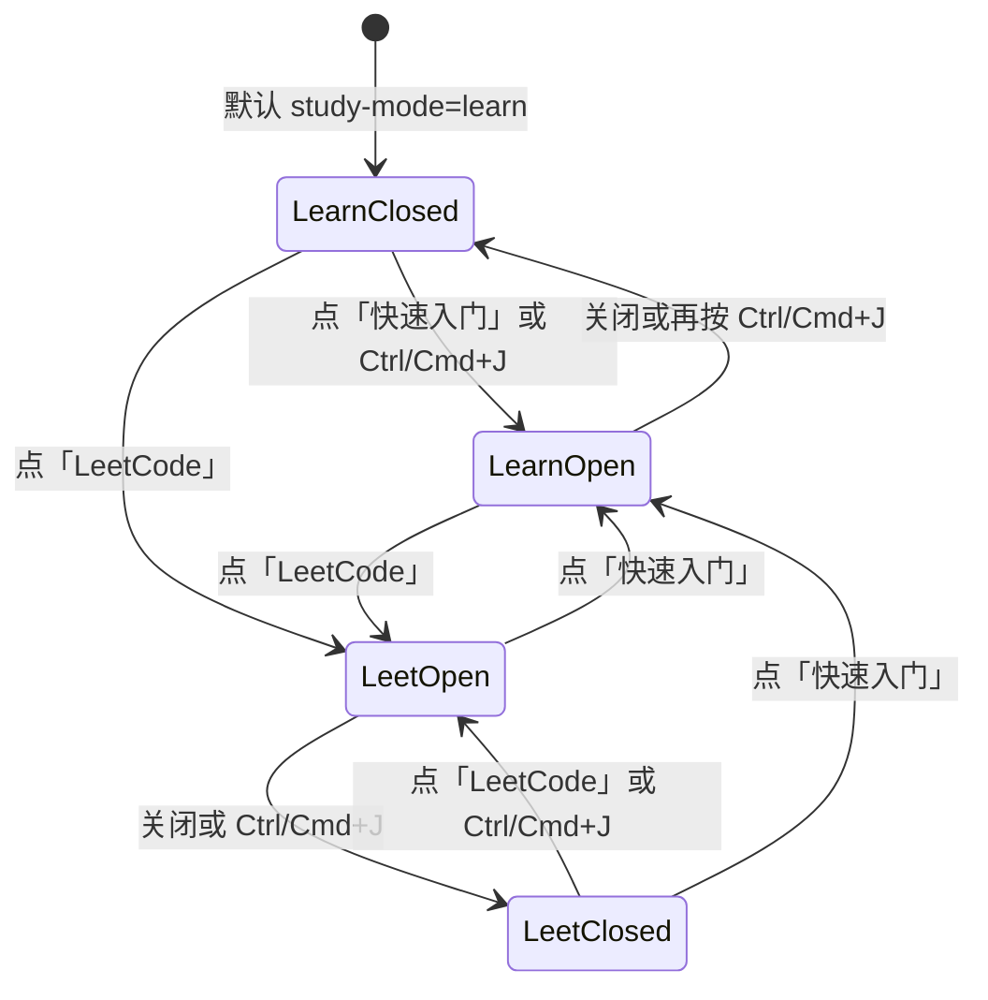

# LeetCode 题库模式

> 状态：阶段 2 已落地。核心题 200 道（简单 41、中等 135、困难 24），全部有 Python 题解。其他语言的题解文件还没有。`extended` 未入库。
> 基线：`main` @ `e9fa758`。
> 已定（不再作为待确认问题）：选题来源、中英标题与难度、只选已下载语言、题解默认隐藏、题解从宽松许可证仓库拷贝并署名。题面仍只放链接和自写短摘要。

相关文档：[plan/LEARN.md](LEARN.md) 的抽屉、[plan/DESIGN.md](DESIGN.md) 的工具栏、[plan/LANGUAGES.md](LANGUAGES.md) 的运行时限制。题库数据和十三本书放在一起：中文在 `docs/leetcode/`，英文对照在 `docs/en/leetcode/`。十三本书的目录、篇幅和 `docs-smoke` 不把这个目录当成一本新书。

## 目录

1. 目标与非目标
2. 入口放在哪
3. 界面
4. 题单从哪来、怎么合并
5. 题解从哪拷、许可证义务
6. 数据放哪、长什么样
7. 哪些语言先有题解、怎么跑
8. 怎么验收
9. 分阶段、体积、风险

---

## 1. 目标与非目标

### 1.1 目标

1. 工具栏右侧、现在「快速入门」所在的那一格，增加 **LeetCode**。它和快速入门共用同一扇右侧抽屉，抽屉顶部仍停在 `--editor-toolbar-h`，不盖住 Run。
2. 题库是一份去重后的题号集合：热题 100、Blind 75、NeetCode 150、CodeTop，以及一份 200 题清单和一份 500 题清单。核心大约 200 题，目录上限 500 题。
3. 每题有 `easy` / `medium` / `hard`，以及中文标题和英文标题。界面按难度分成三组：简单、中等、困难。
4. LeetCode 模式下，语言选择器只列出**已经下载**的运行时（`LangStatus` 为 `cached` 或 `ready`）。点选不会发起新的运行时下载。
5. 题解代码默认不出现。用户点「查看题解」才展开。
6. 题解代码从 GitHub 上许可证允许再分发的仓库拷贝。每一份拷贝在数据里记下上游仓库、commit、许可证和署名。CC BY-SA 4.0 的文件保持相同方式共享。
7. 题面不入库。抽屉里是我们写的短摘要、我们写的小样例，以及指向 `leetcode.cn` / `leetcode.com` 的链接。
8. 题目元数据、摘要和题解都在 `docs/leetcode/`。英文标题、摘要和样例说明在 `docs/en/leetcode/`，与 `docs/en/<book>/` 的对照方式相同。GitHub 上的 [doocs/leetcode](https://github.com/doocs/leetcode) 仍是题解来源之一，它不是本仓库的目录。

### 1.2 非目标

- 不建账号、不做云端进度、不做排行榜。看过题解与否只记在本机 `localStorage`。
- 不接力扣的判题接口，不爬题面 HTML，不把官方示例原文写进仓库。
- 不拷贝「剑指 Offer」「程序员面试金典」等另一本书的目录（doocs 的 `lcof/`、`lcof2/`、`lcci/` 整棵排除）。
- 不把 Shell、SQLite、PHP、Linux 放进可跑题的语言。原因在 §7。
- 不给难度上色。难度用文字，界面仍走现有灰阶，并继续受 `scripts/check-mono.mjs` 约束。

---

## 2. 入口放在哪

今天的结构：

- `EditorToolbar.vue` 从左到右是：文件名、`quickjs` 时的 JS|TS 胶囊、`LearnButton.vue`、Run、Stop、恢复示例。
- `LearnButton` 是 `Button` `variant="ghost"` `size="xs"`（高 28px），图标 `BookOpen`，文案 `{label} 快速入门`。窄屏下文案进 `sr-only`。
- `DocsDrawer.vue` 用 `Teleport` 挂到 `body`，桌面是 `bottom-0 right-0 top-[var(--editor-toolbar-h)]`，`z-40`，左边框，宽度来自 `useDocsStore`（默认 `min(560px, 45vw)`，拖拽夹在 400–760px）。移动端（`<768px`）同样从工具栏下沿铺到视口底。`--editor-toolbar-h` 在 `src/style.css` 里是 `2.5rem`。
- `AppShell.vue` 里 `Ctrl/Cmd+J` 调用 `docs.toggle()`。抽屉打开时，`tests/learn.spec.mjs` 要求 Run 和快速入门按钮的矩形不与抽屉相交。

LeetCode 就加在这一格，不新开一列，也不放到侧栏。

`LearnButton.vue` 换成 `src/components/study/StudyModeSwitch.vue`，仍放在方言胶囊和 Run 之间：

```
[ 文件名 …… ] [ JS | TS ] [ 快速入门 | LeetCode ] [ ▶ Run ] [ Stop ] [ ⟲ ]
```

- 外层 `role="group"`，`data-testid="study-mode"`，`h-7`，`rounded-md border border-border p-0.5`，和现有方言胶囊同一套尺寸，工具栏高度保持 `2.5rem`。
- 两段都是 `h-6` 的按钮。选中段 `bg-accent text-foreground`，未选中 `text-muted-foreground`。
- 左段 `data-testid="study-mode-learn"`，图标 `BookOpen`，文案「快速入门」。右段 `data-testid="study-mode-leetcode"`，图标 `ListChecks`，文案 `LeetCode`。
- `<768px` 时两段文案都 `sr-only`，只留图标。tooltip 给全称。
- 点当前已选中的那段：开关抽屉（等价于今天的快速入门按钮）。点另一段：切到那个模式并打开抽屉。
- 两段都 `aria-controls="docs-drawer"`，`aria-expanded` 在抽屉打开且模式匹配时为 true。
- `Ctrl/Cmd+J` 仍只开关抽屉，不改变模式。模式记在 `localStorage` 键 `simplecode:study-mode`，值 `learn` 或 `leetcode`，缺省 `learn`。
- 抽屉 DOM id 继续叫 `docs-drawer`，并加 `data-mode="learn"|"leetcode"`。几何、拖拽、移动端底栏、关闭后把焦点还回工具栏按钮，都留在现在的抽屉上。快速入门的章节列表和章节页原样留在 `data-mode="learn"`。

语言选择器不放进工具栏。它在抽屉内部的第一行，见 §3。工具栏已经要放文件名、方言、两段模式、Run。

---

## 3. 界面

### 3.1 抽屉关上

```
┌────────────┬────────────────────────────────────────────────────────────┐
│ Py Python  │ main.py          [ JS | TS ] [ 快速入门 | LeetCode ] [▶ Run] │
│ Rb Ruby    │────────────────────────────────────────────────────────────│
│ …          │  编辑器                                                     │
│            │════════════════════════════════════════════════════════════│
│            │  终端                                                       │
└────────────┴────────────────────────────────────────────────────────────┘
```

`LeetCode` 四字在桌面宽度下保持可见。快速入门不再把语言名写在按钮上（「Python 快速入门」会把文件名挤没）；语言名仍在抽屉标题和侧栏。tooltip：「打开快速入门」。LeetCode 的 tooltip：「打开 LeetCode」。

### 3.2 目录（按难度分组，目录即全部题目）

```
┌──────────────────────────────────────────────┐
│ LeetCode                                  [×] │
│ 语言  ( Py ) ( JS ) ( Go )     ← 只有已下载的 │
│ [ 搜索题号或标题…………………… ]                  │
│ 全部   简单 25   中等 120   困难 55           │
│──────────────────────────────────────────────│
│ 目录                                          │
│   简单 · 25    中等 · 120    困难 · 55        │
│──────── 简单 ────────                        │
│  1    两数之和                          简单  │
│ 20    有效的括号                        简单  │
│──────── 中等 ────────                        │
│  3    无重复字符的最长子串              中等  │
│──────── 困难 ────────                        │
│  4    寻找两个正序数组的中位数          困难  │
└──────────────────────────────────────────────┘
```

- 分组顺序固定为简单、中等、困难。组内按力扣题号升序。
- 三行组标题就是目录。不另做一份重复的 500 行清单。组标题显示该组题数，点击把该组滚进视口。
- 搜索框过滤题号（精确或前缀）、中文标题、英文标题、slug、标签。空组不渲染。无匹配时一行「没有匹配的题目」。
- 难度筛选是四个文字按钮：全部、简单、中等、困难。再加一个标签 `<select>`，选项来自 `tags.json` 的中英标签。难度不用红黄绿色。
- 一行是按钮：题号、当前界面语言的标题、右侧难度词。没有代码，没有题解摘要。
- 界面是 EN 时标题用 `title.en`，分组词用 Easy / Medium / Hard。缺英文标题的题不进入索引（导入脚本直接拒绝）。

### 3.3 题目页：摘要可见，题解默认收起

```
┌──────────────────────────────────────────────┐
│ ← 目录   1. 两数之和                      [×] │
│ 简单 · 数组 · 哈希                            │
│──────────────────────────────────────────────│
│ 给一个整数数组和目标值，找出和为目标值的两个   │
│ 下标。同一个下标不能用两次。                   │
│                                              │
│ 样例输入          样例输出                    │
│ 3                 0 2                        │
│ 1 4 8                                        │
│ 9                                            │
│                                              │
│ 力扣中文题面 ↗     LeetCode ↗                 │
│                                              │
│ [ 查看题解 ]          [ 运行样例 ]            │
└──────────────────────────────────────────────┘
```

点「查看题解」之后，同一页变成：

```
│ [ 收起题解 ]          [ 运行样例 ]            │
│ [ 放入编辑器并运行 ]                          │
│ python · MIT · kamyu104/LeetCode-Solutions ↗  │
│ ┌──────────────────────────────────────────┐ │
│ │ class Solution:                          │ │
│ │     def twoSum(self, nums, target):      │ │
│ │         ...                              │ │
│ └──────────────────────────────────────────┘ │
```

行为定死如下：

| 动作 | 结果 |
|---|---|
| 打开一道题 | 不改编辑器，不滚动到代码，不自动跑 |
| 「查看题解」 | 展开当前语言的题解、署名和许可证链接。再点变为「收起题解」 |
| 「放入编辑器并运行」 | 只在题解已展开时渲染。把「包装 + 题解」写入编辑器并跑第一则样例。沿用 `useRunFromDoc` 的撤销备份。抽屉保持打开 |
| 「运行样例」 | 一直可见。用编辑器里**现有**代码跑样例，不展开题解。标准输出与样例输出对照 |
| 这门语言没有题解文件 | 「查看题解」换成不可点的句子「这门语言还没有题解」。「运行样例」仍可用 |

展开状态记在 `localStorage` 键 `simplecode:leetcode:revealed`，值是 `"<题号>:<runtimeId>"` 的数组。换语言要重新点一次才展开那种语言的题解。

「运行样例」把标准输出与 `samples[].stdout` 做对照：双方都去掉末尾连续换行后整段相等。相等时抽屉里用现有灰阶句子「输出符合预期」，并在本机把该题标成做过（`simplecode:leetcode:solved`）。这只是样例对照，不是力扣隐藏测试。

外链是 `<a target="_blank" rel="noreferrer">`，地址用数据里的 `links.cn` 与 `links.en`。

### 3.4 只列出已下载的语言

选择器是抽屉顶上的一排短标签按钮，外观与 JS|TS 胶囊相同。候选集是侧栏顺序里同时满足两条的语言：

1. `useLanguageStore` 里该语言的 `status` 是 `cached` 或 `ready`。`idle`、`downloading`、`error` 不出现。
2. 语言属于 §7 的可跑题集合。

点其中一门调用现有的 `languageStore.select(id)`。因为状态已经是 `cached` 或 `ready`，`ensure()` 不会走网络。`select()` 仍会按今天的规则停掉上一个运行时并清终端。

自动对齐：

- 当前侧栏语言已经在候选集里：选择器跟着它，不再调用 `select`。
- 当前语言不在候选集里，且没有任何语言处于 `downloading`：进入 LeetCode 模式时切到侧栏顺序中的第一门候选。这一步只发生在本地已有字节的语言上。
- 有语言正在下载：不自动切换，避免 `select()` 把用户刚点的下载取消掉。下载完成、状态变成 `cached` 之后，该语言才出现在选择器里。

两句空状态（中英都进 `src/i18n/messages.ts`，`en` 用 `{ [K in MessageKey]: string }` 盖住新键）：

| 条件 | 中文 | English |
|---|---|---|
| 没有任何 `cached`/`ready` 语言 | 还没有已下载的语言。先在左侧点一门语言，等它缓存完成再选题。 | No language runtime is downloaded yet. Pick one in the sidebar and wait until it is cached. |
| 已下载的语言都不在可跑题集合 | 已下载的运行时里还没有能跑这些题的语言。Python、Ruby、JS/TS、C、C++、Lua、Go、Rust、Java 可以。 | None of the downloaded runtimes can run these problems. Python, Ruby, JS/TS, C, C++, Lua, Go, Rust, and Java can. |

空状态不提供「下载 Python」按钮。下载仍只发生在侧栏。

### 3.5 模式



切模式不重置编辑器。从 LeetCode 切回快速入门时，抽屉内容换回当前语言的书，宽度仍用 `simplecode:learn:width`。

---

## 4. 题单从哪来、怎么合并

题单只贡献**题号**（力扣前端题号，整数）。题面段落、官方示例、配图、频度数字、公司部门表都不入库。

检索日期：2026-10-18。导入时把当时的 commit SHA 写进 `docs/leetcode/sources.lock.json`，不在运行时访问 GitHub。

### 4.1 六份题单

| 键 | 清单 | 题号来源 | 许可证 | 入库范围 |
|---|---|---|---|---|
| `hot100` | 力扣热题 100 / Top 100 Liked | 学习计划页公开的题号：[leetcode.com/studyplan/top-100-liked](https://leetcode.com/studyplan/top-100-liked/) 与 [leetcode.cn 热题 100](https://leetcode.cn/studyplan/top-100-liked/)。人工抄 100 个整数。对照仓库 [kernelvale/leetcode-hot100](https://github.com/kernelvale/leetcode-hot100)（MIT，2026-07 创建）只用来核对题号是否齐全 | 题号是学习计划的标识。kernelvale 仓库代码是 MIT；该 README 声明题名和题面版权归力扣，且项目自称非商业。不拷贝该仓库里的题面、题解页面和免责声明正文 | 100 个题号 |
| `blind75` | Blind 75 | [neetcode-gh/leetcode](https://github.com/neetcode-gh/leetcode) 的 `.problemSiteData.json`，字段 `blind75: true`。题号在 `code` 前缀（如 `0001-two-sum` → 1） | MIT（仓库根 `LICENSE`，Copyright (c) 2022 neetcode-gh） | 75 个题号。不保存 JSON 里的 `video` |
| `neetcode150` | NeetCode 150 | 同一份 JSON，字段 `neetcode150: true`。Blind 75 含在其中 | 同上，MIT | 150 个题号 |
| `codetop` | CodeTop | [afatcoder/LeetcodeTop](https://github.com/afatcoder/LeetcodeTop)。各公司 markdown 表第一列里的力扣题号，例如 `1. 两数之和` → 1 | **没有 SPDX 许可证文件**（GitHub Community 页的 License 一项为空）。README 写明：使用频度数据或转载文章须注明仓库地址，并写「侵权必究」 | 只抽取题号。不拷贝「出现次数」、公司、部门、岗位、面经链接和表格句子。`sources/README.md` 注明仓库地址 |
| `top200` | 200 题清单 | [hoangcaobao/LeetCode](https://github.com/hoangcaobao/LeetCode)，README 按周列出的 200 道，MIT | MIT | README 表里的题号和难度列。不拷贝他的 C++/Python 题解，除非该文件同时被 §5 选为题解来源 |
| `pattern500` | 500 题清单 | [tiationg-kho/leetcode-pattern-500](https://github.com/tiationg-kho/leetcode-pattern-500)，README 表的 `100. Same Tree` 这种题号，MIT | MIT | 题号。笔记和 Figma 思维导图不拷贝 |

以下仓库**只作对照，不进入题单，也不进入题解**：

| 仓库 | 许可证结论 | 原因 |
|---|---|---|
| [youngyangyang04/leetcode-master](https://github.com/youngyangyang04/leetcode-master)（代码随想录，约 200 题） | 无许可证元数据。README：内容为原创，引用须注明出处；禁止搬运、洗稿，侵权必究 | 没有可再分发的许可 |
| [azl397985856/leetcode](https://github.com/azl397985856/leetcode) | CC BY-NC-ND 4.0 | 禁止演绎，且非商业 |
| [CyC2018/CS-Notes](https://github.com/CyC2018/CS-Notes) | 根目录没有 GitHub 识别的 LICENSE。README 要求署名并以相同方式共享，公众号转载另信联系。第三方页面把它描述为 CC BY-NC-SA | 非商业，且许可文本不在标准 LICENSE 文件里 |
| [liuchuo/LeetCode-Top100](https://github.com/liuchuo/LeetCode-Top100) | GPL-3.0 | 不是本计划采用的宽松许可（MIT 或 CC BY-SA 4.0） |
| doocs 的 `solution/*/README.md` 与 `README_EN.md` | 仓库整体是 CC BY-SA 4.0，但这些文件是题解说明，通常含题面 | 题面不入库。见 §5 |

CodeTop 没有 SPDX 许可，仍然按已定结论进入**题号**合并：我们注明 [afatcoder/LeetcodeTop](https://github.com/afatcoder/LeetcodeTop)，只保存题号，不保存频度表。剑指 Offer、LCCI、以及「补充题」这类没有力扣数字题号的行丢掉。

### 4.2 去重和两档题量

主键是力扣前端题号（正整数），不用标题做主键。同一题号在多份清单里出现只留一条，`lists` 数组记下它出现过的键。

导入脚本（实现阶段才写，`scripts/leetcode/import.mjs`）按下面的顺序生成索引。数字以脚本打出来的为准，规则以本节为准。

1. 解析六份题单，得到六个题号集合。
2. `core` = `hot100 ∪ blind75 ∪ neetcode150 ∪ top200`，去重。
3. 若 `|core| > 220`：按「出现在这四份里的次数」从高到低，其次题号从小到大，截到 200。Blind 75 的 75 题全部保留。NeetCode 150 在截断前优先于只出现一次的题。
4. 若 `|core| < 180`：从 `codetop` 里按题号升序补进 `core`，直到 200 或 CodeTop 用尽。升序是为了不把 CodeTop 的频度排序抄进来。补进来的题 `lists` 含 `codetop`。
5. 若 `180 ≤ |core| ≤ 220`：`core` 整集保留，不为了凑整 200 而删题。
6. `extended` = `core ∪ pattern500 ∪ codetop`，去重。排序键是：所在清单数（六份里出现几次）降序，然后题号升序。取前 500。`core` 的题全部留在这 500 里；若 `core` 本身超过 500（按第 3 步不会），以第 3 步的 200 为准再按第 6 步填满。
7. 会员题留在集合里，`premium: true`。链接仍指向官网。抽屉里用灰阶文字「会员题」，不用锁形彩色图标。

预期：`core` 落在大约 180–220，界面把它称作核心题；`extended` 不超过 500。第一批可运行题解只覆盖 `core` 的 Python，见 §9。

难度 `easy` | `medium` | `hard` 按这个顺序取值：NeetCode JSON 的 `difficulty`、然后 `top200` README 的难度列、然后 `pattern500` 若表内有难度。三处都没有的题，导入失败并打印题号，不猜测。界面映射：`easy` → 简单 / Easy，`medium` → 中等 / Medium，`hard` → 困难 / Hard。

英文标题取自同一优先顺序里的英文名称（NeetCode 的 `problem`、top200 的 Title、pattern500 的 Name）。中文标题由导入者按力扣公开题名写入 `title.zh`，只写题名，不写题面。两套标题都缺一不可。

标签用我们自己的一组 id（`array`、`hash`、`two-pointers`、`sliding-window`、`stack`、`binary-search`、`linked-list`、`tree`、`graph`、`heap`、`backtracking`、`dp`、`greedy`、`interval`、`bit`、`math`、`design`）。NeetCode 的 `pattern` 只在导入时当提示，不原样显示。中文标签在 `docs/leetcode/tags.json`，英文标签在 `docs/en/leetcode/tags.json`，键相同。

---

## 5. 题解从哪拷、许可证义务

题解**拷贝**，不新写算法。我们新写的只有：短摘要、小样例、标准输入包装，以及界面。

### 5.1 允许拷贝的仓库

按语言挑文件时，先 MIT，再 CC BY-SA 4.0。同一语言只留一个上游，不把两份许可拼进一个文件。

| 顺序 | 仓库 | 许可证 | 适合的语言 | 义务 |
|---|---|---|---|---|
| 1 | [neetcode-gh/leetcode](https://github.com/neetcode-gh/leetcode) | MIT | Python、Java、JavaScript、C++、Go、TypeScript、Rust、Ruby、C 等目录里实际存在的文件 | 保留版权行和 MIT 许可声明 |
| 2 | [kamyu104/LeetCode-Solutions](https://github.com/kamyu104/LeetCode-Solutions) | MIT，Copyright (c) 2018 该仓库 | Python。C++ 多为新标准，clang 8 编不过的不拷 | 同上。文件里若有粘贴的题面注释，删掉并在文件头写明删过 |
| 3 | [tiationg-kho/leetcode-pattern-500](https://github.com/tiationg-kho/leetcode-pattern-500) | MIT | Python、Java | 同上。不拷贝 17 篇概念笔记 |
| 4 | [doocs/leetcode](https://github.com/doocs/leetcode) `solution/<range>/<id>.<Title>/Solution.*` | **CC BY-SA 4.0**（根目录 `LICENSE`） | 上面三家没有、或有但不能在我们的运行时里跑的语言。doocs 的 `Solution.py`、`Solution.java`、`Solution.cpp`、`Solution.go`、`Solution.js`、`Solution.ts`、`Solution.rs`、`Solution.rb` 都在范围内 | 见 §5.2 |

doocs 的 README 另有一句：著作权归 Doocs，商业转载联系 [@yanglbme](mailto:contact@yanglibin.info)，非商业转载注明出处。文件头的许可仍是 CC BY-SA 4.0。本计划按 LICENSE 文件执行：署名、标明修改、演绎作品继续使用 CC BY-SA 4.0。README 的那句商业转载说明原样抄进 `LICENSES/THIRD_PARTY.md` 和 `docs/leetcode/SOURCES.md`，不省略。

### 5.2 CC BY-SA 4.0 要做的事

对每一份从 doocs 拷来的文件：

1. 文件许可证保持 CC BY-SA 4.0。不能改成 MIT，也不能放进 `docs/` 里「代码示例以 MIT 授权」的那一类。
2. 文件头写上：上游 URL（含 commit SHA）、原作者表述「Copyright Doocs contributors」、许可证链接 <https://creativecommons.org/licenses/by-sa/4.0/>、以及修改清单。
3. 修改至少包括：删掉复述题面的注释；为了能在 SimpleCode 里跑而做的改动（见 §7）。修改清单用英文写在文件头，一行一条。
4. 包装代码若和题解正文处在同一个提交文件里，**整个文件**按 CC BY-SA 4.0 再分发。包装模板本身（不含题解正文）放在 `docs/leetcode/harness/`，许可证 MIT，与 `docs/LICENSE` 的代码示例一致。
5. 相同方式共享覆盖这个改编后的题解文件，不覆盖 Vue 界面、运行时和十三本书。那些文件不含 doocs 正文。
6. 抽屉展开题解时，代码块下方一行固定文案，链到该文件头里的 URL 和许可证。CC BY-SA 用「题解改编自 doocs/leetcode，CC BY-SA 4.0」。MIT 用「题解来自 {repo}，MIT」。
7. `LICENSES/THIRD_PARTY.md` 增加一节，列出四个上游仓库、许可证、commit。

MIT 文件头：

```text
SPDX-License-Identifier: MIT
Source: https://github.com/kamyu104/LeetCode-Solutions/blob/<40-char-sha>/<path>
Copyright (c) 2018 https://github.com/kamyu104/LeetCode-Solutions
Modifications by SimpleCode: removed problem-statement comments; appended the stdin harness.
The MIT license text is in docs/leetcode/LICENSES/MIT.txt
```

CC BY-SA 文件头：

```text
SPDX-License-Identifier: CC-BY-SA-4.0
Source: https://github.com/doocs/leetcode/blob/<40-char-sha>/solution/0000-0099/0001.Two%20Sum/Solution.py
Copyright Doocs contributors.
Licensed under CC BY-SA 4.0: https://creativecommons.org/licenses/by-sa/4.0/
Modifications by SimpleCode: removed problem-statement comments; appended the stdin harness.
Adaptations of this file must stay under CC BY-SA 4.0.
The Doocs README also asks commercial reprints to contact contact@yanglibin.info.
```

署名也写进每题 JSON 的 `solutions[].attribution`，界面读这份结构，不解析注释碰运气。

### 5.3 拷贝时丢掉什么

- doocs 的 `README.md`、`README_EN.md`、配图、`lcof/`、`lcof2/`、`lcci/`。
- 任何粘在代码注释里的题面、官方示例、约束段落。算法注释可以留。
- 非 ASCII 的标识符和字符串。题解只存一份，放在 `docs/leetcode/problems/<id>/`，注释保持上游语言，不在 `docs/en/leetcode/` 再放一份代码。标题、摘要和样例说明才做英文对照。可执行记号仍是 ASCII。
- 第三方包、`#include` 私有头、crates.io、npm。SimpleCode 没有这些。

一个题、一种语言，在四个仓库里都找不到能跑的文件：该语言不写 `solutions` 项。题目仍在目录里。

---

## 6. 数据放哪、长什么样

题目元数据、摘要和题解都在 `docs/leetcode/`，和 `docs/python/`、`docs/rust/` 一样放在 `docs/` 下。英文对照放在 `docs/en/leetcode/`，和 `docs/en/python/` 同一层。GitHub 仓库 [doocs/leetcode](https://github.com/doocs/leetcode) 只作为题解来源出现，不表示本仓库还有别的题库目录。

不把 `leetcode` 写进 `BOOKS` 或 `SHIPPED_BOOKS`。`scripts/docs/render.ts` 现在会把 `docs/` 下不认识的目录报成「未知文档目录」；实现时要像跳过 `en` 一样跳过 `leetcode`，并且不要把 `docs/leetcode/**/*.md` 收成快速入门章节。短节长度、60 个汉字不重复、`docs-ascii` 和 `docs-smoke` 都按十三本书的 id 遍历，JSON 和题解源文件不会走进那些检查。题解冒烟仍走 §8 的 `tests/leetcode-smoke.mjs`。题解按题动态导入，不打进首屏包。

```
docs/leetcode/
  README.md                 # 写入规则、许可、怎样加一题
  SOURCES.md                # 六个题单 + 四个题解仓库的许可证和义务
  sources.lock.json         # 每个上游的仓库、commit、检索日期
  LICENSES/MIT.txt
  LICENSES/CC-BY-SA-4.0.txt
  tags.json                 # 标签 id → 中文
  index.json                # 中文标题和与语言无关的元数据
  harness/                  # 我们的包装模板，MIT
    python.py.tpl
    ruby.rb.tpl
    javascript.js.tpl
    c.c.tpl
    cpp.cpp.tpl
    lua.lua.tpl
    go.go.tpl
    rust.rs.tpl
    java.java.tpl
  problems/
    0001/
      problem.json          # 中文摘要、样例、题解出处
      python.py             # 题解只此一份
      javascript.js         # 有文件才有

docs/en/leetcode/
  tags.json                 # 同一批标签 id → 英文
  index.json                # 同一批题号，英文标题
  problems/
    0001/
      problem.json          # 英文摘要和样例说明
```

`docs/en/leetcode/` 不放题解源文件、包装模板、许可证全文和 `sources.lock.json`。那些只有一份，在 `docs/leetcode/`。

`docs/leetcode/index.json` 一条：

```json
{
  "id": 1,
  "slug": "two-sum",
  "title": "两数之和",
  "difficulty": "easy",
  "tags": ["array", "hash"],
  "lists": ["hot100", "blind75", "neetcode150", "top200", "pattern500"],
  "tier": "core",
  "premium": false,
  "langs": ["python"]
}
```

同一题在 `docs/en/leetcode/index.json` 里 `id`、`slug`、`difficulty`、`tags`、`lists`、`tier`、`premium`、`langs` 与中文文件相同，`title` 为 `"Two Sum"`。

`docs/leetcode/problems/0001/problem.json`：

```json
{
  "id": 1,
  "slug": "two-sum",
  "summary": "给出一个整数数组和目标值。在数组里找两个下标，使对应元素之和等于目标值。同一个下标不能用两次。把下标按从小到大输出，中间一个空格。",
  "samples": [
    {
      "stdin": "3\n1 4 8\n9\n",
      "stdout": "0 2\n",
      "note": "1 与 8 的和是 9，下标是 0 和 2。"
    }
  ],
  "links": {
    "cn": "https://leetcode.cn/problems/two-sum/",
    "en": "https://leetcode.com/problems/two-sum/"
  },
  "io": { "kind": "int-array-and-int", "out": "int-pair" },
  "solutions": {
    "python": {
      "file": "python.py",
      "sourceRepo": "kamyu104/LeetCode-Solutions",
      "sourceUrl": "https://github.com/kamyu104/LeetCode-Solutions/blob/<sha>/<path>",
      "sourceRevision": "<40-char-sha>",
      "license": "MIT",
      "spdx": "MIT",
      "attribution": "Copyright (c) 2018 https://github.com/kamyu104/LeetCode-Solutions",
      "shareAlike": false,
      "modifications": ["removed problem-statement comments", "appended stdin harness"]
    }
  }
}
```

`docs/en/leetcode/problems/0001/problem.json` 只写对照文字，样例的输入输出仍以中文目录里的 `stdin` / `stdout` 为准：

```json
{
  "id": 1,
  "summary": "You are given an integer array and a target. Find two indices whose values sum to the target. An index may be used once. Print the two indices in ascending order, separated by one space.",
  "notes": ["1 and 8 sum to 9. The indices are 0 and 2."]
}
```

`notes` 与中文 `samples` 逐条对齐。缺英文文件的题不进入索引。

`shareAlike: true` 只用于 CC BY-SA。界面用它决定展开区的那一行文案。来自 doocs/leetcode 的文件这里为 `true`。

样例数字我们自己写。上面的 `1 4 8` / `9` 是计划里的例子，用来代替官网上常见的那组示例。导入时每题至少一则、至多三则样例，`n ≤ 100`，这样 Yaegi 和 QuickJS 不会在冒烟里跑到超时。

摘要我们自己写。中文 40 到 180 个汉字。英文 30 到 120 个词。不翻译上游 README，不粘贴题面。

加载：

- 两份 `index.json` 与两份 `tags.json` 由 Vite 静态导入。500 条元数据两份合计大约 150 KB。
- 单题的两份 `problem.json` 和 `docs/leetcode/problems/<id>/` 下的源文件用 `import.meta.glob` 的非 eager 动态导入，打开题目时才取。读取集中在 `src/docs/leetcode.ts` 的 `loadProblem(id: number, edition: "zh" | "en"): Promise<Problem>`。界面语言是 EN 时用英文标题、摘要和 `notes`，题解字节仍从 `docs/leetcode/problems/` 读。
- 构建产物里这些 chunk 走普通 JS 资源，不进 `wasm/`，不写进 `wasm/manifest.json`。

`src/docs/leetcode.ts` 导出 `Difficulty`、`ProblemIndexEntry`、`Problem`、`SolutionRef`，字段与上面的 JSON 一致。校验脚本读这些类型做运行时检查：题号唯一；中英索引的题号集合相同；`langs` 与 `docs/leetcode/problems/` 里的文件一致；`docs/en/leetcode/problems/<id>/problem.json` 存在且 `notes` 条数等于样例条数；`license` 只能是 `MIT` 或 `CC-BY-SA-4.0`；`shareAlike` 与许可证一致；摘要长度；样例非空；链接主机只能是 `leetcode.cn` 或 `leetcode.com`；`docs/en/leetcode/` 下没有 `*.py`、`*.js`、`*.go`、`*.java`、`*.rs`、`*.c`、`*.cpp`、`*.lua`、`*.rb`。

---

## 7. 哪些语言先有题解、怎么跑

### 7.1 选择器里的语言

侧栏顺序中，可跑题的是：

| 顺序 | runtime id | 题解文件 | 上游优先 | 跑的方式 |
|---|---|---|---|---|
| 1 | `python` | `python.py` | kamyu104、neetcode、pattern-500，然后 doocs `Solution.py` | CPython 3.11，`input()` / `sys.stdin` |
| 2 | `ruby` | `ruby.rb` | neetcode，然后 doocs `Solution.rb` | Ruby 3.2，`gets` |
| 3 | `quickjs` | `javascript.js`（TS 不单做一套；方言胶囊仍在，题解按 JS 跑） | neetcode 的 javascript，然后 doocs `Solution.js` | 先做 §7.3 的 stdin 探测 |
| 4 | `clang` | `c.c` | neetcode 的 c，然后能在 clang 8 下编译的 MIT/SA 文件 | `scanf` / `printf`，`-Werror` |
| 5 | `clangpp` | `cpp.cpp` | 能用 gnu++14 编过的文件。kamyu104 的现代 C++ 默认不拷 | clang 8，`-Werror`。不用 `throw`、线程、`<filesystem>`。`std::sort` 若因缺少 `__lttf2` 链接失败，改用下标排序并在 `modifications` 里写明 |
| 6 | `lua` | `lua.lua` | 仅当 MIT 或 doocs 有 Lua 文件 | `io.read`。`#` 按字节，样例不用多字节字符 |
| 7 | `go` | `go.go` | neetcode、doocs `Solution.go` | Yaegi 0.16.1，`bufio`/`os.Stdin`。不用 `time.Sleep`，不把自定义 `error` 放进接口再调 `Error()` |
| 8 | `rust` | `rust.rs` | neetcode、doocs `Solution.rs` | weblings，单文件 `main.rs`，edition 2024，`panic=abort`。不用 `std::thread` 和 `sleep` |
| 9 | `java` | `java.java` | pattern-500、neetcode，然后 doocs `Solution.java` | TeaVM。`public` 类名必须是 `Main`。没有包、正则、nio、反射。`HashMap` / `ArrayList` 可用。正则题在 Java 下不提供题解 |

即使已经下载，也不进入选择器：

| runtime id | 原因 |
|---|---|
| `sqlite` | 不是这批算法题的运行时 |
| `php-cgi` | `php://stdin` 和 `php://input` 读不到 WASI 标准输入 |
| `shell` | wasi-sh 没有算术展开和函数 |
| `linux` | 客户机，不是算法语言 |

### 7.2 第一批语言

实现顺序：

1. **Python**，覆盖全部 `core`。冒烟默认跑这批。
2. **Go**，stdin 已在 `tests/smoke.mjs` 里验证。
3. **Ruby**、**C**、**Lua**，包装各写一次，冒烟随文件出现而跑。
4. **JavaScript**，仅在 §7.3 探测通过之后。
5. **C++**，只收 clang 8 能编过的文件。
6. **Java**、**Rust** 最后。冒烟默认不跑，环境变量见 §8。工具链体积和编译时间与现在的书一致。

用户在选择器里能点到的，仍是「已下载 ∩ 上表」。没有题解文件的语言可以点，题目页显示「这门语言还没有题解」。

### 7.3 QuickJS 标准输入

`plan/LEARN.md` 记过：JS 书的例子不依赖 stdin，因为 wasmedge-quickjs 的 `std` / `os` 当时没验证。题库在导入任何 `javascript.js` 之前，用一条 10 行程序在 `tests/smoke.mjs` 同款路径上读一行并打印。读得到，才允许 JS 题解，包装使用探测时确定的 API。读不到，JS 留在选择器里（用户已下载就可以写自己的代码），但导入脚本不生成 `javascript.js`，`langs` 里不出现 `quickjs`。探测结果写回本文件 §7.3 的实现记录，不在规划 PR 里猜。

实现记录：这一批没有 `javascript.js`，所以没有做 QuickJS stdin 探测，`langs` 里也不出现 `quickjs`。选择器在运行时已下载时仍可点 JS/TS，题目页显示「这门语言还没有题解」。

### 7.4 包装

上游文件几乎都是 `class Solution` 的一个方法，没有 `main`，也不读标准输入。我们在文件末尾追加包装，从 stdin 读入，调用该方法，把结果打印到 stdout。

Python 的形状（题解正文来自上游，包装是我们的）：

```python
class Solution:
    def twoSum(self, nums, target):
        index = {}
        for i, value in enumerate(nums):
            need = target - value
            if need in index:
                return [index[need], i]
            index[value] = i
        return []

def __sc_main():
    import sys
    data = sys.stdin.read().split()
    n = int(data[0])
    nums = [int(x) for x in data[1:1 + n]]
    target = int(data[1 + n])
    print(" ".join(str(x) for x in Solution().twoSum(nums, target)))

__sc_main()
```

每种语言一份模板，放在 `docs/leetcode/harness/`。导入脚本按题解方法的参数个数和样例的 stdin 形状套模板。stdin 形状记在 `docs/leetcode/problems/<id>/problem.json` 的 `samples` 里。元素个数这种约定写在同一文件的 `io` 字段：

```json
"io": { "kind": "int-array-and-int", "out": "int-pair" }
```

`kind` 第一批只实现题解签名实际用到的几种：`int-array-and-int`、`int-matrix`、`linked-list`、`tree`、`string`、`string-array`。链表和树在 stdin 里用我们自己的纯文本（一层一行，空节点用 `.`），包装负责建成上游方法要的结构。做不到对应包装的签名：该语言文件不入库，题目保留。

Java 的提交文件是一整份 `Main.java`：上游的 `Solution` 改成包内可见类（TeaVM 要求唯一的 `public` 类叫 `Main`），`Main.main` 是包装。这一改写写入 `modifications`。若上游是 CC BY-SA，整份 `Main.java` 为 CC BY-SA 4.0。

「查看题解」展开的是这个完整文件（含包装和文件头）。用户看到的就是即将放进编辑器、并且冒烟会跑的那一份。收起时连文件头一起不渲染。

「运行样例」不读取题解文件。它把编辑器缓冲和该题第一则 `stdin` 交给现有的 `run` store（`stdin` + EOF），再比输出。

---

## 8. 怎么验收

实现阶段增加这些检查。规划 PR 不跑它们，因为还没有这些文件。

| 检查 | 命令 | 断言 |
|---|---|---|
| 结构 | `node tests/leetcode-unit.test.ts` | 题号唯一；`tier` 只有 `core` 与 `extended`；`extended` ≤ 500；每题有中英标题、难度、至少一则样例；`license` 与 `shareAlike` 一致；链接主机正确；摘要长度；题解文件含 SPDX 头和 `Source:`；CC BY-SA 文件含许可证 URL 和 “Adaptations of this file must stay under CC BY-SA 4.0” |
| ASCII | 扩展 `tests/docs-ascii.test.ts` 的剥离规则，或同目录新测试 | 去掉行注释和块注释后，题解文件没有非 ASCII |
| 单色 | `scripts/check-mono.mjs` 的 `roots` 加上 `src/components/study` | 新界面没有彩色 Tailwind 类和非灰阶色 |
| 文案 | `tests/i18n-unit.test.ts` | 新键中英都在 |
| 抽屉几何 | `tests/learn.spec.mjs` | 抽屉打开时 Run、`study-mode-learn`、`study-mode-leetcode` 与 `#docs-drawer` 不相交。增加：未下载语言不在 `[data-testid=leetcode-lang]` 里；点 LeetCode 不使侧栏状态变成 `downloading` |
| 题解冒烟 | `tests/leetcode-smoke.mjs` | 与 `tests/docs-smoke.mjs` 相同：`vite preview`、`__simplecodeSelect`、`__simplecodeEditor.setValue`、`__simplecodeRun({ stdin, stdinEOF: true })`。每则样例：退出码 0，终端文本去掉 ANSI 后包含规范化的 `stdout` |

冒烟范围：

- 默认 `./build.sh test` 跑已经入库的 Python、Ruby、JS、C、C++、Lua、Go 题解，每题 60 秒。阶段 2 只有 Python，所以默认先是 Python `core`。
- 某一门语言把整次 `./build.sh test` 拉过 15 分钟时，把它从默认列表挪到 `SIMPLECODE_LEETCODE_LANGS`（逗号分隔 runtime id，例如 `python,go`）。挪走的当次在本文件记下实测时间。Python `core` 留在默认列表里。
- Java 只在 `SIMPLECODE_JAVA_LEETCODE=1` 时跑，理由与 `SIMPLECODE_JAVA_DOCS` 相同。
- Rust 只在 `SIMPLECODE_RUST_LEETCODE=1` 时跑。
- `build.sh test` 的帮助行写上这两个变量。运行时下不来时的行为与 `docs-smoke` 相同：失败并打印语言 id。

`./build.sh build` 仍先 `vue-tsc --noEmit`。`index.json` 的类型要能过。

---

## 9. 分阶段、体积、风险

### 9.1 阶段

| 阶段 | 交付 | 本阶段不做 |
|---|---|---|
| 0（本 PR） | `plan/LEETCODE.md`，以及 AGENTS / README / LEARN 里的链接 | 任何 `src/`、`content/`、测试行为 |
| 1 | `StudyModeSwitch`、抽屉 `data-mode`、空状态、语言选择器过滤、i18n、`learn.spec` 的几何和「不触发下载」 | 真实题库。索引可以是空数组 |
| 2 | 导入脚本、`sources.lock.json`、`core` 元数据、全部 `core` 的 Python 题解（含文件头、包装、自写摘要和样例）、`leetcode-unit`、Python 冒烟 | 其他语言的题解文件 |
| 3 | 按 §7.2 的顺序加语言。每种语言单独的提交 | 一次提交混多种语言的几百个文件 |
| 4 | 把索引填到 `extended`（≤ 500）。没有题解的题只显示摘要和链接 | 为了填满 500 而新写算法 |

阶段 1 之后每一阶段合并前都跑 `./build.sh build` 和 `./build.sh test`。

### 9.2 体积

- 索引：500 题 × 约 200 字节 ≈ 100 KB，可进主包。
- 一份 Python 题解约 1–3 KB。`core` 约 200 题 × 2 KB ≈ 400 KB 源文件。动态导入后，打开一题才下载该 chunk。
- 九种语言都齐、且每题都有文件时，源文件大约数 MB。仍按题动态导入，不打进首屏。
- 题解不进 `wasm/`，不改变运行时下载体积。
- `dist/` 会多出这些 chunk。`./build.sh build` 的日志里记一笔 chunk 数量即可，不设第二个清单。

### 9.3 风险

| 风险 | 计划里的做法 |
|---|---|
| 力扣题面受版权保护。力扣服务协议（leetcode.cn，更新日期 2025-01-07）第 5.2 条把平台文字、图片等的权利留在力扣，未经书面授权不得复制或做派生作品 | 题面、官方示例、配图不入库。抽屉给自写摘要、自写样例和链接。标题按已定结论保存，且只保存题名 |
| doocs 是 CC BY-SA 4.0，README 又要求商业转载另行联系 | 题解文件保持 CC BY-SA，文件头和 `THIRD_PARTY.md` 同时写上许可证链接和 README 的联系句。不把这些文件改标成 MIT |
| 相同方式共享被理解成「整个应用都要 SA」 | SA 文件只在 `docs/leetcode/problems/`，文件头写明改编范围。界面代码不复制 doocs 正文 |
| CodeTop 仓库没有 SPDX 许可，README 对频度数据主张权利 | 只用题号，`SOURCES.md` 注明仓库地址，不保存出现次数和面经 |
| 无许可或 NC-ND 仓库（代码随想录、azl397985856、CS-Notes）被顺手拷进题解 | 导入脚本的仓库白名单只有 §5.1 的四个。其他路径直接失败 |
| GPL 题解被当成「也能用」 | 白名单没有 GPL |
| 上游 C++ 用了 C++17/20，clang 8 编不过 | 冒烟失败的文件不入库，或改写后把改动写进 `modifications` |
| Java 不是 OpenJDK | 正则题不做 Java 文件；类名改成 `Main` 的过程写进 `modifications` |
| QuickJS 可能读不了 stdin | §7.3 探测不过就不提供 JS 题解文件 |
| Yaegi 很慢 | 样例 `n ≤ 100`，每题冒烟 60 秒上限 |
| 题解冒烟把 `./build.sh test` 拉得很长 | 默认只跑 Python `core`；Java / Rust 用环境变量 |
| 抽屉再次盖住工具栏 | `learn.spec` 继续量 Run 和两段模式按钮的矩形 |
| 选择器调用 `select()` 导致下载 | 选项在调用前按 `cached`/`ready` 过滤；测试断言侧栏不会变成 `downloading` |
| 会员题链接打开后是付费墙 | 允许。页面用「会员题」标明，摘要仍是我们写的 |

---

## 10. 实现时要动的文件（阶段 0 不改这些）

| 文件 | 作用 |
|---|---|
| `src/components/study/StudyModeSwitch.vue` | 替换 `LearnButton.vue` 在工具栏中的位置 |
| `src/components/EditorToolbar.vue` | 挂上模式开关 |
| `src/components/docs/DocsDrawer.vue` | 接收 `data-mode`，LeetCode 时换主体 |
| `src/components/study/LeetCodeList.vue` | 目录、搜索、难度分组 |
| `src/components/study/LeetCodeProblem.vue` | 摘要、样例、查看题解、运行 |
| `src/stores/study.ts` | `mode`、`revealed`、`solved` |
| `src/stores/leetcode.ts` | 索引、当前题、按已下载语言过滤 |
| `src/docs/leetcode.ts` | 类型，以及从 `docs/leetcode/`、`docs/en/leetcode/` 动态加载 |
| `src/i18n/messages.ts` | 中英键 |
| `src/composables/useRunFromDoc.ts` | 复用备份、stdin、期望输出对照 |
| `scripts/leetcode/import.mjs` | 白名单拷贝、文件头、包装、索引 |
| `scripts/check-mono.mjs` | 扫描新目录 |
| `tests/leetcode-unit.test.ts`、`tests/leetcode-smoke.mjs`、`tests/learn.spec.mjs` | 结构、冒烟、几何与下载 |
| `LICENSES/THIRD_PARTY.md` | 上游许可证和 doocs 的商业转载句 |
| `build.sh` | 帮助文字里的两个环境变量 |

阶段 0 只改计划索引：`plan/LEETCODE.md`、`AGENTS.md` 的计划表、`README.md` 的文档链接、`plan/LEARN.md` §1.2 的互指。

---

## 11. 实现记录

阶段 1 和阶段 2 在同一次改动里完成。阶段 3（其他语言的题解）和阶段 4（`extended`）还没有做。

- 入口是 `StudyModeSwitch.vue`，放在方言胶囊和 Run 之间。`LearnButton.vue` 已删除。抽屉 `data-mode` 为 `learn` 或 `leetcode`。`Ctrl/Cmd+J` 只开关抽屉。
- 目录一次列出全部 200 题，分组为简单 41、中等 135、困难 24。会员题 9 道。Blind 75 的 75 道都在。
- 六份题单按 §4.2 合并后，原始并集大于 220。截到 200 时保留全部 Blind 75，并让 NeetCode 150 优先于只出现一次的题。三处来源都没有难度或英文题名的题号不猜测、不入库，用下一名符合条件的题号补上，所以这一批仍是 200。
- 力扣学习计划页返回 403。热题 100 的题号用 kernelvale/leetcode-hot100 的文件名核对，只存题号。
- Python 题解顺序按 §7.1：kamyu104，然后 neetcode，然后 pattern-500，然后 doocs。doocs 只有 118、129、223 三份，许可证保持 CC BY-SA 4.0。
- 样例在本机 CPython 上对照通过。浏览器冒烟是 `tests/leetcode-smoke.mjs`，默认只跑 Python `core`。Java 要 `SIMPLECODE_JAVA_LEETCODE=1`，Rust 要 `SIMPLECODE_RUST_LEETCODE=1`。
- QuickJS 没有题解文件，§7.3 的 stdin 探测没有跑。
- 题解按题动态导入。`./build.sh build` 在日志里打印 `js chunks` 的数量。
